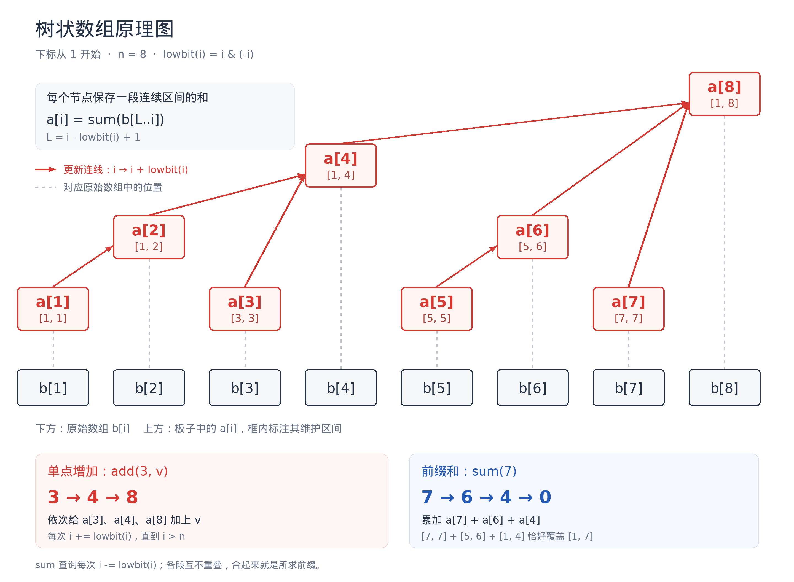
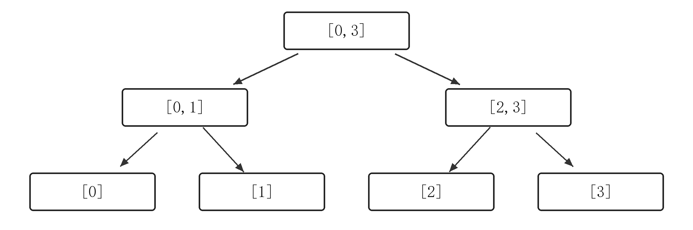
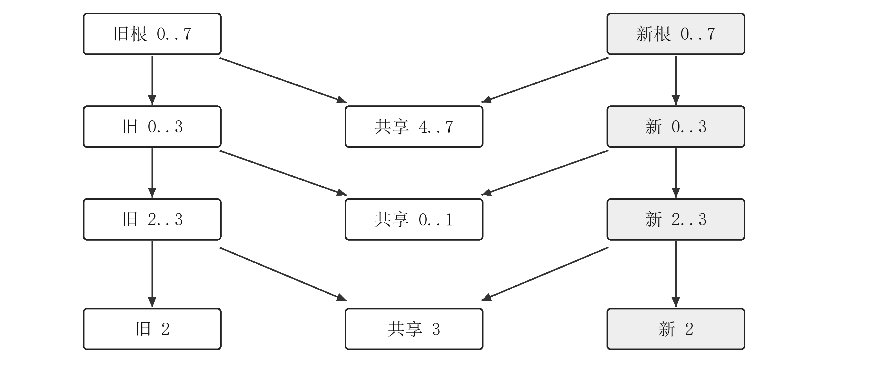
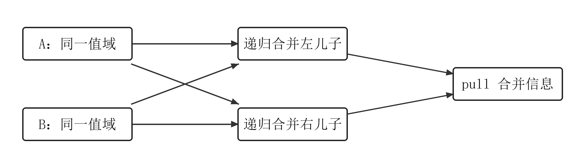
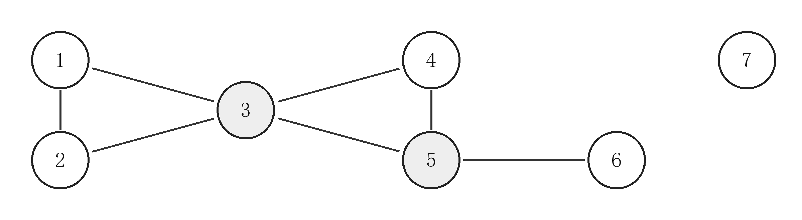

**总目录**

1. [数学](#part-5)
2. [字符串](#part-4)
3. [数据结构](#part-2)
4. [图论](#part-3)
5. [杂项](#part-6)
6. [竞赛基础](#part-1)
7. [附录 积分表](#integral-table)

# 数学 {#part-5}

默认公共头：`using ll = long long; using i64 = ll;`，需要 64 位 `int` 时使用 `#define int long long`，主函数写 `signed main()`。

## 数论 {#p5-number-theory}

### EXGCD && CRT {#p5-h2}

``` cpp
using ll = long long;
#define int long long
using i128 = __int128;

// ax + by = gcd(a,b)，a,b >= 0
int exgcd(int a, int b, int &x, int &y) {
    if (!b) { x = 1, y = 0; return a; }
    int d = exgcd(b, a % b, y, x);
    y -= (i128)(a / b) * x; return d;
}
// 余数在 [0,p) 内，合并后的 lcm 可存入 ll
int CRT(int a1, int p1, int a2, int p2) {
    int x, y, d = exgcd(p1, p2, x, y);
    if ((a2 - a1) % d) return -1;
    int mod = p2 / d, k = (i128)(a2 - a1) / d * x % mod;
    if (k < 0) k += mod;
    return (i128)p1 * k + a1;
}
int CRT(vector<int> &a, vector<int> &m) {
    int x = 0, mod = 1;
    for (int i = 0; i < (int)a.size(); i++) {
        x = CRT(x, mod, a[i], m[i]);
        if (x == -1) return -1;
        mod = lcm(mod, m[i]);
    }
    return x;
}
```

以下先设 $a,b>0$，$c$ 为任意整数，记 $d=\gcd(a,b)$、$A=a/d$、$B=b/d$。`exgcd(a,b,u,v)` 得到的是 $au+bv=d$ 的一组解，时间 $O(\log\min(a,b))$。

$$
ax+by=c\text{ 有整数解}\iff d\mid c.
$$

有解时，先将 EXGCD 的解乘上 $c/d$，再写通解：

$$
x_0=u\frac cd,\qquad y_0=v\frac cd;\qquad
\boxed{x=x_0+Bt,\quad y=y_0-At,\quad t\in\mathbb Z}.
$$

### Miller Rabin {#p5-h3}

``` cpp
mt19937_64 rng(random_device{}());

int fap(int a, int b, int p) {
    a %= p; if (a < 0) a += p;
    int res = 1 % p;
    for (; b; b >>= 1, a = (i128)a * a % p)
        if (b & 1) res = (i128)res * a % p;
    return res;
}
bool isprime(int n) {
    if (n < 2) return false;
    for (int p : {2, 3, 5, 7, 11, 13, 17, 19, 23, 29, 31, 37})
        if (n % p == 0) return n == p;
    int s = __builtin_ctzll(n - 1), d = (n - 1) >> s;
    for (int a : {2, 3, 5, 7, 11, 13, 82, 373}) {
        if (a % n == 0) continue;
        int x = fap(a, d, n);
        if (x == 1 || x == n - 1) continue;
        for (int i = 1; i < s && x != n - 1; i++) x = (i128)x * x % n;
        if (x != n - 1) return false;
    }
    return true;
}
```

### Pollard Rho {#p5-h4}

``` cpp
int rho(int n) { // 仅对合数调用，返回真因子
    if (!(n & 1)) return 2;
    while (true) {
        int c = rng() % (n - 1) + 1, x = rng() % (n - 1) + 1, y = x, prod = 1;
        auto f = [&](int x) { return ((i128)x * x + c) % n; };
        for (int t = 1; ; t++) {
            x = f(x), y = f(f(y));
            int q = (i128)prod * abs(x - y) % n;
            if (!q) {
                int d = gcd(prod, n);
                if (d == 1) d = gcd(abs(x - y), n);
                if (d > 1 && d < n) return d;
                break; // 完整碰撞，换参数重试
            }
            prod = q;
            if (t % 64 == 0) { int d = gcd(prod, n); if (d > 1) return d; }
        }
    }
}
vector<int> factor(int x) {
    vector<int> res;
    auto f = [&](auto f, int x) {
        if (x == 1) return;
        if (isprime(x)) return res.push_back(x);
        int y = rho(x); f(f, y), f(f, x / y);
    };
    f(f, x), sort(res.begin(), res.end()); return res;
}
```

### 试除法求phi {#p5-h5}

``` cpp
int getphi(int n) {
    int res = n;
    for (int i = 2; i <= n / i; i++) if (n % i == 0) {
        res = res / i * (i - 1);
        while (n % i == 0) n /= i;
    }
    if (n > 1) res = res / n * (n - 1);
    return res;
}
```

### 线性筛 {#p5-h6}

``` cpp
vector<int> pr, minp, phi, mu;
void init(int n) {
    pr.clear();
    minp.assign(n + 1, 0), phi.assign(n + 1, 0), mu.assign(n + 1, 0);
    phi[1] = mu[1] = 1;
    for (int i = 2; i <= n; i++) {
        if (!minp[i]) pr.push_back(i), minp[i] = i, phi[i] = i - 1, mu[i] = -1;
        for (int p : pr) {
            if (p > n / i) break;
            int m = i * p; minp[m] = p;
            if (i % p == 0) { phi[m] = phi[i] * p, mu[m] = 0; break; }
            phi[m] = phi[i] * (p - 1), mu[m] = -mu[i];
        }
    }
}
```

### 莫比乌斯反演 {#p5-h7}

$$\begin{aligned}
f(n) = \sum_{d|n} g(d) \iff g(n) = \sum_{d|n} \mu(d) f\left(\frac{n}{d}\right) \\
1 * f   = g \iff \mu * g  = f
\end{aligned}$$ 常见卷积 $$\begin{aligned}
1 * \varepsilon  = 1 \iff \mu * 1 = \varepsilon \\
1 *\varphi  = id \iff \mu * id = \varphi \\
1 * id = \sigma \iff \mu * \sigma = id
\end{aligned}$$

求 $g = \mu * f$ 复杂度 O(nloglogn)

``` cpp
vector <int> get_g (vector<int> &f) {
    vector<int> g = f;
    int n = (int)f.size() - 1;
    for (auto p : pr) {
        if (p > n) break;
        for (int i = n / p; i >= 1; i--) {
            g[i * p] = (g[i * p] - g[i] + mod) % mod;
        }
    }
    return g;
} 
```

### 整除分块 {#p5-h8}

``` cpp
for (int l = 1, r; l <= n; l = r + 1) {
    r = n / (n / l);
    res += (s(r) - s(l - 1)) * (n / l);
}
```

### BSGS / exBSGS {#p5-h9}

求 $a^x\equiv b\pmod p$ 的最小非负整数 $x$，无解返回 `-1`。BSGS 要求 $\gcd(a,p)=1$，exBSGS 不要求互质；$p$ 为正整数，不必为质数。约定 $0^0=1$，模 1 返回 0。时间、空间均为期望 $O(\sqrt p)$，大模数需先考虑内存。

令 $m=\lfloor\sqrt p\rfloor+1$、$x=im-j$，转成 $(a^m)^i\equiv ba^j$。先存 $ba^j$，重复键保留最大的 $j$；再按 $i$ 递增查表，第一个匹配就是最小解。`x=0` 单独判断。[推导参考](https://cp-algorithms.com/algebra/discrete-log.html)

``` cpp
int bsgs(int a, int b, int p) { // gcd(a,p)=1
    if (p == 1) return 0;
    a %= p, b %= p;
    if (a < 0) a += p;
    if (b < 0) b += p;
    if (b == 1) return 0;
    if (gcd(b, p) != 1) return -1;
    int m = sqrtl(p) + 1, t = b, step = fap(a, m, p);
    unordered_map<int, int> mp; mp.reserve(m);
    for (int j = 0; j < m; j++, t = (i128)t * a % p) mp[t] = j;
    t = 1;
    for (int i = 1; i <= m; i++) {
        t = (i128)t * step % p;
        auto it = mp.find(t);
        if (it != mp.end()) return (i128)i * m - it->second;
    }
    return -1;
}
int exbsgs(int a, int b, int p) { // 不要求互质，仍返回最小非负解
    if (p == 1) return 0;
    a %= p, b %= p;
    if (a < 0) a += p;
    if (b < 0) b += p;
    int k = 1, cnt = 0, d;
    while ((d = gcd(a, p)) > 1) {
        if (b == k) return cnt;
        if (b % d) return -1;
        b /= d, p /= d, ++cnt;
        k = (i128)k * (a / d) % p;
    }
    if (b == k) return cnt;
    int x, y; exgcd(k, p, x, y);
    x %= p; if (x < 0) x += p;
    int res = bsgs(a, (i128)b * x % p, p);
    return res == -1 ? -1 : res + cnt;
}
```

BSGS 依赖 `fap`，exBSGS 还依赖 `exgcd`。普通 `unordered_map` 即可，自定义 Hash 不是必需的。

**exBSGS：** 维护 $k a^{x-cnt}\equiv b\pmod p$。每次取 $d=\gcd(a,p)$：先检查 `b==k`，保住当前的小指数解；若 $d\nmid b$ 则无解，否则将 $b,p$ 除以 $d$、`cnt` 加一，并更新 $k\gets k(a/d)$。互质后乘 $k^{-1}$ 化成 BSGS，结果再加 `cnt`。例如 `exbsgs(2,0,8)=3`、`exbsgs(0,1,7)=0`；$p$ 变成 1 时也能正确返回。

### 二次剩余：判定与模平方根 {#p5-h10}

以下 $p$ 为奇质数。Legendre 符号 $(a/p)$：$p\mid a$ 时为 0，否则能表示成非零平方时为 1，不能时为 $-1$。

**高斯引理：** $p\nmid a$ 时，数 $a,2a,\ldots,\frac{p-1}{2}a$ 的模 $p$ 余数中有多少个大于 $p/2$，记为 $s$，则 $(a/p)=(-1)^s$。

$$
\left(\frac ap\right)=(-1)^{\sum_{i=1}^{(p-1)/2}[\,ai\bmod p>p/2\,]}.
$$

  判定         等价条件
  ------------ ------------------------
  $(-1/p)=1$   $p\equiv1\pmod4$
  $(2/p)=1$    $p\equiv\pm1\pmod8$
  $(3/p)=1$    $p\equiv\pm1\pmod{12}$
  $(5/p)=1$    $p\equiv\pm1\pmod5$

**判定的递归写法：** 平方因子 4 可以去掉；因子 2 按 $p\bmod8$ 处理；奇数部分按二次互反律交换。奇质数模下，非零输入与模数互质，可按 Jacobi 符号的递归规则判定；0 单独视为有平方根。不能据此判定合数模是否有平方根。[性质参考](https://oi-wiki.org/math/number-theory/quad-residue/)

**Cipolla：** 随机找 $w=t^2-x$ 为非剩余，在 $u^2=w$ 的形式扩域中计算 $(t+u)^{(p+1)/2}$，实部就是平方根。`sqrtp(x,p)` 要求 $p$ 为质数，返回较小的根，无解返回 `-1`，支持 $p=2$。期望 $O(\log p)$。

``` cpp
bool quadres(int a, int p) { // p 为奇质数；0 也视为有平方根
    a %= p; if (a < 0) a += p;
    if (a <= 1) return true;
    while (a % 4 == 0) a /= 4;
    if (a & 1) return (a % 4 == 1 || p % 4 == 1) == quadres(p % a, a);
    return (p % 8 == 1 || p % 8 == 7) == quadres(a / 2, p);
}
int sqrtp(int x, int p) {
    x %= p; if (x < 0) x += p;
    if (p == 2 || x <= 1) return x;
    if (!quadres(x, p)) return -1;
    if (p % 4 == 3) { int t = fap(x, p / 4 + 1, p); return min(t, p - t); }
    int t, w;
    do { t = rng() % p; w = ((i128)t * t - x + p) % p; } while (quadres(w, p));
    using P = array<int, 2>; // a[0] + a[1] * u，u²=w
    auto prod = [&](P a, P b) {
        int r = ((i128)a[0] * b[0] + (i128)((i128)a[1] * b[1] % p) * w) % p;
        int s = ((i128)a[0] * b[1] + (i128)a[1] * b[0]) % p;
        return P{r, s};
    };
    P ans = {1, 0}, a = {t, 1};
    for (int k = p / 2 + 1; k; k >>= 1, a = prod(a, a))
        if (k & 1) ans = prod(ans, a);
    return min(ans[0], p - ans[0]);
}
```

截图中的 `u64` 乘法适合较小模数，这里改用 `i128` 并先约掉中间乘积，避免大模数溢出。非零剩余有两个根 $r,p-r$，零只有根 0。奇质数模下，$Ax^2+Bx+C=0$ 且 $A\ne0$ 时，先求 $\sqrt{B^2-4AC}$，再用 $x=(-B\pm\sqrt\Delta)(2A)^{-1}$；$A=0$ 按一次方程处理。系数运算分步取模，避免直接相乘三个大数。

### 杜教筛 {#p5-h11}

用于求数论函数前缀和。找一个函数 $g$，使 $h=f*g$，且 $g,h$ 的前缀和能快速计算。

记 $F,G,H$ 分别为 $f,g,h$ 的前缀和，取 $g(1)=1$，则：

$$
H(n)=\sum_{i=1}^{n}g(i)F(\lfloor n/i\rfloor)
$$

把 $i=1$ 移项，再整除分块：

$$\begin{aligned}
\boxed{
F(n)=H(n)-
\sum_{\substack{\text{整除块 }[l,r]\\l\ge2}}
\bigl(G(r)-G(l-1)\bigr)F(\lfloor n/l\rfloor)
}
\end{aligned}$$

其中 $q=n/l,\ r=n/q$。**线性筛小值，记忆化大值。**

### 常用卷积搭配 {#p5-h12}

$\mathbf{1}(n)=1,\ \varepsilon(n)=[n=1]$。

  目标函数 $f(n)$   搭配 $g(n)$       卷积 $h(n)$
  ----------------- ----------------- ------------------
  $\mu(n)$          $\mathbf{1}(n)$   $\varepsilon(n)$
  $\varphi(n)$      $\mathbf{1}(n)$   $n$
  $n^k\mu(n)$       $n^k$             $\varepsilon(n)$
  $n^k\varphi(n)$   $n^k$             $n^{k+1}$

特别地：

$$
\boxed{M(n)=1-\sum_{i=2}^{n}M(\lfloor n/i\rfloor)}
$$

$$
\boxed{\Phi(n)=\frac{n(n+1)}2-\sum_{i=2}^{n}\Phi(\lfloor n/i\rfloor)}
$$

单个询问 $N$，预筛至 $B\ge\sqrt N$，哈希查询按期望 $O(1)$ 计：

$$
T=O\left(B+\frac N{\sqrt B}\right),\qquad
S=O\left(B+\frac NB\right).
$$

取 $B\asymp N^{2/3}$，时间为 $O(N^{2/3})$。

### φ、μ 前缀和模板 {#p5-h13}

直接复用前面的线性筛 `init(n)`。`sphi / smu` 是预筛前缀和，`getsphi(n) / getsmu(n)` 查询大值；缓存分别用 `mpphi / mpmu`。不取模，要求答案可存入 `ll`，支持查询 0。

``` cpp
vector<int> sphi, smu;
unordered_map<int, int> mpphi, mpmu;
void initsum(int n) {
    init(n); mpphi.clear(), mpmu.clear();
    sphi.assign(n + 1, 0), smu.assign(n + 1, 0);
    for (int i = 1; i <= n; i++)
        sphi[i] = sphi[i - 1] + phi[i], smu[i] = smu[i - 1] + mu[i];
}
int getsphi(int n) {
    if (n < (int)sphi.size()) return sphi[n];
    auto it = mpphi.find(n);
    if (it != mpphi.end()) return it->second;
    i128 res = (i128)n * (n + 1) / 2;
    for (int l = 2, r; l <= n; l = r + 1) {
        int q = n / l; r = n / q;
        res -= (i128)(r - l + 1) * getsphi(q);
    }
    return mpphi[n] = (int)res;
}
int getsmu(int n) {
    if (n < (int)smu.size()) return smu[n];
    auto it = mpmu.find(n);
    if (it != mpmu.end()) return it->second;
    i128 res = 1;
    for (int l = 2, r; l <= n; l = r + 1) {
        int q = n / l; r = n / q;
        res -= (i128)(r - l + 1) * getsmu(q);
    }
    return mpmu[n] = (int)res;
}
```

``` cpp
initsum(2000000); // 按数据范围、内存调整，多询问共用
int ansphi = getsphi(n);
int ansmu = getsmu(n);
int intervalphi = getsphi(r) - getsphi(l - 1);
```

### 常用应用 {#p5-h14}

**互质数对：**

$$
\sum_{a=1}^{n}\sum_{b=1}^{m}[\gcd(a,b)=1]
=
\sum_{d=1}^{\min(n,m)}
\mu(d)\left\lfloor\frac nd\right\rfloor
\left\lfloor\frac md\right\rfloor.
$$

**最大公约数之和：**

$$
\sum_{a=1}^{n}\sum_{b=1}^{m}\gcd(a,b)
=
\sum_{d=1}^{\min(n,m)}
\varphi(d)\left\lfloor\frac nd\right\rfloor
\left\lfloor\frac md\right\rfloor.
$$

同时对两个整除商分块，下面求互质数对；把 `getsmu` 换成 `getsphi` 就是最大公约数之和：

``` cpp
i128 ans = 0;
for (int l = 1, r; l <= min(n, m); l = r + 1) {
    int x = n / l, y = m / l;
    r = min(n / x, m / y);
    int s = getsmu(r) - getsmu(l - 1);
    ans += (i128)s * x * y;
}
```

## 组合数学 {#p5-combinatorics}

### 基础代码 {#p5-h16}

``` cpp
using ll = long long;
#define int long long
const int mod = 998244353, inf = 1e9;
vector<int> fac, ifac, inv;

void init(int n) {
    fac.assign(n + 1, 1);
    ifac.assign(n + 1, 1);
    inv.assign(n + 1, 1);
    for (int i = 2; i <= n; i++) {
        fac[i] = fac[i - 1] * i % mod;
        inv[i] = (mod - mod / i) * inv[mod % i] % mod;
        ifac[i] = ifac[i - 1] * inv[i] % mod;
    }
}

int C(int n, int m) {
    if (n < 0 || m < 0 || n < m) return 0;
    return fac[n] * ifac[m] % mod * ifac[n - m] % mod;
}


using ll = long long;
#define int long long
const int mod = 998244353;
// s[n][k]：n 个不同元素组成 k 个置换循环的方案数
vector<vector<int>> s;
void init(int n) {
    s.assign(n + 1, vector<int>(n + 1));
    s[0][0] = 1;
    for (int i = 1; i <= n; i++) for (int j = 1; j <= i; j++)
        // 新元素单独成环，或插入已有循环的 i - 1 个位置之一
        s[i][j] = (s[i - 1][j - 1] + (i - 1) * s[i - 1][j]) % mod;
}


using ll = long long;
#define int long long
const int mod = 998244353;
// s[n][k]：n 个不同元素划分成 k 个非空、无标号集合的方案数
vector<vector<int>> s;
void init(int n) {
    s.assign(n + 1, vector<int>(n + 1));
    s[0][0] = 1;
    for (int i = 1; i <= n; i++) for (int j = 1; j <= i; j++)
        // 新元素单独成集合，或加入已有的 j 个集合之一
        s[i][j] = (s[i - 1][j - 1] + j * s[i - 1][j]) % mod;
}
```

### 组合数恒等式 {#p5-h17}

#### 提出一个被选元素 {#p5-h18}

$$
\binom nk=\frac nk\binom{n-1}{k-1},\qquad1\le k\le n.
$$

吸收恒等式：

$$
x\binom{x+r-1}{r-1}=r\binom{x+r-1}{r}
$$

#### Vandermonde 恒等式 {#p5-h19}

##### 上标固定型 {#p5-h20}

形式是：

$$
\sum_i \binom{a}{i}\binom{b}{k-i}=\binom{a+b}{k}
$$

它的特点是组合数上标固定，下标随枚举变量变化：

$$
\binom{a}{i}\binom{b}{k-i}
$$

组合意义证明：把 $a+b$ 个物品分成两组，第一组有 $a$ 个，第二组有 $b$ 个。现在要从总共 $a+b$ 个物品中选出 $k$ 个，右边直接数方案数，为 $\binom{a+b}{k}$。左边则枚举从第一组中选 $i$ 个，那么第二组就必须选 $k-i$ 个，对所有 $i$ 求和，得到同一个方案数。

##### 下标固定型 {#p5-h21}

形式是：

$$
\sum_i \binom{i}{a}\binom{n-i}{b}=\binom{n+1}{a+b+1}
$$

它的特点是组合数下标固定，上标随枚举变量变化：

$$
\binom{i}{a}\binom{n-i}{b}
$$

组合意义证明：右边是在 $0,1,\ldots,n$ 这 $n+1$ 个位置中选出 $a+b+1$ 个数。考虑选出的数中第 $a+1$ 小的数，设它为 $i$。那么在 $i$ 左边的 $0,1,\ldots,i-1$ 中需要选 $a$ 个数，在 $i$ 右边的 $i+1,\ldots,n$ 中需要选 $b$ 个数，贡献为 $\binom{i}{a}\binom{n-i}{b}$。枚举这个分界数 $i$，就得到左边求和。

#### 组合数平方和 {#p5-h22}

$$
\sum_{i=0}^{n}\binom ni^2=\binom{2n}n.
$$

在上一条中令 $m=k=n$。

#### 一次权重 {#p5-h23}

$$
\sum_{i=0}^{n}i\binom ni=n2^{n-1},\qquad n\ge1.
$$

仍然数“子集加一个被标记元素”，但不再固定子集大小。先选标记有 $n$ 种，其余 $n-1$ 个元素任意选有 $2^{n-1}$ 种。$n=0$ 时左边为 $0$，单独处理即可。

#### 二次权重 {#p5-h24}

$$
\sum_{i=0}^{n}i^2\binom ni=n(n+1)2^{n-2},\qquad n\ge2.
$$

把 $i^2$ 拆成 $i(i-1)+i$。第一部分是在子集里标记两个不同元素、且标记有顺序，因此是 $n(n-1)2^{n-2}$；第二部分是上一条的 $n2^{n-1}$。相加后得到 $n(n+1)2^{n-2}$。

这样推导也提示了更高次权重的处理方式：先改成下降幂 $i(i-1)\cdots$，再用标记计数。$n=0$ 时答案 $0$，$n=1$ 时答案 $1$；代码不能把指数 $n-2$ 为负的情况传给 `fap`。

#### 朱世杰恒等式 {#p5-h25}

$$
\sum_{\ell=0}^{n}\binom\ell k=\binom{n+1}{k+1}.
$$

从 $1,2,\ldots,n+1$ 中选 $k+1$ 个元素，按最大元素的值分类。最大元素是 $\ell+1$ 时，其余 $k$ 个只能从前 $\ell$ 个元素里选，有 $\binom{\ell}{k}$ 种。所有最大值求和就是全部方案。$\ell<k$ 的项自然为 $0$，所以也可以从 $\ell=k$ 开始求和。

这条式子常把组合数的前缀和变成一个下标更大的组合数。求区间和时，例如从 $L$ 到 $R$，先分别求两个前缀，再相减。

#### 两次选取的交换 {#p5-h26}

$$
\binom nr\binom rk=\binom nk\binom{n-k}{r-k},\qquad0\le k\le r\le n.
$$

对象是一对集合 $A\subseteq B$，$|A|=k$、$|B|=r$。左边先选大集合 $B$，再在其中选 $A$；右边先选 $A$，再从剩余元素里选 $r-k$ 个补成 $B$。遇到同一个元素集合被重复分层选择的计数，交换选取顺序常能让后续求和变简单。

#### 斐波那契求和 {#p5-h27}

$$
\sum_{i=0}^{n}\binom{n-i}i=F_{n+1},\qquad F_0=0,\ F_1=1.
$$

考虑用长度 $1$、$2$ 的小块铺满长度 $n$ 的线段。如果用了 $i$ 个长度 $2$ 的块，就还有 $n-2i$ 个长度 $1$ 的块，总块数 $n-i$，从中选 $i$ 个位置放长块，得到 $\binom{n-i}{i}$。枚举长块数量就得到左边。

另一方面，最后一个块长 $1$ 或长 $2$，所以铺法满足 $f(n)=f(n-1)+f(n-2)$，初值 $f(0)=f(1)=1$，因此 $f(n)=F_{n+1}$。实际上只需求和到 $\lfloor n/2\rfloor$，之后的组合数都为 $0$。

#### 李善兰恒等式 {#p5-h28}

$$
\binom{n+k}k^2
=\sum_{j=0}^{k}\binom kj^2\binom{n+2k-j}{2k}.
$$

参数 $n,k\ge0$。比如 $n=k=2$，左边 $\binom{4}{2}^2=36$，右边为 $\binom{6}{4}+4\binom{5}{4}+\binom{4}{4}=15+20+1=36$。

下面给一个组合计数解释。一个长度 $k$、取值 $0,1,\ldots,n$ 的非递减序列有 $\binom{n+k}{k}$ 个，所以左边在数一对这样的序列，分别叫 $A$、$B$。

把这两条序列的 $2k$ 个数合并排序。相同数值时规定所有 $A$ 元素排在 $B$ 元素前面；同一条序列内部保持原顺序。只保留每个数来自 $A$ 还是 $B$，就得到一个含 $k$ 个 $A$、$k$ 个 $B$ 的二进制单词。如果出现相邻的 $BA$，那么这两个数必须严格递增，否则就违背相同值时 $A$ 在前的规定；其他相邻位置只需非递减。

假设这个单词有 $j$ 个 $BA$ 转折：

1.  这样的单词有 $\binom{k}{j}^2$ 个。沿单词走，给每个 $BA$ 转折记录此前出现的 $A$ 数量和 $B$ 数量。前者从 $0,1,\ldots,k-1$ 选 $j$ 个，后者从 $1,2,\ldots,k$ 选 $j$ 个，两组坐标都严格递增；它们唯一决定单词。
2.  对固定单词，要选 $2k$ 个非递减的数，其中 $j$ 处必须严格上升。依次减去此前严格上升的次数，就把它变成 $0,1,\ldots,n-j$ 中普通的非递减序列，数量是 $\binom{n-j+2k}{2k}$。$n<j$ 时没有方案，该组合数自动为 $0$。
3.  对 $j$ 求和，就得到右边。排序过程可以逆向还原 $A$、$B$ 两条序列，所以计数没有多算或少算。

### Cycle Lemma {#p5-h29}

整数序列 $a_1,\dots,a_n$，满足

$$
\boxed{a_i\le 1,\qquad \sum_{i=1}^n a_i=k>0}
$$

那么，**$n$ 个循环起点中，恰有 $k$ 个，使移位后的所有非空前缀和严格 $>0$**。特别地，总和为 $1$ 时，合法起点唯一。 例如 $(1,-1,1,1)$，总和为 $2$，合法的两个移位是

$$
(1,1,1,-1),\qquad (1,1,-1,1).
$$

原序列不合法，因为第二个前缀和为 $0$。

#### 怎么用于计数？ {#p5-h30}

对循环移位封闭、长度 $n$ 与总和 $k$ 固定的序列集合：

$$
\boxed{\text{合法序列数}=\frac{k}{n}\times\text{总序列数}}
$$

注意数的是**起点**，相同的移位结果也按不同起点计数。

例如 $p$ 个 $+1$、$q$ 个 $-1$，$p>q$，要求所有前缀和严格为正：

$$
\boxed{\frac{p-q}{p+q}\binom{p+q}{q}}.
$$

### 杨表的钩长公式 {#p5-h31}

有一个**左对齐、行长度从上到下不增**的格子图形，共 $n$ 格。把 $1,\dots,n$ 填进去，要求**每行向右、每列向下严格递增**。

每格的钩长定义为

$$
h_{i,j}=\text{同一行右边的格数}+\text{同一列下面的格数}+1.
$$

则

$$
\boxed{\text{方案数}=\frac{n!}{\prod_{(i,j)}h_{i,j}}}.
$$

### 基本计数 {#p5-h32}

  -----------------------------------------------------------------------------------------------------------------------------------
  球             盒子           无限制，允许空盒                      每盒至多一个                  每盒至少一个
  -------------- -------------- ------------------------------------- ----------------------------- ---------------------------------
  不同           不同           $m^n$                                 $\displaystyle n!\binom mn$   $m!S(n,m)$

  相同           不同           $\displaystyle\binom{n+m-1}{m-1}$     $\displaystyle\binom mn$      $\displaystyle\binom{n-1}{m-1}$

  不同           相同           $\displaystyle\sum_{k=1}^{m}S(n,k)$   $[n\le m]$                    $S(n,m)$

  相同           相同           $\displaystyle\sum_{k=1}^{m}p_k(n)$   $[n\le m]$                    $p_m(n)$
  -----------------------------------------------------------------------------------------------------------------------------------

### 整数分拆 {#p5-h33}

``` cpp
vector<int> partition(int N) {
    vector<int> p(N + 1); p[0] = 1;
    for (int n = 1; n <= N; ++n) for (int k = 1; ; ++k) {
        int a = k * (3 * k - 1) / 2, b = k * (3 * k + 1) / 2;
        if (a > n) break;
        int t = p[n - a]; if (b <= n) t = (t + p[n - b]) % mod;
        p[n] = mo(p[n] + (k & 1 ? t : -t));
    }
    return p;
}
```

### 斯特林数 {#p5-h34}

#### 一、第二类斯特林数的 EGF {#p5-h35}

单个盒子的非空大小选择写成

$$
x+\frac{x^2}{2!}+\frac{x^3}{3!}+\cdots=e^x-1.
$$

取 $m$ 次方： $n$ 个不同元素 放到 $m$ 个不同集合再除以 $m!$ 即为斯特林数

$$
S(n,m)=\frac{n!}{m!}[x^n](e^x-1)^m.
$$

也就是

$$
\boxed{
\sum_{n\ge0}S(n,m)\frac{x^n}{n!}
=\frac{(e^x-1)^m}{m!}
}.
$$

这是第二类斯特林数固定 $m$ 时的指数生成函数。

------------------------------------------------------------------------

#### 二、由 EGF 继续推出两个常用结论 {#p5-h36}

##### 容斥公式 {#p5-h37}

先二项式展开：

$$
(e^x-1)^m
=\sum_{j=0}^{m}(-1)^{m-j}\binom mj e^{jx}.
$$

利用

$$
e^{jx}=\sum_{n\ge0}j^n\frac{x^n}{n!},
$$

比较 $x^n/n!$ 的系数，得到

$$
\boxed{
S(n,m)=\frac1{m!}
\sum_{j=0}^{m}(-1)^{m-j}\binom mj j^n
}.
$$

其组合意义也很直接：先对“不同盒子全部非空”做容斥，再除以 $m!$。

##### Bell 数 {#p5-h38}

$$
B_n=\sum_{m=0}^{n}S(n,m),
$$

$$
\begin{aligned}
\sum_{n,m\ge0}S(n,m)\frac{x^n}{n!}
&=\sum_{m\ge0}\frac{\bigl(e^x-1\bigr)^m}{m!}\\
&=\boxed{\exp\!\bigl(e^x-1\bigr)}.
\end{aligned}
$$

$$
\boxed{\sum_{n\ge0}B_n\frac{x^n}{n!}=\exp(e^x-1)}.
$$

### 幂次求和 {#p5-h39}

$$
\begin{aligned}
\sum_{k=1}^{n} k
&= \frac{n(n+1)}{2},\\[4pt]
\sum_{k=1}^{n} k^2
&= \frac{n(n+1)(2n+1)}{6},\\[4pt]
\sum_{k=1}^{n} k^3
&= \left(\frac{n(n+1)}{2}\right)^2,\\[4pt]
\sum_{k=1}^{n} k^4
&= \frac{n(n+1)(2n+1)(3n^2+3n-1)}{30},\\[4pt]
\end{aligned}
$$

渐进表达，$k\ge2$ 时： $$
\boxed{\sum_{i=1}^{n}i^k
=\frac{n^{k+1}}{k+1}+\frac{n^k}{2}
+\frac{k}{12}n^{k-1}+O(n^{k-3})}
$$

## 二进制常用小技巧 {#p5-binary}

``` cpp
#include <bits/stdc++.h>
#include <bit>
using namespace std;
using ull = uint64_t;
using u64 = uint64_t;
void bit_note() {
    ull x = 12;                   // 二进制 1100
    popcount(x);                  // 1 的个数：2；x=0 返回 0
    countr_zero(x);               // 末尾连续 0 数：2；x=0 返回 64
    countl_zero(x);               // 前导连续 0 数：60；x=0 返回 64
    countr_one(x);                // 末尾连续 1 数：0；全 1 返回 64
    countl_one(x);                // 前导连续 1 数：0；全 1 返回 64
    bit_width(x);                 // 有效二进制位数：4；x=0 返回 0
    bit_floor(x);                 // <=x 的最大二次幂：8；x=0 返回 0
    bit_ceil(x);                  // >=x 的最小二次幂：16；x=0 返回 1
    has_single_bit(x);            // 是否为 2^k (k>=0)：false；x=0 返回 false
    ull l = rotl(x, 1);           // 按整个 64 位循环左移 1 位
    ull r = rotr(x, 1);           // 按整个 64 位循环右移 1 位
    // rotl/rotr 的位移量对位宽取模，负数表示反方向。
}

for (u64 s = mask; s; s &= s - 1) //枚举子集
```

### 手写bitset {#p5-h41}

``` cpp
#include <bits/stdc++.h>
struct DynBitset {
    using u64 = uint64_t;

    int n = 0;
    vector<u64> a;

    DynBitset() {}
    DynBitset(int n_, bool fill = false) { init(n_, fill); }

    void init(int n_, bool fill = false) {
        n = max(0, n_);
        a.assign((n + 63) >> 6, fill ? ~0ULL : 0ULL);
        trim();
    }

    int size() const { return n; }

    void trim() {
        if (!a.empty() && (n & 63))
            a.back() &= (1ULL << (n & 63)) - 1;
    }

    void set(int p) { a[p >> 6] |= 1ULL << (p & 63); }
    void reset(int p) { a[p >> 6] &= ~(1ULL << (p & 63)); }
    void flip(int p) { a[p >> 6] ^= 1ULL << (p & 63); }
    bool test(int p) const { return a[p >> 6] >> (p & 63) & 1; }
    bool operator[](int p) const { return test(p); }

    void set_all() { fill(a.begin(), a.end(), ~0ULL); trim(); }
    void reset_all() { fill(a.begin(), a.end(), 0ULL); }
    void flip_all() { for (auto &x : a) x = ~x; trim(); }

    bool any() const {
        for (u64 x : a) if (x) return true;
        return false;
    }

    bool none() const { return !any(); }

    int count() const {
        int res = 0;
        for (u64 x : a) res += __builtin_popcountll(x);
        return res;
    }

    int first_one() const {
        for (int i = 0; i < (int)a.size(); i++)
            if (a[i]) return i * 64 + __builtin_ctzll(a[i]);
        return -1;
    }

    int last_one() const {
        for (int i = (int)a.size() - 1; i >= 0; i--)
            if (a[i]) return i * 64 + 63 - __builtin_clzll(a[i]);
        return -1;
    }

    int next_one(int p) const {
        if (++p >= n) return -1;
        int i = p >> 6;
        u64 x = a[i] & (~0ULL << (p & 63));
        if (x) return i * 64 + __builtin_ctzll(x);
        for (i++; i < (int)a.size(); i++)
            if (a[i]) return i * 64 + __builtin_ctzll(a[i]);
        return -1;
    }

    DynBitset &operator&=(const DynBitset &o) {
        assert(n == o.n);
        for (int i = 0; i < (int)a.size(); i++) a[i] &= o.a[i];
        return *this;
    }

    DynBitset &operator|=(const DynBitset &o) {
        assert(n == o.n);
        for (int i = 0; i < (int)a.size(); i++) a[i] |= o.a[i];
        return *this;
    }

    DynBitset &operator^=(const DynBitset &o) {
        assert(n == o.n);
        for (int i = 0; i < (int)a.size(); i++) a[i] ^= o.a[i];
        return *this;
    }

    DynBitset &operator<<=(int k) {
        if (k <= 0) return *this;
        if (k >= n) return reset_all(), *this;

        int m = a.size(), b = k >> 6, s = k & 63;

        if (!s) {
            for (int i = m - 1; i >= b; i--) a[i] = a[i - b];
        } else {
            for (int i = m - 1; i > b; i--)
                a[i] = a[i - b] << s | a[i - b - 1] >> (64 - s);
            a[b] = a[0] << s;
        }

        fill(a.begin(), a.begin() + b, 0ULL);
        trim();
        return *this;
    }

    DynBitset &operator>>=(int k) {
        if (k <= 0) return *this;
        if (k >= n) return reset_all(), *this;

        int m = a.size(), b = k >> 6, s = k & 63;
        int lim = m - b;

        if (!s) {
            for (int i = 0; i < lim; i++) a[i] = a[i + b];
        } else {
            for (int i = 0; i + 1 < lim; i++)
                a[i] = a[i + b] >> s | a[i + b + 1] << (64 - s);
            a[lim - 1] = a[m - 1] >> s;
        }

        fill(a.begin() + lim, a.end(), 0ULL);
        return *this;
    }

    friend DynBitset operator&(DynBitset x, const DynBitset &y) { return x &= y; }
    friend DynBitset operator|(DynBitset x, const DynBitset &y) { return x |= y; }
    friend DynBitset operator^(DynBitset x, const DynBitset &y) { return x ^= y; }
    friend DynBitset operator<<(DynBitset x, int k) { return x <<= k; }
    friend DynBitset operator>>(DynBitset x, int k) { return x >>= k; }

    friend DynBitset operator~(DynBitset x) {
        x.flip_all();
        return x;
    }

    string to_string() const {
        string s(n, '0');
        for (int i = 0; i < n; i++) s[n - 1 - i] = test(i) + '0';
        return s;
    }
};
```

## 线性代数 {#p5-linear-algebra}

各节独立使用；两个高斯消元模板的 `a`、`gsyd` 不共用。

``` cpp
#include <bits/stdc++.h>
using namespace std;
using ll = long long;
#define int long long

const int mod = 1e9 + 7;
```

### 矩阵乘法与快速幂 {#p5-h43}

`Mat(n)` 创建一个全零的 $n\times n$ 方阵，阶数在运行时指定；`Mat::identity(n)` 创建单位矩阵。下标从 $0$ 开始，也可以用初始化列表构造方阵。

乘法要求两个矩阵同阶，元素预先归一化到 $[0,mod)$。循环按 `i, k, j` 的顺序枚举，跳过左矩阵中的零元素。一次乘法 $O(n^3)$，矩阵快速幂 $O(n^3\log b)$；矩阵乘法一般不能交换顺序。这里的乘法不要求 `mod` 为质数。

``` cpp
struct Mat {
    int n;
    vector<vector<int>> a;

    Mat(int n_) : n(n_), a(n, vector<int>(n)) {}

    Mat(initializer_list<initializer_list<int>> lst) : Mat((int)lst.size()) {
        int i = 0;
        for (const auto &row : lst) {
            assert((int)row.size() == n);
            copy(row.begin(), row.end(), a[i++].begin());
        }
    }

    static Mat identity(int n) {
        Mat res(n);
        for (int i = 0; i < n; i++) res.a[i][i] = 1;
        return res;
    }

    friend Mat operator*(const Mat &a, const Mat &b) {
        assert(a.n == b.n);
        Mat res(a.n);
        for (int i = 0; i < a.n; i++) {
            for (int k = 0; k < a.n; k++) {
                if (!a.a[i][k]) continue;
                for (int j = 0; j < a.n; j++) {
                    res.a[i][j] = (res.a[i][j] + a.a[i][k] * b.a[k][j]) % mod;
                }
            }
        }
        return res;
    }
};

Mat fap(Mat a, int b) { // b >= 0
    Mat res = Mat::identity(a.n);
    for (; b; b >>= 1, a = a * a) {
        if (b & 1) res = res * a;
    }
    return res;
}
```

例如斐波那契转移矩阵：

``` cpp
Mat a = {{1, 1}, {1, 0}};
Mat res = fap(a, n); // res.a[0][1] = F_n，F_0 = 0，F_1 = 1
```

### 求解线性方程组 {#p5-h44}

使用高斯约旦消元，求解 $n$ 个方程、$n$ 个未知量的实数方程组。`a` 是增广矩阵，下标从 $1$ 开始，`a[i][n + 1]` 为第 $i$ 个方程的常数项，函数会直接修改 `a`。

按列寻找主元，每次选剩余行中绝对值最大的系数，交换到当前行，再消去其他行这一列的系数。绝对值小于 `eps` 的系数视为零，该列没有主元时直接跳过。

- 返回 `1`：唯一解，$x_i=a[i][n+1]/a[i][i]$，仍需除以主元。
- 返回 `0`：无穷多解，有自由变量。
- 返回 `-1`：无解，消元后出现 $0=c$ 且 $c\ne0$ 的行。

复杂度 $O(n^3)$。`eps` 是绝对误差阈值，需要根据题目的数据范围和精度要求调整。

``` cpp
const double eps = 1e-10;
vector<vector<double>> a;

int gsyd(int n) {
    int row = 1;
    for (int j = 1; j <= n; j++) {
        int mxi = row;
        for (int i = row + 1; i <= n; i++) {
            if (fabs(a[i][j]) > fabs(a[mxi][j])) mxi = i;
        }
        if (fabs(a[mxi][j]) < eps) continue;
        swap(a[row], a[mxi]);
        for (int i = 1; i <= n; i++) {
            if (i == row) continue;
            double t = a[i][j] / a[row][j];
            a[i][j] = 0;
            for (int k = j + 1; k <= n + 1; k++) {
                a[i][k] -= t * a[row][k];
            }
        }
        row++;
    }
    for (int i = row; i <= n; i++) {
        if (fabs(a[i][n + 1]) > eps) return -1;
    }
    return row == n + 1 ? 1 : 0;
}
```

使用方式：

``` cpp
a.assign(n + 1, vector<double>(n + 2));
for (int i = 1; i <= n; i++) {
    for (int j = 1; j <= n + 1; j++) cin >> a[i][j];
}
int type = gsyd(n);
if (type == 1) {
    for (int i = 1; i <= n; i++) cout << a[i][n + 1] / a[i][i] << '\n';
}
```

### 矩阵求逆 {#p5-h45}

在模质数 `mod` 的意义下，构造增广矩阵 $(A,I)$，通过高斯约旦消元得到 $(I,A^{-1})$。下标从 $1$ 开始，输入元素先归一化到 $[0,mod)$。

每列找到一个非零主元即可，用主元的逆元把当前行归一化，再消去其他行的对应系数。这里用费马小定理求逆元，因此要求 `mod` 是质数；每个主元只求一次逆元。函数会直接修改 `a`，返回 `1` 表示可逆，右半部分就是逆矩阵；返回 `0` 表示不可逆。

复杂度 $O(n^3+n\log mod)$。

``` cpp
vector<vector<int>> a;

int fap(int a, int b) {
    int res = 1;
    for (; b; b >>= 1, a = a * a % mod) {
        if (b & 1) res = res * a % mod;
    }
    return res;
}

int gsyd(int n) {
    for (int j = 1; j <= n; j++) {
        int mxi = j;
        while (mxi <= n && !a[mxi][j]) mxi++;
        if (mxi > n) return 0;
        swap(a[j], a[mxi]);
        int inv = fap(a[j][j], mod - 2);
        for (int k = j; k <= 2 * n; k++) a[j][k] = a[j][k] * inv % mod;
        for (int i = 1; i <= n; i++) {
            if (i == j || !a[i][j]) continue;
            int t = a[i][j];
            a[i][j] = 0;
            for (int k = j + 1; k <= 2 * n; k++) {
                a[i][k] = (a[i][k] - t * a[j][k] % mod + mod) % mod;
            }
        }
    }
    return 1;
}
```

构造增广矩阵并取出答案：

``` cpp
a.assign(n + 1, vector<int>(2 * n + 1));
for (int i = 1; i <= n; i++) {
    for (int j = 1; j <= n; j++) {
        cin >> a[i][j];
        a[i][j] = (a[i][j] % mod + mod) % mod;
    }
    a[i][i + n] = 1;
}
if (gsyd(n)) {
    for (int i = 1; i <= n; i++) {
        for (int j = n + 1; j <= 2 * n; j++) cout << a[i][j] << " ";
        cout << '\n';
    }
}
```

### 线性基 {#p5-h46}

把非负整数视为 $\mathbb F_2$ 上的二进制向量，加法就是异或。`a[i]` 为最高位恰好是第 $i$ 位的基向量，`0` 表示这一位没有基向量。

插入时从高位到低位消元：已有基向量就异或消去这一位，遇到空位就放入；最后变成 `0`，说明这个数已经能由已有基向量表示。消元不会改变“已有基向量加上待插入数”所能表示的子集异或值集合。

查询最大子集异或和时从高位到低位贪心，只有答案变大才异或当前向量。更低位的向量无法改变已经确定的高位，因此贪心成立。允许选空集，空线性基的答案是 `0`。插入、查询均为 $O(LOG)$。

默认 `LOG = 61`，处理 $0\le x<2^{61}$；需要覆盖有符号 `ll` 的全部非负范围时设为 `63`，遍历第 $62$ 位到第 $0$ 位。下面的整数类型依赖公共部分的 `#define int long long`。

``` cpp
struct Basis {
    int LOG;
    vector<int> a;

    Basis(int LOG_ = 61) : LOG(LOG_), a(LOG) {}

    void insert(int x) {
        for (int i = LOG - 1; i >= 0; i--) {
            if (!((x >> i) & 1)) continue;
            if (!a[i]) {
                a[i] = x;
                return;
            }
            x ^= a[i];
        }
    }

    int query_max() const {
        int res = 0;
        for (int i = LOG - 1; i >= 0; i--) res = max(res, res ^ a[i]);
        return res;
    }
};
```

### 前缀线性基 {#p5-h47}

用于静态序列的区间最大子集异或和查询。序列下标从 $1$ 开始，`pre[r]` 保存插入 $a_1,\ldots,a_r$ 后的线性基，查询 $[l,r]$ 时调用 `pre[r].query_max(l)`。它不能像前缀和一样通过两个前缀相减得到区间答案，因此插入时还要维护位置标签。

#### 位置标签的含义 {#p5-h48}

成员 `a[i]` 存储基向量，另外维护 `pos[i]`：这个基向量可以由下标都不小于 `pos[i]` 的原序列元素异或得到。在 `pre[r]` 中，这些来源都位于 $[pos[i],r]$。基向量经过消元后可能包含多个元素，`pos[i]` 是维护的来源下界，不能理解为成员 `a[i]` 一定等于原序列第 `pos[i]` 个数。

要保持的核心性质是：对任意左端点 $l$，只取 `pos[i] >= l` 的基向量，就恰好张成 $a_l,\ldots,a_r$ 的所有子集异或值。只有“这些向量来自区间内”还不够，还需要保证筛选后能表示区间内的所有数。

#### 为什么要让更靠后的向量占位 {#p5-h49}

插入 `(x, id)` 时，`id` 也表示当前 `x` 的来源下界。遇到相同最高位的 `a[i]`，优先让位置标签更大的向量留在这一位：

1.  如果 `pos[i] < id`，交换向量及其位置标签，让较新的向量占据 `a[i]`。
2.  用占位向量消去当前 `x` 的这一位，继续向低位插入。此时 `id` 是两个标签中较小的一个，仍然是异或后向量的有效来源下界。

这个变换保留了每个后缀能表示的异或值：设冲突的两个标签为 $p<q$，较新的向量为 $v$，较旧的为 $u$。交换和消元后，保留标签为 $q$ 的 $v$，并继续插入标签为 $p$ 的 $u\oplus v$。

- 当 $l>q$ 时，这两个向量都不能选。
- 当 $p<l\le q$ 时，只能选较新的 $v$，它仍被完整保留。
- 当 $l\le p$ 时，两者都能选，而 $\{u,v\}$ 与 $\{u\oplus v,v\}$ 张成的空间相同。

对每一步消元都成立，因此插入结束后，筛选 `pos[i] >= l` 得到的就是区间 $[l,r]$ 的一组线性基。若消元后 `x = 0`，丢弃它也不会改变可表示的异或值。

例如依次插入 `a[1] = 6 (110)`、`a[2] = 5 (101)`：两者最高位相同，第二次插入会把第 $2$ 位更新成 `(5, 2)`，再把 `6 ^ 5 = 3 (011)` 放到第 $1$ 位，标签为 `1`。查询 $[2,2]$ 时只留下 `(5, 2)`，答案为 `5`；查询 $[1,2]$ 时两者都可用，最大异或和为 `6`。

#### 代码与使用方式 {#p5-h50}

位数和数值范围与普通线性基相同，`id` 使用原序列的下标。

``` cpp
struct PrefixBasis {
    int LOG;
    vector<int> a, pos;

    PrefixBasis(int LOG_ = 61) : LOG(LOG_), a(LOG), pos(LOG) {}

    void insert(int x, int id) {
        for (int i = LOG - 1; i >= 0; i--) {
            if (!((x >> i) & 1)) continue;
            if (!a[i]) {
                a[i] = x;
                pos[i] = id;
                return;
            }
            if (pos[i] < id) { // 较新的向量占位，较旧的向量继续消元
                swap(a[i], x);
                swap(pos[i], id);
            }
            x ^= a[i];
        }
    }

    int query_max(int l) const {
        int res = 0;
        for (int i = LOG - 1; i >= 0; i--) {
            if (pos[i] >= l) res = max(res, res ^ a[i]);
        }
        return res;
    }
};
```

保存每个前缀，预处理 $O(n\cdot LOG)$，空间 $O(n\cdot LOG)$，每次查询 $O(LOG)$。复制时会同时复制基向量和位置标签。

``` cpp
vector<PrefixBasis> pre(n + 1);
for (int i = 1; i <= n; i++) {
    pre[i] = pre[i - 1];
    pre[i].insert(a[i], i);
}
int ans = pre[r].query_max(l); // 1 <= l <= r <= n
```

如果所有询问已知，可以按右端点排序，从左到右插入序列，只维护一份 `PrefixBasis`。处理右端点为 $r$ 的询问前，先插入到 $a_r$，然后调用 `query_max(l)`。排序为 $O(q\log q)$，插入和查询合计 $O((n+q)\cdot LOG)$，线性基本身只占 $O(LOG)$ 空间。

## 多项式 {#p5-polynomial}

### 拉格朗日插值 {#p5-h52}

给定横坐标互不相同的 $n+1$ 个点 $(x_i,y_i)$，构造次数不超过 $n$、满足 $f(x_i)=y_i$ 的多项式。

对第 $i$ 个点，先构造 $\prod_{j\ne i}(x-x_j)$，使它在其他所有点 $x_j$ 处为 0；再除以它在 $x_i$ 处的值，使它在 $x_i$ 处为 1，得到基函数：

$$\begin{aligned}
L_i(x)=\prod_{\substack{0\le j\le n\\j\ne i}}\frac{x-x_j}{x_i-x_j}.
\end{aligned}$$

于是 $L_i(x_i)=1$，而 $L_i(x_j)=0\ (j\ne i)$。将每个基函数乘上对应的 $y_i$ 再相加：

$$\begin{aligned}
\boxed{f(x)=\sum_{i=0}^{n}y_iL_i(x)
=\sum_{i=0}^{n}y_i\prod_{\substack{0\le j\le n\\j\ne i}}\frac{x-x_j}{x_i-x_j}}.
\end{aligned}$$

代入 $x=x_i$ 时，只有第 $i$ 项留下 $y_i$，所以所有点都满足。每个 $L_i(x)$ 的次数为 $n$，因此 $f(x)$ 的次数不超过 $n$。这样的多项式唯一：若有两个，它们的差次数不超过 $n$，却有 $n+1$ 个不同的根，只能是零多项式。

### 生成函数 {#p5-h53}

(等比数列)

  ---------------------------------------------------------------------------------------
  限制                                OGF
  ----------------------------------- ---------------------------------------------------
  重量 $w$，无限个                    $1+x^w+x^{2w}+\cdots=\dfrac{1}{1-x^w}$

  重量 $w$，最多 $1$ 个               $1+x^w$

  重量 $w$，最多 $m$ 个               $1+x^w+\cdots+x^{mw}=\dfrac{1-x^{(m+1)w}}{1-x^w}$
  ---------------------------------------------------------------------------------------

$$
\frac{1}{(1-x)^k}=\sum_{n\ge 0}\binom{n+k-1}{k-1}x^n
$$

$$
\frac{x^k}{(1-x)^{k+1}}=\sum_{n\ge k}\binom{n}{k}x^n
$$

广义二项式定理

$$
(1+x)^\alpha=\sum_{n\ge 0}\binom{\alpha}{n}x^n
$$

### FFT {#p5-h54}

``` cpp
namespace FFT {
    using cd = complex<double>;
    const double PI = acos(-1);

    void fft(vector<cd> &a, int inv) {
        int n = a.size();
        for (int i = 1, j = 0; i < n; i++) {
            int bit = n >> 1;
            for (; j & bit; bit >>= 1) j ^= bit;
            j ^= bit;
            if (i < j) swap(a[i], a[j]);
        }
        for (int len = 2; len <= n; len <<= 1) {
            cd wn(cos(2 * PI / len), sin(2 * PI / len) * inv);
            for (int i = 0; i < n; i += len) {
                cd w(1);
                for (int j = 0; j < len / 2; j++, w *= wn) {
                    cd x = a[i + j], y = a[i + j + len / 2] * w;
                    a[i + j] = x + y, a[i + j + len / 2] = x - y;
                }
            }
        }
        if (inv == -1) for (auto &x : a) x /= n;
    }

    vector<int> mul(vector<int> a, vector<int> b) {
        int need = a.size() + b.size() - 1, n = 1;
        while (n < need) n <<= 1;
        vector<cd> A(a.begin(), a.end()), B(b.begin(), b.end());
        A.resize(n), B.resize(n);
        fft(A, 1), fft(B, 1);
        for (int i = 0; i < n; i++) A[i] *= B[i];
        fft(A, -1);
        vector<int> c(need);
        for (int i = 0; i < need; i++) c[i] = llround(A[i].real());
        return c;
    }
}
```

### NTT {#p5-h55}

  -------------------------------------------------------------------------------------------------------
  用法                        用途                    条件 / 说明
  --------------------------- ----------------------- ---------------------------------------------------
  `power(a, e)`               模意义下的快速幂        `e >= 0`

  `ntt(a, 0)` / `ntt(a, 1)`   NTT / 逆 NTT            原地修改

  `mul(a, b)`                 多项式乘法              自动取模；非空时返回 `a.size() + b.size() - 1` 项

  `cut(a, n)`                 截断或补零到 `n` 项     相当于 `resize(n)`

  `deriv(a)`                  求导                    少一项，空数组仍为空

  `integ(a)`                  积分                    多一项，常数项为 `0`

  `inv(a, n)`                 多项式求逆              `a[0] != 0`

  `ln(a, n)`                  多项式对数              `a[0] == 1`

  `NTT::exp(a, n)`            多项式指数              `a[0] == 0`

  `fpow(a, e, n)`             多项式快速幂            `e >= 0`，支持前导零，约定零次幂为 `1`
  -------------------------------------------------------------------------------------------------------

注意事项：

- `poly` 是 `vector<int>`，系数从低次到高次。FPS 输入须在 `[0, P)`，负数用 `(x % P + P) % P` 处理。
- `n >= 0`；FPS 返回恰好 `n` 项，保留末尾零；`n = 0` 返回空数组。
- NTT 长度须为正的二次幂，且不超过 $2^{23}$。

#### 常用代码 {#p5-h56}

``` cpp
#include <bits/stdc++.h>
using namespace std;
using ll = long long;
#define int long long
namespace NTT {

    const int P = 998244353, G = 3;

    int power(int a, int b) {
        int res = 1;
        while (b) {
            if (b & 1) res = res * a % P;
            a = a * a % P, b >>= 1;
        }
        return res;
    }

    void ntt(vector<int> &a, bool inv) {
        int n = a.size();
        for (int i = 1, j = 0; i < n; i++) {
            int bit = n >> 1;
            while (j & bit) j ^= bit, bit >>= 1;
            j ^= bit;
            if (i < j) swap(a[i], a[j]);
        }
        for (int len = 2; len <= n; len <<= 1) {
            int wn = power(G, (P - 1) / len);
            if (inv) wn = power(wn, P - 2);
            for (int i = 0; i < n; i += len) {
                int w = 1;
                for (int j = 0; j < len / 2; j++) {
                    int x = a[i + j];
                    int y = a[i + j + len / 2] * w % P;
                    a[i + j] = (x + y) % P;
                    a[i + j + len / 2] = (x - y + P) % P;
                    w = w * wn % P;
                }
            }
        }
        if (inv) {
            int in = power(n, P - 2);
            for (int &x : a) x = x * in % P;
        }
    }

    vector<int> mul(vector<int> a, vector<int> b) {
        if (a.empty() || b.empty()) return {};
        int need = a.size() + b.size() - 1, n = 1;
        while (n < need) n <<= 1;
        for (int &x : a) x = (x % P + P) % P;
        for (int &x : b) x = (x % P + P) % P;
        a.resize(n), b.resize(n);
        ntt(a, 0), ntt(b, 0);
        for (int i = 0; i < n; i++) a[i] = a[i] * b[i] % P;
        ntt(a, 1);
        a.resize(need);
        return a;
    }

    using poly = vector<int>;
    poly cut(poly a, int n) { a.resize(n); return a; }

    poly deriv(poly a) {
        for (int i = 1; i < (int)a.size(); i++) a[i - 1] = a[i] * i % P;
        if (!a.empty()) a.pop_back();
        return a;
    }
    poly integ(poly a) {
        static poly iv{0, 1};
        for (int i = iv.size(); i <= (int)a.size(); i++)
            iv.push_back((P - P / i) * iv[P % i] % P);
        a.insert(a.begin(), 0);
        for (int i = 1; i < (int)a.size(); i++) a[i] = a[i] * iv[i] % P;
        return a;
    }
    poly inv(poly a, int n) {
        if (!n) return {};
        poly b{power(a[0], P - 2)};
        for (int m = 2; (int)b.size() < n; m <<= 1) {
            int k = min(m, n);
            auto t = cut(mul(cut(a, k), b), k);
            for (int &x : t) x = (P - x) % P;
            t[0] = (t[0] + 2) % P;
            b = cut(mul(b, t), k);
        }
        return b;
    }
    poly ln(poly a, int n) {
        if (!n) return {};
        a.resize(n);
        auto b = mul(deriv(a), inv(a, n));
        return cut(integ(cut(b, n - 1)), n);
    }
    poly exp(poly a, int n) {
        a.resize(n);
        poly b{1};
        for (int m = 2; (int)b.size() < n; m <<= 1) {
            int k = min(m, n);
            auto t = ln(b, k);
            for (int i = 0; i < k; i++) t[i] = (a[i] - t[i] + P) % P;
            t[0] = (t[0] + 1) % P;
            b = cut(mul(b, t), k);
        }
        return cut(b, n);
    }
} // namespace NTT
```

``` cpp
namespace NTT {
poly fpow(poly a, int e, int n) {
    poly b(n);
    if (!n) return b;
    if (!e) { b[0] = 1; return b; }
    int t = 0;
    while (t < (int)a.size() && !a[t]) t++;
    if (t == (int)a.size() || (t && e > (n - 1) / t)) return b;
    int shift = t * e, c = a[t], ic = power(c, P - 2);
    a.erase(a.begin(), a.begin() + t);
    a.resize(n - shift);
    for (int &x : a) x = x * ic % P;
    a = ln(a, n - shift);
    for (int &x : a) x = x * (e % P) % P;
    a = exp(a, n - shift);
    c = power(c, e);
    for (int i = 0; i < (int)a.size(); i++) b[i + shift] = a[i] * c % P;
    return b;
}

vector<int> mulall(vector<vector<int>> f, int limit = -1) {
      // limit = -1：不截断
      // limit = k ：只保留前 k 项，即次数 < k
      // 例如只需要 0..M 次，就传 M + 1
    if (f.empty()) return {1};
    auto cut = [&](vector<int> &a) {
        if (limit != -1 && (int)a.size() > limit) {
            a.resize(limit);
        }
    };
    priority_queue<pair<int, int>, vector<pair<int, int>>, greater<pair<int, int>>> pq;
    for (int i = 0; i < (int)f.size(); i++) {
        cut(f[i]);
        if (f[i].empty()) return {};
        pq.push({(int)f[i].size(), i});
    }
    while (pq.size() > 1) {
        auto [s1, x] = pq.top(); pq.pop();
        auto [s2, y] = pq.top(); pq.pop();
        auto c = mul(f[x], f[y]);
        cut(c);

        int id = f.size();
        f.push_back(move(c));
        pq.push({(int)f[id].size(), id});
    }
    return f[pq.top().second];
}


} // namespace NTT
```

### FWT（OR / AND / XOR 卷积） {#p5-fwt}

求 $c_k=\sum_{i\circ j=k}a_i b_j$，其中 $\circ$ 为按位 OR、AND 或 XOR。`op=0/1/2` 分别对应三种运算；`f=1/-1` 表示正/逆变换。长度补到不小于两个输入长度的最小二次幂，时间 $O(N\log N)$、空间 $O(N)$。

`FWT_Mod` 默认模数 `998244353`，输入系数先归一化到 `[0,mod)`；XOR 要求模数为奇数，模数取常见的 32 位正数以保证乘法不溢出。`FWT_Raw` 不取模，XOR 逆变换中的除法恰整除；所有中间结果须在 `int` 范围内（公共头已设 `int=ll`）。单独调用 `transform` 时，数组非空且长度为二次幂。

``` cpp
struct FWT_Mod {
    int mod, inv2;
    FWT_Mod(int m = 998244353) : mod(m), inv2((m + 1) / 2) {}

    // op: 0-OR, 1-AND, 2-XOR | f: 1-正变换, -1-逆变换
    void transform(vector<int>& a, int op, int f) {
        int n = a.size();
        for (int l = 2; l <= n; l <<= 1) {
            int m = l >> 1;
            for (int i = 0; i < n; i += l) for (int j = 0; j < m; j++) {
                int &x = a[i + j], &y = a[i + j + m], u, v;
                if (op == 0) (f == 1) ? y = (y + x) % mod : y = (y - x + mod) % mod;
                else if (op == 1) (f == 1) ? x = (x + y) % mod : x = (x - y + mod) % mod;
                else {
                    u = x, v = y;
                    if (f == 1) x = (u + v) % mod, y = (u - v + mod) % mod;
                    else x = (u + v) * inv2 % mod, y = (u - v + mod) * inv2 % mod;
                }
            }
        }
    }

    vector<int> conv(vector<int> a, vector<int> b, int op) {
        int n = 1;
        while (n < max(a.size(), b.size())) n <<= 1;
        a.resize(n); b.resize(n);
        transform(a, op, 1); transform(b, op, 1);
        for (int i = 0; i < n; i++) a[i] = a[i] * b[i] % mod;
        transform(a, op, -1);
        return a;
    }
};

struct FWT_Raw {
    // op: 0-OR, 1-AND, 2-XOR | f: 1-正变换, -1-逆变换
    void transform(vector<int>& a, int op, int f) {
        int n = a.size();
        for (int l = 2; l <= n; l <<= 1) {
            int m = l >> 1;
            for (int i = 0; i < n; i += l) for (int j = 0; j < m; j++) {
                int &x = a[i + j], &y = a[i + j + m], u, v;
                if (op == 0) y += (f == 1 ? x : -x);
                else if (op == 1) x += (f == 1 ? y : -y);
                else {
                    u = x, v = y;
                    if (f == 1) x = u + v, y = u - v;
                    else x = (u + v) / 2, y = (u - v) / 2;
                }
            }
        }
    }

    vector<int> conv(vector<int> a, vector<int> b, int op) {
        int n = 1;
        while (n < max(a.size(), b.size())) n <<= 1;
        a.resize(n); b.resize(n);
        transform(a, op, 1); transform(b, op, 1);
        for (int i = 0; i < n; i++) a[i] *= b[i];
        transform(a, op, -1);
        return a;
    }
};
```

``` cpp
FWT_Mod fwt;
auto c = fwt.conv({1, 2}, {3, 4}, 2); // XOR: {11, 10}
```

## 二维计算几何 {#p5-geometry}

my计算几何

``` cpp
using Point = complex<double>;
using Vector = Point;

const double eps = 1e-8;
const double PI = acos(-1.0);
const double inf = 1e18;

// abs(a)                  // |a|
// norm(a)                 // |a|^2
// arg(a)                  // 极角
// conj(a)                 // 关于 x 轴对称
// real(conj(a) * b)       // dot(a,b)
// imag(conj(a) * b)       // cross(a,b)
// a * polar(1.0, theta)   // 逆时针旋转 theta
// arg(b / a)              // a -> b 的有向角
double angle(Vector a, Vector b) {
    return atan2((double)cross(a, b), (double)dot(a, b));
} // 坐标是整数时用这个
int sgn(double x) { return x < -eps ? -1 : x > eps ? 1 : 0; }
double dot(Vector a, Vector b) { return real(conj(a) * b); }
double cross(Vector a, Vector b) { return imag(conj(a) * b); }
double Cross(Point a, Point b, Point c) { return cross(b - a, c - a); }
bool cmp (Point a, Point b) {
    if (real(a) != real(b)) return real(a) < real(b);
    return imag(a) < imag(b);
}
double turn(double t) {
    return t >= 0.0 ? t : t + PI * 2.0;
} // (-PI, PI] -> [0, 2 * PI)
 
vector<Point> Andrew(vector<Point> p) {
    sort(p.begin(), p.end(), cmp);

    vector<Point> h;

    // 下凸包
    for (auto x : p) {
        while (h.size() > 1 && Cross(h[h.size() - 2], h.back(), x) <= 0)
            h.pop_back();
        h.push_back(x);
    }

    int t = h.size();
    
    // 上凸包
    for (int i = (int)p.size() - 2; i >= 0; i--) {
        while ((int)h.size() > t && Cross(h[h.size() - 2], h.back(), p[i]) <= 0)
            h.pop_back();
        h.push_back(p[i]);
    }

    if (!h.empty()) h.pop_back();
    return h;
}
```

# 字符串 {#part-4}

## 字符串哈希（Hash） {#p4-hash}

### 双模hash {#p4-h2}

从 0 开始

``` cpp
struct Base {
    array<int, N> pow{};
    Base(int mod) {
        pow[0] = 1;
        for (int i = 1; i < N; ++i) pow[i] = 1LL * pow[i - 1] * B % mod;
    }
    const int operator[](int idx) const { return pow[idx]; }
} p1(mod1), p2(mod2);

struct Hash {
    vector<int> h1, h2; // 前缀哈希，h[0] = 0

    void build(const string& s) {
        int n = (int)s.size();
        h1.assign(n + 1, 0);
        h2.assign(n + 1, 0);
        for (int i = 0; i < n; ++i) {
            h1[i + 1] = ( (ll)h1[i] * B + (s[i] - 'a' + 1) ) % mod1;
            h2[i + 1] = ( (ll)h2[i] * B + (s[i] - 'a' + 1) ) % mod2;
        }
    }

    static int merge(int x, int y) { return (x << 31) | y; } 

    // 0-based 闭区间 [l, r]
    int calc(int l, int r) const {
        int len = r - l + 1;
        int res1 = ( h1[r + 1] - 1LL * h1[l] * p1[len] % mod1 + mod1 ) % mod1;
        int res2 = ( h2[r + 1] - 1LL * h2[l] * p2[len] % mod2 + mod2 ) % mod2;
        return merge(res1, res2);
    }
};
```

``` cpp
using ll = long long;
#define int long long
using i128 = __int128;
mt19937_64 rng(random_device{}());
const int mod = (1LL << 61) - 1, B = 31415927;
int val[256];
struct Hash {
    vector<int> h, pw;
    void build(const string &s) {
        int n = s.size();
        h.assign(n + 1, 0), pw.assign(n + 1, 1);
        for (int i = 0; i < n; i++) {
            int c = (unsigned char)s[i];
            if (!val[c]) val[c] = rng() % (mod - 1) + 1;
            pw[i + 1] = (i128)pw[i] * B % mod;
            h[i + 1] = ((i128)h[i] * B + val[c]) % mod;
        }
    }
    // 0-based [l, r]
    int calc(int l, int r) const {
        int res = h[r + 1] - (i128)h[l] * pw[r - l + 1] % mod;
        return res < 0 ? res + mod : res;
    }
};
```

## KMP {#p4-kmp}

`pi[i]` 表示子串 `s[0..i]` 的最长相等真前后缀的长度（下标从 0 开始，真前后缀不能是整个子串）。

求 `pi` 数组并进行字符串匹配：

``` cpp
vector<int> get_pi(string s) {
    int n = (int)s.size();
    vector<int> pi(n, 0);
    for (int i = 1; i < n; i++) {
        int j = pi[i - 1];
        while (j && s[i] != s[j]) j = pi[j - 1];
        if (s[i] == s[j]) j++;
        pi[i] = j;
    }
    return pi;
}
void kmpSearch(string s, string t) {
    if (t.empty()) return; // 此处约定不匹配空模式串
    vector<int> pi = get_pi(t);
    for (int i = 0, j = 0; i < s.size(); ++i) {
        while (j > 0 && s[i] != t[j]) j = pi[j - 1];
        if (s[i] == t[j]) ++j;
        if (j == t.size()) {
            cout << "Pattern found at index " << i - j + 1 << endl;
            j = pi[j - 1];
        }
    }
}
```

### KMP 自动机 {#p4-h4}

普通 KMP 在失配时沿着 `pi` 数组跳转。KMP 自动机提前算出每个状态读入每种字符后的结果，匹配时只需查一次表。它适合固定模式串、反复匹配多个文本，也方便与 DP 结合。

#### 状态与转移 {#p4-h5}

设模式串为 `t`，长度为 `m`。状态 `j` 表示：**当前已读文本的后缀中，与 `t` 的前缀相等的最大长度为 `j`**。

- 状态范围为 `0..m`，初始状态为 `0`。
- `j = 0` 表示没有匹配上任何字符；`j = m` 表示刚刚匹配到一次完整的模式串。
- `go[j][c]` 表示在状态 `j` 读入字符 `c` 后的新状态。

转移分三种情况：

1.  若 `j < m` 且当前字符等于 `t[j]`，则可以继续匹配，转移到 `j + 1`。
2.  若 `j = 0` 且不能匹配，则仍在状态 `0`。
3.  否则，先退到 `pi[j - 1]`，再读入同一个字符，即 `go[j][c] = go[pi[j - 1]][c]`。

第三种情况相当于提前完成普通 KMP 的失配跳转。因为 `pi[j - 1] < j`，按 `j` 从小到大构建时，需要的转移已经算好，总共只需枚举每个状态和每种字符。

**状态 `m` 也要建转移。** 此时不能访问 `t[m]`，而应复用 `go[pi[m - 1]][c]`。这样匹配成功后可以直接继续读字符，保留可能重叠的匹配。

#### C++ 模板 {#p4-h6}

下面假设模式串非空，且模式串、文本都只包含小写字母 `a..z`；空模式串在搜索函数中直接返回空结果。代码复用上面的 `get_pi`，并使用 `array<int, 26>` 存储每个状态的转移。

``` cpp
vector<array<int, 26>> build_kmp_automaton(const string& t) {
    int m = (int)t.size();
    vector<int> pi = get_pi(t);
    vector<array<int, 26>> go(m + 1);

    for (int j = 0; j <= m; ++j) {
        for (int c = 0; c < 26; ++c) {
            if (j < m && t[j] == char('a' + c)) {
                go[j][c] = j + 1;
            } else if (j == 0) {
                go[j][c] = 0;
            } else {
                go[j][c] = go[pi[j - 1]][c];
            }
        }
    }
    return go;
}

// 返回所有匹配起点，下标从 0 开始，允许重叠。
vector<int> kmp_automaton_search(const string& s, const string& t) {
    if (t.empty()) return {};
    int m = (int)t.size();
    auto go = build_kmp_automaton(t);
    vector<int> ans;

    for (int i = 0, j = 0; i < (int)s.size(); ++i) {
        j = go[j][s[i] - 'a'];
        if (j == m) {
            ans.push_back(i - m + 1);
            // 不用手动回退，下一次转移会处理状态 m。
        }
    }
    return ans;
}
```

若字符集不同，需要同时修改转移表的大小和字符到下标的映射。

#### 例子：重叠匹配 {#p4-h7}

模式串为 `aba` 时，`pi = [0, 0, 1]`，转移表如下：

  状态 `j`   已匹配前缀   读入 `a`   读入 `b`   读入其他小写字母
  ---------- ------------ ---------- ---------- ------------------
  0          空串         1          0          0
  1          `a`          1          2          0
  2          `ab`         3          0          0
  3          `aba`        1          2          0

读入文本 `ababa` 时，状态依次为 `0 → 1 → 2 → 3 → 2 → 3`。两次到达状态 `3`，所以匹配起点为 `0` 和 `2`。

特别地，在状态 `3` 读入 `b` 时，退到 `pi[2] = 1`，再转移到状态 `2`；这保留了上一次匹配末尾的 `a`，因此不会漏掉重叠匹配。

#### 复杂度与 DP 应用 {#p4-h8}

设字符集大小为 `Σ`，文本长度为 `n`：

- 构建自动机的时间和空间复杂度均为 `O(mΣ)`。
- 自动机构建后，匹配一个文本的时间复杂度为 `O(n)`，另需 `O(k)` 空间保存 `k` 个匹配位置。
- 普通 KMP 单次匹配也只需 `O(n + m)` 时间；自动机的优势是把每个状态读入字符的转移变为 `O(1)` 查表，便于复用和进行 DP。

例如，统计长度为 `L` 且不包含 `t` 的字符串数量，可以令 `dp[i][j]` 表示已经填了 `i` 个字符、当前状态为 `j` 的合法方案数。初始 `dp[0][0] = 1`，每次枚举字符 `c`，令 `nj = go[j][c]`：若 `nj == m`，说明出现了禁用子串，跳过；否则令 `dp[i + 1][nj] += dp[i][j]`。答案为所有 `dp[L][j]`（`0 <= j < m`）之和，时间复杂度为 `O(LmΣ)`，计数时可按题意取模。

### Border、回文前缀的等差性 {#p4-h9}

#### Border 的等差性 {#p4-h10}

首先我们看一点东西：

- 若字符串 $s$ 有 $border$ 长度为 $k$ 且 $2k > s$，则 $|s| - k$ 是 $s$ 的一个周期。

比如 `abbabba` 有 $border\ k = 4$，则 $7 - 4 = 3$ 是其的一个周期。这个性质应该比较容易理解。同理，知道周期也就能推导出对应的 $border$。

那么就有一个神奇的性质：对于一个**最大** $border\ k_1$ 和一个大于长度一半的周期 $k_2$，因为 $|s| - k_1, |s| - k_2$ 都是周期，$|s| - k_1$ 是**最小周期**，而由弱周期引理，他们的 $\gcd$ 还是周期，因此 $|s| - k_2$ 只能是最小周期的倍数了。换句话说，令 $t$ 为最小周期，满足 $2k > |s|$ 的 $border$ 必有 $k' = k_{max} - xt$，它们构成一段等差数列。

那么对一半长度以内的 $border$ 做同样的递归分析，可知所有 $border$ 划分成 $O(\log)$ 段等差数列。

#### 回文前缀的等差性 {#p4-h11}

对着回文串的回文前缀分析，可以得到类似的结果。

这个并不难理解，还是考虑 $2k > |s|$ 的最大和次大的回文前缀 $k_1, k_2$，我们设 $t = k_1 - k_2$，令 $[k_2 + 1, k_1]$ 是一个模板段，可知模板段在 $[1, t]$ 倒着出现，又因为 $k_2$ 是回文，所以模板段在 $[k_2 - t + 1, k_2]$ 出现。又由此可知，模板段在 $[t + 1, 2t]$ 倒着出现，等等。只要不越过中线，模板就会像这样反复出现，这和 $border$ 与周期的关系就很类似了。

当然你也可以直接证明它：

- 一个回文串的回文前缀等价于其 $border$。

这个引理很容易理解，那这样的话按照 $border$ 的分析方法，$O(\log)$ 段等差数列的性质就不证自明了。

## Z 函数（扩展 KMP） {#p4-z-function}

`z[i]` 表示字符串 `s` 与后缀 `s[i..n-1]` 的最长公共前缀长度，下标从 0 开始。这里约定 `z[0] = 0`；若题目要求它表示整个字符串的长度，可在非空时改为 `z[0] = n`。

例如，`s = "ababa"` 时，`z = [0, 0, 3, 0, 1]`，因为从下标 2 开始的 `aba` 与字符串前缀相同。

### C++ 模板 {#p4-h13}

``` cpp
vector<int> get_z(const string& s) {
    int n = (int)s.size();
    vector<int> z(n, 0);
    // [l, r) 是已处理位置中右端点最远的匹配区间，满足 s[l..r) = s[0..r-l)。
    for (int i = 1, l = 0, r = 0; i < n; ++i) {
        if (i < r) z[i] = min(r - i, z[i - l]);
        while (i + z[i] < n && s[z[i]] == s[i + z[i]]) ++z[i];
        if (i + z[i] > r) {
            l = i;
            r = i + z[i];
        }
    }
    return z;
}
```

维护左闭右开的匹配区间 `[l, r)`：

1.  若 `i < r`，利用区间与前缀相同的性质，先令 `z[i] = min(r - i, z[i - l])`。不能直接照搬 `z[i - l]`，因为超出 `r` 的部分还没有确认。
2.  从已知匹配长度开始继续比较，求出完整的 `z[i]`。
3.  若 `i + z[i] > r`，用当前匹配更新 `[l, r)`。

需要逐个比较的成功扩展只会将右边界向右推进，每个位置至多再有一次失配比较，因此总时间复杂度为 `O(n)`，空间复杂度为 `O(n)`。空串返回空数组。

### 应用：字符串匹配 {#p4-h14}

设文本串为 `s`，模式串为 `t`，拼接 `a = t + '#' + s`，其中 `#` 必须是模式串和文本中都没有出现的字符。设 `m = t.size()`，若某个文本位置对应的 `z[i] >= m`，就找到了一个完整匹配，起点为 `i - m - 1`。

``` cpp
// 返回所有匹配起点，下标从 0 开始，允许重叠。
// 要求 s 和 t 都不包含 '#'；此处约定不匹配空模式串。
vector<int> z_search(const string& s, const string& t) {
    if (t.empty()) return {};
    int m = (int)t.size();
    auto z = get_z(t + '#' + s);
    vector<int> ans;
    for (int i = m + 1; i < (int)z.size(); ++i) {
        if (z[i] >= m) ans.push_back(i - m - 1);
    }
    return ans;
}
```

例如，`z_search("ababa", "aba")` 返回 `[0, 2]`。匹配的时间和空间复杂度均为 `O(|t| + |s|)`。

## Manacher {#p4-manacher}

在O(n)的时间内求出一个字符串的最长回文串 可以在两个字符之间添加 \# ,这样可以保证所有的回文串都是奇回文串 d\[i\]表示回文半径,例如 #a#b#a# 的回文半径为 4, 我们同样可以得知在原字符串中该回文串的长度就是 **回文半径 - 1** 维护当前**右端点最靠右**的最长回文串的l, r (左右端点)

``` cpp
vector get_d (string s) {
    int n = (int)s.size();
    vector<int> d(n);
    d[1] = 1;
    for (int i = 2, l, r = 1, i < s.size(); i++) {
        if (i <= r) d[i] = min(d[r + l - i], r - i + 1);
        while (s[i + d[i]] == s[i - d[i]]) d[i]++;
        if (i + d[i] - 1 > r) r = i + d[i] - 1, l = i - d[i] + 1;
    } 
    return d;
}
string s = "&#";
string tmp; cin >> tmp;
for (char c : string tmp) {
    s += c;
    s += "#"
}
```

## AC 自动机 {#p4-aho-corasick}

给你一个文本串 S 和 n 个模式串 T 1\~n,请你分别求出每个模式串 T i 在 S 中出现的次数。 fail 存回跳边,最长公共后缀 ch\[i\] 存回跳边和转移边

``` cpp
struct AC {
    static const int A = 26;
    static const char B = 'a';

    struct Node {
        array<int, A> ch;
        int ct, fail;
        Node() {
            ch.fill(0);
            ct = fail = 0;
        }
    };

    vector<Node> t;
    int cnt;

    AC(int n = 0) {
        init(n);
    }

    void init(int n = 0) {
        t.clear();
        t.reserve(n + 1);
        t.push_back(Node());
        cnt = 0;
    }

    int newnode() {
        t.push_back(Node());
        return ++cnt;
    }

    int ins(const string &s) {
        int u = 0;
        for (char c : s) {
            int v = c - B;
            if (!t[u].ch[v]) t[u].ch[v] = newnode();
            u = t[u].ch[v];
        }
        return u;
    }

    void build() {  // !!!!! 一定要build()
        queue<int> q;
        for (int i = 0; i < A; i++) {
            if (t[0].ch[i]) {
                q.push(t[0].ch[i]);
            }
        }
        while (!q.empty()) {
            int u = q.front();
            q.pop();
            for (int i = 0; i < A; i++) {
                int v = t[u].ch[i];
                if (v) {
                    t[v].fail = t[t[u].fail].ch[i];
                    q.push(v);
                } else {
                    t[u].ch[i] = t[t[u].fail].ch[i];
                }
            }
        }
    }
};
```

## 后缀自动机（SAM） {#p4-sam}

``` cpp
struct SAM {
    static constexpr int ALPHABET_SIZE = 26;
    struct Node {
        int len;
        int link;
        array<int, ALPHABET_SIZE> next;
        Node() : len{}, link{}, next{} {}
    };
    vector<Node> t;
    SAM() { init();}
    void init() {
        t.assign(2, Node());
        t[0].next.fill(1);
        t[0].len = -1;
    }
    int newNode() {
        t.emplace_back();
        return t.size() - 1;
    }
    int extend(int p, int c) {
        if (t[p].next[c]) {
            int q = t[p].next[c];
            if (t[q].len == t[p].len + 1) {
                return q;
            }
            int r = newNode();
            t[r].len = t[p].len + 1;
            t[r].link = t[q].link;
            t[r].next = t[q].next;
            t[q].link = r;
            while (t[p].next[c] == q) {
                t[p].next[c] = r;
                p = t[p].link;
            }
            return r;
        }
        int cur = newNode();
        t[cur].len = t[p].len + 1;
        while (!t[p].next[c]) {
            t[p].next[c] = cur;
            p = t[p].link;
        }
        t[cur].link = extend(p, c);
        return cur;
    }
    
    int next(int p, int x) { return t[p].next[x];}
    int link(int p) {return t[p].link;}
    int len(int p) {return t[p].len;}
    int size() {return t.size();}
};
```

``` cpp
struct SAM {
    static constexpr int ALPHABET_SIZE = 26;
    struct Node {
        int len;
        int link;
        array<int, ALPHABET_SIZE> next;
        Node() : len{}, link{}, next{} {}
    };
    vector<Node> t;
    vector<int> siz;
    int last;

    SAM() { init(); }

    void init() {
        t.assign(2, Node());
        t[0].next.fill(1);
        t[0].len = -1;
        siz.assign(2, 0);  
        last = 1;
    }

    int newNode() {
        t.emplace_back();
        siz.push_back(1);  
        return t.size() - 1;
    }
    
    void build(const string& s) {
        last = 1;  
        for (char ch : s) {
            last = extend(last, ch - 'a');
        }
    }

    int extend(int p, int c) {
        if (t[p].next[c]) {
            int q = t[p].next[c];
            if (t[q].len == t[p].len + 1) {
                return q;
            }
            int r = newNode();
            siz[r] = 0;
            t[r].len = t[p].len + 1;
            t[r].link = t[q].link;
            t[r].next = t[q].next;
            t[q].link = r;
            while (t[p].next[c] == q) {
                t[p].next[c] = r;
                p = t[p].link;
            }
            return r;
        }
        int cur = newNode();
        t[cur].len = t[p].len + 1;
        while (!t[p].next[c]) {
            t[p].next[c] = cur;
            p = t[p].link;
        }
        t[cur].link = extend(p, c);
        return cur;
    }

    vector<int> calc_endpos_size() {
        vector<int> order(t.size() - 1);
        for (int i = 1; i < t.size(); i++) order[i - 1] = i;
        sort(order.begin(), order.end(), [&](int a, int b) {
            return t[a].len > t[b].len;
        });
        for (int u : order) {
            if (t[u].link >= 0) {
                siz[t[u].link] += siz[u];
            }
        }
        return order;
    }
    int next(int p, int c) { return t[p].next[c]; }
    int link(int p) { return t[p].link; }
    int len(int p) { return t[p].len; }
    int size() { return t.size(); }
};
```

# 数据结构 {#part-2}

## 并查集（DSU） {#p2-dsu}

### 普通并查集 {#p2-dsu-normal}

``` cpp
struct DSU {
    vector<int> f, siz;

    DSU() {}
    DSU(int n) {
        init(n);
    }

    void init(int n) {
        f.resize(n + 1);
        iota(f.begin(), f.end(), 0);
        siz.assign(n + 1, 1);
    }

    int find(int x) {
        return f[x] == x ? x : f[x] = find(f[x]);
    }

    bool same(int x, int y) {
        return find(x) == find(y);
    }

    bool merge(int x, int y) {
        x = find(x);
        y = find(y);
        if (x == y) {
            return false;
        }
        if (siz[x] < siz[y]) swap(x, y);
        siz[x] += siz[y];
        f[y] = x;
        return true;
    }

    int size(int x) {
        return siz[find(x)];
    }
};
```

### 可撤销并查集 {#p2-dsu-rollback}

``` cpp
struct DSU {
    vector<int> siz;
    vector<int> f;
    vector<array<int, 2>> his;
    
    DSU(int n) : siz(n + 1, 1), f(n + 1) {
        iota(f.begin(), f.end(), 0);
    }
    
    int find(int x) {
        return f[x] == x ? x : find(f[x]); // 回滚版不压缩路径
    }
    
    bool merge(int x, int y) {
        x = find(x);
        y = find(y);
        if (x == y) {
            return false;
        }
        if (siz[x] < siz[y]) {
            swap(x, y);
        }
        his.push_back({x, y});
        siz[x] += siz[y];
        f[y] = x;
        return true;
    }
    
    int time() {
        return his.size();
    }
    
    void revert(int tm) {
        while (his.size() > tm) {
            auto [x, y] = his.back();
            his.pop_back();
            f[y] = y;
            siz[x] -= siz[y];
        }
    }
};
```

## 树状数组 {#p2-fenwick}

base 1



``` cpp
template <typename T>
struct Fenwick {
    int n;
    vector<T> a;
    
    Fenwick(int n_ = 0) {
        init(n_);
    }
    
    void init(int n_) {
        n = n_;
        a.assign(n + 5, T{});
    }
    
    void add(int x, const T &v) {
        for (int i = x; i <= n; i += i & -i) {
            a[i] = a[i] + v;
        }
    }
    
    T sum(int x) {
        T ans{};
        for (int i = x; i; i -= i & -i) {
            ans = ans + a[i];
        }
        return ans;
    }
    
    T getsum(int l, int r) {
        return sum(r) - sum(l - 1);
    }
    //查找满足前缀和 <= k 的最大位置
    int select(const T &k) {
        int x = 0;
        T cur{};
        for (int i = 1 << __lg(n); i; i /= 2) {
            if (x + i <= n && cur + a[x + i] <= k) {
                x += i;
                cur = cur + a[x];
            }
        }
        return x;
    }
};
```

## ST 表 {#p2-sparse-table}

``` cpp
template <typename T, auto op = [](T a, T b) { return min(a, b); }>
struct ST {
    vector<vector<T>> t;

    ST() {}
    ST(const vector<T>& a) { build(a); }

    void build(const vector<T>& a) {
        int n = a.size() - 1;
        int K = __lg(n) + 1;
        t.assign(n + 1, vector<T>(K));

        for (int i = 1; i <= n; i++)
            t[i][0] = a[i];

        for (int j = 1; j < K; j++)
            for (int i = 1; i + (1 << j) - 1 <= n; i++)
                t[i][j] = op(t[i][j - 1], t[i + (1 << (j - 1))][j - 1]);
    }

    T query(int l, int r) {
        int k = __lg(r - l + 1);
        return op(t[l][k], t[r - (1 << k) + 1][k]);
    }
};
```

## 线段树基础 {#p2-segment-tree}

``` cpp
#include <bits/stdc++.h>
using namespace std;
using ll = long long;
```

### 引入 {#p2-h5}

线段树把序列递归分成两半，用一棵平衡二叉树保存区间信息。单点修改只影响一条祖先链；区间查询把目标区间拆成少量完整节点；能够整段处理的区间修改用懒标记延后更新孩子。

设元素个数为 `N`。在每次信息合并、标记复合都为 `O(1)` 的前提下，建树 `O(N)`，通常的单点操作、区间查询和满足懒标记条件的区间修改为 `O(log N)`，空间 `O(N)`。

**本文沿用原模板约定：成员 `n` 是最大下标，不是元素个数。** `vector<Info> a(N)` 对应区间 `[0,N-1]`；若使用 `a(N+1)` 并让 `a[0]` 占位，树会建在 `[0,N]`，有效查询仍由你选择 `[1,N]`。

### 基本结构与操作 {#p2-h6}

#### 区间信息 {#p2-h7}

把相邻且不交的两段信息合并成大区间的信息，记为 `A+B`。关键条件是：

- 合并满足结合律，拆分和括号位置不能影响结果。
- `Info{}` 表示空区间信息，与任何信息合并后保持原样。
- 合并不一定交换，必须始终保持左区间在前、右区间在后。

这就是原文使用的幺半群约定。在代码里，`Info` 决定节点存什么，`operator+` 决定如何合并。

  信息         合并                       空信息
  ------------ -------------------------- ----------
  区间和       相加                       0
  区间最大值   取 max                     负无穷
  区间乘积     相乘                       1
  矩阵连乘     左矩阵乘右矩阵             单位矩阵
  函数复合     按题目规定的作用顺序复合   恒等函数

维护最大非空子段和时，只存一个答案不够：跨中点的最优子段要用“左侧最大后缀 + 右侧最大前缀”，所以还需保存区间和、最大前缀和、最大后缀和。完整 `MaxSubInfo` 见后面的 GSS3 例题。

#### 递归建树与存储方式 {#p2-h8}

节点 `[l,r]` 的两个儿子分别是 `[l,m]`、`[m+1,r]`，`m=floor((l+r)/2)`；`l==r` 时直接存叶子。建树的回溯过程做 `pull`。



树高为 `ceil(log2 N)`，实际节点数为 `2N-1`。堆式编号使用根 `1`、左儿子 `u<<1`、右儿子 `u<<1|1`；编号会留空位，因此一般开 `4N`。节点池编号则显式保存左右儿子，下标不再反映树形；后面的动态开点和可持久化依赖这种方式。

普通模板的下标为非负且规模受内存限制，使用 `(l+r)>>1`；大坐标或含负坐标时，使用 `l+(r-l)/2`，并确保差值也不溢出。

#### 单点修改与查询 {#p2-h9}

比较位置 `x` 与中点，沿一个儿子下降，直到叶子。修改叶子后逐层 `pull`，查询则取叶子信息。这里公开 `modify(x,v)` 是**赋值**；若题目是单点加，先查询旧值再赋新值，或自行把叶子处理改为增量更新。

#### 区间查询 {#p2-h10}

节点完全落在查询区间中时返回整份信息，不再深入。否则只访问相交的孩子，并按左到右顺序合并。每层继续深入的边界节点数量有常数上界，因此总共访问 `O(log N)` 个节点。

如果写成“不相交就返回 `Info{}`”，单位元必须正确。区间最大值的空信息不能随意设为零，否则全负数区间会出错。若每次合并耗时 `T`，查询耗时应写成 `O(T log N)`。

#### 区间修改与懒惰标记 {#p2-h11}

本仓库约定 `info[u]` 已经包含这个节点的全部修改，`tag[u]` 记录尚未传给孩子的操作。完整覆盖时同时更新这两者；继续访问孩子前，先 `push`，访问后再 `pull`。

原文将修改表示为 `Transform`，这里保留已有的 `Tag::apply`、`Info::apply` 接口：

  接口              约定
  ----------------- --------------------------------
  `Info{}`          空区间信息
  `Tag{}`           不产生变化的操作
  `info.apply(v)`   用操作 `v` 更新这段信息
  `tag.apply(v)`    先执行旧 tag，再执行新操作 `v`

修改必须能从节点现有信息直接算出结果，并与信息合并相容。区间加作用到区间和时，节点还需存长度 `siz`，于是 `sum += add*siz`；空信息长度为零，仍保持单位元。

标记的复合通常不交换。例如先乘 `a` 再加 `b` 与先加 `b` 再乘 `a` 不同。下传时父亲标记发生在孩子已有标记之后，所以 `childTag.apply(parentTag)` 的顺序不能反过来。

#### 参考实现 {#p2-h12}

下面给出普通树与懒标记树，线段树二分统一使用 `maxRight/minLeft`。它们维护已接纳区间的累计信息；如何寻找合法区间边界，以及区间内第一个、最后一个符合条件的位置，见[线段树二分](#p2-h17)。

``` cpp
#include <bits/stdc++.h>
using namespace std;
using ll = long long;

#define ls (u << 1)
#define rs (u << 1 | 1)

/*
 * 1. 单点修改 + 区间查询
 *
 * n 表示最大下标
 * 下标范围：[0, n]
 * 若由 vector<Info> a 建树，则 n = a.size() - 1
 *
 * query(l, r) 表示闭区间 [l, r]
 * maxRight(l, check) / minLeft(r, check) 返回合法闭区间边界
 * 要求 check(Info{}) 为 true，扩展区间时判定先真后假
 *
 * 要求 Info 支持：
 *   Info{}
 *   Info operator+(const Info&, const Info&)
 */
template<typename Info>
struct SegmentTree {
    int n;
    vector<Info> info;

    SegmentTree(int n = -1) : n(n), info(n >= 0 ? 4 * (n + 1) + 5 : 0) {}

    SegmentTree(const vector<Info> &a) : SegmentTree((int)a.size() - 1) {
        if (n >= 0) build(1, 0, n, a);
    }

    void pull(int u) {
        info[u] = info[ls] + info[rs];
    }

    void build(int u, int l, int r, const vector<Info> &a) {
        if (l == r) return void(info[u] = a[l]);
        int m = (l + r) >> 1;
        build(ls, l, m, a);
        build(rs, m + 1, r, a);
        pull(u);
    }

    void build(const vector<Info> &a) {
        n = (int)a.size() - 1;
        info.assign(n >= 0 ? 4 * (n + 1) + 5 : 0, Info{});
        if (n >= 0) build(1, 0, n, a);
    }

    void modify(int u, int l, int r, int x, const Info &v) {
        if (l == r) return void(info[u] = v);
        int m = (l + r) >> 1;
        x <= m ? modify(ls, l, m, x, v) : modify(rs, m + 1, r, x, v);
        pull(u);
    }

    void modify(int x, const Info &v) {
        assert(0 <= x && x <= n);
        modify(1, 0, n, x, v);
    }

    Info query(int L, int R, int u, int l, int r) {
        if (L <= l && r <= R) return info[u];
        int m = (l + r) >> 1;
        if (R <= m) return query(L, R, ls, l, m);
        if (L > m) return query(L, R, rs, m + 1, r);
        return query(L, R, ls, l, m) + query(L, R, rs, m + 1, r);
    }

    Info query(int l, int r) {
        assert(0 <= l && l <= r && r <= n);
        return query(l, r, 1, 0, n);
    }

    template<class F>
    int maxRight(int L, F check, int u, int l, int r, Info &cur) {
        if (r < L) return -1;
        if (L <= l) {
            Info nxt = cur + info[u];
            if (check(nxt)) { cur = nxt; return -1; }
            if (l == r) return l;
        }
        int m = (l + r) >> 1;
        int p = maxRight(L, check, u << 1, l, m, cur);
        return p != -1 ? p : maxRight(L, check, u << 1 | 1, m + 1, r, cur);
    }
    template<class F>
    int maxRight(int l, F check) {
        assert(0 <= l && l <= n + 1 && check(Info{}));
        if (l == n + 1) return n;
        Info cur{};
        int p = maxRight(l, check, 1, 0, n, cur);
        return p == -1 ? n : p - 1;
    }
    template<class F>
    int minLeft(int R, F check, int u, int l, int r, Info &cur) {
        if (l > R) return -1;
        if (r <= R) {
            Info nxt = info[u] + cur;
            if (check(nxt)) { cur = nxt; return -1; }
            if (l == r) return l;
        }
        int m = (l + r) >> 1;
        int p = minLeft(R, check, u << 1 | 1, m + 1, r, cur);
        return p != -1 ? p : minLeft(R, check, u << 1, l, m, cur);
    }
    template<class F>
    int minLeft(int r, F check) {
        assert(-1 <= r && r <= n && check(Info{}));
        if (r == -1) return 0;
        Info cur{};
        int p = minLeft(r, check, 1, 0, n, cur);
        return p == -1 ? 0 : p + 1;
    }
};

/*
 * 2. 区间修改 + 区间查询（懒标记）
 *
 * n 表示最大下标
 * 下标范围：[0, n]
 * 若由 vector<Info> a 建树，则 n = a.size() - 1
 *
 * modify(l, r) / query(l, r) 均表示闭区间 [l, r]
 * maxRight(l, check) / minLeft(r, check) 返回合法闭区间边界
 * 要求 check(Info{}) 为 true，扩展区间时判定先真后假
 *
 * 要求：
 *   Info{}
 *   Tag{}
 *   Info operator+(const Info&, const Info&)
 *   info.apply(tag)
 *   tag.apply(tag)
 *
 * Tag{} 必须表示空标记 / 单位标记。
 */
template<typename Info, typename Tag>
struct LazySegmentTree {
    int n;
    vector<Info> info;
    vector<Tag> tag;

    LazySegmentTree(int n = -1)
        : n(n),
          info(n >= 0 ? 4 * (n + 1) + 5 : 0),
          tag(n >= 0 ? 4 * (n + 1) + 5 : 0) {}

    LazySegmentTree(const vector<Info> &a)
        : LazySegmentTree((int)a.size() - 1) {
        if (n >= 0) build(1, 0, n, a);
    }

    void pull(int u) {
        info[u] = info[ls] + info[rs];
    }

    void apply(int u, const Tag &v) {
        info[u].apply(v);
        tag[u].apply(v);
    }

    void push(int u) {
        apply(ls, tag[u]);
        apply(rs, tag[u]);
        tag[u] = Tag{};
    }

    void build(int u, int l, int r, const vector<Info> &a) {
        if (l == r) return void(info[u] = a[l]);
        int m = (l + r) >> 1;
        build(ls, l, m, a);
        build(rs, m + 1, r, a);
        pull(u);
    }

    void build(const vector<Info> &a) {
        n = (int)a.size() - 1;
        info.assign(n >= 0 ? 4 * (n + 1) + 5 : 0, Info{});
        tag.assign(n >= 0 ? 4 * (n + 1) + 5 : 0, Tag{});
        if (n >= 0) build(1, 0, n, a);
    }

    void modify(int L, int R, int u, int l, int r, const Tag &v) {
        if (L <= l && r <= R) return apply(u, v);
        push(u);
        int m = (l + r) >> 1;
        if (L <= m) modify(L, R, ls, l, m, v);
        if (R > m) modify(L, R, rs, m + 1, r, v);
        pull(u);
    }

    void modify(int l, int r, const Tag &v) {
        assert(0 <= l && l <= r && r <= n);
        modify(l, r, 1, 0, n, v);
    }

    Info query(int L, int R, int u, int l, int r) {
        if (L <= l && r <= R) return info[u];
        push(u);
        int m = (l + r) >> 1;
        if (R <= m) return query(L, R, ls, l, m);
        if (L > m) return query(L, R, rs, m + 1, r);
        return query(L, R, ls, l, m) + query(L, R, rs, m + 1, r);
    }

    Info query(int l, int r) {
        assert(0 <= l && l <= r && r <= n);
        return query(l, r, 1, 0, n);
    }

    template<class F>
    int maxRight(int L, F check, int u, int l, int r, Info &cur) {
        if (r < L) return -1;
        if (L <= l) {
            Info nxt = cur + info[u];
            if (check(nxt)) { cur = nxt; return -1; }
            if (l == r) return l;
        }
        push(u);
        int m = (l + r) >> 1;
        int p = maxRight(L, check, u << 1, l, m, cur);
        return p != -1 ? p : maxRight(L, check, u << 1 | 1, m + 1, r, cur);
    }
    template<class F>
    int maxRight(int l, F check) {
        assert(0 <= l && l <= n + 1 && check(Info{}));
        if (l == n + 1) return n;
        Info cur{};
        int p = maxRight(l, check, 1, 0, n, cur);
        return p == -1 ? n : p - 1;
    }
    template<class F>
    int minLeft(int R, F check, int u, int l, int r, Info &cur) {
        if (l > R) return -1;
        if (r <= R) {
            Info nxt = info[u] + cur;
            if (check(nxt)) { cur = nxt; return -1; }
            if (l == r) return l;
        }
        push(u);
        int m = (l + r) >> 1;
        int p = minLeft(R, check, u << 1 | 1, m + 1, r, cur);
        return p != -1 ? p : minLeft(R, check, u << 1, l, m, cur);
    }
    template<class F>
    int minLeft(int r, F check) {
        assert(-1 <= r && r <= n && check(Info{}));
        if (r == -1) return 0;
        Info cur{};
        int p = minLeft(r, check, 1, 0, n, cur);
        return p == -1 ? 0 : p + 1;
    }
};

#undef ls
#undef rs

/*
====================== 使用示例 ======================

1) 单点修改 + 区间最大值

struct Info {
    ll mx = -(1LL << 60);
};

Info operator+(const Info &a, const Info &b) {
    return {max(a.mx, b.mx)};
}

// vector<Info> a(n + 1);
// SegmentTree<Info> seg(a);
//
// seg.modify(pos, {val});
// auto res = seg.query(L, R);   // [L, R]
//
// 在 [L, R] 内找第一个 / 最后一个值 >= x 的位置；要求空信息满足 mx < x。
// int p1 = seg.maxRight(L, [&](const Info &t) { return t.mx < x; }) + 1;
// if (p1 > R) p1 = -1;
// int p2 = seg.minLeft(R, [&](const Info &t) { return t.mx < x; }) - 1;
// if (p2 < L) p2 = -1;


2) 区间加 + 区间和 / 最大值

struct Tag {
    ll add = 0;
    Tag(ll x = 0) : add(x) {}
    void apply(const Tag &v) { add += v.add; }
};

struct Info {
    ll sum = 0, mx = -(1LL << 60), siz = 0;

    Info() {}
    Info(ll x) : sum(x), mx(x), siz(1) {}
    Info(ll s, ll m, ll z) : sum(s), mx(m), siz(z) {}

    void apply(const Tag &v) {
        sum += siz * v.add;
        mx += v.add;
    }
};

Info operator+(const Info &a, const Info &b) {
    return {a.sum + b.sum, max(a.mx, b.mx), a.siz + b.siz};
}

// vector<Info> a(n + 1);
// LazySegmentTree<Info, Tag> seg(a);
//
// seg.modify(L, R, Tag{d});    // [L, R]
// auto res = seg.query(L, R);
//
// 在 [L, R] 内找第一个 / 最后一个值 >= x 的位置；要求空信息满足 mx < x。
// int p1 = seg.maxRight(L, [&](const Info &t) { return t.mx < x; }) + 1;
// if (p1 > R) p1 = -1;
// int p2 = seg.minLeft(R, [&](const Info &t) { return t.mx < x; }) - 1;
// if (p2 < L) p2 = -1;

======================================================
*/
```

### 常用技巧 {#p2-h13}

#### 非递归实现 {#p2-h14}

把叶子数补成 2 的幂 `siz`，叶子 `i` 放在 `siz+i`，从后向前合并内部节点。区间查询用左右两个累积器：左边取到的段接在左答案后面，右边取到的段接在右答案前面，最后再合并两边。

非递归懒标记树仍需要自上而下下传边界路径。下面的公开接口都是闭区间；懒标记版内部转成 `[L,R)`，沿两条边界路径 push 和 pull。**刚整段打过标记的节点不能立刻 pull**，否则会被尚未更新的孩子覆盖；位对齐判断正是为了跳过这些节点。

``` cpp
template<typename Info>
struct IterativeSegmentTree {
    int n, siz = 1;
    vector<Info> info;
    IterativeSegmentTree(const vector<Info> &a) : n((int)a.size() - 1) {
        assert(n >= 0);
        while (siz <= n) siz <<= 1;
        info.assign(siz * 2, Info{});
        for (int i = 0; i <= n; i++) info[siz + i] = a[i];
        for (int u = siz - 1; u; u--) pull(u);
    }
    void pull(int u) { info[u] = info[u << 1] + info[u << 1 | 1]; }
    void modify(int x, const Info &v) {
        assert(0 <= x && x <= n);
        info[x += siz] = v;
        while (x >>= 1) pull(x);
    }
    Info query(int l, int r) const {
        assert(0 <= l && l <= r && r <= n);
        Info a{}, b{};
        for (l += siz, r += siz; l <= r; l >>= 1, r >>= 1) {
            if (l & 1) a = a + info[l++];
            if (!(r & 1)) b = info[r--] + b;
        }
        return a + b;
    }
};

template<typename Info, typename Tag>
struct IterativeLazySegmentTree {
    int n, siz = 1, h = 0;
    vector<Info> info;
    vector<Tag> tag;
    IterativeLazySegmentTree(const vector<Info> &a) : n((int)a.size() - 1) {
        assert(n >= 0);
        while (siz <= n) siz <<= 1, h++;
        info.assign(siz * 2, Info{});
        tag.assign(siz, Tag{});
        for (int i = 0; i <= n; i++) info[siz + i] = a[i];
        for (int u = siz - 1; u; u--) pull(u);
    }
    void pull(int u) { info[u] = info[u << 1] + info[u << 1 | 1]; }
    void apply(int u, const Tag &v) {
        info[u].apply(v);
        if (u < siz) tag[u].apply(v);
    }
    void push(int u) {
        apply(u << 1, tag[u]), apply(u << 1 | 1, tag[u]);
        tag[u] = Tag{};
    }
    void modify(int l, int r, const Tag &v) {
        assert(0 <= l && l <= r && r <= n);
        int L = l + siz, R = r + siz + 1; // 内部转换成 [L,R)
        for (int i = h; i; i--) {
            if (((L >> i) << i) != L) push(L >> i);
            if (((R >> i) << i) != R) push((R - 1) >> i);
        }
        for (int x = L, y = R; x < y; x >>= 1, y >>= 1) {
            if (x & 1) apply(x++, v);
            if (y & 1) apply(--y, v);
        }
        for (int i = 1; i <= h; i++) {
            if (((L >> i) << i) != L) pull(L >> i);
            if (((R >> i) << i) != R) pull((R - 1) >> i);
        }
    }
    Info query(int l, int r) {
        assert(0 <= l && l <= r && r <= n);
        int L = l + siz, R = r + siz + 1;
        for (int i = h; i; i--) {
            if (((L >> i) << i) != L) push(L >> i);
            if (((R >> i) << i) != R) push((R - 1) >> i);
        }
        Info a{}, b{};
        for (; L < R; L >>= 1, R >>= 1) {
            if (L & 1) a = a + info[L++];
            if (R & 1) b = info[--R] + b;
        }
        return a + b;
    }
};
```

这两个类与前面的 `Info/Tag` 约定相同。时间复杂度不变，主要区别是遍历方式和常数；堆式布局本身不能直接用于动态开点。

#### 动态开点 {#p2-h15}

值域很大、实际被访问的位置较少时，先只保留空根，写入时再沿途开点。空节点代表的初始信息必须能确定。

下面第一份模板假设所有未写入区间的信息为 `Info{}`，支持单点赋值与区间查询；第二份维护初始全零序列的区间加与区间和。第二份修改下传标记前先建立孩子，查询则携带祖先标记下降，不因查询开点。

``` cpp
template<typename Info>
struct DynamicSegmentTree {
    struct Node {
        int ls = 0, rs = 0;
        Info info{};
    };
    ll L, R;
    int rt = 0;
    vector<Node> tr;
    DynamicSegmentTree(ll L, ll R) : L(L), R(R), tr(1) { assert(L <= R); }
    int modify(int u, ll l, ll r, ll x, const Info &v) {
        if (!u) {
            u = tr.size();
            tr.push_back(Node{});
        }
        if (l == r) {
            tr[u].info = v;
            return u;
        }
        ll m = l + (r - l) / 2;
        if (x <= m) tr[u].ls = modify(tr[u].ls, l, m, x, v);
        else tr[u].rs = modify(tr[u].rs, m + 1, r, x, v);
        tr[u].info = tr[tr[u].ls].info + tr[tr[u].rs].info;
        return u;
    }
    void modify(ll x, const Info &v) {
        assert(L <= x && x <= R);
        rt = modify(rt, L, R, x, v);
    }
    Info query(ll A, ll B, int u, ll l, ll r) const {
        if (!u || r < A || B < l) return Info{};
        if (A <= l && r <= B) return tr[u].info;
        ll m = l + (r - l) / 2;
        return query(A, B, tr[u].ls, l, m) + query(A, B, tr[u].rs, m + 1, r);
    }
    Info query(ll l, ll r) const {
        assert(L <= l && l <= r && r <= R);
        return query(l, r, rt, L, R);
    }
};

struct DynamicLazySegmentTree {
    struct Node {
        int ls = 0, rs = 0;
        ll sum = 0, add = 0;
    };
    ll L, R;
    int rt = 0;
    vector<Node> tr;
    DynamicLazySegmentTree(ll L, ll R) : L(L), R(R), tr(1) { assert(L <= R); }
    int newNode() {
        tr.push_back(Node{});
        return (int)tr.size() - 1;
    }
    void apply(int u, ll len, ll v) {
        tr[u].sum += len * v;
        tr[u].add += v;
    }
    void push(int u, ll l, ll r) {
        if (!tr[u].add || l == r) return;
        ll m = l + (r - l) / 2;
        if (!tr[u].ls) tr[u].ls = newNode();
        if (!tr[u].rs) tr[u].rs = newNode();
        apply(tr[u].ls, m - l + 1, tr[u].add);
        apply(tr[u].rs, r - m, tr[u].add);
        tr[u].add = 0;
    }
    int modify(ll A, ll B, ll v, int u, ll l, ll r) {
        if (!u) u = newNode();
        if (A <= l && r <= B) {
            apply(u, r - l + 1, v);
            return u;
        }
        push(u, l, r);
        ll m = l + (r - l) / 2;
        if (A <= m) tr[u].ls = modify(A, B, v, tr[u].ls, l, m);
        if (B > m) tr[u].rs = modify(A, B, v, tr[u].rs, m + 1, r);
        tr[u].sum = tr[tr[u].ls].sum + tr[tr[u].rs].sum;
        return u;
    }
    void modify(ll l, ll r, ll v) {
        assert(L <= l && l <= r && r <= R);
        rt = modify(l, r, v, rt, L, R);
    }
    ll query(ll A, ll B, int u, ll l, ll r, ll add) const {
        if (r < A || B < l) return 0;
        if (!u) return (min(r, B) - max(l, A) + 1) * add;
        if (A <= l && r <= B) return tr[u].sum + (r - l + 1) * add;
        ll m = l + (r - l) / 2;
        add += tr[u].add;
        return query(A, B, tr[u].ls, l, m, add) + query(A, B, tr[u].rs, m + 1, r, add);
    }
    ll query(ll l, ll r) const {
        assert(L <= l && l <= r && r <= R);
        return query(l, r, rt, L, R, 0);
    }
};
```

坐标使用 `ll`，但仍要求 `R-L`、区间长度乘增量以及最终和不溢出。`Q` 次修改最多建立 `O(Q log C)` 个节点，`C` 为坐标域大小。节点池用 `vector`，递归期间不保留元素引用。

如果未建立区间的初值不是单位元，例如 `a[i]=i`，不能把空节点直接当成原数组的零和。可以按区间端点计算初值，或者像后面的 P13825 一样，让树只维护增量。所有端点提前已知时，还可以离散化后建普通树；若叶子表示一段实际坐标，长度应使用实际长度。

#### 标记永久化 {#p2-h16}

标记留在原节点，不再下传。节点信息已经包含本节点标记，但不包含祖先标记；查询携带祖先贡献，修改回溯时把自身标记补回去。

下面给出区间加、区间和的实现。它与前面动态树的区别是：**修改过程也完全不 push**。

``` cpp
struct PermanentSegmentTree {
    int n;
    vector<ll> sum, tag;
    PermanentSegmentTree(const vector<ll> &a)
        : n((int)a.size() - 1), sum(4 * a.size() + 5), tag(4 * a.size() + 5) {
        assert(n >= 0);
        build(1, 0, n, a);
    }
    void build(int u, int l, int r, const vector<ll> &a) {
        if (l == r) return void(sum[u] = a[l]);
        int m = (l + r) >> 1;
        build(u << 1, l, m, a), build(u << 1 | 1, m + 1, r, a);
        sum[u] = sum[u << 1] + sum[u << 1 | 1];
    }
    void modify(int L, int R, ll v, int u, int l, int r) {
        if (L <= l && r <= R) {
            sum[u] += v * (r - l + 1);
            tag[u] += v;
            return;
        }
        int m = (l + r) >> 1;
        if (L <= m) modify(L, R, v, u << 1, l, m);
        if (R > m) modify(L, R, v, u << 1 | 1, m + 1, r);
        sum[u] = sum[u << 1] + sum[u << 1 | 1] + tag[u] * (r - l + 1);
    }
    void modify(int l, int r, ll v) {
        assert(0 <= l && l <= r && r <= n);
        modify(l, r, v, 1, 0, n);
    }
    ll query(int L, int R, int u, int l, int r, ll add) const {
        if (L <= l && r <= R) return sum[u] + add * (r - l + 1);
        int m = (l + r) >> 1;
        ll ans = 0;
        add += tag[u];
        if (L <= m) ans += query(L, R, u << 1, l, m, add);
        if (R > m) ans += query(L, R, u << 1 | 1, m + 1, r, add);
        return ans;
    }
    ll query(int l, int r) const {
        assert(0 <= l && l <= r && r <= n);
        return query(l, r, 1, 0, n, 0);
    }
};
```

这里区间加可以交换，因此按树上顺序累加不会改变时间顺序的含义。按原文的一般永久化方法，不能直接把这份代码换成同时支持加和乘、或区间覆盖；这些操作通常不交换，需要额外设计。

#### 线段树二分 {#p2-h17}

线段树二分统一使用 `maxRight/minLeft`，在合并区间信息的同时寻找合法边界。以下采用闭区间，`n` 表示最大下标。

  ------------------------------------------------------------------------------------------------------------------------
  接口                    查找目标                                  边界返回值
  ----------------------- ----------------------------------------- ------------------------------------------------------
  `maxRight(l,check)`     最大的 `p`，使累计区间 `[l,p]` 满足条件   一个元素也不能加入时返回 `l-1`；全部能加入时返回 `n`

  `minLeft(r,check)`      最小的 `p`，使累计区间 `[p,r]` 满足条件   一个元素也不能加入时返回 `r+1`；全部能加入时返回 `0`
  ------------------------------------------------------------------------------------------------------------------------

`maxRight` 允许 `0 <= l <= n+1`，从 `n+1` 开始时直接返回 `n`；`minLeft` 允许 `-1 <= r <= n`，从 `-1` 开始时直接返回 `0`。这里返回的是合法区间的边界，空区间也有约定好的返回值。

**累计信息与判定条件**

实现中用 `cur` 保存已经接纳的区间信息。向右查找时检查 `cur + info[u]`，向左查找时检查 `info[u] + cur`；合并顺序不能颠倒。若 `check` 为 `true`，就接纳整个节点并更新 `cur`；若为 `false`，才向下寻找分界。

要求 `check(Info{}) == true`，而且沿搜索方向扩展后，判定必须是“先真后假”，不能重新变真。`check` 只根据传入的信息判断，不应修改外部状态。满足这些条件且合并、判定均为 `O(1)` 时，查找为 `O(log N)`。

例如数组元素非负，寻找从指定端点开始、累计和不超过 `k` 的最长区间：

``` cpp
// a 中的数非负，Info 维护 sum，k >= 0
int right = seg.maxRight(l, [&](const auto &v) { return v.sum <= k; });
int left = seg.minLeft(r, [&](const auto &v) { return v.sum <= k; });
```

若 `right < n`，`right + 1` 才是从 `l` 开始累计时第一个使和超限的位置；`right == n` 表示直到结尾都没有超限。向左同理，`left > 0` 时，`left - 1` 是第一个不能再加入的位置。取 `a = [2,3,4]`，`maxRight(0, sum<=5)` 返回 `1`，`minLeft(2, sum<=5)` 返回 `2`。如果数组允许负数，区间和可能先超限又降回来，以上谓词就不满足单调性。

**查找第一个或最后一个符合条件的位置**

如果区间信息能判断整段是否存在目标位置，就可以把 `check` 写成“当前累计区间还没有目标”。例如维护区间最大值，在 `[L,R]` 内查找第一个、最后一个 `a[i] >= x` 的位置：

``` cpp
// Info 维护 mx，空信息必须满足 mx < x。
int first = seg.maxRight(L, [&](const auto &v) { return v.mx < x; }) + 1;
if (first > R) first = -1;

int last = seg.minLeft(R, [&](const auto &v) { return v.mx < x; }) - 1;
if (last < L) last = -1;
```

`mx < x` 表示尚未遇到目标。向右搜索时，最后一个合法位置再加一就是第一个目标；向左搜索时，最左合法位置再减一就是最后一个目标。两个接口分别会向整棵树的右端、左端搜索，所以限制在 `[L,R]` 内时，必须再检查范围；无答案统一转成 `-1`。数组本身不必有序。如果用有限负数作为最大值的空信息哨兵，它必须小于所有可能的元素值和查询阈值。

这种写法覆盖了常见的位置查找，同时也支持累计和、连续空房等依赖多段信息合并的查找；使用前仍要确认单位元和单调性条件。后面的 Hotel 例题用 `best < x` 表示“累计区间还放不下 x 人”，合并时保留前缀、后缀和最长连续空房，因而能找到跨越左右孩子的空房段。

#### 权值线段树 {#p2-h18}

把树的下标解释成“值”，叶子记录出现次数，就能维护可重集：

  操作                  对应树操作
  --------------------- --------------------------------------
  插入 / 删除一个值 x   位置 x 的计数加一 / 减一
  x 的排名              值域 `<x` 的计数之和加一
  第 k 小               比较左孩子计数与 k，决定下降方向
  前驱 / 后继           用小于或不大于 x 的计数，转成第 k 小

所有频数必须非负，第 k 小中的 `k` 从 1 开始。值域大时离散化或动态开点。可直接复用 [线段树合并与分裂.md](#p2-segment-tree-merge-split) 中 `MergeSegmentTree` 的 `newSet / modify / query / kth`，忽略不需要的合并分裂接口；后面的中位数例题给出完整调用。

### 拓展 {#p2-h19}

- [可持久化线段树](#p2-persistent-segment-tree)：保留历史版本、前缀差分第 k 小。
- [线段树合并与分裂](#p2-segment-tree-merge-split)：多个值域集合间移动信息。
- [李超线段树](#p2-li-chao-tree)：一次函数在指定横坐标处的最优值。
- [猫树](#p2-cat-tree)：静态区间只做一次信息合并。
- [区间最值操作与历史最值](#p2-segment-tree-beats)：Beats 与历史峰值标记。
- OI Wiki 的树套树：[线段树套线段树](https://oi-wiki.org/ds/seg-in-seg/)、[树状数组套线段树](https://oi-wiki.org/ds/seg-in-bit/)、[线段树套平衡树](https://oi-wiki.org/ds/seg-in-balanced/)、[平衡树套线段树](https://oi-wiki.org/ds/balanced-in-seg/)。

### 例题 {#p2-h20}

以下按 OI Wiki 原文题目顺序排列。各主函数单独使用；需要的类在相应小节中注明，不要把多个 `main` 拼到同一个源文件里。

#### Point Add Range Sum {#p2-h21}

[Library Checker](https://judge.yosupo.jp/problem/point_add_range_sum)。普通线段树加下面的 `SumInfo`；`AddTag` 供下一题复用。

``` cpp
struct AddTag {
    ll add = 0;
    void apply(const AddTag &v) { add += v.add; }
};
struct SumInfo {
    ll sum = 0;
    int siz = 0;
    SumInfo() {}
    SumInfo(ll x) : sum(x), siz(1) {}
    void apply(const AddTag &v) { sum += v.add * siz; }
};
SumInfo operator+(const SumInfo &a, const SumInfo &b) {
    SumInfo c;
    c.sum = a.sum + b.sum, c.siz = a.siz + b.siz;
    return c;
}
```

该题查询为半开区间 `[l,r)`，调用本模板时转成 `[l,r-1]`。空区间直接输出 0。

``` cpp
signed main() {
    ios::sync_with_stdio(false);
    cin.tie(nullptr);
    int n, q;
    cin >> n >> q;
    vector<SumInfo> a(n);
    for (auto &v : a) { ll x; cin >> x; v = SumInfo(x); }
    SegmentTree<SumInfo> seg(a);
    while (q--) {
        int op, x;
        ll y;
        cin >> op >> x >> y;
        if (op == 0) seg.modify(x, SumInfo(seg.query(x, x).sum + y));
        else cout << (x == y ? 0 : seg.query(x, y - 1).sum) << '\n';
    }
}
```

#### P3372 线段树 1 {#p2-h22}

[P3372](https://www.luogu.com.cn/problem/P3372)：区间加、区间和。使用 `LazySegmentTree` 和上一节的 `SumInfo / AddTag`。每个真实叶子的 `siz` 必须是 1，不能只给默认构造的叶子填写 `sum` 却漏掉长度。

``` cpp
signed main() {
    ios::sync_with_stdio(false);
    cin.tie(nullptr);
    int n, q;
    cin >> n >> q;
    vector<SumInfo> a(n);
    for (auto &v : a) { ll x; cin >> x; v = SumInfo(x); }
    LazySegmentTree<SumInfo, AddTag> seg(a);
    while (q--) {
        int op, l, r;
        cin >> op >> l >> r;
        --l, --r;
        if (op == 1) { ll x; cin >> x; seg.modify(l, r, {x}); }
        else cout << seg.query(l, r).sum << '\n';
    }
}
```

#### P3373 线段树 2 {#p2-h23}

[P3373](https://www.luogu.com.cn/problem/P3373)：区间乘、区间加、区间和，对 `mod` 取模。统一为仿射变换 `x→mul*x+add`。先旧变换 `(a,b)` 后新变换 `(c,d)`，复合为：

$$
(a,b)\mathbin{\text{apply}}(c,d)=(ac,bc+d).
$$

这正是旧加法标记也要被新乘法放大的原因。下面的 `mod` 在读入后固定，要求 `1<=mod<2^31`，乘法用 `__int128` 计算中间值。

``` cpp
ll mod;
struct AffineTag {
    ll mul = 1, add = 0;
    void apply(const AffineTag &v) {
        mul = (__int128)mul * v.mul % mod;
        add = ((__int128)add * v.mul + v.add) % mod;
    }
};
struct AffineInfo {
    ll sum = 0;
    int siz = 0;
    AffineInfo() {}
    AffineInfo(ll x) : sum((x % mod + mod) % mod), siz(1) {}
    void apply(const AffineTag &v) {
        sum = ((__int128)sum * v.mul + (__int128)siz * v.add) % mod;
    }
};
AffineInfo operator+(const AffineInfo &a, const AffineInfo &b) {
    AffineInfo c;
    c.sum = (a.sum + b.sum) % mod, c.siz = a.siz + b.siz;
    return c;
}
```

搭配 `LazySegmentTree`：

``` cpp
signed main() {
    ios::sync_with_stdio(false);
    cin.tie(nullptr);
    int n, q;
    cin >> n >> q >> mod;
    vector<AffineInfo> a(n);
    for (auto &v : a) { ll x; cin >> x; v = AffineInfo(x); }
    LazySegmentTree<AffineInfo, AffineTag> seg(a);
    while (q--) {
        int op, l, r;
        cin >> op >> l >> r;
        --l, --r;
        if (op == 3) cout << seg.query(l, r).sum << '\n';
        else {
            ll x;
            cin >> x;
            x = (x % mod + mod) % mod;
            seg.modify(l, r, op == 1 ? AffineTag{x, 0} : AffineTag{1, x});
        }
    }
}
```

#### GSS3：最大非空子段和 {#p2-h24}

[SPOJ GSS3](https://www.spoj.com/problems/GSS3/)。用 `siz=0` 显式表示单位元，真实叶子即使为负数，也保留这个负值作为非空子段的答案。

``` cpp
struct MaxSubInfo {
    ll sum = 0, pre = 0, suf = 0, ans = 0;
    int siz = 0;
    MaxSubInfo() {}
    MaxSubInfo(ll x) : sum(x), pre(x), suf(x), ans(x), siz(1) {}
};
MaxSubInfo operator+(const MaxSubInfo &a, const MaxSubInfo &b) {
    if (!a.siz) return b;
    if (!b.siz) return a;
    MaxSubInfo c;
    c.siz = a.siz + b.siz, c.sum = a.sum + b.sum;
    c.pre = max(a.pre, a.sum + b.pre);
    c.suf = max(b.suf, b.sum + a.suf);
    c.ans = max({a.ans, b.ans, a.suf + b.pre});
    return c;
}
```

搭配普通 `SegmentTree`：

``` cpp
signed main() {
    ios::sync_with_stdio(false);
    cin.tie(nullptr);
    int n, q;
    cin >> n;
    vector<MaxSubInfo> a(n);
    for (auto &v : a) { ll x; cin >> x; v = MaxSubInfo(x); }
    SegmentTree<MaxSubInfo> seg(a);
    cin >> q;
    while (q--) {
        int op, x;
        ll y;
        cin >> op >> x >> y;
        if (op == 0) seg.modify(x - 1, MaxSubInfo(y));
        else cout << seg.query(x - 1, y - 1).ans << '\n';
    }
}
```

#### P13825 线段树 1.5 {#p2-h25}

[P13825](https://www.luogu.com.cn/problem/P13825)：初值 `a[i]=i`，但 `N` 很大。原文给出按端点初始化节点、只维护增量、离散化三种实现路线。这里复用 `DynamicLazySegmentTree`，只维护增量：

``` cpp
DynamicLazySegmentTree seg(1, N);
// 原操作：a[l..r] += x
seg.modify(l, r, x);
// 原操作：查询 a[l..r] 的和
ll ans = (l + r) * (r - l + 1) / 2 + seg.query(l, r);
```

这段是调用片段，`N,l,r,x` 用 `ll` 并由输入提供。初值项是等差数列求和；当题目范围可能使乘法溢出时，改用 `__int128` 计算初值和答案。

#### P5490 扫描线与矩形面积并 {#p2-h26}

[P5490](https://www.luogu.com.cn/problem/P5490)。扫描 x 轴，把矩形的进入和离开转成 y 方向区间覆盖次数的加减。两条扫描线之间的面积为“横向距离 × 当前被覆盖的 y 长度”。

离散化后，叶子 `i` 表示真实区间 `[y[i],y[i+1])`，长度不是 1。节点的 `cover` 只记录完整覆盖本节点的操作，留在本节点不下传：`cover>0` 时整段被覆盖，否则使用孩子的覆盖长度。矩形进入与离开落在相同的节点分解上，覆盖次数才能对应抵消。

``` cpp
ll rectangleUnion(const vector<array<ll, 4>> &rect) {
    struct Event {
        ll x, y1, y2;
        int d;
        bool operator<(const Event &v) const { return x < v.x; }
    };
    vector<Event> e;
    vector<ll> y;
    for (auto [x1, y1, x2, y2] : rect) {
        if (x1 >= x2 || y1 >= y2) continue;
        e.push_back({x1, y1, y2, 1}), e.push_back({x2, y1, y2, -1});
        y.push_back(y1), y.push_back(y2);
    }
    if (e.empty()) return 0;
    sort(e.begin(), e.end());
    sort(y.begin(), y.end());
    y.erase(unique(y.begin(), y.end()), y.end());
    int n = (int)y.size() - 2; // 叶子 i 代表 [y[i],y[i+1])
    vector<int> cover(4 * (n + 1) + 5);
    vector<ll> len(cover.size());
    auto pull = [&](int u, int l, int r) {
        if (cover[u]) len[u] = y[r + 1] - y[l];
        else len[u] = l == r ? 0 : len[u << 1] + len[u << 1 | 1];
    };
    auto modify = [&](auto &&self, int L, int R, int v, int u, int l, int r) -> void {
        if (L <= l && r <= R) cover[u] += v;
        else {
            int m = (l + r) >> 1;
            if (L <= m) self(self, L, R, v, u << 1, l, m);
            if (R > m) self(self, L, R, v, u << 1 | 1, m + 1, r);
        }
        pull(u, l, r);
    };
    ll ans = 0, last = e[0].x;
    for (auto [x, y1, y2, d] : e) {
        ans += (x - last) * len[1];
        int l = lower_bound(y.begin(), y.end(), y1) - y.begin();
        int r = lower_bound(y.begin(), y.end(), y2) - y.begin() - 1;
        modify(modify, l, r, d, 1, 0, n);
        last = x;
    }
    return ans;
}
```

坐标、长度乘积和总面积均需在 `ll` 范围内。主函数：

``` cpp
signed main() {
    ios::sync_with_stdio(false);
    cin.tie(nullptr);
    int n;
    cin >> n;
    vector<array<ll, 4>> a(n);
    for (auto &[x1, y1, x2, y2] : a) cin >> x1 >> y1 >> x2 >> y2;
    cout << rectangleUnion(a) << '\n';
}
```

原文还给出另一种信息设计：维护最小覆盖次数与取得最小值的总长度，并做普通区间加。若根的最小覆盖次数为 0，就从总长度减去这部分长度；否则全部被覆盖。两种设计计算的是同一覆盖长度。

#### P2894 Hotel {#p2-h27}

[P2894](https://www.luogu.com.cn/problem/P2894)。区间信息为长度、最长空房前缀、最长空房后缀、最长连续空房。整段入住或退房用覆盖标记。

``` cpp
struct HotelTag {
    int empty = -1; // -1 不修改，0 已入住，1 空房
    void apply(const HotelTag &v) { if (v.empty != -1) empty = v.empty; }
};
struct HotelInfo {
    int siz = 0, pre = 0, suf = 0, best = 0;
    HotelInfo() {}
    HotelInfo(int empty) : siz(1), pre(empty), suf(empty), best(empty) {}
    void apply(const HotelTag &v) {
        if (v.empty != -1) pre = suf = best = v.empty ? siz : 0;
    }
};
HotelInfo operator+(const HotelInfo &a, const HotelInfo &b) {
    HotelInfo c;
    c.siz = a.siz + b.siz;
    c.pre = a.pre == a.siz ? a.siz + b.pre : a.pre;
    c.suf = b.suf == b.siz ? b.siz + a.suf : b.suf;
    c.best = max({a.best, b.best, a.suf + b.pre});
    return c;
}
```

用 `maxRight(0, best<x)` 求出最长连续空房仍不足 x 的最长前缀，返回值加一才是第一个使最长连续空房达到 x 的右端点，再往前取 x 个房间。搭配 `LazySegmentTree`：

``` cpp
signed main() {
    ios::sync_with_stdio(false);
    cin.tie(nullptr);
    int n, q;
    cin >> n >> q;
    LazySegmentTree<HotelInfo, HotelTag> seg(vector<HotelInfo>(n, HotelInfo(1)));
    while (q--) {
        int op, x;
        cin >> op >> x;
        if (op == 1) {
            int r = seg.maxRight(0, [&](const HotelInfo &v) { return v.best < x; }) + 1;
            if (r == n) cout << 0 << '\n';
            else {
                int l = r - x + 1;
                cout << l + 1 << '\n';
                seg.modify(l, r, {0});
            }
        } else {
            int len;
            cin >> len;
            seg.modify(x - 1, x + len - 2, {1});
        }
    }
}
```

#### P1168 中位数 {#p2-h28}

[P1168](https://www.luogu.com.cn/problem/P1168)。依次插入前缀元素，插入奇数个时查询中间排名。复用 [线段树合并与分裂.md](#p2-segment-tree-merge-split) 中的 `MergeSegmentTree`：

``` cpp
signed main() {
    ios::sync_with_stdio(false);
    cin.tie(nullptr);
    int n;
    cin >> n;
    vector<ll> a(n), b;
    for (auto &x : a) cin >> x;
    b = a;
    sort(b.begin(), b.end());
    b.erase(unique(b.begin(), b.end()), b.end());
    MergeSegmentTree seg((int)b.size() - 1);
    int rt = seg.newSet();
    for (int i = 0; i < n; i++) {
        int x = lower_bound(b.begin(), b.end(), a[i]) - b.begin();
        seg.modify(rt, x, 1);
        if (!(i & 1)) cout << b[seg.kth(rt, i / 2 + 1)] << '\n';
    }
}
```

### 习题 {#p2-h29}

保留 OI Wiki 的分类，便于按上面几个技巧练习：

  -----------------------------------------------------------------------------------------------------------------------------------------------------------------------------------------------------------------------------------------------------------------------------------------------------------------------------------------------------------------------------------------------------------------
  分类                                原文题目
  ----------------------------------- -----------------------------------------------------------------------------------------------------------------------------------------------------------------------------------------------------------------------------------------------------------------------------------------------------------------------------------------------------------------------------
  基础实现与信息设计                  [P2574](https://www.luogu.com.cn/problem/P2574)、[P4588](https://www.luogu.com.cn/problem/P4588)、[P1253](https://www.luogu.com.cn/problem/P1253)、[P1471](https://www.luogu.com.cn/problem/P1471)、[P4513](https://www.luogu.com.cn/problem/P4513)、[P2572](https://www.luogu.com.cn/problem/P2572)

  动态开点                            [CF915E](https://codeforces.com/problemset/problem/915/E)、[Range Affine Range Sum (Large Array)](https://judge.yosupo.jp/problem/range_affine_range_sum_large_array)、[CF817F](https://codeforces.com/problemset/problem/817/F)

  标记永久化                          [P1502](https://www.luogu.com.cn/problem/P1502)、[HDU6356](https://acm.hdu.edu.cn/showproblem.php?pid=6356)

  线段树二分                          [ACL Practice J](https://atcoder.jp/contests/practice2/tasks/practice2_j)、[ABC292 Ex](https://atcoder.jp/contests/abc292/tasks/abc292_h)、[P4137](https://www.luogu.com.cn/problem/P4137)、[CF773E](https://codeforces.com/problemset/problem/773/E)、[CF407E](https://codeforces.com/problemset/problem/407/E)、[CF671E](https://codeforces.com/problemset/problem/671/E)

  权值线段树                          [P1908](https://www.luogu.com.cn/problem/P1908)、[P1801](https://www.luogu.com.cn/problem/P1801)、[P1637](https://www.luogu.com.cn/problem/P1637)、[P2286](https://www.luogu.com.cn/problem/P2286)
  -----------------------------------------------------------------------------------------------------------------------------------------------------------------------------------------------------------------------------------------------------------------------------------------------------------------------------------------------------------------------------------------------------------------

### 应用：线段树优化建图 {#p2-h30}

原文最后使用 [CF786B Legacy](https://codeforces.com/problemset/problem/786/B) 说明点到区间、区间到点连边。将一个区间拆成 `O(log N)` 个线段树节点，可以把一批边压缩成少量边。

出树的结构边从父亲指向孩子，允许“一个区间进入其中的点”；入树方向相反，允许“一个点汇入包含它的区间”。叶子共用原图节点，内部节点分开，防止引入题目没有的可达关系。结构边权为零，操作边承载原权值。

仓库已有完整讲解与代码：[线段树优化建图.md](#p3-segment-tree-graph)。其中 `link(l,r,u,w,0)` 对应点到区间，`link(l,r,u,w,1)` 对应区间到点；再对扩展图跑 Dijkstra。原图 N 个点、Q 次操作，辅助结构为 `O(N)` 个点和 `O(N+Q log N)` 条边。

参考：[OI Wiki：线段树基础](https://oi-wiki.org/ds/seg/)（[CC BY-SA 4.0](https://creativecommons.org/licenses/by-sa/4.0/) / [SATA](https://github.com/zTrix/sata)）。

## 树链剖分（HLD） {#p2-hld}

``` cpp
//**   树链剖分（HLD）
struct HLD {
    int n;
    vector<int> siz, top, dep, fa, in, out, seq;
    vector<vector<int>> ed;
    int cur;
    
    HLD() {}
    HLD(int n) {
        init(n);
    }
    void init(int n) {
        this->n = n;
        siz.resize(n + 1);
        top.resize(n + 1);
        dep.resize(n + 1);
        fa.resize(n + 1);
        in.resize(n + 1);
        out.resize(n + 1);
        seq.resize(n + 1);
        cur = 1;
        ed.assign(n + 1, {});
    }
    void addEdge(int u, int v) {
        ed[u].push_back(v);
        ed[v].push_back(u);
    }
    void work(int root = 1) {
        top[root] = root;
        dep[root] = 1;
        fa[root] = 0;
        dfs1(root);
        dfs2(root);
    }
    void dfs1(int u) {
        // 只加单向边要去掉这三行
        if (fa[u] != 0) {
            ed[u].erase(find(ed[u].begin(), ed[u].end(), fa[u]));
        }
        
        siz[u] = 1;
        for (auto &v : ed[u]) {
            fa[v] = u;
            dep[v] = dep[u] + 1;
            dfs1(v);
            siz[u] += siz[v];
            if (siz[v] > siz[ed[u][0]]) {
                swap(v, ed[u][0]);
            }
        }
    }
    void dfs2(int u) {
        in[u] = cur++;
        seq[in[u]] = u;
        for (auto v : ed[u]) {
            top[v] = v == ed[u][0] ? top[u] : v;
            dfs2(v);
        }
        out[u] = cur;
    }
    int lca(int u, int v) {
        while (top[u] != top[v]) {
            if (dep[top[u]] > dep[top[v]]) {
                u = fa[top[u]];
            } else {
                v = fa[top[v]];
            }
        }
        return dep[u] < dep[v] ? u : v;
    }
    
    int dist(int u, int v) {
        return dep[u] + dep[v] - 2 * dep[lca(u, v)];
    }
    
    // 原根下，从 u 向上走 k 条边；不存在时返回 -1
    int jump(int u, int k) {
        if (k < 0 || dep[u] <= k) return -1; // 最多向上走 dep[u] - 1 条边
        if (k == 0) return u;
        
        int d = dep[u] - k; // 目标祖先的深度
        
        // 目标在当前链顶上方，跳到链顶的父亲，继续找目标所在的重链
        while (dep[top[u]] > d) {
            u = fa[top[u]];
        }
        
        // 同一重链上 DFS 序连续，向上走几条边，编号就减几
        return seq[in[u] - dep[u] + d];
    }
    
    // 原根下，判断 u 是否为 v 的祖先（包括 u == v）
    bool isAncester(int u, int v) {
        return in[u] <= in[v] && in[v] < out[u]; // 子树区间是 [in[u], out[u])
    }
    
    int rootedParent(int u, int v) { // 以 u 为新根，查询 v 的父亲
        swap(u, v); // 交换后：u 是询问点，v 是新根
        if (u == v) {
            return u; // 根没有父亲，本板子约定返回自己
        }
        if (!isAncester(u, v)) {
            return fa[u]; // 新根在 u 的原子树外，父亲不变
        }
        // 新根在 u 的原子树内，通往新根的那个孩子成为 u 的新父亲
        // 孩子按 in 递增，取最后一个满足 in[孩子] <= in[v] 的孩子
        auto it = upper_bound(ed[u].begin(), ed[u].end(), v, [&](int x, int y) {
            return in[x] < in[y];
        }) - 1;
        return *it;
    }
    
    int rootedSize(int u, int v) { // 以 u 为新根，查询 v 的子树大小
        if (u == v) {
            return n; // 新根的子树是整棵树
        }
        if (!isAncester(v, u)) {
            return siz[v]; // 新根在 v 的原子树外，子树不变
        }
        // v 是新根的严格祖先：整棵树减去通往新根的那个孩子的原子树
        return n - siz[rootedParent(u, v)];
    }
    
    int rootedLca(int a, int b, int c) { // 以 a 为新根，查询 b、c 的 LCA
        // 三个原根下的 LCA 至少两项相等，异或留下原深度最大的节点
        return lca(a, b) ^ lca(b, c) ^ lca(c, a);
    }


    // 路径加法
    void add_path(int x, int y, int k) {
        while (top[x] != top[y]) {
            if (dep[top[x]] < dep[top[y]]) swap(x, y);
            seg.modify(in[top[x]], in[x], k);
            x = fa[top[x]];
        }
        if (dep[x] > dep[y]) swap(x, y);
        seg.modify(in[x], in[y], k);
    }

    // 路径查询
    int query_path(int x, int y) {
        int res = 0;
        while (top[x] != top[y]) {
            if (dep[top[x]] < dep[top[y]]) swap(x, y);
            res += seg.query(in[top[x]], in[x]).sum;
            res %= Mod;
            x = fa[top[x]];
        }
        if (dep[x] > dep[y]) swap(x, y);
        res += seg.query(in[x], in[y]).sum;
        res %= Mod;
        return res;
    }

    // 子树加法
    void add_subtree(int u, int k) {
        seg.modify(in[u], out[u] - 1, k);
    }

    // 子树查询
    int query_subtree(int u) {
        return seg.query(in[u], out[u] - 1).sum % Mod;
    }
};
```

## Kruskal 重构树与树上倍增 {#p2-kruskal-tree}

``` cpp
DSU dsu(2 * n);
int cnt = n;
for (auto i : edge) {
    int u = i.u;
    int v = i.v;
    int w = i.w;
    if (dsu.same(u, v)) continue;
    cnt++;
    int fu = dsu.find(u);
    int fv = dsu.find(v);
    ed[cnt].push_back(fu);
    ed[cnt].push_back(fv);
    dsu.merge(cnt, fu);
    dsu.merge(cnt, fv);
    fa[fu][0] = cnt;
    fa[fv][0] = cnt;
    a[cnt] = w;
}
auto dfs = [&](auto &&dfs, int u) -> void {
    for (auto v : ed[u]) {
        dfs(dfs, v);
        sum[u] += sum[v];
    }
};
dfs(dfs, cnt);
auto dfs2 = [&] (auto &&dfs2, int u) -> void {
    mx[u][0] = a[fa[u][0]] - sum[u];
    for (int i = 1; i < 20; i++) {
        fa[u][i] = fa[fa[u][i - 1]][i - 1];
        mx[u][i] = max(mx[u][i - 1], mx[fa[u][i - 1]][i - 1]);
    }
    for (auto v: ed[u]) {
        dfs2(dfs2, v);
    }
};
dfs2(dfs2, cnt);

auto cx = [&](int x, int k) -> int {
    for (int i = 19; i >= 0; i--) {
        if (fa[x][i] && mx[x][i] <= k) {
            x = fa[x][i];
        }
    }
    return sum[x];
};
```

## 树上启发式合并（DSU on tree） {#p2-dsu-on-tree}

``` cpp
HLD hld(n);
for (int i = 1; i < n; i++) {
    int x, y;
    cin >> x >> y;
    hld.addEdge(x, y);
}
hld.work(1);

vector<int> a(n + 1);
for (int i = 1; i <= n; i++) cin >> a[i];

int sum = 0;
vector<int> cnt(n + 1, 0);
vector<int> ans(n + 1, 0);

auto &ed = hld.ed;
auto &in = hld.in;
auto &out = hld.out;
auto &seq = hld.seq;

auto del = [&](int x) -> void {
    cnt[a[x]]--;
    if (cnt[a[x]] == 0) sum--;
};

auto add = [&](int x) -> void {
    cnt[a[x]]++;
    if (cnt[a[x]] == 1) sum++;
};

auto dfs = [&](auto &&self, int u, int op) -> void {
    for (int i = 1; i < ed[u].size(); i++) {
        int v = ed[u][i];
        self(self, v, 0);
    }

    if (!ed[u].empty()) self(self, ed[u][0], 1);
    for (int i = 1; i < ed[u].size(); i++) {
        int v = ed[u][i];
        for (int j = in[v]; j < out[v]; j++) {
            add(seq[j]);
        }
    }

    add(u);
    ans[u] = sum;
    if (op == 0) {
        for (int j = in[u]; j < out[u]; j++) {
            del(seq[j]);
        }
    }
};
dfs(dfs, 1, 1);
```

## 笛卡尔树 {#p2-cartesian-tree}

``` cpp
vector<int> stk, L(n + 1), R(n + 1), fa(n + 1);
for (int i = 1; i <= n; i++) {
    while (!stk.empty() && a[stk.back()] > a[i]) {
        L[i] = stk.back(); // 最后弹出的节点成为 i 的左儿子
        stk.pop_back();
    }
    // if (L[i]) fa[L[i]] = i; // 更新左儿子的父亲
    if (!stk.empty()) {
        R[stk.back()] = i; // i 成为剩余栈顶的右儿子
        // fa[i] = stk.back();
    }
    stk.push_back(i);
}
int rt = stk[0]; // 栈底为根，fa[rt] = 0
- 大根堆：将 > 改为 <。
- 相等值：用 > 时下标小的在上；用 >= 时下标大的在上。
- 每个节点入栈、出栈至多一次，时间、空间均为 O(n)
```

## 可持久化线段树（主席树） {#p2-persistent-segment-tree}

参考：[OI Wiki 可持久化线段树](https://oi-wiki.org/ds/persistent-seg/)（[CC BY-SA 4.0](https://creativecommons.org/licenses/by-sa/4.0/) / [SATA](https://github.com/zTrix/sata)）。

### 先分清维护的是什么 {#p2-h36}

可持久化就是保留旧版本；更新时从一个旧版本生成新版本，之后仍能查询原来的版本。从任意历史版本继续更新，属于完全可持久化。

  ---------------------------------------------------------------------------------------------------
  用法                       线段树的叶子表示   一个版本表示                 查询方式
  -------------------------- ------------------ ---------------------------- ------------------------
  可持久化数组、历史区间和   原数组的位置       某次修改后的整个数组         在指定版本里查位置区间

  主席树、静态区间第 k 小    离散化后的值       某个前缀里各个值的出现次数   两个前缀版本的计数相减
  ---------------------------------------------------------------------------------------------------

两者都复制修改路径，但树的下标含义不同。**主席树里的左右子树按值域划分，数组的左右端点用来选择版本。**

代码使用 C++17，沿用 [线段树.md](#p2-segment-tree) 中 `n` 表示最大下标的约定，树内闭区间为 `[0,n]`。原数组示例从 `1` 开始，离散化编号从 `0` 开始，`k` 从 `1` 开始。两份模板可分别复制，均需要：

``` cpp
#include <bits/stdc++.h>
using namespace std;
using ll = long long;
```

### 路径复制：一次修改只新建一条链 {#p2-h37}

[OI Wiki](https://oi-wiki.org/ds/persistent-seg/) 对单点修改的关键观察是：

> 只更改了 $O(\log{n})$ 个结点，形成一条链

设原树维护 `[0,7]`，现在把位置 `2` 的值改掉。受影响的区间只有：

``` text
[0,7] → [0,3] → [2,3] → [2,2]
```

为这四个节点分别开一个新节点，未经过的子树直接使用旧节点编号：



实现时记住三件事：

1.  `rt[ver]` 保存版本 `ver` 的根节点编号。
2.  修改先复制当前节点，再递归修改其中一个儿子，最后维护新节点的信息。
3.  共享节点只读；旧版本中的任何节点都不能原地修改。

节点按创建顺序编号，左右儿子保存在 `tr[u].ls / tr[u].rs`，不能再用普通线段树中的 `u << 1` 和 `u << 1 | 1`。

**版本编号和节点编号是两回事。** 本文公开接口接收版本编号，内部递归接收节点编号。复制版本只需复制根编号，不需要复制整棵树。

### 可持久化数组 / 单点赋值 + 历史区间查询 {#p2-h38}

这一份直接在原数组下标上建树。`Info` 和普通线段树一样，只要求能用 `operator+` 按左右顺序合并；查询一个版本不涉及两个版本相减，所以可以维护区间和、最小值、最大值等。

  --------------------------------------------------------------------------------------------------
  接口                                   含义
  -------------------------------------- -----------------------------------------------------------
  `PersistentSegmentTree<Info> seg(a)`   用 `a[0..n]` 建立版本 `0`，`a` 非空

  `seg.modify(ver, x, v)`                基于版本 `ver`，把位置 `x` **赋值**为 `v`，返回新版本编号

  `seg.copy(ver)`                        复制版本 `ver`，返回新版本编号，不新建树节点

  `seg.query(ver, l, r)`                 查询版本 `ver` 的闭区间 `[l,r]`，不产生新版本
  --------------------------------------------------------------------------------------------------

``` cpp
template<typename Info>
struct PersistentSegmentTree {
    struct Node {
        int ls = 0, rs = 0;
        Info info{};
    };

    int n;
    vector<Node> tr;
    vector<int> rt;

    PersistentSegmentTree(const vector<Info> &a)
        : n((int)a.size() - 1), tr(1), rt(1, 0) {
        assert(n >= 0);
        rt[0] = build(0, n, a);
    }

    int clone(int u) {
        int v = tr.size();
        Node t = tr[u];
        tr.push_back(t);
        return v;
    }

    void pull(int u) {
        tr[u].info = tr[tr[u].ls].info + tr[tr[u].rs].info;
    }

    int build(int l, int r, const vector<Info> &a) {
        int u = clone(0);
        if (l == r) {
            tr[u].info = a[l];
            return u;
        }
        int m = (l + r) >> 1;
        tr[u].ls = build(l, m, a);
        tr[u].rs = build(m + 1, r, a);
        pull(u);
        return u;
    }

    int modify(int u, int l, int r, int x, const Info &v) {
        u = clone(u);
        if (l == r) {
            tr[u].info = v;
            return u;
        }
        int m = (l + r) >> 1;
        if (x <= m) tr[u].ls = modify(tr[u].ls, l, m, x, v);
        else tr[u].rs = modify(tr[u].rs, m + 1, r, x, v);
        pull(u);
        return u;
    }

    int modify(int ver, int x, const Info &v) {
        assert(0 <= ver && ver < (int)rt.size());
        assert(0 <= x && x <= n);
        int u = modify(rt[ver], 0, n, x, v);
        rt.push_back(u);
        return (int)rt.size() - 1;
    }

    int copy(int ver) {
        assert(0 <= ver && ver < (int)rt.size());
        int u = rt[ver];
        rt.push_back(u);
        return (int)rt.size() - 1;
    }

    Info query(int L, int R, int u, int l, int r) const {
        if (L <= l && r <= R) return tr[u].info;
        int m = (l + r) >> 1;
        if (R <= m) return query(L, R, tr[u].ls, l, m);
        if (L > m) return query(L, R, tr[u].rs, m + 1, r);
        return query(L, R, tr[u].ls, l, m)
             + query(L, R, tr[u].rs, m + 1, r);
    }

    Info query(int ver, int l, int r) const {
        assert(0 <= ver && ver < (int)rt.size());
        assert(0 <= l && l <= r && r <= n);
        return query(l, r, rt[ver], 0, n);
    }
};
```

#### 区间和与分支版本 {#p2-h39}

``` cpp
struct Info {
    ll sum = 0;
};

Info operator+(const Info &a, const Info &b) {
    return {a.sum + b.sum};
}

signed main() {
    vector<Info> a = {{0}, {4}, {1}, {7}}; // a[1..3]，a[0] 占位
    PersistentSegmentTree<Info> seg(a);
    int v1 = seg.modify(0, 2, {6});       // 版本 1：4 6 7
    int v2 = seg.modify(0, 1, {9});       // 版本 2：9 1 7，从版本 0 分支
    int v3 = seg.copy(v1);               // 版本 3：4 6 7
    cout << seg.query(0, 1, 3).sum << '\n';  // 12
    cout << seg.query(v1, 1, 3).sum << '\n'; // 17
    cout << seg.query(v2, 1, 3).sum << '\n'; // 17
    cout << seg.query(v3, 2, 2).sum << '\n'; // 6
}
```

单点查询写成 `query(ver, x, x)` 即可得到可持久化数组。单点加则先读取旧值，再赋新值，例如 `seg.modify(ver, x, {seg.query(ver, x, x).sum + d})`。

#### 洛谷 P3919：每次操作都对应一个版本 {#p2-h40}

[P3919 可持久化数组](https://www.luogu.com.cn/problem/P3919) 的查询操作也会产生新版本。因此使用上面的模板和 `Info`，把 `main` 换成：

``` cpp
signed main() {
    ios::sync_with_stdio(false);
    cin.tie(nullptr);

    int n, m;
    cin >> n >> m;
    vector<Info> a(n + 1);
    for (int i = 1; i <= n; i++) cin >> a[i].sum;
    PersistentSegmentTree<Info> seg(a);
    int h = 0;
    while ((1LL << h) < n + 1) h++;
    seg.tr.reserve(seg.tr.size() + (size_t)m * (h + 1));
    seg.rt.reserve(m + 1);

    for (int i = 1; i <= m; i++) {
        int ver, op, x;
        cin >> ver >> op >> x;
        if (op == 1) {
            ll v;
            cin >> v;
            seg.modify(ver, x, {v});
        } else {
            cout << seg.query(ver, x, x).sum << '\n';
            seg.copy(ver);
        }
    }
}
```

这里每轮恰好调用一次 `modify` 或 `copy`，所以生成的版本号恰好等于操作编号 `i`。

### 主席树：静态区间第 k 小 {#p2-h41}

给定静态数组 `a[1..N]`，查询 `[l,r]` 中第 `k` 小的值。先把不同的值排序去重，映射到 `[0,M-1]`；大小关系和重复次数都保留。

建立前缀版本：`rt[0]` 是空树；第 `i` 次插入 `a[i]`，在版本 `i-1` 的基础上，把对应值的计数加一，得到版本 `i`。

对任意值域区间 `S`，都有：

$$
\operatorname{cnt}_{[l,r]}(S)
=\operatorname{cnt}_{[1,r]}(S)-\operatorname{cnt}_{[1,l-1]}(S).
$$

所以查询时同时在 `rt[l-1]` 和 `rt[r]` 上下降。这里相减的是**同一值域里的出现次数**，不需要真的构造一棵差分树。

#### 在值域上二分 {#p2-h42}

设当前左右根为 `u、v`，左半值域里共有：

``` text
cnt = tr[tr[v].ls].sum - tr[tr[u].ls].sum
```

- `k <= cnt`：答案在左半，两个根都走左儿子。
- `k > cnt`：答案在右半，两个根都走右儿子，并令 `k -= cnt`。
- 到叶子时得到离散化编号，再用 `b[id]` 还原原值。

例如 `a = [4,1,7,1,3]`，查询 `[2,5]` 的第 `3` 小。取版本 `5` 减版本 `1`，得到值的计数 `{1:2,3:1,7:1}`，按计数下降找到 `3`。重复的两个 `1` 分别占据第 `1、2` 小。

#### 主席树模板 {#p2-h43}

`tr[0]` 表示计数为零的空子树，左右儿子仍是 `0`。因此不用事先建出整棵空树，只在插入路径上开点。

  ------------------------------------------------------------------------------------------------------
  接口                                含义
  ----------------------------------- ------------------------------------------------------------------
  `PersistentKth seg(M - 1)`          值域 `[0,M-1]`，版本 `0` 为空

  `seg.modify(ver, x, v)`             基于版本 `ver`，将值 `x` 的计数加 `v`，返回新版本编号

  `seg.kth(vl, vr, k)`                在版本 `vr - vl` 的计数分布里找第 `k` 小，返回离散化编号

  `seg.query(vl, vr, L, R)`           在版本 `vr - vl` 中，统计值域 `[L,R]` 的元素个数；空区间返回 `0`
  ------------------------------------------------------------------------------------------------------

这里的 `vr - vl` 表示两个版本的计数相减。`kth` 要求每个值的差分计数非负，且 `1 <= k <= 总个数`；前缀版本满足这个条件，任意两个分支版本不一定满足。

``` cpp
struct PersistentKth {
    struct Node {
        int ls = 0, rs = 0, sum = 0;
    };

    int n;
    vector<Node> tr;
    vector<int> rt;

    PersistentKth(int n) : n(n), tr(1), rt(1, 0) {
        assert(n >= 0);
    }

    int clone(int u) {
        int v = tr.size();
        Node t = tr[u];
        tr.push_back(t);
        return v;
    }

    int modify(int u, int l, int r, int x, int v) {
        u = clone(u);
        tr[u].sum += v;
        if (l == r) return u;
        int m = (l + r) >> 1;
        if (x <= m) tr[u].ls = modify(tr[u].ls, l, m, x, v);
        else tr[u].rs = modify(tr[u].rs, m + 1, r, x, v);
        return u;
    }

    int modify(int ver, int x, int v = 1) {
        assert(0 <= ver && ver < (int)rt.size());
        assert(0 <= x && x <= n);
        int u = modify(rt[ver], 0, n, x, v);
        rt.push_back(u);
        return (int)rt.size() - 1;
    }

    int kth(int u, int v, int l, int r, int k) const {
        if (l == r) return l;
        int m = (l + r) >> 1;
        int cnt = tr[tr[v].ls].sum - tr[tr[u].ls].sum;
        if (k <= cnt) return kth(tr[u].ls, tr[v].ls, l, m, k);
        return kth(tr[u].rs, tr[v].rs, m + 1, r, k - cnt);
    }

    int kth(int vl, int vr, int k) const {
        assert(0 <= vl && vl < (int)rt.size());
        assert(0 <= vr && vr < (int)rt.size());
        assert(1 <= k && k <= tr[rt[vr]].sum - tr[rt[vl]].sum);
        return kth(rt[vl], rt[vr], 0, n, k);
    }

    int query(int L, int R, int u, int v, int l, int r) const {
        if (L <= l && r <= R) return tr[v].sum - tr[u].sum;
        int m = (l + r) >> 1;
        if (R <= m) return query(L, R, tr[u].ls, tr[v].ls, l, m);
        if (L > m) return query(L, R, tr[u].rs, tr[v].rs, m + 1, r);
        return query(L, R, tr[u].ls, tr[v].ls, l, m)
             + query(L, R, tr[u].rs, tr[v].rs, m + 1, r);
    }

    int query(int vl, int vr, int l, int r) const {
        assert(0 <= vl && vl < (int)rt.size());
        assert(0 <= vr && vr < (int)rt.size());
        if (l > r) return 0;
        assert(0 <= l && r <= n);
        return query(l, r, rt[vl], rt[vr], 0, n);
    }
};
```

#### 洛谷 P3834：离散化 + 建前缀版本 + 查询 {#p2-h44}

[P3834 静态区间第 k 小](https://www.luogu.com.cn/problem/P3834)，复制文件头、`PersistentKth` 和下面的 `main` 即可。

``` cpp
signed main() {
    ios::sync_with_stdio(false);
    cin.tie(nullptr);

    int n, q;
    cin >> n >> q;
    vector<ll> a(n + 1), b;
    for (int i = 1; i <= n; i++) cin >> a[i];
    b.assign(a.begin() + 1, a.end());
    sort(b.begin(), b.end());
    b.erase(unique(b.begin(), b.end()), b.end());

    int m = b.size();
    PersistentKth seg(m - 1);
    int h = 0;
    while ((1LL << h) < m) h++;
    seg.tr.reserve(1 + (size_t)n * (h + 1));
    seg.rt.reserve(n + 1);

    for (int i = 1; i <= n; i++) {
        int x = lower_bound(b.begin(), b.end(), a[i]) - b.begin();
        seg.modify(i - 1, x);
    }

    while (q--) {
        int l, r, k;
        cin >> l >> r >> k;
        cout << b[seg.kth(l - 1, r, k)] << '\n';
    }
}
```

#### 计数、排名、前驱后继 {#p2-h45}

继续使用上面的 `b` 和前缀版本。下面是放在查询位置的片段，`x` 可以不是数组里出现过的值：

``` cpp
ll x;
cin >> x; // 查询阈值
int p = lower_bound(b.begin(), b.end(), x) - b.begin();
int t = upper_bound(b.begin(), b.end(), x) - b.begin();
int less = seg.query(l - 1, r, 0, p - 1);   // < x 的个数
int leq = seg.query(l - 1, r, 0, t - 1);    // <= x 的个数
int equal = leq - less;                    // = x 的个数
int rank = less + 1;                       // x 插入后的排名
int len = r - l + 1;

if (less > 0) {
    ll pre = b[seg.kth(l - 1, r, less)];   // 严格小于 x 的最大值
    cout << pre << '\n';
}
if (leq < len) {
    ll nxt = b[seg.kth(l - 1, r, leq + 1)]; // 严格大于 x 的最小值
    cout << nxt << '\n';
}
```

值在 `[x,y]` 内的数量：令 `L = lower_bound(b,x)`、`R = upper_bound(b,y)-1` 对应的下标，查询 `seg.query(l-1,r,L,R)`。当值域里没有符合条件的值时 `L > R`，返回 `0`。第 `k` 大对应第 `r-l+2-k` 小。

### 时间、空间与实现细节 {#p2-h46}

设一棵树有 `S` 个叶子，`H = ceil(log2(S))`，实际修改次数为 `U`，保存的版本数为 `V`。每次单点修改最多新建 `H+1` 个节点。

  操作                                    时间                                   新增树节点
  --------------------------------------- -------------------------------------- ------------
  数组模板初始建树                        `O(S)`                                 `2S-1`
  单点修改                                `O(H+1)`，使用 vector 时为摊还复杂度   至多 `H+1`
  单版本区间查询 / 主席树计数 / 第 k 小   `O(H+1)`                               `0`
  复制版本                                摊还 `O(1)`                            `0`

数组模板的节点数上界（包含 `tr[0]`）为 `2S + U(H+1)`；空根主席树为 `1 + U(H+1)`。总空间还要计入 `O(V)` 的根数组。主席树对长为 `N`、有 `M` 个不同值的静态数组，离散化耗时 `O(N log N)`，插入耗时 `O(N log(M+1))`，每次查询 `O(log(M+1))`。

例如 `N=M=200000`，`H=18`，空根主席树至多有 `3800001` 个节点。普通 32 位 `int` 下，模板的节点包含三个整数，节点有效数据约 `43.5 MiB`；还需加根数组、原数组以及 `vector` 容量的开销。示例用 `reserve` 预留上界，避免节点池反复扩容。

实现时尤其注意：

- **`vector` 扩容会使元素引用失效。** 不要保存 `Node &t = tr[u]` 后递归开点，也不要把 `tr[u].ls` 以 `int &` 传进会开点的递归。模板始终保存编号；`clone` 先拷贝到局部变量。递归赋值使用 C++17 的右侧先求值规则。
- 数组模板的 `modify` 是赋值，主席树的 `modify` 是计数增量。后者若传负数，调用方必须保证相应计数仍合法。
- 查询历史版本不新建节点；题目要求查询也产生版本时，再调用 `copy`。
- `rt[0]` 是初始版本，不一定等于节点 `0`：数组模板初始已经建树，主席树初始才是空根。
- 主席树区间查询配对的是版本 `l-1、r`；不能把数组下标 `[l,r]` 当作值域递归边界。
- 离散化只保留顺序。第 k 小最后输出 `b[id]`，不要直接输出 `id`；统计数值和时，也要使用原值。
- 根的编号大小不能说明两个版本之间有包含关系。`kth` 的断言只检查总数，不能代替“每个值的差分计数非负”这个前提。
- 若惯用 `#define int long long`，两份模板也可使用，但节点空间会增大；主席树的节点编号和出现次数通常用 32 位就够，数值和单独用 `ll`。

### 常见扩展 {#p2-h47}

#### 树上路径第 k 小 {#p2-h48}

令版本 `rt[u]` 统计树根到节点 `u` 的点权，DFS 到 `u` 时从父亲版本插入 `a[u]`。设 `w = lca(u,v)`，路径上的计数为：

$$
rt[u] + rt[v] - rt[w] - rt[fa[w]].
$$

这里仍表示计数的加减。把 `kth` 改成四个根同时下降，左侧个数也按这个式子计算；根节点的父亲对应空版本。当前两根模板需要扩展接口才能使用这个公式。

#### 区间最小的 k 个数之和 {#p2-h49}

节点同时维护 `cnt` 和原值的 `sum`。查询时如果进入右子树，就把左侧差分得到的数值和加入答案，再令 `k -= 左侧个数`；到叶子时补上 `k * 原值`。其中 `sum` 和答案用 `ll`，计数仍用于决定下降方向。

#### 可持久化并查集 {#p2-h50}

OI Wiki 原文还给出了这个扩展。把并查集的 `fa` 和 `siz/rank` 放进按位置建树的可持久化数组，合并时产生新的数组版本，回到旧状态时直接取旧根。

使用按秩或按大小合并，`find` 不做普通路径压缩。父亲链长为 `O(log N)`，每次读取父亲需要 `O(log N)`，因此查找和合并为 `O(log² N)`；一次成功合并只需更新常数个数组位置，新建 `O(log N)` 个线段树节点。如果分两次更新父亲和大小，要额外保存“操作编号 → 最终根/版本”的对应关系，中间版本不能直接当题目的操作版本。

#### 区间修改与懒标记 {#p2-h51}

前面的模板只支持单点修改。改成可持久化懒标记线段树时，普通 `push` 会修改共享儿子，必须先复制将要修改的儿子；只读查询则可携带祖先标记下降。区间加、区间和也可以设计标记永久化写法，但都需要重新约定节点信息与标记的含义。

静态前缀主席树也不直接支持“原数组单点修改后继续查区间第 k 小”：改变 `a[p]` 会影响所有 `i >= p` 的前缀。此类题通常需要树状数组套权值线段树、整体二分等另行处理。

## 可持久化字典树 {#p2-persistent-trie}

参考：[OI Wiki 可持久化字典树](https://oi-wiki.org/ds/persistent-trie/)。

### 思路 {#p2-h53}

01 Trie 将整数从高位到低位拆成二进制位，每条边为 `0` 或 `1`。查询与 `x` 异或的最大值时，从高位开始，优先走与 `x` 当前位相反的分支。

可持久化时，每次插入只复制根到叶子的一条路径，其他分支直接沿用旧节点，因此旧版本仍可查询。

- `t[u].ch[0/1]`：节点 `u` 的两个儿子，编号 `0` 表示空节点。
- `t[u].cnt`：经过节点 `u` 的数的个数，重复的数分别计数。
- `rt[i]`：插入前 `i` 个数后的根，`rt[0] = 0` 表示空树。

若插入顺序为 `a[1..n]`，查询区间 `[l, r]` 时，同时从 `rt[l - 1]` 和 `rt[r]` 出发。对于相同的二进制前缀，两个节点的 `cnt` 之差就是区间内具有该前缀的数的个数。

优先分支的计数差大于 `0` 时就走该分支，否则走另一个分支。两个版本始终同步向下，便能求出 `max(a[i] ^ x)`，其中 `l <= i <= r`。

### C++ 模板 {#p2-h54}

处理 `0 <= x < 2^31` 的非负整数，`B = 30` 表示最高处理第 30 位。可按值域调小 `B`，但要同时覆盖插入值和查询值的最高位。

``` cpp
struct Trie {
    static constexpr int B = 30;

    struct node {
        array<int, 2> ch{};
        int cnt = 0;
    };

    vector<node> t;
    vector<int> rt;

    Trie(int n = 0) {
        init(n);
    }

    // n 为预计插入次数，用于预留空间。
    void init(int n = 0) {
        t.assign(1, node{});
        t.reserve(1LL * n * (B + 2) + 1);
        rt.assign(1, 0);
        rt.reserve(n + 1);
    }

    int newnode(int p) {
        t.push_back(t[p]);
        return (int)t.size() - 1;
    }

    // 在根 p 对应的版本上插入 x，返回新根。
    int ins(int p, int x) {
        int q = newnode(p), u = q;
        ++t[u].cnt;
        for (int i = B; i >= 0; --i) {
            int b = x >> i & 1;
            int v = newnode(t[p].ch[b]);
            t[u].ch[b] = v;
            p = t[p].ch[b];
            u = v;
            ++t[u].cnt;
        }
        return q;
    }

    // 在末尾添加 x，生成下一个前缀版本。
    void add(int x) {
        rt.push_back(ins(rt.back(), x));
    }

    // 查询插入序列 [l, r] 中与 x 异或的最大值，下标从 1 开始。
    int query(int l, int r, int x) const {
        if (l > r) return -1;
        int u = rt[l - 1], v = rt[r], ans = 0;
        for (int i = B; i >= 0; --i) {
            int b = x >> i & 1;
            if (t[t[v].ch[b ^ 1]].cnt > t[t[u].ch[b ^ 1]].cnt) {
                ans |= 1 << i;
                b ^= 1;
            }
            u = t[u].ch[b];
            v = t[v].ch[b];
        }
        return ans;
    }
};
```

依次 `add(3)`、`add(5)`、`add(6)` 后，`query(2, 3, 2)` 返回 `max(5 ^ 2, 6 ^ 2) = 7`。继续插入新数不会改变旧区间的查询结果。

`query(l, r, x)` 要求 `1 <= l <= r <= 已插入数量`；代码额外约定空区间 `l > r` 返回 `-1`。区间差分适用于这里依次插入得到的前缀版本。

### 例题：最大异或和 {#p2-h55}

[洛谷 P4735 - 最大异或和](https://www.luogu.com.cn/problem/P4735) 支持在序列末尾添加一个数，以及给定 `l, r, x`，求：

$$
\max_{l \le p \le r}\left(a_p \oplus a_{p+1} \oplus \cdots \oplus a_n \oplus x\right).
$$

令 `s[0] = 0`，`s[i] = s[i - 1] ^ a[i]`，则查询式变为：

$$
\max_{l \le p \le r}\left(s_{p-1} \oplus (s_n \oplus x)\right).
$$

于是只需在 `s[l - 1..r - 1]` 中，查询与 `s[n] ^ x` 异或的最大值。

**先插入 `s[0] = 0`，再依次插入 `s[1]`、`s[2]` 等。** 这样插入序列的第 `p` 个数恰好是 `s[p - 1]`，可以直接调用 `query(l, r, s[n] ^ x)`，无需单独处理 `l = 1`。此时 `rt[k]` 保存 `s[0..k - 1]`，`rt[0]` 仍为空树。

下面的 `main` 与上面的 `Trie` 一起使用，需要 `#include <bits/stdc++.h>` 和 `using namespace std;`：

``` cpp
int main() {
    ios::sync_with_stdio(false);
    cin.tie(nullptr);

    int n, m;
    cin >> n >> m;
    Trie tr(n + m + 1);
    vector<int> s(n + m + 1);
    tr.add(0);
    for (int i = 1, x; i <= n; ++i) {
        cin >> x;
        s[i] = s[i - 1] ^ x;
        tr.add(s[i]);
    }

    while (m--) {
        char op;
        cin >> op;
        if (op == 'A') {
            int x;
            cin >> x;
            ++n;
            s[n] = s[n - 1] ^ x;
            tr.add(s[n]);
        } else {
            int l, r, x;
            cin >> l >> r >> x;
            cout << tr.query(l, r, s[n] ^ x) << '\n';
        }
    }
    return 0;
}
```

### 复杂度与细节 {#p2-h56}

- 每次插入新建 `B + 2` 个节点（根和 `B + 1` 层二进制位），插入、查询均为 `O(B + 1)` 时间；插入 `n` 个数共需 `O(n(B + 1))` 空间。
- 插入时只能修改新复制的节点，保留旧节点及未修改分支的编号；节点复制会同时带上原来的 `ch` 和 `cnt`。
- 查询必须判断两个版本的计数差。分支在右版本中存在，也可能只有区间左端点之前的数经过它。
- 数值 `0` 是合法元素，与编号为 `0` 的空节点不同；需要查询 `s[0]` 时，要显式执行 `add(0)`。
- `rt[0]` 为空树；示例中 `rt[1]` 才包含 `s[0]`，不要把版本编号与前缀异或下标混用。

## 线段树合并 & 分裂 {#p2-segment-tree-merge-split}

``` cpp

#include <bits/stdc++.h>
using namespace std;
using ll = long long;
```

线段树建立在共同的值域上，叶子保存每个值的出现次数。多棵树描述多个可重集；合并把对应频数相加，分裂把某个值域里的元素移到新集合。这里树内值域为 `[0,n]`，`n` 是最大值域下标，集合编号从 `1` 开始。

### 线段树合并 {#p2-h58}

#### 过程 {#p2-h59}

从两棵树的根开始，对相同值域的节点进行递归：一侧为空就移交另一侧的子树；都非空且已到叶子时合并叶子信息；否则递归合并对应儿子，再 `pull`。



**这是破坏性合并。** 合并后第二个集合被清空，其节点已经移交或回收，不能再通过旧根访问。两棵待合并的树必须互不共享节点；可持久化线段树的共享节点不能直接交给这个模板。

设值域大小为 `V`，累计创建的节点数为 `K`。一次合并可能访问整棵树，不能说单次一定为 `O(log V)`。但每次“两侧都非空”的递归会消耗第二棵树的一个节点，把这些工作收费给被消耗节点，所有破坏性合并的总工作量是 `O(K + 合并次数)`。若节点来自 `U` 次单点插入，`K=O(U log(V+1))`。有分裂时还需计入分裂新建的节点。

#### 实现 {#p2-h60}

同一个节点池同时支持合并、分裂、区间计数、第 k 小和众数。`tr[0]` 是空节点，`rt[p]` 才是集合 `p` 的根。所有集合必须由同一个对象管理。

  接口              含义
  ----------------- -------------------------------------------------------
  `newSet()`        建一个空集合，返回集合编号
  `modify(p,x,v)`   集合 `p` 中值 `x` 的次数加 `v`
  `merge(p,q)`      把 `q` 并入 `p`，清空 `q`，要求 `p!=q`
  `split(p,l,r)`    从 `p` 移走值域 `[l,r]`，返回新集合编号
  `query(p,l,r)`    值域 `[l,r]` 内的次数之和
  `kth(p,k)`        第 k 小的值域下标，不存在返回 `-1`
  `best(p)`         正频数最大的值域下标，并列取最小；没有正频数返回 `-1`

普通可重集要求叶子频数非负。为了支持树上差分，`modify` 允许中间出现负数，但此时不能调用 `kth`。内部节点也不能仅因 `sum==0` 就删除：两个孩子可能分别有正负贡献，尚未抵消到同一个叶子。

``` cpp
struct MergeSegmentTree {
    struct Node {
        int ls = 0, rs = 0, best = 0;
        ll sum = 0, mx = 0;
    };
    int n;
    vector<Node> tr;
    vector<int> rt, bin;

    MergeSegmentTree(int n) : n(n), tr(1), rt(1, 0) { assert(n >= 0); }

    int newSet() {
        rt.push_back(0);
        return (int)rt.size() - 1;
    }
    int newNode() {
        if (bin.empty()) {
            tr.push_back(Node{});
            return (int)tr.size() - 1;
        }
        int u = bin.back();
        bin.pop_back();
        tr[u] = Node{};
        return u;
    }
    void del(int u) {
        tr[u] = Node{};
        bin.push_back(u);
    }
    void pull(int u) {
        int x = tr[u].ls, y = tr[u].rs;
        tr[u].sum = tr[x].sum + tr[y].sum;
        tr[u].mx = max(tr[x].mx, tr[y].mx);
        tr[u].best = tr[x].mx >= tr[y].mx ? tr[x].best : tr[y].best;
    }
    int modify(int u, int l, int r, int x, ll v) {
        if (!u) u = newNode();
        if (l == r) {
            tr[u].sum += v;
            if (!tr[u].sum) {
                del(u);
                return 0;
            }
            tr[u].mx = tr[u].sum;
            tr[u].best = l;
            return u;
        }
        int m = (l + r) >> 1;
        if (x <= m) tr[u].ls = modify(tr[u].ls, l, m, x, v);
        else tr[u].rs = modify(tr[u].rs, m + 1, r, x, v);
        if (!tr[u].ls && !tr[u].rs) {
            del(u);
            return 0;
        }
        pull(u);
        return u;
    }
    void modify(int p, int x, ll v) {
        assert(1 <= p && p < (int)rt.size() && 0 <= x && x <= n);
        rt[p] = modify(rt[p], 0, n, x, v);
    }
    int merge(int u, int v, int l, int r) {
        if (!u || !v) return u ? u : v;
        if (l == r) {
            tr[u].sum += tr[v].sum;
            tr[u].mx = tr[u].sum;
            tr[u].best = l;
        } else {
            int m = (l + r) >> 1;
            tr[u].ls = merge(tr[u].ls, tr[v].ls, l, m);
            tr[u].rs = merge(tr[u].rs, tr[v].rs, m + 1, r);
            pull(u);
        }
        del(v);
        if ((l == r && !tr[u].sum) || (l != r && !tr[u].ls && !tr[u].rs)) {
            del(u);
            return 0;
        }
        return u;
    }
    void merge(int p, int q) {
        assert(1 <= p && p < (int)rt.size() && 1 <= q && q < (int)rt.size());
        assert(p != q);
        rt[p] = merge(rt[p], rt[q], 0, n);
        rt[q] = 0;
    }
    pair<int, int> split(int L, int R, int u, int l, int r) {
        if (!u || r < L || R < l) return {u, 0};
        if (L <= l && r <= R) return {0, u};
        int m = (l + r) >> 1;
        auto [a, b] = split(L, R, tr[u].ls, l, m);
        auto [c, d] = split(L, R, tr[u].rs, m + 1, r);
        tr[u].ls = a, tr[u].rs = c;
        if (!a && !c) del(u), u = 0;
        else pull(u);
        int v = 0;
        if (b || d) {
            v = newNode();
            tr[v].ls = b, tr[v].rs = d;
            pull(v);
        }
        return {u, v};
    }
    int split(int p, int l, int r) {
        assert(1 <= p && p < (int)rt.size() && 0 <= l && l <= r && r <= n);
        auto [u, v] = split(l, r, rt[p], 0, n);
        rt[p] = u;
        rt.push_back(v);
        return (int)rt.size() - 1;
    }
    ll query(int L, int R, int u, int l, int r) const {
        if (!u || r < L || R < l) return 0;
        if (L <= l && r <= R) return tr[u].sum;
        int m = (l + r) >> 1;
        return query(L, R, tr[u].ls, l, m) + query(L, R, tr[u].rs, m + 1, r);
    }
    ll query(int p, int l, int r) const {
        assert(1 <= p && p < (int)rt.size());
        if (l > r) return 0;
        assert(0 <= l && r <= n);
        return query(l, r, rt[p], 0, n);
    }
    int kth(int p, ll k) const {
        assert(1 <= p && p < (int)rt.size());
        int u = rt[p], l = 0, r = n;
        if (k <= 0 || k > tr[u].sum) return -1;
        while (l < r) {
            int m = (l + r) >> 1;
            ll cnt = tr[tr[u].ls].sum;
            if (k <= cnt) u = tr[u].ls, r = m;
            else k -= cnt, u = tr[u].rs, l = m + 1;
        }
        return l;
    }
    int best(int p) const {
        int u = rt[p];
        return tr[u].mx > 0 ? tr[u].best : -1;
    }
};
```

这里 `bin` 回收的是一个节点槽位，`del` 不递归删除孩子。合并时孩子已经合并或转交；分裂时则先移动子树，再回收空壳。递归过程中只保存节点编号，避免 `vector` 扩容使引用失效。

#### 例题：P4556 雨天的尾巴 {#p2-h61}

[P4556](https://www.luogu.com.cn/problem/P4556)：每次向树上路径 `u→v` 添加一个颜色 `z`，求每个节点出现最多的颜色，并列取编号最小的颜色。

令 `w=lca(u,v)`，对颜色 `z` 做点差分：

$$
+d_u(z),\quad +d_v(z),\quad -d_w(z),\quad -d_{fa(w)}(z).
$$

即在 `u、v` 各加一次，在 `w、fa(w)` 各减一次；`w` 是根时跳过父亲项。之后递归遍历树，回溯时把儿子的颜色树合并给父亲。某节点完成所有儿子合并后，其颜色频数就是经过该节点的路径颜色统计。

使用上面的模板；颜色先离散化，最后还原。递归预处理 LCA，回溯时合并颜色树。

``` cpp
signed main() {
    ios::sync_with_stdio(false);
    cin.tie(nullptr);
    int n, m;
    cin >> n >> m;
    auto ed = vector(n + 1, vector<int>{});
    for (int i = 1; i < n; i++) {
        int u, v;
        cin >> u >> v;
        ed[u].push_back(v), ed[v].push_back(u);
    }
    int h = 1;
    while ((1LL << h) <= n) h++;
    auto up = vector(h, vector<int>(n + 1));
    vector<int> dep(n + 1);
    auto dfs = [&](auto &&self, int u, int f) -> void {
        up[0][u] = f;
        for (int j = 1; j < h; j++) up[j][u] = up[j - 1][up[j - 1][u]];
        for (int v : ed[u]) if (v != f) {
            dep[v] = dep[u] + 1;
            self(self, v, u);
        }
    };
    dfs(dfs, 1, 0);
    auto lca = [&](int u, int v) {
        if (dep[u] < dep[v]) swap(u, v);
        int d = dep[u] - dep[v];
        for (int j = 0; j < h; j++) if (d >> j & 1) u = up[j][u];
        if (u == v) return u;
        for (int j = h - 1; j >= 0; j--) if (up[j][u] != up[j][v]) {
            u = up[j][u], v = up[j][v];
        }
        return up[0][u];
    };
    vector<array<int, 3>> q(m);
    vector<int> b;
    for (auto &[u, v, z] : q) cin >> u >> v >> z, b.push_back(z);
    sort(b.begin(), b.end());
    b.erase(unique(b.begin(), b.end()), b.end());
    if (b.empty()) {
        for (int i = 1; i <= n; i++) cout << 0 << '\n';
        return 0;
    }
    MergeSegmentTree seg((int)b.size() - 1);
    vector<int> id(n + 1), ans(n + 1);
    for (int i = 1; i <= n; i++) id[i] = seg.newSet();
    for (auto [u, v, z] : q) {
        int x = lower_bound(b.begin(), b.end(), z) - b.begin(), w = lca(u, v);
        seg.modify(id[u], x, 1), seg.modify(id[v], x, 1);
        seg.modify(id[w], x, -1);
        if (up[0][w]) seg.modify(id[up[0][w]], x, -1);
    }
    auto merge = [&](auto &&self, int u, int f) -> void {
        for (int v : ed[u]) if (v != f) {
            self(self, v, u);
            seg.merge(id[u], id[v]);
        }
        int x = seg.best(id[u]);
        ans[u] = x == -1 ? 0 : b[x];
    };
    merge(merge, 1, 0);
    for (int i = 1; i <= n; i++) cout << ans[i] << '\n';
}
```

务必在将 `u` 的集合交给父亲**之前**保存 `ans[u]`。这道题只需要正频数的最大者，中间差分为负或为零不代表最终答案。

### 线段树分裂 {#p2-h62}

#### 过程 {#p2-h63}

从集合 `p` 中分出值域 `[L,R]`：

  当前节点区间              操作
  ------------------------- ----------------------------------------
  为空，或与 `[L,R]` 不交   原树保留，分出部分为空
  完全在 `[L,R]` 内         整棵子树移走，原位置断开
  部分相交                  递归两个儿子，分别维护留下与移走的部分

完整覆盖的子树直接转移，只有两条区间边界附近需要继续递归和新建节点。一次分裂耗时、新建节点数都是 `O(log(V+1))`。分裂后两棵树仍使用同一完整值域，根节点代表的值域不会变成 `[L,R]`。

#### 实现 {#p2-h64}

上面模板的内部 `split` 返回 `{原集合剩余根, 新集合根}`。使用返回值而非把 `tr[u].ls` 作为引用传入递归，可以安全处理节点池扩容。公开接口自动保存新根，即使分出的集合为空，也会分配一个新集合编号。

合并与分裂交错时，回收池可以复用被消耗的槽位；累计开点量与当前活跃节点量要区分。若不回收，反复拆分再合并会持续消耗新槽位。

#### 例题：P5494 线段树分裂 {#p2-h65}

[P5494](https://www.luogu.com.cn/problem/P5494) 的操作依次对应 `split / merge / modify / query / kth`。注意操作 `2 p x q` 表示插入 **x 个值 q**；不是在位置 `x` 加 `q`。初始集合编号为 `1`。

``` cpp
signed main() {
    ios::sync_with_stdio(false);
    cin.tie(nullptr);
    int n, m;
    cin >> n >> m;
    MergeSegmentTree seg(n);
    seg.newSet();
    for (int i = 1; i <= n; i++) {
        ll x;
        cin >> x;
        if (x) seg.modify(1, i, x);
    }
    while (m--) {
        int op, p;
        cin >> op >> p;
        if (op == 0) {
            int x, y;
            cin >> x >> y;
            seg.split(p, x, y);
        } else if (op == 1) {
            int t;
            cin >> t;
            seg.merge(p, t);
        } else if (op == 2) {
            ll x;
            int q;
            cin >> x >> q;
            seg.modify(p, q, x);
        } else if (op == 3) {
            int x, y;
            cin >> x >> y;
            cout << seg.query(p, x, y) << '\n';
        } else {
            ll k;
            cin >> k;
            cout << seg.kth(p, k) << '\n';
        }
    }
}
```

`k` 从 `1` 开始，次数之和可能超过 32 位。若删除元素，调用方还要保证删除后的频数非负。若值域由离散化产生，`kth` 返回的是离散化编号，输出前要还原。

### 习题 {#p2-h66}

  --------------------------------------------------------------------------------------------------
  OI Wiki 原文题目                                               对应内容
  -------------------------------------------------------------- -----------------------------------
  [P4556 雨天的尾巴](https://www.luogu.com.cn/problem/P4556)     树上差分与线段树合并

  [P5494 线段树分裂](https://www.luogu.com.cn/problem/P5494)     合并、分裂、计数与第 k 小

  [P1600 天天爱跑步](https://www.luogu.com.cn/problem/P1600)     树上路径统计

  [P4577 领导集团问题](https://www.luogu.com.cn/problem/P4577)   树上信息合并

  [P2824 排序](https://www.luogu.com.cn/problem/P2824)           值域结构与区间排序
  --------------------------------------------------------------------------------------------------

参考：[OI Wiki：线段树合并 & 分裂](https://oi-wiki.org/ds/seg-merge-split/)（[CC BY-SA 4.0](https://creativecommons.org/licenses/by-sa/4.0/) / [SATA](https://github.com/zTrix/sata)）。

## 李超线段树 {#p2-li-chao-tree}

``` cpp

#include <bits/stdc++.h>
using namespace std;
using ll = long long;
```

### 引入 {#p2-h68}

原文以 [P4097 / HEOI2013 Segment](https://www.luogu.com.cn/problem/P4097) 引入：在线加入线段，给定整数横坐标 `x`，询问该竖线上最高交点对应的线段编号；同高取最小编号，没有交点返回 `0`。线段编号按插入顺序从 `1` 增加。

一条非竖直线段可以表示成一个一次函数 `f(x)=kx+b`，但只在自己的横坐标区间内有效。求最大值时，竖直线段 `(x,y0)→(x,y1)` 等价于仅在 `[x,x]` 有效、值为 `max(y0,y1)` 的常值函数。

### 过程 {#p2-h69}

#### 节点保存中点处更优的线段 {#p2-h70}

线段树按横坐标划分区间。对一个被新线段完整覆盖的节点 `[l,r]`，令 `m` 为中点：

1.  节点没有线段时，直接保存新线段。
2.  将新线段与节点原线段比较，让中点处更优者留在当前节点。
3.  剩下的线段如果在左端更优，只向左递归；若在右端更优，只向右递归；两个端点都不优就舍弃。

两条一次函数之差仍是一次函数，因此中点处落后的那条最多在一侧重新占优。一次完整定义域插入只沿一条链下降，时间 `O(log C)`，`C` 为横坐标整数域的大小。

节点保存的线段不保证在整个节点区间最优。它只是这个节点保留的候选；真正答案需要同时比较根到叶路径上的所有候选。这里的“标记”不会像普通区间加那样无条件复制给两个儿子。

#### 线段插入与查询 {#p2-h71}

线段只在 `[x0,x1]` 上有效，先像普通区间操作一样分解成 `O(log C)` 个完整覆盖节点，再分别做上面的李超插入。因此插入一条**线段**为 `O(log² C)`；查询一个横坐标只走根到叶的一条链，为 `O(log C)`。全定义域的**直线**插入才是 `O(log C)`。

#### 实现 {#p2-h72}

下面统一使用动态节点池，这样同一份代码也能实现原文下一节的合并。普通使用只操作 `seg.rt`，不需要自行管理根；需要合并时，在同一个对象里管理多个互不共享节点的根。

  接口                                      含义
  ----------------------------------------- ----------------------------------------
  `LiChao seg(L,R)`                         横坐标闭区间 `[L,R]`，端点为整数
  `seg.add(x0,y0,x1,y1)`                    加入线段，返回插入编号
  `seg.query(x)`                            返回最大值对应的最小线段编号，空为 `0`
  `seg.line[id].get(x)`                     求编号 `id` 在线上的函数值
  `seg.add(root,...) / seg.query(root,x)`   操作自己保存的根
  `seg.merge(u,v)`                          将根 `v` 并入根 `u`，然后置 `v=0`

``` cpp
struct LiChao {
    static constexpr long double eps = 1e-9L;
    struct Line {
        long double k = 0, b = 0;
        long double get(int x) const { return k * x + b; }
    };
    struct Node {
        int ls = 0, rs = 0, id = 0;
    };
    int L, R, rt = 0;
    vector<Line> line;
    vector<Node> tr;
    vector<int> bin;

    LiChao(int L, int R) : L(L), R(R), line(1), tr(1) { assert(L <= R); }

    bool better(int a, int b, int x) const {
        if (!a) return false;
        if (!b) return true;
        long double d = line[a].get(x) - line[b].get(x);
        if (fabsl(d) <= eps) return a < b;
        return d > 0;
    }
    int newNode() {
        if (bin.empty()) {
            tr.push_back(Node{});
            return (int)tr.size() - 1;
        }
        int u = bin.back();
        bin.pop_back();
        tr[u] = Node{};
        return u;
    }
    int insert(int u, int l, int r, int id) {
        if (!id) return u;
        if (!u) u = newNode();
        if (!tr[u].id) {
            tr[u].id = id;
            return u;
        }
        int m = l + (r - l) / 2;
        if (better(id, tr[u].id, m)) swap(id, tr[u].id);
        if (l == r) return u;
        if (better(id, tr[u].id, l)) tr[u].ls = insert(tr[u].ls, l, m, id);
        else if (better(id, tr[u].id, r)) tr[u].rs = insert(tr[u].rs, m + 1, r, id);
        return u;
    }
    int modify(int A, int B, int u, int l, int r, int id) {
        if (A <= l && r <= B) return insert(u, l, r, id);
        if (!u) u = newNode();
        int m = l + (r - l) / 2;
        if (A <= m) tr[u].ls = modify(A, B, tr[u].ls, l, m, id);
        if (B > m) tr[u].rs = modify(A, B, tr[u].rs, m + 1, r, id);
        return u;
    }
    int add(int &root, int x0, long double y0, int x1, long double y1) {
        if (x0 > x1) swap(x0, x1), swap(y0, y1);
        assert(L <= x0 && x1 <= R);
        Line v;
        if (x0 == x1) v.b = max(y0, y1);
        else {
            v.k = (y1 - y0) / (x1 - x0);
            v.b = y0 - v.k * x0;
        }
        int id = line.size();
        line.push_back(v);
        root = modify(x0, x1, root, L, R, id);
        return id;
    }
    int add(int x0, long double y0, int x1, long double y1) {
        return add(rt, x0, y0, x1, y1);
    }
    int query(int root, int x) const {
        assert(L <= x && x <= R);
        int l = L, r = R, ans = 0;
        while (root) {
            if (better(tr[root].id, ans, x)) ans = tr[root].id;
            if (l == r) break;
            int m = l + (r - l) / 2;
            if (x <= m) root = tr[root].ls, r = m;
            else root = tr[root].rs, l = m + 1;
        }
        return ans;
    }
    int query(int x) const { return query(rt, x); }

    int merge(int u, int v, int l, int r) {
        if (!u || !v) return u ? u : v;
        int a = tr[v].ls, b = tr[v].rs, id = tr[v].id;
        u = insert(u, l, r, id);
        if (l != r) {
            int m = l + (r - l) / 2;
            tr[u].ls = merge(tr[u].ls, a, l, m);
            tr[u].rs = merge(tr[u].rs, b, m + 1, r);
        }
        tr[v] = Node{};
        bin.push_back(v);
        return u;
    }
    void merge(int &u, int &v) {
        assert(&u != &v);
        u = merge(u, v, L, R);
        v = 0;
    }
};
```

比较规则与原文相同：纵坐标相差不超过 `eps` 时按编号比较。实现将浮点类型改为 `long double`，并显式处理空编号 `0`，所以负数函数值不会被一条虚构的 `y=0` 线段盖住。极大坐标、极端接近的交点仍需按题目误差要求选择精度；`eps` 并不能保证任意数据下的精确比较。

根只接受整数横坐标查询；坐标差 `R-L` 要能放入 `int`。斜率相等、线段重合、竖直线段、左右端点输入颠倒，都在当前实现内处理。若整条直线有效，可以用横坐标边界处的两个端点调用 `add`。

#### P4097 完整调用 {#p2-h73}

输入有强制在线解码。上一轮输出的线段编号是 `last`，并不是交点高度；只有查询操作更新它。复制模板和以下主函数：

``` cpp
signed main() {
    ios::sync_with_stdio(false);
    cin.tie(nullptr);
    int q, last = 0;
    cin >> q;
    LiChao seg(1, 39989);
    auto decode = [&](ll x, ll mod) {
        return (x + last - 1) % mod + 1;
    };
    while (q--) {
        int op;
        cin >> op;
        if (op == 1) {
            ll x0, y0, x1, y1;
            cin >> x0 >> y0 >> x1 >> y1;
            x0 = decode(x0, 39989), x1 = decode(x1, 39989);
            y0 = decode(y0, 1000000000), y1 = decode(y1, 1000000000);
            seg.add(x0, y0, x1, y1);
        } else {
            ll x;
            cin >> x;
            last = seg.query(decode(x, 39989));
            cout << last << '\n';
        }
    }
}
```

### 合并 {#p2-h74}

#### 过程与复杂度 {#p2-h75}

两棵树的横坐标区间必须相同，并且使用同一个线段编号表。递归到相同区间时，一侧为空就转移另一侧；都非空时，把第二个节点保存的候选线段插入第一个节点，再合并对应儿子。

**插入范围必须是当前节点代表的区间**，不能把一个只在该区间有效的候选重新当成全域直线。模板的内部 `merge(u,v,l,r)` 正是把候选交给 `insert(u,l,r,id)`。

原文用“线段向下移动或被淘汰”分析总工作量：候选每向下移动一层，深度就增加一；每个候选副本最多移动 `O(log C)` 层。设参与合并的候选副本总数为 `K`，总复杂度按 `O(K log C)` 计。它不是“一次合并一定 `O(log C)`”。

#### 使用 {#p2-h76}

``` cpp
LiChao seg(1, 100);
int u = 0, v = 0;
seg.add(u, 1, 10, 100, 10); // 编号 1：常值 10
seg.add(v, 1, 0, 100, 99);  // 编号 2：x-1
seg.merge(u, v);            // v 变为空根
cout << seg.query(u, 11) << '\n'; // 同高，输出 1
cout << seg.query(u, 12) << '\n'; // 输出 2
```

合并是破坏性的，不能复制根编号后当成两棵独立树，也不能把不同 `LiChao` 对象的根直接拿来合并。回收的是节点，`line` 中的插入编号不会回收或重排。

### 习题 {#p2-h77}

- [JSOI2008 Blue Mary 开公司](https://www.luogu.com.cn/problem/P4254)
- [CodeChef TSUM2 Sum on Tree](https://www.codechef.com/problems/TSUM2)
- [USACO13MAR Hill Walk G](https://www.luogu.com.cn/problem/P3081)
- [CF932F Escape Through Leaf](https://codeforces.com/problemset/problem/932/F)

参考：[OI Wiki：李超线段树](https://oi-wiki.org/ds/li-chao-tree/)（[CC BY-SA 4.0](https://creativecommons.org/licenses/by-sa/4.0/) / [SATA](https://github.com/zTrix/sata)）。

## 区间最值操作 & 区间历史最值 {#p2-segment-tree-beats}

``` cpp

#include <bits/stdc++.h>
using namespace std;
using ll = long long;
```

原文主线是吉如一《区间最值操作与历史最值问题》：先处理区间取最值，再讨论历史信息。下面保留四道区间最值例题以及历史最值的定义、标记生命周期和 CPU 监控例题。

### 区间最值 {#p2-h79}

`chmin(l,r,x)` 表示 `a[i]=min(a[i],x)`，`chmax` 对称。它们只改变区间中的部分元素；仅知道区间和与当前最值，通常不能直接算出修改后的区间和。

#### HDU5306 Gorgeous Sequence：区间 chmin、最大值、区间和 {#p2-h80}

[原题](https://acm.hdu.edu.cn/showproblem.php?pid=5306)。每个节点维护：

  字段    含义
  ------- ------------------------------
  `mx`    最大值
  `se`    严格次大值；不存在时为负无穷
  `cnt`   最大值出现次数
  `sum`   区间和

对阈值 `x` 分三类：

1.  `mx<=x`：所有数已经符合要求，直接结束。
2.  整段包含在修改区间内，且 `se<x<mx`：只有最大值这一类会改变。令 `sum += (x-mx)*cnt`，再令 `mx=x`。
3.  `x<=se`，或当前节点只是部分覆盖：继续递归，最后合并。

必须是**严格次大**，第二类也必须使用严格不等号。`x==se` 时最大值会与原次大值合并，原 `cnt` 不再正确；这时要向下处理。

例如 `[9,9,4,1]` 对 `6` 取 min，只改变两个 `9`；对 `4` 取 min 后最大值出现次数从 `2` 变成 `3`，不能沿用原计数。

父节点 `mx` 同时充当子节点的上界。下传时若孩子 `mx` 更大，就对孩子施加该上界。能在父节点停下的修改只影响父节点最大值一类，因而孩子接受这个约束时也满足快速修改条件。

``` cpp
struct ChminSegmentTree {
    static constexpr ll inf = (1LL << 60);
    struct Node {
        ll sum = 0, mx = -inf, se = -inf;
        int cnt = 0;
    };
    int n;
    vector<Node> tr;
    ChminSegmentTree(const vector<ll> &a)
        : n((int)a.size() - 1), tr(4 * a.size() + 5) {
        assert(n >= 0);
        build(1, 0, n, a);
    }
    Node merge(const Node &a, const Node &b) const {
        Node c;
        c.sum = a.sum + b.sum;
        c.mx = max(a.mx, b.mx);
        c.cnt = (a.mx == c.mx ? a.cnt : 0) + (b.mx == c.mx ? b.cnt : 0);
        c.se = max(a.mx == c.mx ? a.se : a.mx, b.mx == c.mx ? b.se : b.mx);
        return c;
    }
    void pull(int u) { tr[u] = merge(tr[u << 1], tr[u << 1 | 1]); }
    void build(int u, int l, int r, const vector<ll> &a) {
        if (l == r) {
            tr[u] = {a[l], a[l], -inf, 1};
            return;
        }
        int m = (l + r) >> 1;
        build(u << 1, l, m, a), build(u << 1 | 1, m + 1, r, a);
        pull(u);
    }
    void apply(int u, ll v) {
        if (tr[u].mx <= v) return;
        assert(tr[u].se < v);
        tr[u].sum += (v - tr[u].mx) * tr[u].cnt;
        tr[u].mx = v;
    }
    void push(int u) { apply(u << 1, tr[u].mx), apply(u << 1 | 1, tr[u].mx); }
    void modify(int L, int R, ll v, int u, int l, int r) {
        if (tr[u].mx <= v) return;
        if (L <= l && r <= R && tr[u].se < v) return apply(u, v);
        push(u);
        int m = (l + r) >> 1;
        if (L <= m) modify(L, R, v, u << 1, l, m);
        if (R > m) modify(L, R, v, u << 1 | 1, m + 1, r);
        pull(u);
    }
    void modify(int l, int r, ll v) {
        assert(0 <= l && l <= r && r <= n);
        modify(l, r, v, 1, 0, n);
    }
    Node query(int L, int R, int u, int l, int r) {
        if (L <= l && r <= R) return tr[u];
        push(u);
        int m = (l + r) >> 1;
        if (R <= m) return query(L, R, u << 1, l, m);
        if (L > m) return query(L, R, u << 1 | 1, m + 1, r);
        return merge(query(L, R, u << 1, l, m), query(L, R, u << 1 | 1, m + 1, r));
    }
    Node query(int l, int r) {
        assert(0 <= l && l <= r && r <= n);
        return query(l, r, 1, 0, n);
    }
};
```

树内区间为 `[0,n]`，`n=a.size()-1`。公开 `modify(l,r,x)` 就是 chmin，`query(l,r).mx / .sum` 分别取最大值和区间和。将题目 1-based 的端点都减一后使用。

单次修改可能访问很多节点；复杂度依赖势能分析，不能称每次最坏 `O(log N)`。只做 chmin 时，连同建树的总时间可按 `O((N+Q)log N)` 估计，空间 `O(N)`。原文给出操作部分 `O(Q log N)` 的摊还分析并指向论文。

#### BZOJ4695 最假女选手：加、chmin、chmax、和、最大、最小 {#p2-h81}

[题目镜像 LOJ 6565](https://loj.ac/p/6565)。在上一组字段外，对称维护最小值 `mn`、严格次小 `ss`、最小值个数 `cmn`，再加一个区间加标记。

  修改        可以整段处理的条件   和的变化
  ----------- -------------------- --------------
  加 `v`      完整覆盖             `v*siz`
  chmin `v`   `se<v<mx`            `(v-mx)*cmx`
  chmax `v`   `mn<v<ss`            `(v-mn)*cmn`

原文给区间加最高优先级。下面用当前 `mx、mn` 隐式保存上下界，`push` 时同样先加，再下传上界和下界：孩子的数值先移动到父节点所用的坐标上，再截断到父节点允许的范围。

**一类数、两类数必须同时修正另一端的信息。** chmin 改最大值时，若 `mn==旧mx`，说明全部相等，最小值也要改；否则若 `ss==旧mx`，严格次小也要改。chmax 对称。无穷哨兵不能跟着区间加一起移动。

``` cpp
struct SegmentTreeBeats {
    static constexpr ll inf = (1LL << 60);
    struct Node {
        ll sum = 0, mx = -inf, se = -inf, mn = inf, ss = inf, add = 0;
        int cmx = 0, cmn = 0, siz = 0;
    };
    int n;
    vector<Node> tr;

    SegmentTreeBeats(const vector<ll> &a)
        : n((int)a.size() - 1), tr(4 * a.size() + 5) {
        assert(n >= 0);
        build(1, 0, n, a);
    }
    Node merge(const Node &a, const Node &b) const {
        Node c;
        c.sum = a.sum + b.sum;
        c.siz = a.siz + b.siz;
        c.mx = max(a.mx, b.mx);
        c.se = max(a.mx == c.mx ? a.se : a.mx, b.mx == c.mx ? b.se : b.mx);
        c.cmx = (a.mx == c.mx ? a.cmx : 0) + (b.mx == c.mx ? b.cmx : 0);
        c.mn = min(a.mn, b.mn);
        c.ss = min(a.mn == c.mn ? a.ss : a.mn, b.mn == c.mn ? b.ss : b.mn);
        c.cmn = (a.mn == c.mn ? a.cmn : 0) + (b.mn == c.mn ? b.cmn : 0);
        return c;
    }
    void pull(int u) { tr[u] = merge(tr[u << 1], tr[u << 1 | 1]); }
    void build(int u, int l, int r, const vector<ll> &a) {
        if (l == r) {
            tr[u].sum = tr[u].mx = tr[u].mn = a[l];
            tr[u].siz = tr[u].cmx = tr[u].cmn = 1;
            return;
        }
        int m = (l + r) >> 1;
        build(u << 1, l, m, a);
        build(u << 1 | 1, m + 1, r, a);
        pull(u);
    }
    void applyAdd(int u, ll v) {
        auto &a = tr[u];
        a.sum += v * a.siz;
        a.mx += v, a.mn += v;
        if (a.se != -inf) a.se += v;
        if (a.ss != inf) a.ss += v;
        a.add += v;
    }
    void applyMin(int u, ll v) {
        auto &a = tr[u];
        if (a.mx <= v) return;
        assert(a.se < v);
        a.sum += (v - a.mx) * a.cmx;
        if (a.mn == a.mx) a.mn = v;
        else if (a.ss == a.mx) a.ss = v;
        a.mx = v;
    }
    void applyMax(int u, ll v) {
        auto &a = tr[u];
        if (a.mn >= v) return;
        assert(v < a.ss);
        a.sum += (v - a.mn) * a.cmn;
        if (a.mx == a.mn) a.mx = v;
        else if (a.se == a.mn) a.se = v;
        a.mn = v;
    }
    void push(int u) {
        int x = u << 1, y = x | 1;
        if (tr[u].add) {
            applyAdd(x, tr[u].add);
            applyAdd(y, tr[u].add);
            tr[u].add = 0;
        }
        applyMin(x, tr[u].mx), applyMin(y, tr[u].mx);
        applyMax(x, tr[u].mn), applyMax(y, tr[u].mn);
    }
    void modify(int L, int R, int op, ll v, int u, int l, int r) {
        if (op == 1 && tr[u].mx <= v) return;
        if (op == 2 && tr[u].mn >= v) return;
        if (L <= l && r <= R) {
            if (op == 0) return applyAdd(u, v);
            if (op == 1 && tr[u].se < v) return applyMin(u, v);
            if (op == 2 && v < tr[u].ss) return applyMax(u, v);
        }
        push(u);
        int m = (l + r) >> 1;
        if (L <= m) modify(L, R, op, v, u << 1, l, m);
        if (R > m) modify(L, R, op, v, u << 1 | 1, m + 1, r);
        pull(u);
    }
    void modify(int l, int r, int op, ll v) {
        assert(0 <= l && l <= r && r <= n && 0 <= op && op <= 2);
        modify(l, r, op, v, 1, 0, n);
    }
    void add(int l, int r, ll v) { modify(l, r, 0, v); }
    void chmin(int l, int r, ll v) { modify(l, r, 1, v); }
    void chmax(int l, int r, ll v) { modify(l, r, 2, v); }
    Node query(int L, int R, int u, int l, int r) {
        if (L <= l && r <= R) return tr[u];
        push(u);
        int m = (l + r) >> 1;
        if (R <= m) return query(L, R, u << 1, l, m);
        if (L > m) return query(L, R, u << 1 | 1, m + 1, r);
        return merge(query(L, R, u << 1, l, m), query(L, R, u << 1 | 1, m + 1, r));
    }
    Node query(int l, int r) {
        assert(0 <= l && l <= r && r <= n);
        return query(l, r, 1, 0, n);
    }
};
```

``` cpp
signed main() {
    vector<ll> a = {9, 9, 4, 1};
    SegmentTreeBeats seg(a);
    seg.chmin(0, 3, 6); // 6 6 4 1
    seg.chmax(1, 3, 3); // 6 6 4 3
    seg.add(0, 2, -2);  // 4 4 2 3
    auto ans = seg.query(0, 3);
    cout << ans.sum << ' ' << ans.mx << ' ' << ans.mn << '\n'; // 13 4 2
}
```

完整版本按原文采用 `O((N+Q)log² N)` 的摊还总复杂度界，空间 `O(N)`。`inf=2^60` 只是哨兵，实际值、累计加量和区间和必须留在 `ll` 的安全范围内，实际最值也不能碰到哨兵。

#### Mzl loves segment tree：记录每个位置发生了几次变化 {#p2-h82}

原文这一例给出分类维护思路：有数组 `A、B`，`B` 初始为零；对 `A` 做区间加、chmin、chmax，每次真实操作后，仅当 `A[i]` 改变时才令 `B[i]++`，查询 `B` 的区间和。

沿用 Beats 的分类：最大值、最小值、其余值。有效区间加影响全部位置；快速 chmin 只影响最大值类；快速 chmax 只影响最小值类。因此除 `A` 的信息外，还要维护 `B` 的总和，以及这几类累计发生的变化次数。

一次有效整段操作的计数增量分别是 `siz、cmx、cmn`。加零以及没有改变最值的截断，贡献为零。将父亲的记录传给孩子时，要按孩子的最大/最小是否属于父亲的对应类别分发，不能把父亲最大值类的次数无条件加给每个孩子的最大值类。

计数代表**逻辑操作造成的变化**，不是 `push` 函数执行次数。推迟的操作下传时只是兑现之前的计数，不能再次记作新事件。节点全部相等时最大、最小集合重合，也必须避免重复计数。原文在这一例只给思路；上面的普通 Beats 模板未额外存储这个 `B` 数组。

#### CTSN loves segment tree：两套最大值分类 {#p2-h83}

[U180387](https://www.luogu.com.cn/problem/U180387)：分别对 `A、B` 做区间加或 chmin，查询区间内 `A[i]+B[i]` 的最大值。

分别维护两个数组的最大值和严格次大值。按一个位置是否取得当前节点的 `A` 最大值、`B` 最大值，保存四类候选：

$$
C_{00},C_{10},C_{01},C_{11}.
$$

每类保存该类中的最大 `A[i]+B[i]`，不存在的类别为负无穷。A 的 chmin 只改变第一位为 1 的类别，B 的 chmin 只改变第二位为 1 的类别；任意一个数组整体加 `v`，四个存在的类别都加 `v`。

合并孩子时，“孩子最大”不一定是“父亲最大”。若孩子某一维最大值小于父亲最大值，该维类别标志应从 `1` 降为 `0`。代码用 `I=i&&(child.mxA==parent.mxA)` 和 `J=j&&(child.mxB==parent.mxB)` 完成原文四种情况的统一映射。

``` cpp
struct PairBeats {
    static constexpr ll inf = (1LL << 60);
    struct Node {
        array<ll, 2> mx{-inf, -inf}, se{-inf, -inf}, add{0, 0};
        array<array<ll, 2>, 2> c{{{-inf, -inf}, {-inf, -inf}}};
    };
    int n;
    vector<Node> tr;

    PairBeats(const vector<ll> &a, const vector<ll> &b)
        : n((int)a.size() - 1), tr(4 * a.size() + 5) {
        assert(n >= 0 && a.size() == b.size());
        build(1, 0, n, a, b);
    }
    void pull(int u) {
        int x = u << 1, y = x | 1;
        Node a;
        for (int k = 0; k < 2; k++) {
            a.mx[k] = max(tr[x].mx[k], tr[y].mx[k]);
            a.se[k] = max(tr[x].mx[k] == a.mx[k] ? tr[x].se[k] : tr[x].mx[k],
                          tr[y].mx[k] == a.mx[k] ? tr[y].se[k] : tr[y].mx[k]);
        }
        for (int v : {x, y}) {
            bool p = tr[v].mx[0] == a.mx[0], q = tr[v].mx[1] == a.mx[1];
            for (int i = 0; i < 2; i++) for (int j = 0; j < 2; j++) {
                int I = i && p, J = j && q;
                a.c[I][J] = max(a.c[I][J], tr[v].c[i][j]);
            }
        }
        tr[u] = a;
    }
    void build(int u, int l, int r, const vector<ll> &a, const vector<ll> &b) {
        if (l == r) {
            tr[u].mx = {a[l], b[l]};
            tr[u].c[1][1] = a[l] + b[l];
            return;
        }
        int m = (l + r) >> 1;
        build(u << 1, l, m, a, b);
        build(u << 1 | 1, m + 1, r, a, b);
        pull(u);
    }
    void applyAdd(int u, int k, ll v) {
        auto &a = tr[u];
        a.mx[k] += v;
        if (a.se[k] != -inf) a.se[k] += v;
        a.add[k] += v;
        for (int i = 0; i < 2; i++) for (int j = 0; j < 2; j++)
            if (a.c[i][j] != -inf) a.c[i][j] += v;
    }
    void applyMin(int u, int k, ll v) {
        auto &a = tr[u];
        if (a.mx[k] <= v) return;
        assert(a.se[k] < v);
        ll d = v - a.mx[k];
        for (int i = 0; i < 2; i++) for (int j = 0; j < 2; j++)
            if ((k == 0 ? i : j) && a.c[i][j] != -inf) a.c[i][j] += d;
        a.mx[k] = v;
    }
    void push(int u) {
        for (int k = 0; k < 2; k++) {
            for (int v : {u << 1, u << 1 | 1}) {
                if (tr[u].add[k]) applyAdd(v, k, tr[u].add[k]);
                applyMin(v, k, tr[u].mx[k]);
            }
            tr[u].add[k] = 0;
        }
    }
    void modify(int L, int R, int k, bool isAdd, ll v, int u, int l, int r) {
        if (!isAdd && tr[u].mx[k] <= v) return;
        if (L <= l && r <= R) {
            if (isAdd) return applyAdd(u, k, v);
            if (tr[u].se[k] < v) return applyMin(u, k, v);
        }
        push(u);
        int m = (l + r) >> 1;
        if (L <= m) modify(L, R, k, isAdd, v, u << 1, l, m);
        if (R > m) modify(L, R, k, isAdd, v, u << 1 | 1, m + 1, r);
        pull(u);
    }
    void modify(int l, int r, int k, bool isAdd, ll v) {
        assert(0 <= l && l <= r && r <= n && 0 <= k && k <= 1);
        modify(l, r, k, isAdd, v, 1, 0, n);
    }
    void add(int l, int r, int k, ll v) { modify(l, r, k, true, v); }
    void chmin(int l, int r, int k, ll v) { modify(l, r, k, false, v); }
    ll query(int L, int R, int u, int l, int r) {
        if (L <= l && r <= R) {
            ll ans = -inf;
            for (const auto &row : tr[u].c) for (ll x : row) ans = max(ans, x);
            return ans;
        }
        push(u);
        int m = (l + r) >> 1;
        ll ans = -inf;
        if (L <= m) ans = max(ans, query(L, R, u << 1, l, m));
        if (R > m) ans = max(ans, query(L, R, u << 1 | 1, m + 1, r));
        return ans;
    }
    ll query(int l, int r) {
        assert(0 <= l && l <= r && r <= n);
        return query(l, r, 1, 0, n);
    }
};
```

`k=0` 表示 A，`k=1` 表示 B。`add(l,r,k,x)`、`chmin(l,r,k,x)` 操作对应数组，`query(l,r)` 返回最大和。复制后配合原题主函数：

``` cpp
signed main() {
    ios::sync_with_stdio(false);
    cin.tie(nullptr);
    int n, q;
    cin >> n >> q;
    vector<ll> a(n), b(n);
    for (auto &x : a) cin >> x;
    for (auto &x : b) cin >> x;
    PairBeats seg(a, b);
    while (q--) {
        int op, l, r;
        cin >> op >> l >> r;
        --l, --r;
        if (op == 5) cout << seg.query(l, r) << '\n';
        else {
            ll x;
            cin >> x;
            if (op <= 2) seg.chmin(l, r, op - 1, x);
            else seg.add(l, r, op - 3, x);
        }
    }
}
```

总时间同样按 `O((N+Q)log² N)`，空间 `O(N)`。每个真实叶子只有 `C11` 存在；其他类别必须保持负无穷，不能初始化为零。

#### 小结 {#p2-h84}

这四道例题依次增加了：按最值分类、不同操作的下传顺序、把另一份统计附着在类别上、两套类别的交叉维护。能够在节点处停下，是因为这次操作只影响已知的一整类元素；无法确定受影响类别时就递归细分。

### 历史最值问题 {#p2-h85}

#### 历史最值不等于可持久化 {#p2-h86}

历史统计把过去的信息汇总在当前节点里，不提供任意历史版本的完整数组。

  名称         辅助数组初值   每次操作后的定义
  ------------ -------------- -----------------------
  历史最大值   `B=A`          `B[i]=max(B[i],A[i])`
  历史最小值   `B=A`          `B[i]=min(B[i],A[i])`
  历史版本和   `B=0`          `B[i]+=A[i]`

最后一种累加的是每个版本的数值，并不是“每次修改量之和”。下面的 CPU 监控模板维护第一种，不包含历史版本和。

#### 可以用标记处理的问题：P4314 CPU 监控 {#p2-h87}

[P4314](https://www.luogu.com.cn/problem/P4314) 支持区间加、区间覆盖，查询当前区间最大值以及区间内各位置的历史最大值。这道题没有 chmin/chmax，所以可以使用普通懒标记线段树。

##### 只有区间加：累计增量还不够 {#p2-h88}

某个节点自上次下传以来先加 `10` 再减 `10`，最后增量为 `0`，但其孩子应知道中途曾经增加过 `10`。因此除了最终增量 `add`，还要保存这段操作序列的最大前缀增量 `pre`，其中包含空前缀 `0`。

设孩子旧标记为 `(add_s,pre_s)`，父亲待下传序列为 `(add_u,pre_u)`，按时间顺序复合：

$$
pre_s\leftarrow\max(pre_s,add_s+pre_u),\qquad
add_s\leftarrow add_s+add_u.
$$

更新 `pre_s` 时要使用尚未改变的 `add_s`。

##### 标记的生命周期 {#p2-h89}

生命周期从节点上一次清空标记后开始，到下一次下传前结束。在这段时间内，子节点没有被访问；否则访问前就必须先下传，生命周期已经结束。因此，可以用一份“最终变换 + 中途峰值”摘要完整补上孩子尚未经历的操作。

##### 加入区间覆盖：两阶段 {#p2-h90}

第一次覆盖以前，结果仍依赖原值，是“原值 + 累计增量”；从第一次覆盖开始，后续结果只依赖覆盖值与之后的加减，与原值无关。

按原文两阶段设计，标记记录：

  字段       含义
  ---------- ----------------------------------------------------
  `hasSet`   生命周期中是否出现覆盖
  `add`      尚无覆盖时的最终累计增量
  `pre`      第一次覆盖以前的最大前缀增量，包含 0
  `set`      已出现覆盖时的最终绝对值
  `his`      第一次覆盖以后曾出现的最大绝对值，无覆盖时为负无穷

对一个原值 `x`，这段标记序列结束后是 `hasSet ? set : x+add`，序列中曾达到的最大值是 `max(x+pre,his)`。因而对节点信息有：

$$
history\leftarrow\max(history,currentMax+pre,his).
$$

先更新历史，再更新当前值。复合旧标记 A 与新标记 B 时，B 的相对峰值若接在覆盖之前，就更新 `A.pre`；若 A 已经覆盖，就转成绝对峰值更新 `A.his`。下面的 `apply` 正是这个时间顺序。

##### 实现 {#p2-h91}

先复制 [线段树.md](#p2-segment-tree) 中的 `LazySegmentTree<Info,Tag>`，再搭配以下信息与标记，不需要再写一份树骨架。

``` cpp
struct HistoryTag {
    static constexpr ll inf = (1LL << 60);
    ll add = 0, pre = 0, set = 0, his = -inf;
    bool hasSet = false;

    static HistoryTag makeAdd(ll v) {
        HistoryTag t;
        t.add = v, t.pre = max(0LL, v);
        return t;
    }
    static HistoryTag makeSet(ll v) {
        HistoryTag t;
        t.hasSet = true, t.set = t.his = v;
        return t;
    }
    void apply(const HistoryTag &v) { // 先当前标记，再 v
        if (hasSet) his = max(his, set + v.pre);
        else pre = max(pre, add + v.pre);
        his = max(his, v.his);
        if (v.hasSet) hasSet = true, set = v.set;
        else if (hasSet) set += v.add;
        else add += v.add;
    }
};

struct HistoryInfo {
    ll mx = -HistoryTag::inf, his = -HistoryTag::inf;
    int siz = 0;
    HistoryInfo() {}
    HistoryInfo(ll x) : mx(x), his(x), siz(1) {}
    void apply(const HistoryTag &v) {
        if (!siz) return;
        his = max({his, mx + v.pre, v.his});
        mx = v.hasSet ? v.set : mx + v.add;
    }
};

HistoryInfo operator+(const HistoryInfo &a, const HistoryInfo &b) {
    HistoryInfo c;
    c.mx = max(a.mx, b.mx), c.his = max(a.his, b.his);
    c.siz = a.siz + b.siz;
    return c;
}
```

`HistoryTag{}` 是空操作；零覆盖由 `hasSet` 区分，不能把 `set==0` 当成没有覆盖。负初值的历史最大值从初值开始，也不能初始化成零。

``` cpp
signed main() {
    ios::sync_with_stdio(false);
    cin.tie(nullptr);
    int n, q;
    cin >> n;
    vector<HistoryInfo> a(n);
    for (auto &v : a) {
        ll x;
        cin >> x;
        v = HistoryInfo(x);
    }
    LazySegmentTree<HistoryInfo, HistoryTag> seg(a);
    cin >> q;
    while (q--) {
        char op;
        int l, r;
        cin >> op >> l >> r;
        --l, --r;
        if (op == 'Q') cout << seg.query(l, r).mx << '\n';
        else if (op == 'A') cout << seg.query(l, r).his << '\n';
        else {
            ll x;
            cin >> x;
            seg.modify(l, r, op == 'P' ? HistoryTag::makeAdd(x) : HistoryTag::makeSet(x));
        }
    }
}
```

区间加、覆盖和两种查询均为 `O(log N)`，空间 `O(N)`。历史最小值可按同样的两阶段思路维护最小前缀和最小覆盖值；不要把这个模板直接宣称为任意历史统计的通用实现。

参考：[OI Wiki：区间最值操作 & 区间历史最值](https://oi-wiki.org/ds/seg-beats/)（[CC BY-SA 4.0](https://creativecommons.org/licenses/by-sa/4.0/) / [SATA](https://github.com/zTrix/sata)）。

## 猫树 {#p2-cat-tree}

``` cpp

#include <bits/stdc++.h>
using namespace std;
using ll = long long;
```

### 引入 {#p2-h93}

普通线段树查询要合并 `O(log N)` 份信息。如果一次合并本身很贵，例如 `K×K` 矩阵相乘需要 `O(K³)`，这一层对数就很明显。

猫树面向静态数组：建树多做一些预处理，每次查询只合并两份信息。它要求合并满足结合律；不需要交换律，也不需要 ST 表重叠查询所要求的幂等性。

  结构         预处理合并次数   每次查询合并次数   修改
  ------------ ---------------- ------------------ --------
  普通线段树   `O(N)`           `O(log N)`         支持
  猫树         `O(N log N)`     至多一次           不支持

设一次合并耗时 `T`，猫树预处理为 `O(N log N·T)`，查询为 `O(T)`。所谓常数查询说的是合并次数，不代表矩阵、线性基等信息的合并本身是常数。原文也特别指出：静态区间线性基可使用前缀线性基，猫树并不自动成为最优方案。

### 原理 {#p2-h94}

考虑查询端点 `l、r` 对应叶子的最近公共祖先。`l<r` 时，它们必然位于该祖先的不同儿子中，否则还能找到更低的公共祖先。

设这个节点区间为 `[L,R]`，中点为 `m`，则：

$$
[l,r]=[l,m]\cup[m+1,r].
$$

对每个节点预存左半边的全部后缀信息，以及右半边的全部前缀信息。查询只取出 `[l,m]` 的后缀和 `[m+1,r]` 的前缀，按从左到右顺序合并。

``` text
节点区间 [L........................R]
                  m | m+1
查询        [l......|..........r]
             左后缀 + 右前缀
```

每一层合计处理 `O(N)` 个位置，共 `O(log N)` 层，所以时间、存储的信息份数都是 `O(N log N)`。

### 实现 {#p2-h95}

用 `t[d][i]` 表示第 `d` 层中，与位置 `i` 对应的后缀或前缀信息。每层各节点的区间互不相交，因此可以共用这一行数组。

- 左半从中点向左扫：`t[d][i] = a[i] + t[d][i+1]`。
- 右半从中点向右扫：`t[d][i] = t[d][i-1] + a[i]`。
- 两端相同时直接返回原元素；这个分支还避免对 `0` 求二进制位数。

注意左半的合并顺序，写反会使矩阵乘法、函数复合、字符串拼接等非交换信息出错。

### 堆式建树 {#p2-h96}

按原文，把叶子数补成 `2` 的幂 `siz`。根编号为 `1`，叶子 `i` 的编号是 `siz+i`，所有叶子深度相同。

两节点编号的二进制公共前缀就是 LCA 的编号。令 `digits(x)` 为正整数 `x` 的二进制位数，两个不同叶子编号为 `x、y`，有：

$$
\operatorname{lca}(x,y)=x\gg\operatorname{digits}(x\oplus y).
$$

原文使用预处理的 `digits` 数组，下面保留这个方法。LCA 所在深度为 `digits(lca)-1`，于是能直接定位查询需要的那层。

#### 通用模板 {#p2-h97}

原数组区间 `[0,n]`，`n=a.size()-1`，数组非空。`Info` 默认构造为单位元，`operator+` 按左、右顺序合并。

``` cpp
template<typename Info>
struct CatTree {
    int n, siz = 1, h = 0;
    vector<Info> a;
    vector<vector<Info>> t;
    vector<int> digits;

    CatTree(const vector<Info> &v) : n((int)v.size() - 1), a(v) {
        assert(n >= 0);
        while (siz <= n) siz <<= 1, h++;
        a.resize(siz);
        t.assign(h, vector<Info>(siz));
        digits.assign(siz * 2, 0);
        for (int i = 1; i < siz * 2; i++) digits[i] = digits[i >> 1] + 1;
        build(0, 0, siz - 1);
    }
    void build(int d, int l, int r) {
        if (l == r) return;
        int m = (l + r) >> 1;
        t[d][m] = a[m];
        for (int i = m - 1; i >= l; i--) t[d][i] = a[i] + t[d][i + 1];
        t[d][m + 1] = a[m + 1];
        for (int i = m + 2; i <= r; i++) t[d][i] = t[d][i - 1] + a[i];
        build(d + 1, l, m);
        build(d + 1, m + 1, r);
    }
    Info query(int l, int r) const {
        assert(0 <= l && l <= r && r <= n);
        if (l == r) return a[l];
        int x = siz + l, y = siz + r;
        int u = x >> digits[x ^ y];
        int d = digits[u] - 1;
        return t[d][l] + t[d][r];
    }
};
```

#### 最大非空子段和示例 {#p2-h98}

这类信息不能像区间和那样用两个前缀相减，却可以用猫树。需要同时维护总和、最大前缀、最大后缀、最大子段和；与基础篇的定义一致：

``` cpp
struct MaxSubInfo {
    ll sum = 0, pre = 0, suf = 0, ans = 0;
    int siz = 0;
    MaxSubInfo() {}
    MaxSubInfo(ll x) : sum(x), pre(x), suf(x), ans(x), siz(1) {}
};
MaxSubInfo operator+(const MaxSubInfo &a, const MaxSubInfo &b) {
    if (!a.siz) return b;
    if (!b.siz) return a;
    MaxSubInfo c;
    c.siz = a.siz + b.siz, c.sum = a.sum + b.sum;
    c.pre = max(a.pre, a.sum + b.pre);
    c.suf = max(b.suf, b.sum + a.suf);
    c.ans = max({a.ans, b.ans, a.suf + b.pre});
    return c;
}
```

``` cpp
signed main() {
    vector<MaxSubInfo> a = {{-4}, {3}, {-1}, {5}, {-8}};
    CatTree<MaxSubInfo> seg(a);
    cout << seg.query(0, 4).ans << '\n'; // 7
    cout << seg.query(0, 0).ans << '\n'; // -4，非空子段
}
```

模板可直接换成矩阵 `Info`，把 `operator+` 实现为矩阵乘法。若每份信息占 `S` 字节，总空间要乘上 `S`，不能只按元素数估计。

#### 参考 {#p2-h99}

- [OI Wiki 原文](https://oi-wiki.org/ds/cat-tree/)
- [本仓库线段树基础](#p2-segment-tree)

参考：[OI Wiki：猫树](https://oi-wiki.org/ds/cat-tree/)（[CC BY-SA 4.0](https://creativecommons.org/licenses/by-sa/4.0/) / [SATA](https://github.com/zTrix/sata)）。

## 分块 {#p2-sqrt-decomposition}

``` cpp
int B = sqrt(n) + 1;
int cnt = (n + B - 1) / B;
vector<int> bel(n + 1, 0), L(cnt + 1, 0), R(cnt + 1, 0);
for (int blk = 1; blk <= cnt; blk++) {
    L[blk] = (blk - 1) * B + 1;
    R[blk] = min(n, blk * B);
    for (int i = L[blk]; i <= R[blk]; i++) {
        bel[i] = blk;
    }
}

{
    int x = bel[l], y = bel[r];
    if (x == y) {
        for (int i = l; i <= r; i++)
    }
    for (int i = l; i <= R[x]; i++)
    for (int i = L[y]; i <= r; i++)
    for (int blk = x + 1; blk < y; blk++)
}
```

## 莫队算法用法与模板 {#p2-mo}

莫队适合解决这样的离线询问：**单独求一个区间的答案不容易，但在已有区间的左端或右端加入、删除一个元素，答案很好更新。** 它把所有询问重新排序，让相邻询问的区间尽量接近，再移动左右端点复用已经算出的信息。

学莫队要分清两件事：排序负责控制总移动次数，`add / del` 负责维护题目要求的答案。不同题目往往只需要换后者；带修改、树上和回滚莫队则还要改变状态或移动方式。

建议先读第 1～3 节，掌握普通莫队和频率维护，再根据题目查后面的变体。

  --------------------------------------------------------------------------------------------
  题目特征                         考虑的方法              关键变化
  -------------------------------- ----------------------- -----------------------------------
  静态区间，支持两端增删           普通莫队                对左端点分块，块内按右端点排序

  颜色数、相等数对、频率平方和     普通莫队加计数桶        用单个值的贡献变化更新答案

  逆序对等与相对顺序有关的统计     区分左右操作的莫队      写四个不同的增删函数

  查询区间内部满足条件的子区间数   前缀数组上的莫队        先把子区间转成前缀之间的配对

  单点修改与区间查询交错           带修改莫队              增加时间维，执行或撤销修改

  树上子树统计                     DFS 序加普通莫队        子树对应连续区间

  树上路径的颜色、频率统计         树上莫队                双次 DFS 序、节点状态翻转、补 LCA

  增加容易，删除后答案难维护       回滚莫队                保留右侧状态，左侧临时加入后回滚

  单次移动要做昂贵但可离线的查询   莫队二次离线            先记录贡献请求，再统一处理

  区间集合间的交集或小值域配对     莫队配合 bitset         移动时维护集合，查询时做位运算
  --------------------------------------------------------------------------------------------

代码约定：使用 C++17；`n≥1`，原数组和树节点从 `1` 开始；区间为合法闭区间；树为连通无向树；询问答案按输入顺序返回。标为“模板”的代码块可各自独立放入源文件，再配合 `main` 使用。其余代码块是维护逻辑片段。

### 普通莫队的原理 {#p2-h102}

#### 从一个区间移动到另一个区间 {#p2-h103}

假设已经维护了 `[L,R]`，目标为 `[l,r]`，只需要逐个增删两端的元素：

``` cpp
while (L > l) add(--L);
while (R < r) add(++R);
while (L < l) del(L++);
while (R > r) del(R--);
```

这里 `add(p)` 和 `del(p)` 的参数是**位置**，函数内部通常再通过 `a[p]` 找到值。

初始设 `L=1, R=0`，表示空区间。先扩张、再收缩，可以保证不会删除当前区间中不存在的元素。不要随意交换四个循环，例如从 `[1,2]` 移动到 `[5,6]` 时，先把左端点移到 `5` 就会删除尚未加入的元素。

一个具体例子：

``` text
数组：      1  2  1  3  2
当前位置： [1,3]          颜色 {1,2}，答案 2
右端扩张： [1,4]          加入 3，答案 3
继续扩张： [1,5]          加入 2，答案仍为 3
左端收缩： [2,5]          删除一个 1，仍有另一个 1，答案仍为 3
```

如果每次都从空区间开始，最坏要处理 `O(nm)` 个元素。莫队通过排序减少重复移动。

#### 为什么按左端点所在块排序 {#p2-h104}

设块长为 `B`，位置 `p` 所在块是 `(p-1)/B`。排序规则为：

1.  左端点块号小的询问在前。
2.  同一左块内，按右端点排序。

常用奇偶排序：偶数左块的右端点递增，奇数左块的右端点递减，减少右指针在块与块之间折返。

``` cpp
sort(q.begin(), q.end(), [&](const auto &x, const auto &y) {
    int bx = (x.l - 1) / B, by = (y.l - 1) / B;
    if (bx != by) return bx < by;
    return (bx & 1) ? x.r > y.r : x.r < y.r;
});
```

**普通莫队的第二关键字是右端点本身，不是右端点的块号。** 这一点和带修莫队不同。

#### 复杂度和块长 {#p2-h105}

设数组长 `n`，询问数 `m`，一次增删耗时 `T`，一次提取答案耗时 `Q`。

同一左块内，左指针每次至多移动 `O(B)`，合计 `O(mB)`；左块切换还会产生 `O(n)` 量级的左指针移动。右指针在每个左块内单调移动，至多扫过整个数组一次，共 `O(n²/B)`。

因此总复杂度为：

$$
O\left(m\log m+\left(mB+\frac{n^2}{B}\right)T+mQ\right).
$$

将 `mB` 和 `n²/B` 平衡，取：

$$
B\approx\frac{n}{\sqrt m}.
$$

代码中将块长限制在 `[1,n]`。当 `m` 和 `n` 同阶、增删和取答案均为 `O(1)` 时，常写成 `O(n√n)`；一般情况在这个块长下是 `O(n√m+m)` 次移动，再加排序与预处理。`m=0` 时直接返回。

奇偶排序主要优化常数，不改变上面的复杂度。普通莫队的分块排序也可参阅 [OI Wiki 普通莫队算法](https://oi-wiki.org/misc/mo-algo/)。

### 普通莫队模板 {#p2-h106}

问题：静态数组，多次查询 `[l,r]` 中不同数字的个数。

维护 `cnt[x]` 表示值 `x` 在当前区间中的出现次数，`distinct` 表示出现过的值的个数：加入时只有 `0→1` 会使答案增加；删除时只有 `1→0` 会使答案减少。

``` cpp
// 模板 A：普通莫队，区间不同数字个数
#include <bits/stdc++.h>
using namespace std;
using ll = long long;

vector<int> moDistinct(const vector<ll> &raw,
                       const vector<pair<int, int>> &ranges) {
    int n = (int)raw.size() - 1;
    int m = (int)ranges.size();
    if (m == 0) return {};

    vector<ll> vals(raw.begin() + 1, raw.end());
    sort(vals.begin(), vals.end());
    vals.erase(unique(vals.begin(), vals.end()), vals.end());
    vector<int> a(n + 1);
    for (int i = 1; i <= n; ++i)
        a[i] = lower_bound(vals.begin(), vals.end(), raw[i]) - vals.begin();

    struct Query { int l, r, id; };
    vector<Query> q;
    for (int i = 0; i < m; ++i)
        q.push_back({ranges[i].first, ranges[i].second, i});

    int B = clamp((int)(n / sqrt((double)m)), 1, n);
    sort(q.begin(), q.end(), [&](const Query &x, const Query &y) {
        int bx = (x.l - 1) / B, by = (y.l - 1) / B;
        if (bx != by) return bx < by;
        return (bx & 1) ? x.r > y.r : x.r < y.r;
    });

    vector<int> cnt(vals.size(), 0), ans(m);
    int distinct = 0;
    auto add = [&](int p) {
        if (cnt[a[p]]++ == 0) ++distinct;
    };
    auto del = [&](int p) {
        if (--cnt[a[p]] == 0) --distinct;
    };

    int L = 1, R = 0;
    for (const auto &e : q) {
        while (L > e.l) add(--L);
        while (R < e.r) add(++R);
        while (L < e.l) del(L++);
        while (R > e.r) del(R--);
        ans[e.id] = distinct;
    }
    return ans;
}
```

调用示例，输入为 `n m`、`n` 个数、`m` 对 `l r`：

``` cpp
int main() {
    ios::sync_with_stdio(false);
    cin.tie(nullptr);
    int n, m;
    cin >> n >> m;
    vector<ll> a(n + 1);
    for (int i = 1; i <= n; ++i) cin >> a[i];
    vector<pair<int, int>> q(m);
    for (auto &[l, r] : q) cin >> l >> r;
    for (int x : moDistinct(a, q)) cout << x << '\n';
}
```

离散化只改变桶下标。若答案涉及原值，例如 `值 × 次数²`，要用 `vals[a[p]]` 取回原值；不能把压缩编号当成原值参与算术。

### 常见统计量怎么维护 {#p2-h107}

#### 统一写成每个值的贡献之和 {#p2-h108}

如果答案能写成：

$$
ans=\sum_x f(x,cnt[x]),
$$

加入或删除一个值 `x` 时，只有它自己的贡献会变化。最稳妥的写法是先减旧贡献、修改次数、再加新贡献：

``` cpp
auto change = [&](int x, int delta) {
    ans -= contribution(x, cnt[x]);
    cnt[x] += delta;
    ans += contribution(x, cnt[x]);
};
```

`x` 是值的编号，`delta` 为 `+1` 或 `-1`。初始答案要对应所有频率为 `0` 的状态，下面常见贡献都满足 `f(x,0)=0`。

  ------------------------------------------------------------------------------------
  统计目标                        一个值出现 `c` 次时的贡献   注意事项
  ------------------------------- --------------------------- ------------------------
  不同数字个数                    `[c>0]`                     只关心跨过零的时刻

  恰好出现固定 `k` 次的数字种数   `[c=k]`                     通常 `k≥1`

  出现次数为正偶数的数字种数      `[c>0 且 c 为偶数]`         不能把未出现的值算进去

  相等数对数，要求 `i<j`          `c(c-1)/2`                  答案用 `ll`

  频率平方和                      `c²`                        加入一次增量为 `2c+1`

  带权频率平方和                  `原值 × c²`                 原值和乘法范围都要检查
  ------------------------------------------------------------------------------------

例如相等数对数：

``` cpp
auto add = [&](int p) {
    int x = a[p];
    pairs += cnt[x];   // 新元素和已有的每个 x 各组成一对
    ++cnt[x];
};
auto del = [&](int p) {
    int x = a[p];
    --cnt[x];
    pairs -= cnt[x];   // 删掉的元素原本和剩下的每个 x 配对
};
```

如果求“随机选两个不同位置，数值相同的概率”，答案就是 `pairs / C(len,2)`。用最大公约数约分；`len<2` 时分母为零，需要按题意单独处理。

仓库中的 [CF86D 代码](../0003%20-%20CF/CF86/D.cpp) 维护的是 `Σ 原值 × 次数²`，可以结合这套贡献公式阅读。

#### 每次询问的频率条件不同 {#p2-h109}

维护第二层桶：

``` text
cnt[x] = 值 x 出现了几次
num[c] = 恰好出现 c 次的值有多少种，只统计 c≥1
```

加入 `x`：从 `num[cnt[x]]` 中移走它，再放到 `num[cnt[x]+1]` 中。删除反过来操作，忽略频率为 `0` 的桶。

这样每个询问可以带不同的 `k`，直接返回 `num[k]`；超出 `[1,n]` 返回 `0`。如果问出现次数至少 `k` 的种数，可以对 `num` 建树状数组求后缀和，但每次移动会多出 `log n` 因子；也可以对频率分块，实现 `O(1)` 修改、`O(√n)` 查询。

“恰好出现零次”必须先规定要统计哪个有限值域；如果值域没有定义，不能直接回答 `num[0]`。

#### 区间众数的出现次数 {#p2-h110}

维护 `cnt[x]`、`num[c]` 和最大非空频率 `mx`：

``` cpp
auto addValue = [&](int x) {
    if (cnt[x] > 0) --num[cnt[x]];
    ++cnt[x];
    ++num[cnt[x]];
    mx = max(mx, cnt[x]);
};
auto delValue = [&](int x) {
    --num[cnt[x]];
    --cnt[x];
    if (cnt[x] > 0) ++num[cnt[x]];
    if (mx > 0 && num[mx] == 0) --mx;
};
```

一次只删除一个元素，最大频率至多减少 `1`：如果最后一个出现 `mx` 次的值被删去一次，它还会出现 `mx-1` 次。因此这里不需要向下扫描很多频率。

这只返回众数的**次数**。如果还要求输出最小众数，需要额外维护每个频率下的值集合或其他索引，不能仅凭 `mx` 得到答案。

#### 原值的 mex {#p2-h111}

`mex` 指最小未出现的非负整数。长度不超过 `n` 的区间，其 mex 一定在 `[0,n]` 中，因此只需维护这一段值域；负数和大于 `n` 的数可以忽略。

对值域 `[0,n]` 再分块，维护：

- `cnt[x]`：原值 `x` 的出现次数。
- `missing[b]`：第 `b` 个值域块中，有多少个值没有出现。

增删时只有频率从 `0→1` 或 `1→0` 才更新 `missing`，耗时 `O(1)`。查询先找 `missing[b]>0` 的第一个块，再在块内找第一个 `cnt[x]=0` 的值，耗时 `O(√n)`。

因此总复杂度是移动次数加 `O(m√n)`。最后一个值域块的初始化长度要按实际范围计算。

**不能对原值做普通排名离散化后直接求 mex。** 例如 `{0,2}` 的 mex 是 `1`，压成 `{0,1}` 后就变成了 `2`，数值之间的空隙被破坏了。

#### 出现次数的正 mex {#p2-h112}

另一种题问：最小的正整数 `k`，使得没有任何值恰好出现 `k` 次。此时查的是 `num[k]`，与上一节原值的 mex 不同。

``` cpp
int answer = 1;
while (num[answer] > 0) ++answer;
```

这段扫描为什么不至于达到 `O(n)`？如果答案为 `k`，那么频率 `1,2,...,k-1` 都存在，它们对应的值互不相同，至少占用：

$$
1+2+\cdots+(k-1)=\frac{k(k-1)}2\le R-L+1.
$$

所以单次查询只扫描 `O(√n)` 个频率。仓库中的 [CF940F 代码](../0003%20-%20CF/CF940/F.cpp) 就是带修改莫队加这种统计；时间维的处理见第 6 节。

该旧代码先收缩左端点，可能删除尚未加入的元素，随后用负频率访问 `tot` 桶。复用时应改成本文的先扩张、后收缩顺序。

#### 当前区间中值落在某个范围的元素数 {#p2-h113}

询问可以写成 `(l,r,x,y)`：在位置区间 `[l,r]` 内，有多少元素的值在 `[x,y]`。

莫队只排序和移动位置区间；在当前值域桶上查询 `[x,y]`。可以用树状数组维护值频率，也可以用值域分块，把每次移动压到 `O(1)`，每次取答案用 `O(√V)`，其中 `V` 是压缩后的值域大小。

离散化后，用 `lower_bound(x)` 和 `upper_bound(y)` 确定查询范围，边界值本身不一定出现过。如果问的是不同值的种数，值域结构维护 `[cnt[v]>0]`，而不是 `cnt[v]`。

### 与顺序有关的统计和逆序对 {#p2-h114}

查询 `[l,r]` 的逆序对数，即满足 `l≤i<j≤r` 且 `a[i]>a[j]` 的二元组数量。

颜色数只关心区间里有哪些数，左右加入的作用相同。逆序对还关心先后顺序，因此需要四个操作：

  操作       新增或删除的元素为 `x`    配对数量
  ---------- ------------------------- ---------------------------
  左端加入   `x` 在其他元素左边        当前比 `x` 小的元素个数
  右端加入   `x` 在其他元素右边        当前比 `x` 大的元素个数
  左端删除   删除以 `x` 为左元素的对   剩余区间中比 `x` 小的个数
  右端删除   删除以 `x` 为右元素的对   剩余区间中比 `x` 大的个数

对值离散化后，用树状数组维护当前区间的值频率。严格小于 `x` 用 `sum(x-1)`；严格大于 `x` 用 `len-sum(x)`，相等元素不构成逆序对。

``` cpp
// 模板 B：普通莫队加树状数组，区间逆序对
#include <bits/stdc++.h>
using namespace std;
using ll = long long;

vector<ll> moInversions(const vector<ll> &raw,
                               const vector<pair<int, int>> &ranges) {
    int n = (int)raw.size() - 1, m = (int)ranges.size();
    if (m == 0) return {};
    vector<ll> vals(raw.begin() + 1, raw.end());
    sort(vals.begin(), vals.end());
    vals.erase(unique(vals.begin(), vals.end()), vals.end());
    int V = (int)vals.size();
    vector<int> a(n + 1), bit(V + 1, 0);
    for (int i = 1; i <= n; ++i)
        a[i] = lower_bound(vals.begin(), vals.end(), raw[i]) - vals.begin() + 1;
    auto update = [&](int x, int d) {
        for (; x <= V; x += x & -x) bit[x] += d;
    };
    auto sum = [&](int x) {
        int s = 0;
        for (; x > 0; x -= x & -x) s += bit[x];
        return s;
    };

    struct Query { int l, r, id; };
    vector<Query> q;
    for (int i = 0; i < m; ++i)
        q.push_back({ranges[i].first, ranges[i].second, i});
    int B = clamp((int)(n / sqrt((double)m)), 1, n);
    sort(q.begin(), q.end(), [&](const Query &x, const Query &y) {
        int bx = (x.l - 1) / B, by = (y.l - 1) / B;
        if (bx != by) return bx < by;
        return (bx & 1) ? x.r > y.r : x.r < y.r;
    });

    ll inv = 0;
    int len = 0;
    auto addLeft = [&](int p) {
        int x = a[p];
        inv += sum(x - 1);
        update(x, 1);
        ++len;
    };
    auto addRight = [&](int p) {
        int x = a[p];
        inv += len - sum(x);
        update(x, 1);
        ++len;
    };
    auto delLeft = [&](int p) {
        int x = a[p];
        update(x, -1);
        --len;
        inv -= sum(x - 1);
    };
    auto delRight = [&](int p) {
        int x = a[p];
        update(x, -1);
        --len;
        inv -= len - sum(x);
    };

    vector<ll> ans(m);
    int L = 1, R = 0;
    for (const auto &e : q) {
        while (L > e.l) addLeft(--L);
        while (R < e.r) addRight(++R);
        while (L < e.l) delLeft(L++);
        while (R > e.r) delRight(R--);
        ans[e.id] = inv;
    }
    return ans;
}
```

每次移动耗时 `O(log V)`，要把这个因子乘到莫队的移动次数上。数据很大时，可以进一步研究第 9 节的二次离线。

### 转到前缀数组上做莫队 {#p2-h115}

典型问题：给定固定的 `K`，每次问 `[l,r]` 内有多少个非空子区间的异或和等于 `K`。

令 `s[0]=0`，`s[i]=a[1] xor ... xor a[i]`，则：

$$
a_i\oplus\cdots\oplus a_j=K
\iff s[i-1]\oplus s[j]=K.
$$

原来的询问 `[l,r]` 变成：在前缀数组的 **`[l-1,r]`** 中，有多少对不同位置的前缀值异或为 `K`。

加入前缀值 `x` 时，新增配对数量是当前 `cnt[x xor K]`；删除时先删掉自身频率，再扣除剩余配对数。这保证 `K=0` 时不会把自己和自己配对。

``` cpp
auto add = [&](int p) {
    answer += cnt[s[p] ^ K];
    ++cnt[s[p]];
};
auto del = [&](int p) {
    --cnt[s[p]];
    answer -= cnt[s[p] ^ K];
};
```

直接开桶要求异或结果的值域也在数组范围内；否则先收集所有 `s[i]` 和 `s[i] xor K`，一起离散化，预处理每个位置的自身编号和配对编号。**不能直接对离散化编号做异或。**

此时有效前缀位置为 `0..n`，空区间可以设 `L=0,R=-1`，块号使用 `p/B`，处理序列长度按 `n+1` 计算。所有询问共用同一个 `K`，才能共用这份配对答案。

例如 `a=[1,1]`、`K=0`，前缀数组为 `[0,1,0]`，两个 `0` 组成一对，对应唯一满足条件的子区间 `[1,2]`。

区间和等于 `K` 也能做前缀变换，但关系是 `s[j]-s[i-1]=K`，左右方向不同：右端加入 `x` 查 `cnt[x-K]`，左端加入 `x` 查 `cnt[x+K]`；删除先减自身频率再扣对应贡献。不能照搬异或的同一个增删函数。

### 带修改莫队 {#p2-h116}

#### 在区间之外增加时间坐标 {#p2-h117}

操作包括查询 `[l,r]` 和单点赋值 `a[p]=v`。把每个查询记作 `(l,r,t)`，其中 `t` 是**该查询之前已经发生的修改次数**，不是查询编号，也不是全部操作的编号。

当前维护 `(L,R,T)`，除了左右端点移动，还要让当前数组回到第 `t` 次修改之后的状态：`T<t` 时执行修改，`T>t` 时撤销修改。查询排序与时间维的基本框架可参阅 [OI Wiki 带修改莫队](https://oi-wiki.org/misc/modifiable-mo-algo/)。

每次修改存储 `(pos,before,after)`。假设要把当前位置的值改成 `v`：

1.  若 `pos` 在当前 `[L,R]` 中，删除旧值的贡献。
2.  无论位置是否在区间中，都将 `a[pos]` 改成 `v`。
3.  若位置在区间中，再加入新值的贡献。

撤销时把目标值换成 `before`。连续多次修改同一位置时，`before` 必须是那次修改发生前的值，因此读入后要用一个临时数组顺序模拟，不能一直取初始数组的值。

#### 排序和复杂度 {#p2-h118}

排序关键字依次为：左端点块号、右端点块号、修改次数。固定左右块以后，时间单调；块与块之间也可以使用奇偶顺序减少折返。

设查询数 `m`，修改数 `u`，块长 `B`，端点移动和单次执行、撤销修改都是 `O(1)`。一个方便分析的上界为：

$$
O\left(m\log m+mB+\frac{n^2}{B}
+u\left\lceil\frac nB\right\rceil^2\right).
$$

其中 `mB` 来自同一对左右块内的端点调整，`n²/B` 来自块间端点移动，最后一项来自每组左右块内的时间扫描及组间时间重置。

当 `n,m,u` 同阶时，取 `B≈n^(2/3)`，得到常见的 `O(n^(5/3))`。规模不均衡时，可从 `max(n/√m, ∛(n²u/m))` 附近选择块长；这只是平衡上界的实用起点，还可以按实测常数调整。没有修改时，退化为普通莫队。

**带修莫队要求区间内部一个位置改值时也能高效维护答案。** 颜色计数可以；第 4 节的逆序对模板仅支持两端增删，不能直接用同一套树状数组处理区间中间位置的改值。

#### 区间不同数字个数模板 {#p2-h119}

`MoOperation{'Q',l,r}` 表示查询，`MoOperation{'C',p,v}` 表示修改；返回结果只包含查询答案，按原操作顺序排列。初始值和所有修改后的值一起离散化。

``` cpp
// 模板 C：带修改莫队，区间不同数字个数
#include <bits/stdc++.h>
using namespace std;
using ll = long long;

struct MoOperation {
    char type;       // 'Q' 查询，'C' 单点赋值
    int x;           // 查询左端点或修改位置
    ll y;     // 查询右端点或修改后的值
};

vector<int> moDistinctWithUpdates(const vector<ll> &raw,
                                  const vector<MoOperation> &ops) {
    int n = (int)raw.size() - 1;
    vector<ll> vals(raw.begin() + 1, raw.end());
    for (const auto &op : ops)
        if (op.type == 'C') vals.push_back(op.y);
    sort(vals.begin(), vals.end());
    vals.erase(unique(vals.begin(), vals.end()), vals.end());
    auto encode = [&](ll x) {
        return (int)(lower_bound(vals.begin(), vals.end(), x) - vals.begin());
    };

    vector<int> a(n + 1);
    for (int i = 1; i <= n; ++i) a[i] = encode(raw[i]);
    vector<int> temp = a;
    struct Change { int pos, before, after; };
    struct Query { int l, r, t, id; };
    vector<Change> changes;
    vector<Query> q;
    for (const auto &op : ops) {
        if (op.type == 'Q') {
            q.push_back({op.x, (int)op.y, (int)changes.size(), (int)q.size()});
        } else {
            int v = encode(op.y);
            changes.push_back({op.x, temp[op.x], v});
            temp[op.x] = v;
        }
    }
    // a 仍然是初始状态；temp 才是模拟完所有修改后的状态。
    int m = (int)q.size(), u = (int)changes.size();
    if (m == 0) return {};
    double estimate = max(n / sqrt((double)m), cbrt(1.0 * n * n * u / m));
    int B = clamp((int)estimate, 1, n);
    sort(q.begin(), q.end(), [&](const Query &x, const Query &y) {
        int lx = (x.l - 1) / B, ly = (y.l - 1) / B;
        if (lx != ly) return lx < ly;
        int rx = (x.r - 1) / B, ry = (y.r - 1) / B;
        if (rx != ry) return (lx & 1) ? rx > ry : rx < ry;
        return ((lx + rx) & 1) ? x.t > y.t : x.t < y.t;
    });

    vector<int> cnt(vals.size(), 0), ans(m);
    int distinct = 0, L = 1, R = 0, T = 0;
    auto add = [&](int p) {
        if (cnt[a[p]]++ == 0) ++distinct;
    };
    auto del = [&](int p) {
        if (--cnt[a[p]] == 0) --distinct;
    };
    auto apply = [&](int id, bool forward) {
        const auto &c = changes[id];
        bool inside = (L <= c.pos && c.pos <= R);
        if (inside) del(c.pos);
        a[c.pos] = forward ? c.after : c.before;
        if (inside) add(c.pos);
    };

    for (const auto &e : q) {
        while (T < e.t) { apply(T, true); ++T; }
        while (T > e.t) { --T; apply(T, false); }
        while (L > e.l) add(--L);
        while (R < e.r) add(++R);
        while (L < e.l) del(L++);
        while (R > e.r) del(R--);
        ans[e.id] = distinct;
    }
    return ans;
}
```

这里先移动时间，再移动端点，所以 `apply` 检查的是当前的 `[L,R]`。也可以先移动端点，但区间判断必须始终与当时实际维护的区间一致。

### 树上莫队 {#p2-h120}

#### 子树询问和路径询问要分开 {#p2-h121}

子树询问比较直接：做一次每个点只记录一次的 DFS 序，若 `tin[u]` 为进入位置、`last[u]` 为子树最后一个位置，则子树对应 `[tin[u],last[u]]`，直接使用普通莫队。只有子树统计时，也可以比较 [DSU on tree](#p2-dsu-on-tree) 是否更合适。

树上路径通常不是单个普通 DFS 序区间。路径颜色数等问题，可以采用下面的双次 DFS 序。

#### 双次 DFS 序与奇偶性 {#p2-h122}

进入节点时记录一次，退出时再记录一次，得到长度为 `2n` 的序列 `euler`。记进入位置为 `tin[u]`，退出位置为 `tout[u]`。

``` text
树：          1
            /   \
           2     3
          / \
         4   5

双次序列： 1  2  4  4  5  5  2  3  3  1
位置：     1  2  3  4  5  6  7  8  9 10
```

维护一个节点集合：某个节点在当前序列区间中出现奇数次，就在集合中；出现偶数次，就不在集合中。

指针经过序列位置 `p` 时，不论是加入这个位置还是删去这个位置，都会改变节点 `euler[p]` 出现次数的奇偶性，因此统一做一次 `toggle(euler[p])`。`active[u]` 表示节点是否在集合中，`cnt[color[u]]` 表示集合中该颜色的节点数，两者不能混用。

#### 路径转区间和 LCA {#p2-h123}

对于路径 `(u,v)`，先保证 `tin[u]≤tin[v]`，再令 `w=lca(u,v)`：

  条件     莫队维护的序列区间   额外处理
  -------- -------------------- --------------------------------
  `w==u`   `[tin[u],tin[v]]`    无
  `w!=u`   `[tout[u],tin[v]]`   取答案时临时加入 `w`，随后移除

上图中查询 `4→3`，区间 `[tout[4],tin[3]]=[4,8]` 对应 `4,5,5,2,3`，两个 `5` 抵消，留下 `4,2,3`，恰好缺少 LCA `1`。

为什么成立：在两端之间完整经过的旁支节点会同时出现进入、退出两次；路径上的节点只留下其中一次；非祖先情形下 LCA 的两个位置都不在区间内，因此额外补一次。这两种映射及 LCA 的临时处理可参阅 [OI Wiki 树上莫队](https://oi-wiki.org/misc/mo-algo-on-tree/)。

这套方法维护的是**路径节点的集合统计**。序列区间中的节点顺序不是原路径顺序，不能直接套用数组逆序对模板来计算路径上的逆序对。

#### 路径不同颜色个数模板 {#p2-h124}

输入为从 `1` 开始的点颜色数组、无向树邻接表，以及路径端点对。递归 DFS 构造双次序列，LCA 使用倍增。

``` cpp
// 模板 D：树上莫队，路径不同颜色个数
#include <bits/stdc++.h>
using namespace std;
using ll = long long;

vector<int> moTreeDistinct(const vector<ll> &raw,
                           const vector<vector<int>> &g,
                           const vector<pair<int, int>> &paths) {
    int n = (int)raw.size() - 1, m = (int)paths.size();
    if (m == 0) return {};
    vector<ll> vals(raw.begin() + 1, raw.end());
    sort(vals.begin(), vals.end());
    vals.erase(unique(vals.begin(), vals.end()), vals.end());
    vector<int> color(n + 1);
    for (int i = 1; i <= n; ++i)
        color[i] = lower_bound(vals.begin(), vals.end(), raw[i]) - vals.begin();

    int LOG = 1;
    while ((1LL << LOG) <= n) ++LOG;
    auto up = vector(LOG, vector<int>(n + 1, 0));
    vector<int> dep(n + 1), tin(n + 1), tout(n + 1), euler(2 * n + 1);
    int timer = 0;
    auto dfs = [&](auto &&self, int u, int p) -> void {
        tin[u] = ++timer;
        euler[timer] = u;
        up[0][u] = p;
        dep[u] = dep[p] + 1;
        for (int j = 1; j < LOG; ++j)
            up[j][u] = up[j - 1][up[j - 1][u]];
        for (int v : g[u]) if (v != p) self(self, v, u);
        tout[u] = ++timer;
        euler[timer] = u;
    };
    dfs(dfs, 1, 0);
    auto lca = [&](int u, int v) {
        if (dep[u] < dep[v]) swap(u, v);
        int d = dep[u] - dep[v];
        for (int j = 0; j < LOG; ++j)
            if ((d >> j) & 1) u = up[j][u];
        if (u == v) return u;
        for (int j = LOG - 1; j >= 0; --j) {
            if (up[j][u] != up[j][v]) {
                u = up[j][u];
                v = up[j][v];
            }
        }
        return up[0][u];
    };

    struct Query { int l, r, extra, id; };
    vector<Query> q;
    for (int i = 0; i < m; ++i) {
        auto [u, v] = paths[i];
        if (tin[u] > tin[v]) swap(u, v);
        int w = lca(u, v);
        if (w == u) q.push_back({tin[u], tin[v], 0, i});
        else q.push_back({tout[u], tin[v], w, i});
    }
    int N = 2 * n;
    int B = clamp((int)(N / sqrt((double)m)), 1, N);
    sort(q.begin(), q.end(), [&](const Query &x, const Query &y) {
        int bx = (x.l - 1) / B, by = (y.l - 1) / B;
        if (bx != by) return bx < by;
        return (bx & 1) ? x.r > y.r : x.r < y.r;
    });

    vector<int> cnt(vals.size(), 0), ans(m);
    vector<char> active(n + 1, false);
    int distinct = 0;
    auto toggle = [&](int u) {
        int c = color[u];
        if (active[u]) {
            if (--cnt[c] == 0) --distinct;
        } else {
            if (cnt[c]++ == 0) ++distinct;
        }
        active[u] = !active[u];
    };

    int L = 1, R = 0;
    for (const auto &e : q) {
        while (L > e.l) toggle(euler[--L]);
        while (R < e.r) toggle(euler[++R]);
        while (L < e.l) toggle(euler[L++]);
        while (R > e.r) toggle(euler[R--]);
        if (e.extra != 0) toggle(e.extra);
        ans[e.id] = distinct;
        if (e.extra != 0) toggle(e.extra);
    }
    return ans;
}
```

设增删为 `O(1)`，总复杂度为 `O(n log n + m log n + m log m + n√m + m)`，包括 LCA 预处理、每个查询求 LCA 和莫队移动。空间为 `O(n log n+m)`。

#### 树上带修和边权怎么扩展 {#p2-h125}

节点颜色允许修改时，把树上查询扩展成 `(l,r,t,extra)`，排序改成第 6 节的三维顺序。修改节点 `u` 时，用 `active[u]` 判断它是否参与当前统计：参与则先删旧颜色，改色后再加新颜色；不参与也要更新其颜色。

双次 DFS 序中同一节点出现两次，但一次改色仍然只是**一次节点修改**。不能把两个序列位置当成两个独立元素去修改，也不能只判断 `tin[u]` 是否在 `[L,R]` 内。

临时补入的 LCA 必须在一次取答案后立即移除，再处理下一个查询的时间或端点变化。

如果统计路径上的边，把每条父子边的权值存到较深的节点上，目标节点集合就是路径节点去掉 LCA。沿用前面的区间映射时：祖先情形临时移除 LCA 后取答案再恢复；非祖先情形不补 LCA。`u=v` 时路径没有边，答案应为空集合的答案。

### 回滚莫队 {#p2-h126}

#### 什么情况下需要回滚 {#p2-h127}

有些答案加入元素后很好更新，但删除后很难找回新的最优值。例如查询区间内相同数的最远距离：

$$
\max_{l\le i\le j\le r,\ a_i=a_j}(j-i).
$$

维护每个值的最左、最右位置，加入一个位置就可以更新距离最大值。但是删去当前最优值的一个端点后，只保留全局最大值无法知道答案应该变成多少。

回滚莫队让长期维护的部分只增加，短暂增加的部分则保存旧状态后撤销。**回滚是按相反顺序恢复刚才的操作，不是任意删除一个元素。**

只增回滚莫队按左块分组、让右端点单调增长的框架可参阅 [OI Wiki 回滚莫队](https://oi-wiki.org/misc/rollback-mo-algo/)。下面用位置极值和修改日志实现这个框架。

#### 固定左块后的处理过程 {#p2-h128}

设当前左块右边界为 `br`。将左端点位于该块的询问按右端点递增排序。

对于 `r≤br` 的询问，区间长度不超过 `B`，从空状态扫描 `[l,r]`，记录答案，再回滚到空状态。

对于 `r>br` 的询问，把区间拆成：

``` text
[l ........ br] [br+1 ................ r]
 临时加入部分          长期维护部分
 长度不超过 B          右端点只向右移动
```

先把长期维护的右端点扩展到 `r`，保存日志长度 `checkpoint`；再从 `br` 向左加入到 `l`，记录答案；最后回滚到 `checkpoint`，留下 `[br+1,r]` 供下一次查询复用。

换一个左块时，回滚到空状态重新开始。这里必须按 `r` 递增，**不能照搬普通莫队的奇偶排序**，否则长期维护部分就需要删除。

#### 相同数最远距离模板 {#p2-h129}

用 `first[x]` 和 `last[x]` 维护当前加入的位置极值，`best` 为全局最大距离。每次加入前保存这三个量的旧状态，撤销时直接恢复。

``` cpp
// 模板 E：回滚莫队，区间相同数的最远距离
#include <bits/stdc++.h>
using namespace std;
using ll = long long;

vector<int> moMaxEqualDistance(const vector<ll> &raw,
                               const vector<pair<int, int>> &ranges) {
    int n = (int)raw.size() - 1, m = (int)ranges.size();
    if (m == 0) return {};
    vector<ll> vals(raw.begin() + 1, raw.end());
    sort(vals.begin(), vals.end());
    vals.erase(unique(vals.begin(), vals.end()), vals.end());
    vector<int> a(n + 1);
    for (int i = 1; i <= n; ++i)
        a[i] = lower_bound(vals.begin(), vals.end(), raw[i]) - vals.begin();

    int B = clamp((int)(n / sqrt((double)m)), 1, n);
    int blocks = (n + B - 1) / B;
    struct Query { int l, r, id; };
    auto groups = vector(blocks, vector<Query>{});
    for (int i = 0; i < m; ++i) {
        auto [l, r] = ranges[i];
        groups[(l - 1) / B].push_back({l, r, i});
    }

    int V = (int)vals.size(), best = 0;
    vector<int> first(V, n + 1), last(V, 0), ans(m);
    struct Record { int x, oldFirst, oldLast, oldBest; };
    vector<Record> history;
    auto add = [&](int p) {
        int x = a[p];
        history.push_back({x, first[x], last[x], best});
        first[x] = min(first[x], p);
        last[x] = max(last[x], p);
        best = max(best, last[x] - first[x]);
    };
    auto rollback = [&](int checkpoint) {
        while ((int)history.size() > checkpoint) {
            auto e = history.back();
            history.pop_back();
            first[e.x] = e.oldFirst;
            last[e.x] = e.oldLast;
            best = e.oldBest;
        }
    };

    for (int b = 0; b < blocks; ++b) {
        auto &q = groups[b];
        if (q.empty()) continue;
        int br = min(n, (b + 1) * B);
        sort(q.begin(), q.end(), [](const Query &x, const Query &y) {
            return x.r < y.r;
        });
        int R = br;
        for (const auto &e : q) {
            if (e.r <= br) {
                // r 递增保证所有块内询问在跨块询问之前，此时状态为空。
                for (int p = e.l; p <= e.r; ++p) add(p);
                ans[e.id] = best;
                rollback(0);
            } else {
                while (R < e.r) add(++R);
                int checkpoint = (int)history.size();
                for (int p = br; p >= e.l; --p) add(p);
                ans[e.id] = best;
                rollback(checkpoint);
            }
        }
        rollback(0);   // 清空本块长期维护的状态
    }
    return ans;
}
```

每个左块的右端点只前进 `O(n)` 次，每次查询临时加入、回滚 `O(B)` 次，故移动及恢复耗时 `O(n²/B+mB)`，另加排序、离散化。本模板日志的同时存储量不超过 `O(n)`。

#### 回滚时哪些东西要恢复 {#p2-h130}

恢复状态包括计数、极值、辅助结构、全局答案。仅把 `L` 指针重置回去，不会恢复这些数据；只恢复 `best` 也不够。

更一般地，若一次增加会修改 `k` 个单元，就记录这些单元的旧值，并在回滚时逆序恢复。如果一次加入或回滚需要 `T` 时间，仍须将 `T` 乘到移动次数上；回滚不会自动消除复杂数据结构的代价。

对称地也有只删回滚莫队：选一个便于初始化的较大状态，让长期状态只删除，临时删除后再撤销。选哪一种取决于题目的维护操作，初始化和清理的复杂度也要一起计算。

### 莫队二次离线 {#p2-h131}

#### 把移动产生的查询也离线 {#p2-h132}

第 4 节的逆序对莫队，每次移动都要查询一个值的排名，因此多出 `log V` 因子。若移动的贡献能拆成前缀查询，可以先确定莫队的移动路线，记录贡献请求，再用一次扫描统一计算。这是二次离线的适用条件；仅仅把查询保存下来，并不会自动降低复杂度。[OI Wiki 莫队二次离线](https://oi-wiki.org/misc/mo-algo-secondary-offline/)

以逆序对为例，定义：

$$
G(t,x)=\#\{i\le t:a_i>x\},\qquad
S(t,x)=\#\{i\le t:a_i<x\}.
$$

`G` 和 `S` 都针对**原数组前缀**，不是当前莫队区间；前缀长度为 `0` 时结果为 `0`。设操作前的当前区间为 `[L,R]`，单步贡献为：

  操作       操作位置 `p`   答案变化量
  ---------- -------------- ----------------------------
  右端加入   `p=R+1`        `G(p-1,a[p])-G(L-1,a[p])`
  右端删除   `p=R`          `-G(p-1,a[p])+G(L-1,a[p])`
  左端加入   `p=L-1`        `S(R,a[p])-S(p-1,a[p])`
  左端删除   `p=L`          `-S(R,a[p])+S(p-1,a[p])`

例如右端加入 `p`，它贡献的逆序对是左侧 `[L,p-1]` 中比自己大的元素，可以由两个原数组前缀的计数相减得到。

#### 如何批量计算 {#p2-h133}

表中的 `G(p-1,a[p])` 和 `S(p-1,a[p])` 只与位置 `p` 有关，可以用一次树状数组扫描预处理。

剩下的项形如 `G(t,a[p])` 或 `S(t,a[p])`。把它们记录在前缀长度 `t` 对应的请求列表中，再从 `t=0` 扫描到 `n`，维护前缀 `[1,t]` 的值分布，回答该位置的全部请求。

这里有一个数量差异：扫描过程中只插入 `n` 个元素，却要回答约 `n√m` 个贡献请求。所以可以采用**插入稍慢、查询常数时间**的值域结构：

- 对压缩值域 `1..V` 分块，块长为 `C≈√V`。
- `inside[x]` 保存同一个值域块内，从块首到 `x` 的频率之和。
- `before[b]` 保存编号小于 `b` 的所有值域块的总频率。

插入值 `x` 时，从 `x` 更新到其所在块末尾的全部 `inside`，再更新后面所有块的 `before`，耗时 `O(C+V/C)`。查询 `≤x` 的个数为 `before[block(x)]+inside[x]`，耗时 `O(1)`；于是可以得到严格小于和严格大于的计数。

端点的一次连续移动，另一端点保持固定。例如左端点为 `L`、右端点从 `R` 移动到 `r`，产生的请求共享同一个前缀 `L-1`，查询位置连续。可以把这批请求压成一个事件：

``` text
事件 = 前缀长度、位置起点、位置终点、查询 G 或 S、正负号、所属转移编号
```

每次从上一个查询移动到下一个查询，最多记录四段事件，空间为 `O(m)`；处理事件时再枚举段内的位置，总枚举量仍等于莫队的移动量。不要为每一步都存一个独立事件，否则空间也会膨胀到移动次数量级。

每个事件的贡献先累加到“本次转移的答案差”上，最后按**莫队排序后的查询顺序**做前缀累加，得到每个查询的答案，再按原编号输出。

这种实现的总时间为 `O(n log n+m log m+n√V+n√m+m)`，空间为 `O(n+m+V)`；当 `V≤n`、`m` 和 `n` 同阶时，主要部分是 `O(n√n)`。需要为具体贡献推导事件，不能只替换比较器完成二次离线。

### 莫队配合 bitset 和排序优化 {#p2-h134}

#### 用 bitset 表示区间中出现的值 {#p2-h135}

维护 `cnt[x]` 和位集 `present`，只有 `cnt[x]` 从 `0→1` 时置位，从 `1→0` 时清位。莫队负责快速得到每个区间的集合，位运算负责查询集合之间的关系。

例如值域为非负整数 `[0,V]`，问当前区间中是否存在两个位置的值相差 `k`，其中 `k>0`：

``` cpp
bool exists = (present & (present >> k)).any();
```

位 `x` 同时为真，表示 `x` 与 `x+k` 都出现过。`k=0` 时要另判是否有某个值出现至少两次，不能因为一个值存在就判断成功。

问是否存在两数之和为 `k`，可同时维护反向位集 `reversed[V-x]=present[x]`。令：

``` cpp
// present 和 reversed 都是长度 V+1 的同类型 bitset，且 0 <= k <= 2*V。
auto candidates = (k <= V)
    ? (present & (reversed >> (V - k)))
    : (present & (reversed << (k - V)));
if (k % 2 == 0 && cnt[k / 2] < 2) candidates.reset(k / 2);
bool exists = candidates.any();
```

在这里 `k/2` 在 `[0,V]` 范围内；若 `k` 不在 `[0,2V]`，直接返回不存在。清除不合法的中点，是为了避免把同一位置重复选两次。

这类移位依赖原值之间的加减关系，不能随意排名离散化。一次位集操作的成本按机器字模型约为 `O(V/w)`，`w` 通常取机器字位数；不是 `O(1)`，总查询成本仍需乘 `m`。

#### 多个区间的集合交与多重集交 {#p2-h136}

如果一组查询包含多个区间，可以把它们拆成独立的莫队子查询，在处理到每个子查询时将当前位集并入该组的计算。区间长度很大时，逐元素比较可能比位集交更贵。多区间位集维护的基本用法可参阅 [OI Wiki 莫队配合 bitset](https://oi-wiki.org/misc/mo-algo-with-bitset/)。

普通出现位集只能求不同值的交集，不能表示重复次数。对于静态数组中的多重集交，可以为每个值预留一段位，长度等于它在整个数组中的出现次数；当前区间出现 `c` 次，就把这一段的前 `c` 位设为 `1`。

这样两个位集相交后，该值留下 `min(c1,c2)` 个 `1`，所有位数之和正好等于多重集交的大小；总位数不超过 `n`。增加第 `c` 次出现只需置一位，删除时清掉最后一位。

若每个查询都存一份完整位集，空间可能达到 `O(mV)` 位。可以按查询组分批处理，或及时汇总并释放；分批重新跑莫队的时间也要计入。

#### Hilbert 序能做什么 {#p2-h137}

普通莫队把每个查询看成平面上的一个点 `(l,r)`，分块排序是在这些点之间安排一条移动路线。Hilbert 序使用空间填充曲线给点排序，让排序相邻的点通常也在平面上相近。

它只改变查询顺序，不改变区间维护逻辑、离线要求或每次增删的代价。实际是否更快取决于查询分布、键计算和排序开销，需要与奇偶排序实测比较。竞赛中优先掌握奇偶排序，不能指望 Hilbert 序弥补一次增删本身过慢的问题。

#### 二维矩形和更多端点 {#p2-h138}

查询对象也可以是矩阵中的矩形，状态有上下左右四个边界。移动一条边通常需要加入或删除一整行、一整列，因此单步成本与边长有关，不能照搬一维莫队 `O(1)` 移动的结论。

如果出现多个区间、更多坐标或时间维，需要重新分析分组方式、每个维度的移动次数和单次成本。多加几个排序关键字，并不能直接得到 `O(n√n)` 的复杂度。

## ODT（珂朵莉树） {#p2-odt}

``` cpp
#include <bits/stdc++.h>
using namespace std;
using ll = long long;
#define int long long
// 使用 C++17，主函数写 signed main()。

// 普通 ODT：每个节点表示一段值相同的闭区间 [l, r]。
// 区间按左端点排序，操作耗时与覆盖的区间数量有关。
struct ODT {
    struct node {
        int l, r;
        mutable int v; // set 中的元素通常不能修改，mutable 允许直接修改段值。
        node(int l, int r = -1, int v = 0) : l(l), r(r), v(v) {}
        bool operator<(const node& o) const { return l < o.l; } // 只按左端点比较。
    };
    set<node> s;

    // 快速幂：b >= 0，p > 0，计算中的乘法需在 ll 范围内。
    int qpow(int a, int b, int p) {
        int ans = 1;
        a %= p;
        for (; b; b >>= 1, a = a * a % p)
            if (b & 1) ans = ans * a % p;
        return ans;
    }

    // 初始化：逐点 insert(i, i, a[i])，或插入若干连续且不重叠的段。
    // 所有段需完整覆盖 [1, n]；多组数据先调用 s.clear()。
    void insert(int l, int r, int v) { s.emplace(l, r, v); }

    // 将包含 p 的段 [l, r] 拆成 [l, p-1] 和 [p, r]，返回右段迭代器。
    // p 已是某段左端点时直接返回；调用位置应在 [1, n+1] 内。
    auto split(int p) {
        if (s.empty() || p > s.rbegin()->r) return s.end(); // p = n+1 时无需新增空段。
        auto it = s.lower_bound({p}); // 找第一个左端点 >= p 的段。
        if (it != s.end() && it->l == p) return it;
        --it; // 前一个段包含 p。
        int l = it->l, r = it->r, v = it->v;
        s.erase(it);
        s.emplace(l, p - 1, v);
        return s.emplace(p, r, v).first;
    }

    // 区间赋值：将 [l, r] 全部推平为 v。
    void assign(int l, int r, int v) {
        // 必须先 split(r+1)，否则后续分裂右端点可能使先取得的左端迭代器失效。
        auto ir = split(r + 1), il = split(l);
        s.erase(il, ir); // [il, ir) 恰好对应位置区间 [l, r]。
        s.emplace(l, r, v);
    }

    // 区间加：每个段的值整体增加 v，不改变段的左右端点。
    void add(int l, int r, int v) {
        auto ir = split(r + 1), il = split(l);
        for (auto it = il; it != ir; ++it) it->v += v;
    }

    // 查询 [l, r] 内第 k 小的值，k 从 1 开始。
    int kth(int l, int r, int k) {
        auto ir = split(r + 1), il = split(l);
        vector<pair<int, int>> a; // {段值, 段长度}，一段相当于 len 个相同的数。
        for (auto it = il; it != ir; ++it)
            a.push_back({it->v, it->r - it->l + 1});
        sort(a.begin(), a.end());
        for (auto [v, len] : a) {
            k -= len;
            if (k <= 0) return v;
        }
        return -1; // k 大于区间长度时返回 -1。
    }

    // 查询 [l, r] 的幂次和：sum(a[i]^x) % p。
    // 每段贡献为 len * v^x；要求 x >= 0、p > 0。
    int sum(int l, int r, int x, int p) {
        auto ir = split(r + 1), il = split(l);
        int ans = 0;
        for (auto it = il; it != ir; ++it)
            ans = (ans + (it->r - it->l + 1) * qpow(it->v, x, p)) % p;
        return ans;
    }
};

// 染色 ODT：区间染色后合并相邻同色段，并维护各颜色的连续段贡献。
// 贡献只统计同一连续段内的点对：每段 len * (len-1) / 2。
// 例如 [1,1,2,1,1,1] 中，颜色 1 的答案为 1 + 3 = 4。
struct ColorODT {
    struct node {
        int l, r, v; // [l, r] 的颜色为 v。
        node(int l, int r = -1, int v = 0) : l(l), r(r), v(v) {}
        bool operator<(const node& o) const { return l < o.l; }
    };
    set<node> s;
    map<int, int> ans; // ans[c]：颜色 c 的所有连续段贡献之和。

    int calc(int len) { return len * (len - 1) / 2; }

    // 清空旧数据，将整个 [1, n] 初始化为颜色 c。
    void init(int n, int c = 0) {
        s.clear();
        ans.clear();
        s.emplace(1, n, c);
        ans[c] = calc(n);
    }

    // 染色的内部辅助操作：分裂时同步扣除旧段贡献，加上两个新段贡献。
    // 单独 split 会拆开同色段；对外通过 assign 完成染色与重新合并。
    auto split(int p) {
        if (s.empty() || p > s.rbegin()->r) return s.end();
        auto it = s.lower_bound({p});
        if (it != s.end() && it->l == p) return it;
        --it;
        int l = it->l, r = it->r, v = it->v;
        ans[v] += calc(p - l) + calc(r - p + 1) - calc(r - l + 1);
        s.erase(it);
        s.emplace(l, p - 1, v);
        return s.emplace(p, r, v).first;
    }

    // 将 [l, r] 染成颜色 c；结束后每个节点都是一个极大的同色连续段。
    void assign(int l, int r, int c) {
        auto ir = split(r + 1), il = split(l); // 同样先分裂右端点。
        // 删除被覆盖的段之前，先从各自颜色的答案中扣除贡献。
        for (auto it = il; it != ir; ++it)
            ans[it->v] -= calc(it->r - it->l + 1);
        s.erase(il, ir); // ir 未被删除，仍指向右侧相邻段（或 end）。

        // 向左合并：扣除左段旧贡献，扩展新区间的左端点。
        if (ir != s.begin()) {
            auto it = prev(ir);
            if (it->v == c) {
                ans[c] -= calc(it->r - it->l + 1);
                l = it->l;
                s.erase(it);
            }
        }
        // 向右合并：扣除右段旧贡献，扩展新区间的右端点。
        if (ir != s.end() && ir->v == c) {
            ans[c] -= calc(ir->r - ir->l + 1);
            r = ir->r;
            s.erase(ir);
        }
        // 最后只插入一个合并后的段，并计入它的完整贡献。
        s.emplace(l, r, c);
        ans[c] += calc(r - l + 1);
    }

    // 查询颜色 c 的贡献之和；不存在的颜色返回 0。
    int query(int c) { return ans[c]; }
};
```

## 平板电视（PBDS） {#p2-pbds}

### 头文件 {#p2-h141}

``` cpp
#include<ext/pb_ds/assoc_container.hpp> //必写
#include<ext/pb_ds/tree_policy.hpp>//用tree
#include<ext/pb_ds/hash_policy.hpp>//用hash
#include<ext/pb_ds/trie_policy.hpp>//用trie
#include<ext/pb_ds/priority_queue.hpp>//用priority_queue

using namespace __gnu_pbds; 
```

### 平衡树 {#p2-h142}

#### 定义 {#p2-h143}

``` cpp
tree<
    Key,                  // 键类型
    Mapped,               // 值类型（若为集合则用 null_type）
    Compare,              // 比较函数（如 less<int>）
    Tag,                  // 树类型标签（rb_tree_tag ）
    Node_Update           // 节点更新策略（tree_order_statistics_node_update）
> tr;
//example
tree<pair<int, int>, null_type, less<pair<int, int>>, rb_tree_tag, 
tree_order_statistics_node_update> tr;
```

#### 操作 {#p2-h144}

``` cpp
tr.insert(make_pair(x, y)); //插入;
tr.erase(make_pair(x, y)); //删除;
tr.order_of_key(make_pair(x, y)); //base 0 求排名 （即小于该元素的个数）
tr.find_by_order(k); //base 0 查询排名为 k 的元素（即第 k+1 小的元素）返回迭代器
tr.join(b); //将b并入tr，前提是两棵树类型一样且没有重复元素 
tr.split(v, b); //分裂，key小于等于v的元素属于tr，其余的属于b
tr.lower_bound(x); //返回第一个大于等于x的元素的迭代器
tr.upper_bound(x); //返回第一个大于x的元素的迭代器
```

元素不能重复,如果你想要重复的话,可以再开一维加上编号

``` cpp
//example
for (int i = 0; i < n; ++i) tr.insert(make_pair(a[i], i));

//然后这样找到小于一个元素x的个数
it = ps.lower_bound(make_pair(x, -1));
int ans = ps.order_of_key(*it);
```

### priority_queue {#p2-h145}

#### 定义 {#p2-h146}

``` cpp

__gnu_pbds:: priority_queue<Key, // 键类型
                            Compare, // 比较函数（如 less<int>）
                            Tag // 实现方式
                            > Q;
//加上命名空间pbds, 否则可能和<queue>的pq冲突

/*其中的TAG为类型，有以下几种：
pairing_heap_tag
thin_heap_tag
binomial_heap_tag
rc_binomial_heap_tag 
binary_heap_tag
其中pairing_help_tag最快*/

/*使用合并的时候使用 pairing_heap_tag
做dijisktra的时候使用 thin_heap_tag*/

//example
__gnu_pbds:: priority_queue<int, less<int>, pairing_heap_tag> Q;
```

#### 操作 {#p2-h147}

1.基本操作

``` cpp
Q.push(x);
Q.pop();
Q.top();
Q.empty();
Q.size();
```

2.将另一个堆加入Q

``` cpp
Q.join(b);
```

3.删除修改

``` cpp
Q.modify(it,6);
Q.erase(it);

// 获取元素句柄（Iterator/Handle）
// 插入元素时，push 方法会返回一个指向该元素的 句柄（point_iterator），后续可通过句柄操作该元素
auto it1 = Q.push(10);  // 插入10，获取句柄it1
auto it2 = Q.push(20);  // 插入20，获取句柄it2
auto it3 = Q.push(15);  // 插入15，获取句柄it3

Q.erase(it2); // 删除元素20，堆中剩余{15, 10}
Q.modify(it, 50); //将it指向的元素修改为50，并重新调整堆
```

4.分裂

``` cpp
Q.push(10); Q.push(20); Q.push(30); Q.push(15); // Q = {30, 20, 15, 10}
Q.split(15, Q2); // 以15为界分裂

// 结果：
// Q = {15, 10}     (所有 ≤15 的元素)
// Q2 = {30, 20}     (所有 >15 的元素)
```

# 图论 {#part-3}

## Dijkstra 最短路 {#p3-dijkstra}

``` cpp
auto dij = [&] (int s) -> void {
    dis[s] = 0;
    priority_queue<pair<int, int>, vector<pair<int, int>>, greater<>> q;
    q.emplace(dis[s], s);
    while (!q.empty()) {
        auto[cost, u] = q.top();
        q.pop();
        if (dis[u] == cost) {
            for (auto[v, w] : ed[u]) {
                if (dis[u] + w < dis[v]) {
                    dis[v] = dis[u] + w;
                    q.emplace(dis[v], v);
                }
            }
        }
    }
};
dij(1);
```

## SPFA 判负环 {#p3-spfa-negative-cycle}

``` cpp
// 单源 s 出发检查是否存在“可从 s 到达”的负环
// 多源的话就一开始全都push一下
bool has_negative_cycle(int s) {
    vector<int> dis(n + 1, inf), len(n + 1), inq(n + 1);
    queue<int> q;
    dis[s] = 0, q.push(s), inq[s] = 1;
    while (!q.empty()) {
        int u = q.front(); q.pop(); inq[u] = 0;
        for (auto [v, w] : g[u]) {
            if (dis[v] > dis[u] + w) {
                dis[v] = dis[u] + w, len[v] = len[u] + 1;
                if (len[v] >= n) return true;
                if (!inq[v]) q.push(v), inq[v] = 1;
            }
        }
    }
    return false;
}
```

## Johnson 全源最短路径 {#p3-johnson}

先用超级源点求势能，再重赋权，最后枚举源点跑 Dijkstra。适合稀疏有向图，允许负边；有负环时返回无解。

### 为什么不能给每条边加同一个数 {#p3-h4}

两条路径的边数可能不同，统一加 `c` 后，它们增加的代价分别是 `边数 * c`，大小关系可能改变。需要让同一起终点的所有路径增加同一个量。

加一个超级源点 `0`，向所有点连权值为 `0` 的边，用 Bellman–Ford 求 `h[u] = dist(0,u)`。对原边改成：

$$
w'(u,v)=w(u,v)+h[u]-h[v].
$$

由最短路不等式 `h[v] <= h[u] + w`，得到 `w' >= 0`。一条 `s → t` 路径上的中间势能全部抵消，总长度变为 `原长度 + h[s] - h[t]`，所以最短路径不变。Dijkstra 求得 `dis[t]` 后，原距离为：

$$
dist(s,t)=dis[t]-h[s]+h[t].
$$

### 板子 {#p3-h5}

直接在主函数里读图，`init()` 求势能并判负环，`dij(s)` 把从 `s` 出发的原图距离写入 `dis`。先调用一次 `init()`，成功后再枚举源点；不必保存 `n*n` 的矩阵。

下面是 [Luogu P5905 全源最短路](https://www.luogu.com.cn/problem/P5905) 的完整写法，不可达按题意记作 `1e9`。主函数主体也可以直接放进自己的 `solve()`。

``` cpp
#include <bits/stdc++.h>
using namespace std;
using ll = long long;
#define int long long

signed main() {
    ios::sync_with_stdio(false);
    cin.tie(0);

    int n, m;
    cin >> n >> m;
    vector<tuple<int, int, int>> e;
    auto ed = vector(n + 1, vector<pair<int, int>>{});
    for (int i = 1; i <= m; i++) {
        int u, v, w;
        cin >> u >> v >> w;
        e.emplace_back(u, v, w);
        ed[u].emplace_back(v, w);
    }
    const int inf = 1LL << 62;
    vector<int> h(n + 1), dis(n + 1);
    auto init = [&]() -> bool {
        // 等价于先松弛超级源点的 n 条零边，不必实际建 0 号点。
        fill(h.begin(), h.end(), 0);
        for (int i = 1; i <= n; i++) {
            bool ok = false;
            for (auto [u, v, w] : e) {
                if (h[v] <= h[u] + w) continue;
                h[v] = h[u] + w;
                ok = true;
            }
            if (!ok) return true;
            if (i == n) return false;
        }
        return true;
    };

    auto dij = [&](int s) -> void {
        fill(dis.begin(), dis.end(), inf);
        priority_queue<pair<int, int>, vector<pair<int, int>>, greater<>> q;
        dis[s] = 0;
        q.emplace(0, s);
        while (!q.empty()) {
            auto [cost, u] = q.top(); q.pop();
            if (cost != dis[u]) continue;
            for (auto [v, w] : ed[u]) {
                w += h[u] - h[v];
                if (dis[v] <= cost + w) continue;
                dis[v] = cost + w;
                q.emplace(dis[v], v);
            }
        }
        for (int i = 1; i <= n; i++) {
            if (dis[i] != inf) dis[i] += h[i] - h[s];
        }
    };

    if (!init()) {
        cout << -1 << '\n';
        return 0;
    }
    for (int s = 1; s <= n; s++) {
        dij(s); // 原图距离保存在 dis 中，不可达为 inf
        int ans = 0;
        for (int v = 1; v <= n; v++) {
            ans += v * (dis[v] == inf ? 1000000000LL : dis[v]);
        }
        cout << ans << '\n';
    }
}
```

`h` 全零相当于所有原点都能从超级源到达，因此不连通部分里的负环也能发现。Bellman–Ford 的第 `n` 轮还发生松弛，就存在负环。这里保留原边权，`dij` 内临时重赋权；每次调用会先重置 `dis`。

初始化最坏 `O(nm)`，本实现全源总时间 `O(nm + n(n+m) log(n+m))`，逐行处理的空间 `O(n+m)`；保存所有结果另需 `O(n²)`。稠密图可以考虑 Floyd。

先加完边再 `init()`；之后修改图必须重新初始化。要求势能、重赋权、距离加法和最终加权和都在 `ll` 范围内，有限距离小于 `inf`；判负环前的 Bellman–Ford 松弛过程也不能溢出。无向图若存在负边，双向建边后便有负环，不能直接使用。

参考：[OI Wiki 最短路及其贡献者](https://oi-wiki.org/graph/shortest-path/)（[CC BY-SA 4.0](https://creativecommons.org/licenses/by-sa/4.0/) / [SATA](https://github.com/zTrix/sata-license)）。

## 差分约束 {#p3-difference-constraints}

最短路满足 `dis[v] <= dis[u] + w(u,v)`。反过来，把形如 `x[v] <= x[u] + w` 的限制建成边 `u → v`，求一组满足全部限制的距离，就是差分约束。

### 建边规则 {#p3-h7}

先统一成一种不等号，再选择最短路或最长路；不要把两种方向的限制不经转换就混在一起。

**最短路：全部化为上界 `x[v] <= x[u] + w`。**

  限制                                   建边
  -------------------------------------- ---------------------------------
  `x[v] - x[u] <= w`                     `u → v`，权 `w`
  `x[v] - x[u] >= w`                     `v → u`，权 `-w`
  `x[v] - x[u] == w`                     `u → v` 权 `w`，`v → u` 权 `-w`
  `x[v] < x[u] + w`，变量与 `w` 为整数   `u → v`，权 `w-1`

最短路图有负环就无解：把环上的限制相加，会得到 `0 <= 负数`。没有负环时，用超级源点到所有点的最短距离就能构造一组解。

**最长路：全部化为下界 `x[v] >= x[u] + w`。** 这种限制直接建 `u → v`、权 `w`；若原限制是 `x[v] - x[u] <= w`，应反向建 `v → u`、权 `-w`。最长路图出现正环时无解。

### SPFA 最短路 + 判负环 {#p3-h8}

下面是 [Luogu P5960 差分约束](https://www.luogu.com.cn/problem/P5960) 的完整写法。输入 `u v w` 表示 `x[u]-x[v] <= w`，所以建边方向是 **`v → u`**。

`spfa()` 默认把所有点距离设为 `0` 并入队，相当于额外的超级源向每个点连零边，能检查所有连通块。返回 `true` 表示有解，此时 `dis` 就是一组可行解；`false` 表示有负环。

``` cpp
#include <bits/stdc++.h>
using namespace std;
using ll = long long;
#define int long long

signed main() {
    ios::sync_with_stdio(false);
    cin.tie(0);

    int n, m;
    cin >> n >> m;
    auto ed = vector(n + 1, vector<pair<int, int>>{});
    for (int i = 1; i <= m; i++) {
        int u, v, w;
        cin >> u >> v >> w;
        ed[v].emplace_back(u, w);
    }

    const int inf = 1LL << 62;
    vector<int> dis(n + 1);
    auto spfa = [&](int s = -1) -> bool {
        int tot = ed.size(); // 包含预留的 0 号点，共 n+1 个点
        dis.assign(tot, inf);
        vector<int> len(tot), inq(tot);
        queue<int> q;
        if (s == -1) {
            for (int i = 0; i < tot; i++) {
                dis[i] = 0, q.push(i), inq[i] = 1;
            }
        } else {
            dis[s] = 0, q.push(s), inq[s] = 1;
        }
        while (!q.empty()) {
            int u = q.front(); q.pop(); inq[u] = 0;
            for (auto [v, w] : ed[u]) {
                if (dis[v] <= dis[u] + w) continue;
                dis[v] = dis[u] + w;
                len[v] = len[u] + 1;
                if (len[v] >= tot) return false;
                if (!inq[v]) q.push(v), inq[v] = 1;
            }
        }
        return true;
    };

    if (!spfa()) {
        cout << "NO\n";
        return 0;
    }
    for (int i = 1; i <= n; i++) {
        cout << dis[i] << " \n"[i == n];
    }
}
```

这里的 `0` 号点预留给后面的固定值建模；普通差分约束没有与它相关的边。全点入队所对应的超级源是隐含的，不占用这个编号。

`len[v]` 记录本次距离对应的松弛路径边数，不是 `v` 被更新了多少次。**每次成功松弛都更新 `len`，即使 `v` 已经在队列里也要更新。** `inq` 只用于避免重复入队；总点数取 `ed.size()`，加入参考点后判环阈值也随之正确增加。

传入 `spfa(s)` 就是单源版：不可达点为 `inf`，只检查从 `s` 可达的负环。因此，只判断整个约束系统有无解时应调用 `spfa()`；若要进一步求相对某个源点的界，可以先全图判可行，再调用 `spfa(s)`，每次调用都会重置距离。

### SPFA 最长路 + 判正环 {#p3-h9}

仍使用上面的 `ed、dis、inf`，**只替换 `spfa` lambda**，并按下界规则建图。松弛改成取更大的值，单源不可达初值改成 `-inf`；判环方法相同，但现在检测的是正环。

``` cpp
auto spfa = [&](int s = -1) -> bool {
    int tot = ed.size();
    dis.assign(tot, -inf);
    vector<int> len(tot), inq(tot);
    queue<int> q;
    if (s == -1) {
        for (int i = 0; i < tot; i++) {
            dis[i] = 0, q.push(i), inq[i] = 1;
        }
    } else {
        dis[s] = 0, q.push(s), inq[s] = 1;
    }
    while (!q.empty()) {
        int u = q.front(); q.pop(); inq[u] = 0;
        for (auto [v, w] : ed[u]) {
            if (dis[v] >= dis[u] + w) continue;
            dis[v] = dis[u] + w;
            len[v] = len[u] + 1;
            if (len[v] >= tot) return false;
            if (!inq[v]) q.push(v), inq[v] = 1;
        }
    }
    return true;
};
```

如果所有变量要求 `x[i] >= 1`，且其他限制全是变量之间的差，最长路全点入队先求出非负解，再统一 `+1`，就得到满足这些限制的逐点最小解。若已经建了固定值或不相同的绝对上下界，则要按下一节通过参考点建边，不能随意给最终答案加常数。

### 固定值与绝对上下界 {#p3-h10}

让 `0` 号点作为参考，最终变量取 `x[i] = dis[i] - dis[0]`。以下都按**最短路上界图**建边，放在调用 `spfa()` 之前：

``` cpp
// x[i] <= R：x[i] - x[0] <= R
ed[0].emplace_back(i, R);

// x[i] >= L：x[0] - x[i] <= -L
ed[i].emplace_back(0, -L);

// x[i] == c：上下界都加
ed[0].emplace_back(i, c);
ed[i].emplace_back(0, -c);
```

上述三种是独立的建边用法，按题意选择。只加一条边表达的是单侧界，不能表示固定值。

仍然调用全点入队的 `spfa()`。此时参考点的距离也可能变化，输出要把模板中的 `dis[i]` 改为 `dis[i]-dis[0]`，从而让参考点归零。例如只有约束 `x[1]=5`，算法可以得到 `dis[0]=-5、dis[1]=0`，归一化后才是答案 `5`。

最长路图的绝对下界 `x[i] >= L` 建 `0 → i`、权 `L`；上界 `x[i] <= R` 建 `i → 0`、权 `-R`；固定值仍需这两条相反方向的边。全点入队后同样减去 `dis[0]` 恢复实际值。

### 最短路求最大、最长路求最小的前提 {#p3-h11}

纯差分约束的所有变量可以整体平移，所以没有固定参考或绝对界时，不存在绝对意义的最大值、最小值。全点初值为 `0` 的版本首先用于求可行解：最短路额外选取各点不大于零的代表，最长路额外选取各点不小于零的代表。

固定 `x[s]=0` 并确认整个系统可行后，若从 `s` 能沿上界图到达 `v`，沿路径累加便有 `x[v] <= 路径长度`。所有路径中最短的给出最紧上界，所以单源最短距离是 `x[v]` 的最大可行值；下界图同理，单源最长距离是最小可行值。从源点不可达的变量，在相应方向没有有限界，不能输出 `inf` 或 `-inf` 当成解。

SPFA 最坏时间 `O(nm+n)`，空间 `O(n+m)`，不能保证比 Bellman–Ford 快。只对有限距离出队松弛；所有有限距离的绝对值应小于 `inf`，松弛加法、负权取反和最后归一化都不能溢出 64 位整数。

参考：[OI Wiki 差分约束及其贡献者](https://oi-wiki.org/graph/diff-constraints/)（[CC BY-SA 4.0](https://creativecommons.org/licenses/by-sa/4.0/) / [SATA](https://github.com/zTrix/sata-license)）。

## 有向图与无向图找环 {#p3-cycle-detection}

有向图、无向图分开写，按需复制。都返回任意一个环的点序列，首尾重复；无环返回空数组。点编号 `1..n`，支持不连通图，时间复杂度 `O(n + m)`。

``` cpp
#include <bits/stdc++.h>
using namespace std;
using ll = long long;
#define int long long
```

两个版本都只用 `vis、st、ring`：`st` 存当前 DFS 路径，`ring` 存答案。`vis[u]` 同时记录状态和路径位置：

- `0`：没有访问。
- 大于 `0`：在当前路径中，位置为 `vis[u] - 1`。
- `-1`：已经退出当前路径。

遇到当前路径中的点 `v`，直接截取 `st` 从 `v` 到当前点的一段，再补一个 `v`，就是环，不需要父亲数组、父边数组或反转路径。

### 有向图 {#p3-cycle-detection-sub-1}

邻接表只存终点。只有连向当前路径中的点才构成环，不能把连向已结束节点的边也算作环。

``` cpp
vector<int> cycle(const vector<vector<int>> &ed) {
    int n = (int)ed.size() - 1;
    vector<int> vis(n + 1), st, ring;
    auto dfs = [&](auto&& self, int u) -> bool {
        vis[u] = st.size() + 1;
        st.push_back(u);
        for (int v : ed[u]) {
            if (!vis[v]) {
                if (self(self, v)) return true;
            } else if (vis[v] > 0) {
                ring.assign(st.begin() + vis[v] - 1, st.end());
                ring.push_back(v);
                return true;
            }
        }
        st.pop_back();
        vis[u] = -1;
        return false;
    };
    for (int u = 1; u <= n; ++u) if (!vis[u] && dfs(dfs, u)) break;
    return ring;
}
```

``` cpp
signed main() {
    auto ed = vector(5, vector<int>{});
    ed[1] = {2};
    ed[2] = {3};
    ed[3] = {1, 4};
    auto ring = cycle(ed);
    for (int u : ring) cout << u << ' '; // 1 2 3 1
}
```

例如 `1 → 2`、`1 → 3`、`3 → 2` 没有环。搜索完 `2` 后它的 `vis` 为 `-1`，随后遇到 `3 → 2` 会直接略过。

### 无向图 {#p3-cycle-detection-sub-2}

邻接表存 `(邻点, 边编号)`，同一条无向边的两个方向共用编号。DFS 只跳过进入当前点的那条边 `pe`，这样仍能发现另一条平行边构成的环。

``` cpp
vector<int> cycle(const vector<vector<pair<int, int>>> &ed) {
    int n = (int)ed.size() - 1;
    vector<int> vis(n + 1), st, ring;
    auto dfs = [&](auto&& self, int u, int pe) -> bool {
        vis[u] = st.size() + 1;
        st.push_back(u);
        for (auto [v, id] : ed[u]) {
            if (id == pe) continue;
            if (!vis[v]) {
                if (self(self, v, id)) return true;
            } else if (vis[v] > 0) {
                ring.assign(st.begin() + vis[v] - 1, st.end());
                ring.push_back(v);
                return true;
            }
        }
        st.pop_back();
        vis[u] = -1;
        return false;
    };
    for (int u = 1; u <= n; ++u) if (!vis[u] && dfs(dfs, u, -1)) break;
    return ring;
}
```

``` cpp
signed main() {
    auto ed = vector(6, vector<pair<int, int>>{});
    vector<pair<int, int>> e = {{1, 2}, {3, 4}, {4, 5}, {5, 3}};
    for (int i = 0; i < (int)e.size(); ++i) {
        auto [u, v] = e[i];
        ed[u].push_back({v, i});
        ed[v].push_back({u, i});
    }
    auto ring = cycle(ed);
    for (int u : ring) cout << u << ' '; // 3 4 5 3
}
```

自环返回 `{u, u}`，两条无向重边组成的环返回 `{u, v, u}`。两个版本只保存环上的点；不会枚举全部环，也不保证最短。额外空间和最坏递归深度为 `O(n)`。

无向基环树也可以使用这个模板。“不断删度为 1 的点”只能在相应的基环结构下找环，不能直接推广成一般图的环上点判定：两个环用一条长路径相连时，路径内部的点不会被删掉，却不在任何环上。一般无向图的环上边可以通过 [Tarjan 找桥](#p3-tarjan) 判断：非桥边都位于某个环上。

## Tarjan：强连通与双连通分量 {#p3-tarjan}

三个 Tarjan 模板分别处理有向图的强连通分量、无向图的边双连通分量、无向图的点双连通分量。它们都用 DFS 序和 `low`，但判定条件和栈的含义不同。

点编号 `1..n`，无向边编号从 `0` 开始。函数接收邻接表，每次调用重新计算。

``` cpp
#include <bits/stdc++.h>
using namespace std;
using ll = long long;
#define int long long
```

  -----------------------------------------------------------------------------------------------------------------------
  要求的结果         图的类型          核心判断                                      分量之间的关系
  ------------------ ----------------- --------------------------------------------- ------------------------------------
  强连通分量 SCC     有向图            `low[u] == dfn[u]` 时弹栈                     每个点只属于一个 SCC，缩点后为 DAG

  桥、边双 E-BCC     无向图            树边 `u-v` 是桥当且仅当 `low[v] > dfn[u]`     删除所有桥后的连通块，缩点后为森林

  割点、点双 V-BCC   无向图            非根 `u` 有孩子 `v` 满足 `low[v] >= dfn[u]`   割点可以属于多个点双，构成块点森林
  -----------------------------------------------------------------------------------------------------------------------

**DFS 序与 `low`**

`dfn[u]` 是第一次访问 `u` 的时间，访问后不再变化；`low[u]` 在搜索过程中更新。

无向图中，`low[u]` 表示：从 `u` 的 DFS 子树出发，经过若干条树边向下，再至多经过一条非树边，能到达的最小 DFS 序。必须排除进入 `u` 的那条树边，否则每个孩子都会通过父边“回到父亲”，导致桥判断失效。

有向图 SCC 中还要限制：已被分配到某个 SCC 的点不参与更新。下面用“已经访问，但 `bel[v] == 0`”表示仍在 SCC 栈中，省去单独的 `in_stack` 数组。

两者的递推形式很相似：

- `v` 尚未访问：先递归，再用 `low[v]` 更新 `low[u]`。
- `v` 已访问且符合当前算法的条件：用 `dfn[v]` 更新 `low[u]`。

不要把 `low[u]` 理解成“沿任意路径能到达的最小编号”，也不要把三个模板中的栈混为一谈。

### 强连通分量：把相互可达的点缩成一个点 {#p3-tarjan-sub-1}

同一个 SCC 中任意两个点都能相互到达。有向边只表示一个方向可达，所以普通连通块的 DFS 不能直接解决它。

SCC 栈保存“已经访问，但尚未归属某个 SCC”的点。它与递归栈不同：一个点的递归已经返回，也可能仍留在 SCC 栈中。遇到已经弹出的点时，不能再借它降低 `low`。

当 `low[u] == dfn[u]`，以 `u` 为根的这一段尚未归属的点已经无法连向更早的未归属点。于是从栈顶弹到 `u`，得到一个完整 SCC。

``` cpp
vector<int> scc(const vector<vector<int>> &ed) {
    int n = (int)ed.size() - 1, tim = 0, cnt = 0;
    vector<int> dfn(n + 1), low(n + 1), bel(n + 1), st;
    auto dfs = [&](auto&& self, int u) -> void {
        dfn[u] = low[u] = ++tim;
        st.push_back(u);
        for (int v : ed[u]) {
            if (!dfn[v]) {
                self(self, v);
                low[u] = min(low[u], low[v]);
            } else if (!bel[v]) {          // 已访问，但还没出栈
                low[u] = min(low[u], dfn[v]);
            }
        }
        if (low[u] != dfn[u]) return;
        ++cnt;
        while (true) {
            int v = st.back(); st.pop_back();
            bel[v] = cnt;
            if (v == u) break;
        }
    };
    for (int u = 1; u <= n; ++u) if (!dfn[u]) dfs(dfs, u);
    return bel;
}
```

调用例子：

``` cpp
int n = 5;
auto ed = vector(n + 1, vector<int>{});
ed[1] = {2};
ed[2] = {1, 3};
ed[3] = {4};
ed[4] = {3, 5};
auto bel = scc(ed);
int cnt = *max_element(bel.begin(), bel.end());
auto grp = vector(cnt + 1, vector<int>{});
for (int u = 1; u <= n; ++u) grp[bel[u]].push_back(u);
// 三个 SCC：{1,2}、{3,4}、{5}
```

`bel[u]` 是点 `u` 的分量编号，范围 `1..cnt`。本实现按照弹栈顺序编号，因此对于跨分量的原边 `u → v`，一定有 `bel[u] > bel[v]`：编号越小，越靠近缩点 DAG 的终点。这一点会用于 [2-SAT](#p3-two-sat) 的方案恢复，不能直接套用其他 SCC 实现的比较方向。

缩点只需保留跨分量边：

``` cpp
auto dag = vector(cnt + 1, vector<int>{});
for (int u = 1; u <= n; ++u) {
    for (int v : ed[u]) {
        if (bel[u] != bel[v]) dag[bel[u]].push_back(bel[v]);
    }
}
```

这里允许重边。若只做可达性或常见的 DAG 最值 DP，可以保留；若要统计不同边、不同路径等，需根据题意决定是否去重。

### 桥与边双：删除一条边会不会断开 {#p3-tarjan-sub-2}

对 DFS 树边 `u-v`，如果 `low[v] > dfn[u]`，说明 `v` 的子树无法绕过这条树边回到 `u` 或其祖先，故它是桥。等号表示还能通过另一条边回到 `u`，所以桥的条件必须严格大于。

无向图存在重边时，不能写 `if (v == parent) continue`：与父亲相连的另一条边恰好可以绕过树边。模板用边编号跳过唯一的进入边，支持重边和自环。桥的判定与重边处理可参看 [CP-Algorithms 的桥算法说明](https://cp-algorithms.com/graph/bridge-searching.html)。

求出桥后，沿非桥边再遍历一次即可得到边双，无须并查集或哈希映射。孤立点也单独构成一个边双分量。

``` cpp
pair<vector<int>, vector<int>> ebcc(
    const vector<vector<pair<int, int>>> &ed, int m) {
    int n = (int)ed.size() - 1, tim = 0, cnt = 0;
    vector<int> dfn(n + 1), low(n + 1), bel(n + 1), bri(m);
    auto dfs = [&](auto&& self, int u, int pe) -> void {
        dfn[u] = low[u] = ++tim;
        for (auto [v, id] : ed[u]) {
            if (id == pe) continue;        // 只跳过进入 u 的那条边
            if (!dfn[v]) {
                self(self, v, id);
                low[u] = min(low[u], low[v]);
                if (low[v] > dfn[u]) bri[id] = 1;
            } else low[u] = min(low[u], dfn[v]);
        }
    };
    auto paint = [&](auto&& self, int u) -> void {
        bel[u] = cnt;
        for (auto [v, id] : ed[u]) {
            if (!bri[id] && !bel[v]) self(self, v);
        }
    };
    for (int u = 1; u <= n; ++u) if (!dfn[u]) dfs(dfs, u, -1);
    for (int u = 1; u <= n; ++u) {
        if (!bel[u]) ++cnt, paint(paint, u);
    }
    return {bel, bri};
}
```

调用 `auto [bel, bri] = ebcc(ed, m)`：`bel[u]` 为边双编号，`bri[id]` 标记桥。邻接表存 `(邻点, 边编号)`，同一条无向边的两个方向使用相同编号。与 SCC 不同，这里的分量编号不保证拓扑顺序。

### 割点与点双：删除一个点会不会断开 {#p3-tarjan-sub-3}

如果非根节点 `u` 有孩子 `v` 满足 `low[v] >= dfn[u]`，那么 `v` 的子树最多只能绕回 `u`，无法绕过 `u` 到达它的祖先。删除 `u` 后，这一部分就与上方断开，因此 `u` 是割点。

等号在这里也能成立：虽然可以回到 `u`，但 `u` 本身会被删除。这正是割点用 `>=`、桥用 `>` 的原因。

DFS 根节点没有“上方”，要单独判断：它至少有两个 DFS 树孩子时才是割点。这里数的是新递归出去的孩子，不是度数。割点判定可参看 [CP-Algorithms 的说明](https://cp-algorithms.com/graph/cutpoints.html)。

下面用顶点栈保存尚未划分完的部分。每当 `low[v] >= dfn[u]`，从栈顶弹到孩子 `v`，再加上 `u`，就得到一个点双；`u` 本身暂不弹出，因为它还可能属于其他点双。这样不必维护边栈、排序和去重。

约定：一条桥的两个端点形成一个二点块，孤立点形成一个单点块；自环不影响割点和这里的顶点分块，DFS 时跳过。模板支持重边。

``` cpp
pair<vector<vector<int>>, vector<int>> vbcc(
    const vector<vector<pair<int, int>>> &ed) {
    int n = (int)ed.size() - 1, tim = 0;
    vector<int> dfn(n + 1), low(n + 1), cut(n + 1), st;
    auto bcc = vector(1, vector<int>{});
    auto dfs = [&](auto&& self, int u, int pe) -> void {
        dfn[u] = low[u] = ++tim;
        st.push_back(u);
        int ch = 0;
        for (auto [v, id] : ed[u]) {
            if (id == pe || v == u) continue;
            if (!dfn[v]) {
                ++ch;
                self(self, v, id);
                low[u] = min(low[u], low[v]);
                if (low[v] >= dfn[u]) {
                    if (pe != -1 || ch > 1) cut[u] = 1;
                    bcc.push_back({u});
                    while (true) {
                        int x = st.back(); st.pop_back();
                        bcc.back().push_back(x);
                        if (x == v) break;
                    }
                }
            } else low[u] = min(low[u], dfn[v]);
        }
        if (pe == -1 && ch == 0) bcc.push_back({u});
    };
    for (int u = 1; u <= n; ++u) {
        if (!dfn[u]) dfs(dfs, u, -1), st.pop_back(); // 最后弹出 DFS 根
    }
    return {bcc, cut};
}
```

调用 `auto [bcc, cut] = vbcc(ed)`：`cut[u]` 标记割点，`bcc[id]` 存一个点双的所有顶点，块编号从 `1` 开始。块点树（也常称圆方树）保留所有原点，并为每个点双新建一个块点，原点与包含它的块点连边；原图不连通时得到森林。

下面这个例子能区分边双和点双：



两个三角形共用点 `3`，点 `5` 再连一条边到 `6`，点 `7` 孤立。

  结果   内容
  ------ --------------------------------------
  桥     `5-6`
  割点   `3、5`
  边双   `{1,2,3,4,5}`、`{6}`、`{7}`
  点双   `{1,2,3}`、`{3,4,5}`、`{5,6}`、`{7}`

``` cpp
int n = 7;
vector<pair<int, int>> e = {
    {1, 2}, {2, 3}, {3, 1}, {3, 4}, {4, 5}, {5, 3}, {5, 6}
};
int m = e.size();
auto ed = vector(n + 1, vector<pair<int, int>>{});
for (int i = 0; i < m; ++i) {
    auto [u, v] = e[i];
    ed[u].push_back({v, i});
    ed[v].push_back({u, i});
}
auto [bel, bri] = ebcc(ed, m);
auto [bcc, cut] = vbcc(ed);
```

按需缩成桥森林：

``` cpp
int cnt = *max_element(bel.begin(), bel.end());
auto tr = vector(cnt + 1, vector<int>{});
for (int i = 0; i < m; ++i) {
    if (!bri[i]) continue;
    auto [u, v] = e[i];
    tr[bel[u]].push_back(bel[v]);
    tr[bel[v]].push_back(bel[u]);
}
```

或建立块点森林，同时记录每个原点属于哪些点双：

``` cpp
int k = (int)bcc.size() - 1;
auto tr = vector(n + k + 1, vector<int>{});
auto pos = vector(n + 1, vector<int>{});
for (int i = 1; i <= k; ++i) {
    for (int u : bcc[i]) {
        tr[u].push_back(n + i);
        tr[n + i].push_back(u);
        pos[u].push_back(i);
    }
}
```

这两个建树片段按需选用；若同时使用，给两个 `tr` 分别命名。

三个算法本体的时间和空间复杂度均为 `O(n + m)`；点双顶点表虽然会重复记录割点，总规模仍是 `O(n + m)`。DFS 递归深度最坏为 `O(n)`，长链规模很大时需要考虑运行环境的栈容量。

## 2-SAT {#p3-two-sat}

2-SAT 处理布尔变量，每条约束形如 `(x=a) 或 (y=b)`，其中 `a、b` 为 `0` 或 `1`。模板返回一组可行赋值，无解时返回空数组。

使用 C++17，变量从 `1` 编号。先复制 [tarjan.md](#p3-tarjan) 中的 `scc()` 函数，再使用这里的 `SAT`。

``` cpp
#include <bits/stdc++.h>
using namespace std;
using ll = long long;
#define int long long
```

**拆点与建边**

  条件    图中编号
  ------- ----------
  `x=0`   `2*x-1`
  `x=1`   `2*x`

条件 `x=a` 的编号是 `2*x-1+a`，相反条件的编号是 `2*x-a`。对 `(x=a) 或 (y=b)`，加入：

``` text
(x=!a) → (y=b)
(y=!b) → (x=a)
```

只保留一个建边接口 `add(x,a,y,b)`，其余约束直接转成“或”，避免为每种约束再写一层函数：

  条件                            写法
  ------------------------------- ---------------------------------------
  `(x=a)`、`(y=b)` 至少一个成立   `sat.add(x,a,y,b)`
  `x=a ⇒ y=b`                     `sat.add(x,!a,y,b)`
  不能同时 `x=a`、`y=b`           `sat.add(x,!a,y,!b)`
  固定 `x=a`                      `sat.add(x,a,x,a)`
  `x=y`                           `sat.add(x,0,y,1); sat.add(x,1,y,0);`
  `x!=y`，即恰好选一个            `sat.add(x,0,y,0); sat.add(x,1,y,1);`

每次 `add` 都会加入一对互为逆否的蕴含边，不要只手动加入其中一条。这一转换可参看 [CP-Algorithms 的 2-SAT 说明](https://cp-algorithms.com/graph/2SAT.html)。

``` cpp
struct SAT {
    int n;
    vector<vector<int>> ed;
    SAT(int n) : n(n), ed(2 * n + 1) {}

    int var() {                           // 新增一个辅助变量
        ed.resize(2 * ++n + 1);
        return n;
    }
    void add(int x, int a, int y, int b) {
        ed[2 * x - a].push_back(2 * y - 1 + b);
        ed[2 * y - b].push_back(2 * x - 1 + a);
    }
    vector<int> solve() {
        auto bel = scc(ed);
        vector<int> ans(n + 1);
        for (int i = 1; i <= n; ++i) {
            if (bel[2 * i - 1] == bel[2 * i]) return {};
            ans[i] = bel[2 * i] < bel[2 * i - 1];
        }
        return ans;
    }
};
```

**判断无解与恢复方案**

`x=0` 和 `x=1` 如果在同一个 SCC 中，就会互相推出，无论选择哪个都矛盾，因此无解。

本模板的 `scc()` 按弹栈顺序编号，缩点 DAG 上越靠近终点的分量编号越小。每个变量选择编号更小的那个条件即可，所以写 `ans[i] = bel[2*i] < bel[2*i-1]`。

为什么不会违反蕴含？设有边 `A → B`，却选了 `A`、没有选 `B`，则有：

``` text
bel[A] < bel[!A] <= bel[!B] < bel[B] <= bel[A]
```

两个 `<=` 分别来自逆否边 `!B → !A` 和原边 `A → B`，矛盾。比较方向依赖这里的 SCC 编号方式，换 SCC 模板时需要确认。

``` cpp
signed main() {
    SAT sat(3);
    sat.add(1, 1, 2, 1);                 // x1、x2 至少选一个
    sat.add(1, 0, 2, 0);                 // x1、x2 不能同时选
    sat.add(2, 0, 3, 1);                 // 选 x2 必须选 x3
    sat.add(1, 0, 1, 0);                 // 固定 x1=0
    auto ans = sat.solve();
    if (ans.empty()) cout << "IMPOSSIBLE\n";
    else for (int i = 1; i <= 3; ++i) cout << ans[i] << ' '; // 0 1 1
}
```

两个变量“至多选一个”只需 `sat.add(x,0,y,0)`；“恰好选一个”还要 `sat.add(x,1,y,1)`。

一组 `k` 个条件至多一个成立，可以用 [前缀优化](#p3-prefix-graph) 把两两冲突的 `O(k²)` 建边降到 `O(k)`。三个或更多条件的“至少一个成立”一般不能直接写成 2-SAT 子句。

设共有 `N` 个变量（包括辅助变量）、`M` 个子句，时间和空间复杂度都是 `O(N + M)`。可以追加约束后再次调用 `solve()`，每次重新跑 SCC。`ans[1..n]` 是任意可行解，不保证字典序最小；若有辅助变量，只输出原变量。

## 欧拉回路与欧拉路径 {#p3-euler}

点编号 `1..n`，使用递归 Hierholzer。

### 先分清经过的是边 {#p3-h16}

欧拉路径经过**每条边恰好一次**，顶点可以重复；起点和终点相同就是欧拉回路。存在回路称为欧拉图，只有不闭合的欧拉路径称为半欧拉图。它不要求每个顶点只经过一次，后者是哈密顿路径的问题。

下面的连通性都只考虑**非零度顶点**，孤立点不影响能否走完所有边。有向图的弱连通指忽略边的方向后连通。

  -----------------------------------------------------------------------------------------------------------------------------------------
  图与要求             连通性             度数条件                                                           起点
  -------------------- ------------------ ------------------------------------------------------------------ ------------------------------
  无向欧拉回路         非零度部分连通     所有点度数为偶数                                                   任意非零度点

  无向不闭合欧拉路径   非零度部分连通     恰有两个奇度点，其余为偶数                                         两个奇度点之一，另一个是终点

  有向欧拉回路         非零度部分弱连通   每个点 `out[u]==in[u]`                                             任意有出边的点

  有向不闭合欧拉路径   非零度部分弱连通   唯一的 `s` 满足 `out-in=1`，唯一的 `t` 满足 `in-out=1`，其余平衡   必须是 `s`，终点是 `t`
  -----------------------------------------------------------------------------------------------------------------------------------------

有向回路在入出度平衡的前提下，弱连通已经能推出非零度部分强连通；有向**路径**不要求原图强连通，例如只有一条 `1→2` 就有欧拉路径。表中把回路和不闭合路径分开写；题目只说“欧拉路径”时通常允许回路。

无向自环贡献 `2` 的度数；有向自环同时贡献 `1` 入度和 `1` 出度。重边各算一条边，不能用 `set` 去重。下面约定 `n>=1`；`m=0` 时输出单个顶点 `1`，表示长度为零的路径。

### Hierholzer 怎么写 {#p3-h17}

沿未使用的边走，只有当前点再也没有边可走时才把它加入答案，最后反转答案。可以理解为在回溯时把各段回路插回主路径。

例如有向边按 `1→3、1→2、2→1` 的顺序存储，第一次走到 `3` 就无路可走，但最终路径应为 `1→2→1→3`。因此不能直接把第一次走过的顺序当答案，也不需要像普通搜索一样撤销已使用的边。

下面递归遍历，回溯时记录顶点和进入它的边。`he[u]` 记录下一条待检查的邻接边，每次只向后移动。无向图用原边编号标记，两条邻接记录共用一份 `vis`。

**先检查度数并选对起点，再检查 `ans.size()==m+1`。** 后一个检查负责确认所有边都被走到，不能单独代替度数判定：`1→2、1→3` 虽然可能得到三个回溯顶点，但它们并不是一条合法路径。

### 无向图完整板子 {#p3-h18}

输入 `n m`，随后 `m` 行 `u v`。无解输出 `No`，有解输出 `m+1` 个顶点。支持自环、重边和孤立点；同一条无向边的两个方向存 `+id、-id`，`vis[abs(id)]` 保证只用一次。

``` cpp
#include <bits/stdc++.h>
using namespace std;
using ll = long long;
#define int long long

signed main() {
    ios::sync_with_stdio(false);
    cin.tie(0);

    int n, m;
    cin >> n >> m;
    auto ed = vector(n + 1, vector<pair<int, int>>{});
    vector<int> deg(n + 1);
    for (int i = 1; i <= m; i++) {
        int u, v;
        cin >> u >> v;
        ed[u].emplace_back(v, i);
        ed[v].emplace_back(u, -i); // 负号表示逆着输入方向走
        deg[u]++, deg[v]++;
    }
    vector<int> odd;
    int s = 1;
    for (int u = 1; u <= n; u++) {
        if (deg[u] & 1) odd.push_back(u);
    }
    if (!odd.empty() && odd.size() != 2) {
        cout << "No\n";
        return 0;
    }
    if (odd.size() == 2) s = odd[0];
    else {
        for (int u = 1; u <= n; u++) {
            if (deg[u]) { s = u; break; }
        }
    }
    vector<int> he(n + 1), vis(m + 1), ans, eid;
    auto dfs = [&](auto &&self, int u, int id) -> void {
        int &i = he[u];
        while (i < (int)ed[u].size()) {
            auto [v, e] = ed[u][i++];
            if (vis[abs(e)]) continue;
            vis[abs(e)] = 1;
            self(self, v, e);
        }
        ans.push_back(u);
        if (id) eid.push_back(id);
    };
    dfs(dfs, s, 0);
    if ((int)ans.size() != m + 1) { // 有边没有走到，非零度部分不连通
        cout << "No\n";
        return 0;
    }
    reverse(ans.begin(), ans.end());
    reverse(eid.begin(), eid.end());
    for (int x : ans) cout << x << ' ';
    cout << '\n';
    // 若题目要求边序列，改为输出 eid；abs(eid[i]) 是原边编号。
}
```

`eid[i]` 对应 `ans[i]→ans[i+1]`。正数表示沿读入的 `u→v` 走，负数表示反向；若不要求方向，只取绝对值。自环也只使用一次。

若题目只接受回路，将奇度判定改为 `if (!odd.empty())` 时无解；后面的全边覆盖检查仍要保留。

### 有向图完整板子 {#p3-h19}

输入、输出约定同上，边 `u v` 表示 `u→v`。有向边只加入一次，当前弧已经保证不会重复使用，无需另开边标记。

``` cpp
#include <bits/stdc++.h>
using namespace std;
using ll = long long;
#define int long long

signed main() {
    ios::sync_with_stdio(false);
    cin.tie(0);

    int n, m;
    cin >> n >> m;
    auto ed = vector(n + 1, vector<pair<int, int>>{});
    vector<int> in(n + 1), out(n + 1);
    for (int i = 1; i <= m; i++) {
        int u, v;
        cin >> u >> v;
        ed[u].emplace_back(v, i);
        out[u]++, in[v]++;
    }
    int s = 0, c1 = 0, c2 = 0;
    bool ok = true;
    for (int u = 1; u <= n; u++) {
        int d = out[u] - in[u];
        if (d == 1) s = u, c1++;
        else if (d == -1) c2++;
        else if (d != 0) ok = false;
    }
    if (!ok || !((c1 == 0 && c2 == 0) || (c1 == 1 && c2 == 1))) {
        cout << "No\n";
        return 0;
    }
    if (!s) {
        s = 1;
        for (int u = 1; u <= n; u++) {
            if (out[u]) { s = u; break; }
        }
    }
    vector<int> he(n + 1), ans, eid;
    auto dfs = [&](auto &&self, int u, int id) -> void {
        int &i = he[u];
        while (i < (int)ed[u].size()) {
            auto [v, e] = ed[u][i++];
            self(self, v, e);
        }
        ans.push_back(u);
        if (id) eid.push_back(id);
    };
    dfs(dfs, s, 0);
    if ((int)ans.size() != m + 1) {
        cout << "No\n";
        return 0;
    }
    reverse(ans.begin(), ans.end());
    reverse(eid.begin(), eid.end());
    for (int x : ans) cout << x << ' ';
    cout << '\n';
    // eid[i] 是 ans[i] -> ans[i + 1] 使用的原边编号。
}
```

若只求回路，度数判定改成要求每个点 `in[u]==out[u]`，即 `!ok || c1 || c2` 时无解。两份程序时间、空间都是 `O(n+m)`，递归深度最多为 `m+1`。

### 字典序最小与指定起点 {#p3-h20}

需要**顶点序列**字典序最小时，在读完图后、开始遍历前排序：

``` cpp
for (int u = 1; u <= n; u++) {
    sort(ed[u].begin(), ed[u].end()); // 先按终点编号，再按边编号
}
```

仍按“走到无边时加入答案，最后反转”处理，不能一边走一边直接输出。起点也要选最小的合法点：无向开路径选较小的奇度点，有向开路径的起点唯一，回路选最小的非零度点；上面的选点代码已经满足这一点。排序后总时间为 `O(n+m log(m+1))`。

题目指定起点时：有向开路径必须与唯一的 `out-in=1` 点一致；无向开路径必须是两个奇度点之一；有边的回路必须从非零度点出发。不能不检查条件就把 `s` 强改成题目给的点。

### 常用结论与转化 {#p3-h21}

下面几条可从度数判定和回路拼接直接推出：

- 连通无向图的边能拆成若干个不共边的环，当且仅当所有点度数为偶数。无向欧拉图没有桥：删去回路中的一条边后，它的两端仍由回路剩余部分相连；有欧拉路径的图则可以有桥。
- 对连通且至少有一条边的无向图，设奇度点数为 `2k`，最少用 `max(1,k)` 条互不重复用边的迹覆盖所有边。将奇度点两两配对加虚边，跑欧拉回路，再在虚边处断开即可。
- 已有一条从 `s` 到 `t` 的有向欧拉路径时，加一条 `t→s` 可变成回路；无向图则加 `s—t`。反过来删除这条虚边，并从它后面旋转序列，就得到原图路径。重边情况下要按**虚边编号**定位，不能只看端点。
- 无向图的任意割中，跨割边数与一侧顶点度数和同奇偶。因此所有度数为偶数时，每个割的边数也为偶数。

字符串拼接也可以建欧拉图：把字符串的前缀、后缀当点，把整段字符串当边。每段恰用一次就是欧拉路径，重复字符串要保留为不同的边。

[OI Wiki 的译码应用](https://oi-wiki.org/graph/euler/#应用) 是 de Bruijn 序列：字母表大小为 `k`，以长度 `L-1` 的串为点、长度 `L` 的串为边，边从它的前缀连向后缀。欧拉回路依次取每条边的最后一个字符，得到长 `k^L` 的循环串，每种长度 `L` 的串恰出现一次；写成普通线性串时，再补前 `L-1` 个字符。`L=1` 时只有一个空串顶点和 `k` 条自环。

练习：[P7771 欧拉路径](https://www.luogu.com.cn/problem/P7771)、[P2731 骑马修栅栏](https://www.luogu.com.cn/problem/P2731)。原有补充阅读：[基础图论选讲](https://www.cnblogs.com/alex-wei/p/basic_graph_theory.html)。

参考：[OI Wiki 欧拉图及其贡献者](https://oi-wiki.org/graph/euler/)（[CC BY-SA 4.0](https://creativecommons.org/licenses/by-sa/4.0/) / [SATA](https://github.com/zTrix/sata-license)）。

## 二分图最大匹配 {#p3-bipartite-matching}

只列模板用法和网络流转化，参考 [OI Wiki：二分图最大匹配](https://oi-wiki.org/graph/graph-matching/bigraph-match/)。目标是选最多条边，每个点最多出现在一条选中的边里。

左部编号 `1..n`，右部编号 `1..m`，两边各自编号。输入边 `(u,v)` 必须表示左点 `u` 连右点 `v`；一般无向图应先染色确认是二分图，再分别编号。

### 直接模板 {#p3-h23}

C++17，DFS 增广版。只存左到右的边，`ml[u]、mr[v]` 是配偶编号，`0` 表示未匹配。每个左点发起一次 `dfs`，成功一次就增加一条匹配边；重边可以保留。

下面是 [P3386 二分图最大匹配](https://www.luogu.com.cn/problem/P3386) 的完整程序，输入 `n m e` 和 `e` 条左、右端点。主函数主体可直接放进自己的 `solve()`。

``` cpp
#include <bits/stdc++.h>
using namespace std;
using ll = long long;
#define int long long

signed main() {
    ios::sync_with_stdio(false);
    cin.tie(0);

    int n, m, e;
    cin >> n >> m >> e;
    auto ed = vector(n + 1, vector<int>{});
    for (int i = 1; i <= e; i++) {
        int u, v;
        cin >> u >> v;
        ed[u].push_back(v);
    }
    vector<int> ml(n + 1), mr(m + 1), vis(m + 1);
    int tim = 0, ans = 0;
    auto dfs = [&](auto &&self, int u) -> bool {
        for (int v : ed[u]) {
            if (vis[v] == tim) continue;
            vis[v] = tim;
            if (!mr[v] || self(self, mr[v])) {
                ml[u] = v, mr[v] = u;
                return true;
            }
        }
        return false;
    };
    for (int u = 1; u <= n; u++) {
        tim++;
        ans += dfs(dfs, u);
    }
    cout << ans << '\n';
    // 需要输出方案时启用：
    // for (int u = 1; u <= n; u++) if (ml[u]) cout << u << ' ' << ml[u] << '\n';
}
```

时间 `O(n*e+n+m)`，空间 `O(n+m+e)`；可以交换左右两侧，让枚举的左侧更小。DFS 递归深度可能达到匹配规模，大图可使用下面的 Dinic 版本。

### 转最大流 {#p3-h24}

复制 [dinic.md](#p3-dinic) 的 `Dinic`，把下面代码直接放在读入之后。`e` 为 `vector<pair<int,int>>`，保存原二分图边。网络编号：左点 `u`，右点 `n+v`，源点 `s=n+m+1`，汇点 `t=s+1`。

  边                     容量
  ---------------------- ------
  `s → u`                `1`
  原二分图边 `u → n+v`   `1`
  `n+v → t`              `1`

最大流就是匹配边数。原左、右连边的反向残量为 `1`，表示该边被选中。这里 `Dinic::add_edge()` 不返回编号，所以在加边前记录 `mf.e.size()`。

``` cpp
int s = n + m + 1, t = s + 1;
Dinic mf(t, s, t);
for (int u = 1; u <= n; u++) mf.add_edge(s, u, 1);
for (int v = 1; v <= m; v++) mf.add_edge(n + v, t, 1);
vector<tuple<int, int, int>> pos;
for (auto [u, v] : e) {
    int id = mf.e.size();
    mf.add_edge(u, n + v, 1);
    pos.emplace_back(u, v, id);
}
int cnt = mf.maxflow();
vector<pair<int, int>> pairs;
for (auto [u, v, id] : pos) {
    if (mf.e[id ^ 1].cap) pairs.emplace_back(u, v);
}
cout << cnt << '\n';
// pairs 中保存匹配点对，需要时遍历输出。
```

运行后 `cnt` 为匹配数量，`pairs` 为方案。若 `cnt==n`，左部全部匹配；若还满足 `n==m`，就是完美匹配。这种单位容量二分图网络用 Dinic 的时间为 `O((n+m+e)*sqrt(n+m))`，空间 `O(n+m+e)`。

若左点最多匹配 `a[u]` 次、右点最多匹配 `b[v]` 次，把源边、汇边容量分别改为 `a[u]、b[v]`；中间边容量按该对点允许使用几次设置。此时是容量匹配，已经不是每点最多匹配一次的普通匹配，单位网络复杂度也不再直接适用。

带边权时见 [二分图最大权匹配](#p3-weighted-bipartite-matching)；含奇环的一般图见 [一般图最大匹配](#p3-general-matching)。

参考：[OI Wiki 二分图最大匹配及其贡献者](https://oi-wiki.org/graph/graph-matching/bigraph-match/)（[CC BY-SA 4.0](https://creativecommons.org/licenses/by-sa/4.0/) / [SATA](https://github.com/zTrix/sata-license)）。

## Dinic 最大流 {#p3-dinic}

Dinic 求有向图的最大流：反复 **BFS 分层 → DFS 沿分层图增广**，直到源点无法到达汇点。

下面是 C++17 模板，保留最大流的核心接口，使用连续的边编号管理反向边。点编号可用 `1..n`，也可用 `0..n-1`；要求 `s != t`，容量非负，容量和最大流均不超过 `ll` 的范围。

``` cpp
#include <bits/stdc++.h>
using namespace std;
using ll = long long;

struct Dinic {
    using ll = ll;
    struct Edge {
        int to;
        ll cap;                       // 剩余容量，不是原始容量
    };

    int s, t;
    vector<Edge> e;
    vector<vector<int>> g;             // g[u] 存从 u 出发的边编号
    vector<int> dep, cur;              // 层数、当前弧下标

    Dinic(int n, int s, int t)
        : s(s), t(t), g(n + 1), dep(n + 1), cur(n + 1) {}

    void add_edge(int u, int v, ll cap) {
        int id = (int)e.size();
        g[u].push_back(id);
        e.push_back({v, cap});
        g[v].push_back(id ^ 1);
        e.push_back({u, 0});            // 正反边成对加入，编号互为 id ^ 1
    }

    bool bfs() {
        fill(dep.begin(), dep.end(), -1);
        queue<int> q;
        dep[s] = 0;
        q.push(s);
        while (!q.empty()) {
            int u = q.front();
            q.pop();
            for (int id : g[u]) {
                auto [v, cap] = e[id];
                if (cap > 0 && dep[v] == -1) {
                    dep[v] = dep[u] + 1;
                    q.push(v);
                }
            }
        }
        return dep[t] != -1;
    }

    ll dfs(int u, ll limit) {          // 本次最多送 limit，返回实际送出的流量
        if (u == t) return limit;
        for (int &i = cur[u]; i < (int)g[u].size(); ++i) {
            int id = g[u][i], v = e[id].to;
            if (e[id].cap == 0 || dep[v] != dep[u] + 1) continue;
            ll f = dfs(v, min(limit, e[id].cap));
            if (f == 0) continue;
            e[id].cap -= f;
            e[id ^ 1].cap += f;        // 反向边允许后续撤回、改道
            return f;                 // 成功时保留当前弧，下次可能还能走
        }
        return 0;
    }

    ll maxflow() {
        ll flow = 0;
        while (bfs()) {
            fill(cur.begin(), cur.end(), 0); // 每次重新分层后重置当前弧
            while (ll f = dfs(s, LLONG_MAX)) flow += f;
        }
        return flow;
    }

    // 求完最大流后调用：返回最小割源点侧的标记，1 表示属于 S
    vector<char> mincut_side() const {
        vector<char> vis(g.size(), 0);
        queue<int> q;
        vis[s] = 1;
        q.push(s);
        while (!q.empty()) {
            int u = q.front();
            q.pop();
            for (int id : g[u]) {
                auto [v, cap] = e[id];
                if (cap > 0 && !vis[v]) { // 只走残量网络中仍能通过的边
                    vis[v] = 1;
                    q.push(v);
                }
            }
        }
        return vis;
    }
};
```

**使用示例**：以下代码接在结构体后即可运行，输出 `5`。

``` cpp
int main() {
    Dinic mf(4, 1, 4);                 // 4 个点，源点 1，汇点 4
    mf.add_edge(1, 2, 3);
    mf.add_edge(1, 3, 2);
    mf.add_edge(2, 3, 1);
    mf.add_edge(2, 4, 2);
    mf.add_edge(3, 4, 3);
    cout << mf.maxflow() << '\n';
    auto side = mf.mincut_side();      // 本例 S = {1}，T = {2, 3, 4}
}
```

继续阅读：[费用流](#p3-min-cost-flow) 用最短路选择增广路；[上下界网络流](#p3-bounded-flow) 复用本模板处理边的流量下界、可行流和流量最值。

## 费用流 {#p3-min-cost-flow}

最小费用最大流先让 `s → t` 的流量最大，再在最大流中让总费用最小。每条原边有容量 `cap` 和单位费用 `cost`，流过 `f` 单位就贡献 `f * cost`。

先看 [Dinic 最大流](#p3-dinic)，理解残量网络和反向边。

``` cpp
#include <bits/stdc++.h>
using namespace std;
using ll = long long;
#define int long long
```

点编号为 `1..n`，要求 `s != t`、容量为非负整数。两份实现都要求初始网络没有负费用环；允许负费用边。存在负费用环时，需要先处理负环，不能直接套下面的最短路增广。

### 残量网络与最短路增广 {#p3-h27}

加入原边 `u → v` 时，同时加入容量为 `0`、费用为 `-cost` 的反向边。反向边表示撤回已经送出的流量，退回时也要退还费用。

SSP 每次在**剩余容量大于零的边**上求费用最短路，然后沿路增广瓶颈流量 `f`：

``` text
flow += f
cost += f * dis[t]
正向边剩余容量 -= f
反向边剩余容量 += f
```

当汇点不可达时，流量已最大。没有负环时，任意同流量的更优方案与当前方案的差，都可以分解成残量网络中的环；若费用更小，就必须包含负环。沿最短路增广会保持无负环，因此每一步得到的也是当前流量下的最小费用。

不要把单位费用非负的路径跳过：最小费用**最大流**仍要继续增广，直到无路可走。若题目只要求费用最小、不要求流量最大，则停止条件要按题意另定。

### SPFA 版本 {#p3-h28}

每轮直接求最短路，保存前驱边编号。`e` 连续存正反边，编号互为 `id ^ 1`；`ed[u]` 只存边编号，重边、自环都可以正常建边。

``` cpp
struct MCMF {
    static constexpr int inf = 1LL << 62;
    struct Edge {
        int v, cap, cost;
    };
    int n;
    vector<Edge> e;
    vector<vector<int>> ed;
    MCMF(int n) : n(n), ed(n + 1) {}

    int add(int u, int v, int cap, int cost) {
        int id = e.size();
        ed[u].push_back(id);
        e.push_back({v, cap, cost});
        ed[v].push_back(id ^ 1);
        e.push_back({u, 0, -cost});
        return id;
    }
    void spfa(int s, vector<int> &dis, vector<int> &pre) {
        fill(dis.begin(), dis.end(), inf);
        vector<int> inq(n + 1);
        queue<int> q;
        dis[s] = 0, q.push(s), inq[s] = 1;
        while (!q.empty()) {
            int u = q.front(); q.pop(); inq[u] = 0;
            for (int id : ed[u]) {
                auto [v, cap, cost] = e[id];
                if (!cap || dis[v] <= dis[u] + cost) continue;
                dis[v] = dis[u] + cost, pre[v] = id;
                if (!inq[v]) q.push(v), inq[v] = 1;
            }
        }
    }
    pair<int, int> flow(int s, int t, int limit = inf) {
        int ans = 0, cost = 0;
        vector<int> dis(n + 1), pre(n + 1);
        while (ans < limit) {
            spfa(s, dis, pre);
            if (dis[t] == inf) break;
            int f = limit - ans;
            for (int v = t; v != s; v = e[pre[v] ^ 1].v) {
                f = min(f, e[pre[v]].cap);
            }
            for (int v = t; v != s; v = e[pre[v] ^ 1].v) {
                e[pre[v]].cap -= f;
                e[pre[v] ^ 1].cap += f;
            }
            ans += f, cost += f * dis[t];
        }
        return {ans, cost};
    }
};
```

`flow(s,t)` 返回 `{最大流量, 最小费用}`。`flow(s,t,k)` 最多再送 `k` 单位；若返回流量不足 `k`，说明无法送满。函数会修改残量网络，再次对同一对源汇调用时，返回的是**这次新增**的流量和费用。

``` cpp
signed main() {
    ios::sync_with_stdio(false);
    cin.tie(0);

    int n, m, s, t;
    cin >> n >> m >> s >> t;
    MCMF mf(n);
    for (int i = 1; i <= m; i++) {
        int u, v, cap, cost;
        cin >> u >> v >> cap >> cost;
        mf.add(u, v, cap, cost);
    }
    auto [flow, cost] = mf.flow(s, t);
    cout << flow << ' ' << cost << '\n';
}
```

例如输入：

``` text
4 5 1 4
1 2 2 1
1 3 1 3
2 3 1 -2
2 4 1 3
3 4 2 1
```

输出 `3 8`。三条实际使用的路径为 `1→2→3→4`、`1→2→4`、`1→3→4`，各送一单位，费用分别是 `0、4、4`。

### 势能 Dijkstra 版本 {#p3-h29}

即 Primal-Dual。保留上面的 `Edge、add、spfa`，**只替换 `flow()`**。初始跑一次 SPFA 求势能，之后每轮跑 Dijkstra。

对剩余容量大于零的边，使用调整费用：

``` text
w'(u,v) = cost(u,v) + h[u] - h[v]
```

初始 `h[v]` 为从源点出发的最短距离。由最短路不等式，源点可达部分的 `w' >= 0`。任意一条 `s → t` 路径的费用都只改变 `h[s]-h[t]`，因此最短路径不变。

设 Dijkstra 得到调整费用下的最短距离 `dis`，更新可达点 `h[v] += dis[v]`。源点可达部分的原有残量边仍满足调整费用非负；增广路径上新出现的反向边，其调整费用恰好为 `0`，所以下一轮仍可使用 Dijkstra。当前路径的原始单位费用为：

``` text
更新前：dis[t] - h[s] + h[t]
更新后：h[t] - h[s]
```

不可达点不累加 `inf`。固定源点且不额外建边时，增广新出现的反向边只连接此前可达的点，不会把此前不可达的点变成可达点。

``` cpp
    pair<int, int> flow(int s, int t, int limit = inf) {
        int ans = 0, cost = 0;
        vector<int> h(n + 1), dis(n + 1), pre(n + 1);
        spfa(s, h, pre);
        for (int i = 1; i <= n; i++) if (h[i] == inf) h[i] = 0;

        auto dij = [&]() -> bool {
            fill(dis.begin(), dis.end(), inf);
            priority_queue<pair<int, int>, vector<pair<int, int>>, greater<>> q;
            dis[s] = 0, q.emplace(0, s);
            while (!q.empty()) {
                auto [d, u] = q.top(); q.pop();
                if (d != dis[u]) continue;
                for (int id : ed[u]) {
                    auto [v, cap, w] = e[id];
                    w += h[u] - h[v];
                    if (!cap || dis[v] <= d + w) continue;
                    dis[v] = d + w, pre[v] = id;
                    q.emplace(dis[v], v);
                }
            }
            return dis[t] != inf;
        };
        while (ans < limit && dij()) {
            for (int i = 1; i <= n; i++) if (dis[i] != inf) h[i] += dis[i];
            int f = limit - ans;
            for (int v = t; v != s; v = e[pre[v] ^ 1].v) {
                f = min(f, e[pre[v]].cap);
            }
            for (int v = t; v != s; v = e[pre[v] ^ 1].v) {
                e[pre[v]].cap -= f;
                e[pre[v] ^ 1].cap += f;
            }
            ans += f, cost += f * (h[t] - h[s]);
        }
        return {ans, cost};
    }
```

原始费用全部非负时，第一次调用可以直接令势能全为 `0`，省去初始 SPFA。若在已有残量网络上继续求解，反向边可能带负费用，仍应保留初始化。

### 使用细节与复杂度 {#p3-h30}

`add()` 返回原边的正向编号 `id`。求解后 `e[id ^ 1].cap` 就是这条原边的实际流量；反向边费用必须取负，不能照搬最大流只维护容量的建边方式。

要求总流量小于 `inf`，所有最短距离、势能及其差值的绝对值明显小于 `inf`，费用乘法和累计费用在 `ll` 范围内。若只可能在总费用处溢出，可将累计费用及乘法改为 `__int128`，并配套修改返回类型和输出。

最大费用最大流可以将所有原边费用取反，最后将返回费用取反；取反后的初始网络仍须满足无负环条件。带下界的建图和流量恢复见 [上下界网络流](#p3-bounded-flow)。

设原图有 `n` 个点、`m` 条边，实际增广 `A` 次，整数容量下 `A <= F`，其中 `F` 是本次送出的总流量。SPFA 每轮最坏 `O(nm)`，总时间通常记为 `O((A+1)nm)`；势能版初始化 SPFA 后，每轮用堆求最短路，时间为 `O(nm + (A+1)(n+m) log(n+m))`，空间均为 `O(n+m)`。复杂度依赖流量数值，不能因为使用 Dijkstra 就认为一定是强多项式算法。

练习：[Luogu P3381 最小费用最大流](https://www.luogu.com.cn/problem/P3381)。

参考来源为 [OI Wiki 费用流及其贡献者](https://oi-wiki.org/graph/flow/min-cost/)，原文按 [CC BY-SA 4.0](https://creativecommons.org/licenses/by-sa/4.0/) 和 [SATA](https://github.com/zTrix/sata-license) 提供；本篇重组讲解并重写代码，改编部分沿用原文许可。

## 上下界网络流 {#p3-bounded-flow}

每条有向边给定下界 `l`、上界 `r`，要求 `l <= f <= r`。无源汇时所有点流量守恒；有源汇时只要求除 `s、t` 外的点守恒，可以求可行流、最大流和最小流。

先复制 [dinic.md](#p3-dinic) 中的 `Dinic`，再接上本篇的 `BoundFlow`，不用修改原来的最大流模板。

使用 C++17，点编号为 `1..n`，要求 `0 <= l <= r`、`s != t`。

``` cpp
#include <bits/stdc++.h>
using namespace std;
using ll = long long;
#define int long long
```

### 无源汇上下界可行流 {#p3-h32}

先假设每条边都流了下界 `l`，剩余可调整量为 `r-l`，所以在残量网络中加入 `u → v`、容量 `r-l` 的边。此时下界流可能不守恒，用 `d` 记录它造成的净流入：

``` cpp
d[u] -= l;
d[v] += l;
```

`d[v] > 0` 表示下界带来的流入更多，后续必须再从这个点流出 `d[v]`。新建超级源 `ss=n+1`、超级汇 `tt=n+2`：

  下界流的净流入   补边                     剩余网络需要做什么
  ---------------- ------------------------ -------------------------
  `d[v] > 0`       `ss → v`，容量 `d[v]`    从 `v` 再送出这么多流量
  `d[v] < 0`       `v → tt`，容量 `-d[v]`   向 `v` 再送入这么多流量
  `d[v] == 0`      不补边                   保持平衡

例如只有边 `1 → 2`、下界为 `3`：`d[1]=-3、d[2]=3`，补边方向是 `ss → 2` 和 `1 → tt`。剩余网络必须提供一条 `2 → … → 1` 的回路才能补平衡。

令 `need = sum(max(d[v],0))`，跑 `ss → tt` 最大流。若最大流等于 `need`，所有需求边都满流，原图存在可行流；否则无解。因为 `sum(d[v])=0`，检查超级源流出的总量就够了。

**恢复原边流量**：设原边的正向编号为 `id`，下界为 `l`，则：

``` text
实际流量 = l + e[id ^ 1].cap
         = r - e[id].cap
```

初始反向容量为 `0`，所以反向容量只记录超过下界的部分。撤回这部分最多回到下界，不会把下界也撤掉。

### 有源汇可行流与最大流 {#p3-h33}

先加一条 `t → s`、容量 `inf` 的回流边，把流出的量接回源点，再按无源汇方法求可行循环。回流边的实际流量就是初始可行流量 `f0`。

这个构造寻找的是**流值非负**的 `s → t` 可行流；本篇主模板的可行、最大、最小流接口都按这一约定处理。

找到可行流后，将超级源汇边和回流边的**正反两条残量边都置零**，保留原边的当前残量状态。若还要最大流，就继续跑 `s → t`，答案为：

``` text
最大流 = f0 + 残量网络中的 maxflow(s,t)
```

不能重新建一张容量为 `r-l` 的空图，那会丢掉为满足下界已经使用的流量；也不能只删附加边的正向边，留下的反向边仍可能产生错误路径。

### 有源汇最小流 {#p3-h34}

从初始可行流出发，在清理后的残量网络中跑 `t → s`，相当于撤回源点流出的流量。若退回 `delta`，新流量就是 `f0-delta`。

要求结果非负时，最多只能撤回 `f0`。现有 Dinic 没有总流量上限参数，可以利用清空后的超级源 `ss`：加入 `ss → t`、容量 `f0` 的边，跑 `ss → s` 最大流，就恰好限制了退流量。

``` text
最小非负流 = f0 - min(f0, 残量网络中的 maxflow(t,s))
```

代码直接对退流过程限流，返回的边流量也与答案一致。若先无限退流得到负数、最后只把答案改成 `0`，恢复出来的方案仍可能对应负流量。

### 统一模板 {#p3-h35}

`BoundFlow` 只负责下界建图和附加边处理，最大流使用原有 `Dinic`。`solve()` 每个对象只调用一次，调用后 `get()` 按原边加入顺序返回流量。

  要求               调用                 返回值
  ------------------ -------------------- ----------------------------
  无源汇可行流       `bf.solve()`         `{是否可行, 0}`
  有源汇可行流       `bf.solve(s,t)`      `{是否可行, 一个非负流量}`
  有源汇最大流       `bf.solve(s,t,1)`    `{是否可行, 最大流量}`
  有源汇最小非负流   `bf.solve(s,t,-1)`   `{是否可行, 最小非负流量}`

``` cpp
struct BoundFlow {
    static constexpr int inf = 1LL << 62;
    int n, ss, tt;
    Dinic mf;
    vector<int> d, id, low;
    BoundFlow(int n)
        : n(n), ss(n + 1), tt(n + 2), mf(n + 2, ss, tt), d(n + 1) {}

    void add(int u, int v, int l, int r) {
        id.push_back(mf.e.size());
        low.push_back(l);
        mf.add_edge(u, v, r - l);
        d[u] -= l, d[v] += l;
    }
    pair<bool, int> solve(int s = 0, int t = 0, int type = 0) {
        int pos = mf.e.size();             // 之后加入的都是附加边
        if (s) mf.add_edge(t, s, inf);
        int need = 0;
        for (int u = 1; u <= n; u++) {
            if (d[u] > 0) mf.add_edge(ss, u, d[u]), need += d[u];
            if (d[u] < 0) mf.add_edge(u, tt, -d[u]);
        }
        if (mf.maxflow() != need) return {false, 0};
        int ans = s ? mf.e[pos ^ 1].cap : 0;
        for (int i = pos; i < (int)mf.e.size(); i++) mf.e[i].cap = 0;

        if (!s || !type) return {true, ans};
        if (type == 1) {
            mf.s = s, mf.t = t;
            ans += mf.maxflow();
        } else {
            mf.add_edge(ss, t, ans);       // 最多退回当前流量，保证结果非负
            mf.s = ss, mf.t = s;
            ans -= mf.maxflow();
        }
        return {true, ans};
    }
    vector<int> get() const {
        vector<int> ans(id.size());
        for (int i = 0; i < (int)id.size(); i++) {
            ans[i] = low[i] + mf.e[id[i] ^ 1].cap;
        }
        return ans;
    }
};
```

`s=0` 留作无源汇标记。有源汇调用必须同时给出 `s、t`。取 `inf=2^62` 时，要求所有原边上界之和小于 `inf`，使回流边足够大，容量和流量计算也不溢出。

#### 无源汇调用示例 {#p3-h36}

以下主函数接在 `Dinic、BoundFlow` 后，输入每条边的 `u v l r`，输出可行方案：

``` cpp
signed main() {
    ios::sync_with_stdio(false);
    cin.tie(0);

    int n, m;
    cin >> n >> m;
    BoundFlow bf(n);
    for (int i = 1; i <= m; i++) {
        int u, v, l, r;
        cin >> u >> v >> l >> r;
        bf.add(u, v, l, r);
    }
    auto [ok, flow] = bf.solve();
    if (!ok) return cout << "No\n", 0;
    cout << "Yes\n";
    for (int f : bf.get()) cout << f << '\n';
}
```

例如两条边 `1 → 2 [2,4]`、`2 → 1 [1,3]`，可以取两条边都流 `2`；只有第一条边时则无解。

#### 同时求最大流与最小流 {#p3-h37}

两次求解必须从各自的初始网络出发，所以在 `solve()` 前复制对象。下面输出 `2 7`：

``` cpp
signed main() {
    BoundFlow bf(3);
    bf.add(1, 2, 2, 5);
    bf.add(2, 3, 2, 4);
    bf.add(1, 3, 0, 3);
    auto mn = bf, mx = bf;
    auto [ok1, f1] = mn.solve(1, 3, -1);
    auto [ok2, f2] = mx.solve(1, 3, 1);
    if (!ok1 || !ok2) return cout << "No\n", 0;
    cout << f1 << ' ' << f2 << '\n';
    auto a = mn.get();                    // 最小流的一组边流量
    auto b = mx.get();                    // 最大流的一组边流量
}
```

#### 允许负流值的题目 {#p3-h38}

若题目允许 `s` 的净流出为负，单独加入 `t → s` 会漏掉只有负流的可行方案，例如只有边 `t → s [1,1]` 时，可行流值为 `-1`。

这类题在初始建图时同时加入 `t → s` 和 `s → t` 两条容量为 `inf` 的附加边。求可行循环后，初始流值为两条回流边实际流量的差：

``` text
f0 = flow(t→s 附加边) - flow(s→t 附加边)
```

然后照样清空所有附加边的正反容量。最大流继续跑 `s → t` 并加到 `f0`；最小流直接跑 `t → s` 并从 `f0` 中减去，退流不设 `f0` 上限。主模板采用非负约定，遇到这种题需按这里的建图和公式调整。

### 带费用的下界流 {#p3-h39}

若每条边还有单位费用 `w`，预先送下界时，要累计基础费用 `base += l*w`；剩余边容量仍为 `r-l`，费用仍为 `w`。

若原边费用均非负，可以按相同的需求补边，用 [费用流](#p3-min-cost-flow) 求 `ss → tt`、恰好 `need` 单位的最小费用流：送不满则无解，否则总费用为 `base + cost`。有源汇时额外回流边费用为 `0`，这样求的是最小费用可行流；若题目还要求流量最大，需要继续处理最大流目标。

若有负费用边，构造出的网络可能存在负费用环，不能仅把 Dinic 换成 SPFA 就直接套用。此时要先处理负环，或者采用适用于该模型的最小费用循环算法。

新图有 `n+2` 个点、`O(n+m)` 条边，只跑常数次 Dinic。一般图下时间为 `O(n²(n+m))`，空间为 `O(n+m)`；原 Dinic 使用递归 DFS，深链图也要考虑栈空间。

练习：[Luogu P14578 无源汇上下界可行流](https://www.luogu.com.cn/problem/P14578)。

参考来源为 [OI Wiki 上下界网络流及其贡献者](https://oi-wiki.org/graph/flow/bound/)，原文按 [CC BY-SA 4.0](https://creativecommons.org/licenses/by-sa/4.0/) 和 [SATA](https://github.com/zTrix/sata-license) 提供；本篇重组讲解并重写代码，改编部分沿用原文许可。

## 二分图最大权匹配 {#p3-weighted-bipartite-matching}

只列模板用法和网络流转化，参考 [OI Wiki：二分图最大权匹配](https://oi-wiki.org/graph/graph-matching/bigraph-weight-match/)。左、右两侧各自从 `1` 编号，边权为整数，可以为负。

先确认题目目标：

  要求                             使用方式
  -------------------------------- ----------------------------------------
  只让权值和最大，允许不匹配       费用流加“不选”的零费用边，或 KM 补虚点
  先匹配数量最大，再让权值和最大   费用流直接跑到最大流
  恰好选 `k` 对，权值和最大        费用流限制流量 `k`，检查是否送满
  两侧各 `n` 个点，全部配对        KM；或费用流送 `n` 单位并检查是否送满

只求权值和最大时，答案至少为 `0`，可以一条边也不选；有负边时尤其不能直接当成最大费用最大流。

### KM：最大权完美匹配 {#p3-h41}

C++17。`KM(n)` 要求左右各 `n` 个点；只对存在的边调用 `add(u,v,w)`，重边取最大权。`solve()` 返回 `optional<int>`：无完美匹配为 `nullopt`，有解时为最大权值和。只有成功后才能使用 `ml[u]、mr[v]`，两者都是 `1..n` 的配偶编号。

下面保留缺边标记，不把缺边当成零权边。多次 `solve()` 会重新计算。

``` cpp
#include <bits/stdc++.h>
using namespace std;
using ll = long long;
#define int long long

struct KM {
    static constexpr int inf = 1LL << 62;
    int n;
    vector<vector<int>> w;
    vector<int> ml, mr;

    KM(int n) : n(n), w(n + 1, vector<int>(n + 1, -inf)), ml(n + 1), mr(n + 1) {}
    void add(int u, int v, int val) {
        w[u][v] = max(w[u][v], val);
    }
    optional<int> solve() {
        fill(ml.begin(), ml.end(), 0);
        fill(mr.begin(), mr.end(), 0);
        vector<int> lx(n + 1), ly(n + 1);
        for (int u = 1; u <= n; u++) {
            lx[u] = *max_element(w[u].begin() + 1, w[u].end());
            if (lx[u] == -inf) return nullopt;
        }
        for (int s = 1; s <= n; s++) {
            vector<int> slack(n + 1, inf), pre(n + 1), vis(n + 1);
            mr[0] = s;
            int v = 0;
            do {
                vis[v] = 1;
                int u = mr[v], d = inf, to = 0;
                for (int j = 1; j <= n; j++) {
                    if (vis[j]) continue;
                    if (w[u][j] != -inf) {
                        int cost = lx[u] + ly[j] - w[u][j];
                        if (cost < slack[j]) slack[j] = cost, pre[j] = v;
                    }
                    if (slack[j] < d) d = slack[j], to = j;
                }
                if (d == inf) return nullopt;
                for (int j = 0; j <= n; j++) {
                    if (vis[j]) lx[mr[j]] -= d, ly[j] += d;
                    else if (slack[j] != inf) slack[j] -= d;
                }
                v = to;
            } while (mr[v]);
            while (v) {
                mr[v] = mr[pre[v]];
                v = pre[v];
            }
        }
        mr[0] = 0;
        int ans = 0;
        for (int v = 1; v <= n; v++) {
            ml[mr[v]] = v;
            ans += w[mr[v]][v];
        }
        return ans;
    }
};
```

时间 `O(n³)`，空间 `O(n²)`。边权、顶标、差值和答案均须在 64 位范围内，有限值的绝对值明显小于 `inf`。

调用示例：输入 `n m`，再输入 `m` 条 `左点 右点 权值`；输出权值和、每个左点的配偶。可以用于 [P6577 二分图最大权完美匹配](https://www.luogu.com.cn/problem/P6577)，该题保证有解。

``` cpp
signed main() {
    ios::sync_with_stdio(false);
    cin.tie(0);

    int n, m;
    cin >> n >> m;
    KM km(n);
    for (int i = 1; i <= m; i++) {
        int u, v, w;
        cin >> u >> v >> w;
        km.add(u, v, w);
    }
    auto ans = km.solve();
    if (!ans) {
        cout << "NO\n";
        return 0;
    }
    cout << *ans << '\n';
    for (int u = 1; u <= n; u++) cout << km.ml[u] << " \n"[u == n];
}
```

**允许不匹配时的 KM 用法**：原左部 `n` 个、右部 `m` 个点，创建 `KM km(n+m)`。增加 `m` 个虚左点、`n` 个虚右点；凡是至少一个端点为虚点的边都加权 `0`，真实边按原权加入，真实缺边继续保留缺边状态。求完后只保留 `u<=n && km.ml[u]<=m` 的匹配。不要只补到两边人数相等后就强行覆盖全部真实点。

``` cpp
KM km(n + m);
for (int u = 1; u <= n + m; u++) {
    for (int v = 1; v <= n + m; v++) {
        if (u > n || v > m) km.add(u, v, 0);
    }
}
for (auto [u, v, w] : e) km.add(u, v, w);
auto ans = km.solve(); // 此构造一定有解，*ans 为原图最大权匹配值
vector<pair<int, int>> pairs;
for (int u = 1; u <= n; u++) {
    if (km.ml[u] <= m) pairs.emplace_back(u, km.ml[u]);
}
```

### 转费用流 {#p3-h42}

复制 [费用流.md](#p3-min-cost-flow) 的 `MCMF`，可以使用 SPFA 版或势能 Dijkstra 版。网络点编号为：左点 `u`，右点 `n+v`，源点 `s=n+m+1`，汇点 `t=s+1`。

  边               容量   费用
  ---------------- ------ ------
  `s → u`          `1`    `0`
  原边 `u → n+v`   `1`    `-w`
  `n+v → t`        `1`    `0`

下面直接写普通最大权匹配，允许不选负权边。把代码放在读入后，`n、m` 分别为两部点数，`e` 为 `vector<tuple<int,int,int>>`，保存原边 `{u,v,w}`。

``` cpp
int s = n + m + 1, t = s + 1;
MCMF mf(t);
for (int u = 1; u <= n; u++) {
    mf.add(s, u, 1, 0);
    mf.add(u, t, 1, 0); // 允许这个左点不选任何边
}
for (int v = 1; v <= m; v++) mf.add(n + v, t, 1, 0);
vector<tuple<int, int, int>> pos;
for (auto [u, v, w] : e) {
    int id = mf.add(u, n + v, 1, -w);
    pos.emplace_back(u, v, id);
}
auto [flow, cost] = mf.flow(s, t, n);
int weight = -cost;
vector<pair<int, int>> pairs;
for (auto [u, v, id] : pos) {
    if (mf.e[id ^ 1].cap) pairs.emplace_back(u, v);
}
cout << weight << '\n'; // pairs 中保存匹配点对
```

这里额外加入 `u → t` 的容量 `1`、费用 `0` 的“不选”边，固定送 `n` 单位流。**流量不是匹配数量**，匹配数量取 `pairs.size()`；原权值和为 `weight`。

其他目标按下表调整建边和费用流调用：

  -------------------------------------------------------------------------------------------------------
  目标                      是否保留 `mf.add(u,t,1,0)`   费用流调用及检查
  ------------------------- ---------------------------- ------------------------------------------------
  只求最大权，允许不选      保留                         `mf.flow(s,t,n)`，即上面写法

  先数量最多，再权值最大    删除                         `mf.flow(s,t)`，此时 `flow` 就是匹配数量

  恰好选 `k` 对、权值最大   删除                         `mf.flow(s,t,k)`，必须检查 `flow==k`，否则无解

  左部全部匹配              删除                         `mf.flow(s,t,n)`，必须检查 `flow==n`，否则无解
  -------------------------------------------------------------------------------------------------------

固定 `k` 要求 `0<=k<=min(n,m)`。两边人数相同且左部全部匹配时，就是完美匹配。每种目标都从新建的网络开始求解，不能在已跑过的残量网络上直接换目标。

最小权的固定数量匹配：删除“不选”边，把原边费用 `-w` 改成 `w`，答案取 `cost`，调用 `mf.flow(s,t,k)` 并检查 `flow==k`。若每点允许多次匹配，调整两侧容量，同时按题意重新设置总流量上限。

设网络规模为 `V=n+m+2`、`E=O(n+m+|e|)`，实际增广 `F` 次：SPFA 版最坏 `O((F+1)VE)`，势能版为 `O(VE+(F+1)(V+E)log(V+E))`，空间 `O(V+E)`。稠密完美匹配可用 KM，稀疏图和带容量的模型可用费用流。

参考：[OI Wiki 二分图最大权匹配及其贡献者](https://oi-wiki.org/graph/graph-matching/bigraph-weight-match/)（[CC BY-SA 4.0](https://creativecommons.org/licenses/by-sa/4.0/) / [SATA](https://github.com/zTrix/sata-license)）。

## 一般图最大匹配 {#p3-general-matching}

只列用法，参考 [OI Wiki：一般图最大匹配](https://oi-wiki.org/graph/graph-matching/general-match/)。用于无向图，允许有奇环，目标是匹配边数最多。每个原点最多匹配一次，不需要划分左右部。

### 带花树模板 {#p3-h44}

C++17，点从 `1` 编号。`Blossom(n)` 建图，`add(u,v)` 自动加双向边并忽略自环；`solve()` 返回匹配边数，`match[u]` 为配偶，`0` 表示未匹配。每次 `solve()` 都从空匹配重新计算。

``` cpp
#include <bits/stdc++.h>
using namespace std;
using ll = long long;
#define int long long

struct Blossom {
    int n;
    vector<vector<int>> ed;
    vector<int> match, pre, base, used, flower;

    Blossom(int n) : n(n), ed(n + 1), match(n + 1), pre(n + 1),
        base(n + 1), used(n + 1), flower(n + 1) {}
    void add(int u, int v) {
        if (u == v) return;
        ed[u].push_back(v);
        ed[v].push_back(u);
    }
    int lca(int u, int v) {
        vector<int> vis(n + 1);
        while (true) {
            u = base[u];
            vis[u] = 1;
            if (!match[u]) break;
            u = pre[match[u]];
        }
        while (true) {
            v = base[v];
            if (vis[v]) return v;
            v = pre[match[v]];
        }
    }
    void mark(int u, int rt, int v) {
        while (base[u] != rt) {
            flower[base[u]] = flower[base[match[u]]] = 1;
            pre[u] = v;
            v = match[u];
            u = pre[match[u]];
        }
    }
    bool bfs(int s) {
        fill(pre.begin(), pre.end(), 0);
        fill(used.begin(), used.end(), 0);
        iota(base.begin(), base.end(), 0);
        queue<int> q;
        q.push(s), used[s] = 1;
        while (!q.empty()) {
            int u = q.front(); q.pop();
            for (int v : ed[u]) {
                if (base[u] == base[v] || match[u] == v) continue;
                if (v == s || (match[v] && pre[match[v]])) {
                    int rt = lca(u, v);
                    fill(flower.begin(), flower.end(), 0);
                    mark(u, rt, v);
                    mark(v, rt, u);
                    for (int x = 1; x <= n; x++) {
                        if (!flower[base[x]]) continue;
                        base[x] = rt;
                        if (!used[x]) q.push(x), used[x] = 1;
                    }
                } else if (!pre[v]) {
                    pre[v] = u;
                    if (!match[v]) {
                        int x = v;
                        while (x) {
                            int p = pre[x], nxt = match[p];
                            match[x] = p, match[p] = x;
                            x = nxt;
                        }
                        return true;
                    }
                    q.push(match[v]);
                    used[match[v]] = 1;
                }
            }
        }
        return false;
    }
    int solve() {
        fill(match.begin(), match.end(), 0);
        int ans = 0;
        for (int u = 1; u <= n; u++) {
            if (!match[u]) ans += bfs(u);
        }
        return ans;
    }
};
```

时间 `O(n(n²+m))`，简单图通常记为 `O(n³)`；空间 `O(n+m)`。重边不影响答案，重复边很多时可先对每个邻接表排序去重。

### 调用与取方案 {#p3-h45}

输入 `n m`，再读 `m` 条无向边。下面输出匹配边数和每个点的配偶，对应 [P6113 一般图最大匹配](https://www.luogu.com.cn/problem/P6113)。

``` cpp
signed main() {
    ios::sync_with_stdio(false);
    cin.tie(0);

    int n, m;
    cin >> n >> m;
    Blossom bm(n);
    for (int i = 1; i <= m; i++) {
        int u, v;
        cin >> u >> v;
        bm.add(u, v);
    }
    int cnt = bm.solve();
    cout << cnt << '\n';
    for (int u = 1; u <= n; u++) cout << bm.match[u] << " \n"[u == n];
}
```

如果要按边输出方案，只枚举 `u < match[u]`，避免每条边输出两次。`2*cnt==n` 表示存在完美匹配；`n` 为奇数时不可能完美匹配。

### 与网络流的关系 {#p3-h46}

含奇环时，不能直接使用二分图的 `s → 左点 → 右点 → t` 转化，也不能把每个原点拆成左右两份后直接跑最大流再除以二。比如三角形的最大匹配只有 `1` 条，而双份拆点图可以流出 `3`。

若原图经二染色确认是二分图，可以把两种颜色分别编号，按 [二分图最大匹配](#p3-bipartite-matching) 的单位容量网络求解；否则使用本篇带花树。带边权时使用 [一般图最大权匹配](#p3-weighted-general-matching)。

参考：[OI Wiki 一般图最大匹配及其贡献者](https://oi-wiki.org/graph/graph-matching/general-match/)（[CC BY-SA 4.0](https://creativecommons.org/licenses/by-sa/4.0/) / [SATA](https://github.com/zTrix/sata-license)）。

## 一般图最大权匹配 {#p3-weighted-general-matching}

只列用法，模板按 [OI Wiki：一般图最大权匹配](https://oi-wiki.org/graph/graph-matching/general-weight-match/) 整理。用于带整数边权的无向图，允许奇环。默认只让权值和最大，不要求匹配数量最多，也不要求完美匹配。

### 接口 {#p3-h48}

  操作         用法
  ------------ -----------------------------------------------------
  建图         `WeightedBlossom bm(n)`，原点编号 `1..n`
  加无向边     `bm.add(u,v,w)`，只调用一次；重边取最大权，自环忽略
  求解         `auto [weight,cnt] = bm.solve()`
  取配偶       `bm.match[u]`，`0` 表示未匹配
  输出匹配边   遍历满足 `u < bm.match[u]` 的原点

默认模式会忽略权值 `<=0` 的边，允许返回空匹配，所以答案至少为 `0`。它返回一种最大权方案，**同权时不保证匹配数量最多**。若题目要求优先最大数量或完美匹配，使用文末的权值变换。

C++17，沿用 `#define int long long`。时间 `O(n³)`、空间 `O(n²)`，矩阵按最多 `2n` 个点分配，适合几百点量级。`solve()` 可重复调用并重新计算，外部只使用 `1..n` 的 `match`。

### 模板 {#p3-h49}

``` cpp
#include <bits/stdc++.h>
using namespace std;
using ll = long long;
#define int long long

struct WeightedBlossom {
    static constexpr int inf = 1LL << 62;
    struct Edge {
        int u = 0, v = 0, w = 0;
    };
    int n, nx, tim = 0;
    vector<vector<Edge>> g;
    vector<vector<int>> flower, from;
    vector<int> lab, match, slack, st, pre, type, vis;
    queue<int> q;

    WeightedBlossom(int n) : n(n), nx(n), g(2 * n + 1, vector<Edge>(2 * n + 1)),
        flower(2 * n + 1), from(2 * n + 1, vector<int>(n + 1)), lab(2 * n + 1),
        match(2 * n + 1), slack(2 * n + 1), st(2 * n + 1), pre(2 * n + 1),
        type(2 * n + 1), vis(2 * n + 1) {
        for (int u = 0; u <= 2 * n; u++) {
            for (int v = 0; v <= 2 * n; v++) g[u][v] = {u, v, 0};
        }
    }
    void add(int u, int v, int w) {
        if (u == v || w <= g[u][v].w) return;
        g[u][v] = {u, v, w};
        g[v][u] = {v, u, w};
    }
    int delta(const Edge &e) {
        return lab[e.u] + lab[e.v] - 2 * e.w;
    }
    void update_slack(int u, int x) {
        if (!slack[x] || delta(g[u][x]) < delta(g[slack[x]][x])) slack[x] = u;
    }
    void set_slack(int x) {
        slack[x] = 0;
        for (int u = 1; u <= n; u++) {
            if (g[u][x].w > 0 && st[u] != x && type[st[u]] == 0) update_slack(u, x);
        }
    }
    void push(int x) {
        if (x <= n) q.push(x);
        else for (int u : flower[x]) push(u);
    }
    void set_st(int x, int b) {
        st[x] = b;
        if (x > n) for (int u : flower[x]) set_st(u, b);
    }
    int position(int b, int x) {
        int p = find(flower[b].begin(), flower[b].end(), x) - flower[b].begin();
        if (p & 1) {
            reverse(flower[b].begin() + 1, flower[b].end());
            return (int)flower[b].size() - p;
        }
        return p;
    }
    void set_match(int u, int v) {
        Edge e = g[u][v];
        match[u] = e.v;
        if (u <= n) return;
        int x = from[u][e.u], p = position(u, x);
        for (int i = 0; i < p; i++) set_match(flower[u][i], flower[u][i ^ 1]);
        set_match(x, v);
        rotate(flower[u].begin(), flower[u].begin() + p, flower[u].end());
    }
    void augment(int u, int v) {
        while (true) {
            int x = st[match[u]];
            set_match(u, v);
            if (!x) return;
            set_match(x, st[pre[x]]);
            u = st[pre[x]], v = x;
        }
    }
    int lca(int u, int v) {
        tim++;
        while (u || v) {
            if (u) {
                if (vis[u] == tim) return u;
                vis[u] = tim;
                u = st[match[u]];
                if (u) u = st[pre[u]];
            }
            swap(u, v);
        }
        return 0;
    }
    void shrink(int u, int rt, int v) {
        int b = n + 1;
        while (b <= nx && st[b]) b++;
        if (b > nx) nx++;
        lab[b] = 0, type[b] = 0, match[b] = match[rt];
        flower[b] = {rt};
        for (int x = u, y; x != rt; x = st[pre[y]]) {
            flower[b].push_back(x);
            y = st[match[x]];
            flower[b].push_back(y);
            push(y);
        }
        reverse(flower[b].begin() + 1, flower[b].end());
        for (int x = v, y; x != rt; x = st[pre[y]]) {
            flower[b].push_back(x);
            y = st[match[x]];
            flower[b].push_back(y);
            push(y);
        }
        set_st(b, b);
        for (int x = 1; x <= nx; x++) g[b][x].w = g[x][b].w = 0;
        fill(from[b].begin(), from[b].end(), 0);
        for (int xs : flower[b]) {
            for (int x = 1; x <= nx; x++) {
                if (!g[xs][x].w) continue;
                if (!g[b][x].w || delta(g[xs][x]) < delta(g[b][x])) {
                    g[b][x] = g[xs][x];
                    g[x][b] = g[x][xs];
                }
            }
            for (int x = 1; x <= n; x++) if (from[xs][x]) from[b][x] = xs;
        }
        set_slack(b);
    }
    void expand(int b) {
        for (int x : flower[b]) set_st(x, x);
        int xr = from[b][g[b][pre[b]].u], p = position(b, xr);
        for (int i = 0; i < p; i += 2) {
            int x = flower[b][i], y = flower[b][i + 1];
            pre[x] = g[y][x].u;
            type[x] = 1, type[y] = 0;
            slack[x] = 0;
            set_slack(y);
            push(y);
        }
        type[xr] = 1, pre[xr] = pre[b];
        for (int i = p + 1; i < (int)flower[b].size(); i++) {
            int x = flower[b][i];
            type[x] = -1;
            set_slack(x);
        }
        st[b] = 0;
    }
    bool found(const Edge &e) {
        int u = st[e.u], v = st[e.v];
        if (type[v] == -1) {
            pre[v] = e.u, type[v] = 1;
            int x = st[match[v]];
            slack[v] = slack[x] = 0;
            type[x] = 0;
            push(x);
        } else if (type[v] == 0) {
            int rt = lca(u, v);
            if (!rt) {
                augment(u, v);
                augment(v, u);
                return true;
            }
            shrink(u, rt, v);
        }
        return false;
    }
    bool work() {
        fill(type.begin(), type.end(), -1);
        fill(slack.begin(), slack.end(), 0);
        q = queue<int>();
        for (int x = 1; x <= nx; x++) {
            if (st[x] == x && !match[x]) {
                pre[x] = 0, type[x] = 0;
                push(x);
            }
        }
        if (q.empty()) return false;
        while (true) {
            while (!q.empty()) {
                int u = q.front(); q.pop();
                if (type[st[u]] == 1) continue;
                for (int v = 1; v <= n; v++) {
                    if (g[u][v].w <= 0 || st[u] == st[v]) continue;
                    if (delta(g[u][v]) == 0) {
                        if (found(g[u][v])) return true;
                    } else update_slack(u, st[v]);
                }
            }
            int d = inf;
            for (int u = 1; u <= n; u++) if (type[st[u]] == 0) d = min(d, lab[u]);
            for (int b = n + 1; b <= nx; b++) {
                if (st[b] == b && type[b] == 1) d = min(d, lab[b] / 2);
            }
            for (int x = 1; x <= nx; x++) {
                if (st[x] != x || !slack[x]) continue;
                if (type[x] == -1) d = min(d, delta(g[slack[x]][x]));
                else if (type[x] == 0) d = min(d, delta(g[slack[x]][x]) / 2);
            }
            for (int u = 1; u <= n; u++) {
                if (type[st[u]] == 0) {
                    if (lab[u] <= d) return false;
                    lab[u] -= d;
                } else if (type[st[u]] == 1) lab[u] += d;
            }
            for (int b = n + 1; b <= nx; b++) {
                if (st[b] != b) continue;
                if (type[b] == 0) lab[b] += 2 * d;
                else if (type[b] == 1) lab[b] -= 2 * d;
            }
            q = queue<int>();
            for (int x = 1; x <= nx; x++) {
                if (st[x] == x && slack[x] && st[slack[x]] != x && delta(g[slack[x]][x]) == 0) {
                    if (found(g[slack[x]][x])) return true;
                }
            }
            for (int b = n + 1; b <= nx; b++) {
                if (st[b] == b && type[b] == 1 && lab[b] == 0) expand(b);
            }
        }
    }
    pair<int, int> solve() {
        nx = n, tim = 0;
        fill(match.begin(), match.end(), 0);
        fill(st.begin(), st.end(), 0);
        fill(vis.begin(), vis.end(), 0);
        for (auto &a : flower) a.clear();
        int mx = 0;
        for (int u = 1; u <= n; u++) {
            st[u] = u;
            for (int v = 1; v <= n; v++) {
                from[u][v] = u == v ? u : 0;
                mx = max(mx, g[u][v].w);
            }
        }
        for (int u = 1; u <= n; u++) lab[u] = mx;
        int cnt = 0, weight = 0;
        while (work()) cnt++;
        for (int u = 1; u <= n; u++) {
            if (match[u] && match[u] < u) weight += g[u][match[u]].w;
        }
        return {weight, cnt};
    }
};
```

内部会计算 `2*w`、顶标和差值；这些中间量和总权值都必须在 64 位范围内，有限量应明显小于 `inf`。传入的边权是原权值，**调用方不要再乘二**。

### 调用 {#p3-h50}

输入 `n m`，后面 `m` 行 `u v w`。下面输出最大权值和，以及每个点的配偶；返回的 `cnt` 可以按题目需要另行输出。练习：[UOJ #81 一般图最大权匹配](https://uoj.ac/problem/81)。

``` cpp
signed main() {
    ios::sync_with_stdio(false);
    cin.tie(0);

    int n, m;
    cin >> n >> m;
    WeightedBlossom bm(n);
    for (int i = 1; i <= m; i++) {
        int u, v, w;
        cin >> u >> v >> w;
        bm.add(u, v, w);
    }
    auto [weight, cnt] = bm.solve();
    cout << weight << '\n';
    for (int u = 1; u <= n; u++) cout << bm.match[u] << " \n"[u == n];
}
```

### 最大数量、完美匹配怎么改 {#p3-h51}

原边最大绝对权值为 `W`，取 `B=n*W+1`。只对原来存在的边变换权值，不能补不存在的边。

  ----------------------------------------------------------------------------------------
  目标                             传入 `add` 的权值            取回原答案
  -------------------------------- ---------------------------- --------------------------
  先匹配数量最多，再让原权值最大   `B+w`                        `返回权值-B*cnt`

  最大权完美匹配                   `B+w`，求完检查 `2*cnt==n`   同上；不满足则无完美匹配

  最小权完美匹配                   `B-w`，求完检查 `2*cnt==n`   `B*cnt-返回权值`
  ----------------------------------------------------------------------------------------

下面直接在读入后做“先最大数量，再最大权值”的变换，保留负边和零边。`e` 为 `vector<tuple<int,int,int>>`，存原始无向边，不需要双向存储：

``` cpp
int W = 0;
for (auto [u, v, w] : e) if (u != v) W = max(W, abs(w));
int B = n * W + 1;
WeightedBlossom bm(n);
for (auto [u, v, w] : e) bm.add(u, v, B + w);
auto [weight, cnt] = bm.solve();
weight -= B * cnt;
cout << weight << '\n';
// cnt 为匹配数量，bm.match[u] 为 u 的配偶，0 表示未匹配。
```

先保证 `n*W`、变换后的双倍边权和总权值都不会溢出，再使用此变换。完美匹配只判断 `n` 为偶数不够，必须检查返回的匹配数量。普通最大权模板没有匹配满，也不能据此断言不存在完美匹配。

### 与网络流的关系 {#p3-h52}

一般图带权匹配不能直接套二分图费用流，也不能把无向边双向加入费用流图后把答案除二。若原图可二染色，按 [二分图最大权匹配](#p3-weighted-bipartite-matching) 分部后转费用流；存在奇环时使用本篇模板。只求数量、不看权值时使用更短的 [一般图最大匹配](#p3-general-matching)。

参考：[OI Wiki 一般图最大权匹配及其贡献者](https://oi-wiki.org/graph/graph-matching/general-weight-match/)（[CC BY-SA 4.0](https://creativecommons.org/licenses/by-sa/4.0/) / [SATA](https://github.com/zTrix/sata-license)）。

## 虚树 {#p3-virtual-tree}

虚树适合原树固定、每次只涉及少量关键点、所有询问关键点总量较小的题。

### 从整棵树 DP 到只保留关键点 {#p3-h54}

[Luogu P2495 消耗战](https://www.luogu.com.cn/problem/P2495)：树根为 `1`，边权为断边代价，每次给若干不含 `1` 的关键点，要求切断根与所有关键点的连接，求最小代价。

在原树上，设 `dp[u]` 为切断 `u` 与其子树里所有关键点的最小代价。对孩子 `v`，若 `v` 是关键点，必须断边；否则可选断边或继续向下切：

``` text
dp[u] += key[v] ? w(u,v) : min(w(u,v), dp[v])
```

每次遍历整树要 `O(n)`。没有关键点的支路不影响答案；只有一个有效分支的非关键点可以压缩。最终只需保留关键点、它们的 LCA，以及这道题必须保留的根 `1`，祖先关系沿用原树。

虚树的每条边代表原树的一段路径。**边的信息取决于题目**：距离题存路径长度，消耗战存路径最小边权，不能把距离直接当成断边代价。

### 两次排序 + LCA 连边 {#p3-h55}

把关键点按原树 DFS 序排序，加入相邻两点的 LCA，再排序去重。相邻 LCA 足够：若某个分叉点需要保留，它不同子树的关键点在 DFS 序上分成连续段，在两个相邻段的交界处就会求到它。

补齐 LCA 后，设排序结果为 `a`，对相邻的 `a[i-1],a[i]` 连 `lca(a[i-1],a[i]) → a[i]`。这个 LCA 就是虚树中 `a[i]` 最近的保留祖先，因为 DFS 序中不可能再夹着另一个保留祖先。

不强制根时，`k` 个不同关键点最多保留 `2k-1` 个点；额外强制加入根最多再多 `1` 个。下面始终保留根 `1`，空关键点集也会得到仅含根的虚树。

### 完整板子：消耗战 {#p3-h56}

C++17，点编号 `1..n`。`ed` 存原树双向边，`ve` 存虚树父亲到孩子的单向边，格式为 `{v,len,mn}`：孩子、原路径长度、原路径最小边权。`nodes` 记录上次虚树用到的点，下一次只清这些位置。

读图后先预处理原树，再写 `lca、path_min、build`，最后逐次读入关键点并 DP。预处理和虚树 DP 均使用递归。换题时主要修改 `ve` 保存的信息和最后的 DP。

``` cpp
#include <bits/stdc++.h>
using namespace std;
using ll = long long;
#define int long long

signed main() {
    ios::sync_with_stdio(false);
    cin.tie(0);

    int n;
    cin >> n;
    auto ed = vector(n + 1, vector<pair<int, int>>{});
    for (int i = 1; i < n; i++) {
        int u, v, w;
        cin >> u >> v >> w;
        ed[u].emplace_back(v, w);
        ed[v].emplace_back(u, w);
    }
    int LOG = 1;
    while ((1LL << LOG) <= n) LOG++;
    const int inf = 1LL << 62;
    auto fa = vector(LOG, vector<int>(n + 1));
    auto low = vector(LOG, vector<int>(n + 1, inf));
    vector<int> in(n + 1), out(n + 1), dep(n + 1), dis(n + 1);
    vector<int> key(n + 1), nodes, dp(n + 1);
    auto ve = vector(n + 1, vector<tuple<int, int, int>>{}); // {孩子, 原路径长度, 最小边权}
    // 预处理原树的 DFS 序、倍增祖先与路径信息，只做一次。
    int cur = 0;
    auto dfs = [&](auto &&self, int u, int f) -> void {
        in[u] = ++cur;
        fa[0][u] = f;
        for (int j = 1; j < LOG; j++) {
            fa[j][u] = fa[j - 1][fa[j - 1][u]];
            low[j][u] = min(low[j - 1][u], low[j - 1][fa[j - 1][u]]);
        }
        for (auto [v, w] : ed[u]) if (v != f) {
            low[0][v] = w;
            dep[v] = dep[u] + 1, dis[v] = dis[u] + w;
            self(self, v, u);
        }
        out[u] = cur + 1; // 子树为 [in[u],out[u])
    };
    dfs(dfs, 1, 0);

    auto isanc = [&](int u, int v) -> bool {
        return in[u] <= in[v] && in[v] < out[u];
    };
    auto lca = [&](int u, int v) -> int {
        if (isanc(u, v)) return u;
        if (isanc(v, u)) return v;
        for (int j = LOG - 1; j >= 0; j--) {
            if (fa[j][u] && !isanc(fa[j][u], v)) u = fa[j][u];
        }
        return fa[0][u];
    };
    auto path_min = [&](int u, int v) -> int {
        // 要求 u 是 v 的祖先
        int ans = inf, d = dep[v] - dep[u];
        for (int j = 0; j < LOG; j++) {
            if (!(d >> j & 1)) continue;
            ans = min(ans, low[j][v]);
            v = fa[j][v];
        }
        return ans;
    };

    auto build = [&](vector<int> a) -> void {
        for (int u : nodes) ve[u].clear(), key[u] = 0;
        nodes.clear();
        for (int u : a) key[u] = 1;
        a.push_back(1); // 强制保留根，但不把根标成关键点
        sort(a.begin(), a.end(), [&](int u, int v) { return in[u] < in[v]; });
        a.erase(unique(a.begin(), a.end()), a.end());
        int k = a.size();
        for (int i = 1; i < k; i++) a.push_back(lca(a[i - 1], a[i]));
        sort(a.begin(), a.end(), [&](int u, int v) { return in[u] < in[v]; });
        a.erase(unique(a.begin(), a.end()), a.end());
        nodes = a;
        for (int i = 1; i < (int)a.size(); i++) {
            int u = lca(a[i - 1], a[i]), v = a[i];
            ve[u].emplace_back(v, dis[v] - dis[u], path_min(u, v));
        }
    };
    int q;
    cin >> q;
    while (q--) {
        int k;
        cin >> k;
        vector<int> a(k);
        for (auto &x : a) cin >> x;
        build(a);
        auto solve = [&](auto &&self, int u) -> void {
            dp[u] = 0;
            for (auto [v, len, w] : ve[u]) {
                self(self, v);
                dp[u] += key[v] ? w : min(w, dp[v]);
            }
        };
        solve(solve, 1);
        cout << dp[1] << '\n';
    }
}
```

预处理 `O(n log n)` 时间、空间。每次 `k` 个关键点建树 `O(k log k+k log n)`，虚树 DP 为 `O(k)`。上轮清理为 `O(k_prev)`，全部询问合计仍按关键点总量计算。不要每轮给 `ve`、标记或 DP 开 `n` 大小的新数组再清零。

### 单调栈建法 {#p3-h57}

只对关键点排序，用栈维护尚未封口的一条祖先链。新点 `u` 与栈顶的 LCA 为 `p`：

1.  栈顶就是 `p`，直接把 `u` 压栈。
2.  否则，不断把比 `p` 更深、已经处理完的分支连边出栈。
3.  若栈里还没有 `p`，把 `p` 插入；最后把 `u` 入栈。

把主函数里的 `build` 替换成下面这段即可，调用处仍写 `build(a)`。清理、标记和去重也放在这一段中；根保证栈不会被弹空。这里 `nodes` 只用于清理，不保证 DFS 序。

``` cpp
auto build = [&](vector<int> a) -> void {
    for (int u : nodes) ve[u].clear(), key[u] = 0;
    nodes.clear();
    for (int u : a) key[u] = 1;
    a.push_back(1); // 强制保留根，但不把根标成关键点
    sort(a.begin(), a.end(), [&](int u, int v) { return in[u] < in[v]; });
    a.erase(unique(a.begin(), a.end()), a.end());
    auto link = [&](int u, int v) -> void {
        ve[u].emplace_back(v, dis[v] - dis[u], path_min(u, v));
    };
    vector<int> st = {1};
    nodes.push_back(1);
    for (int u : a) {
        if (u == 1) continue;
        int p = lca(u, st.back());
        while (st.size() > 1 && dep[st[st.size() - 2]] >= dep[p]) {
            int v = st.back(); st.pop_back();
            link(st.back(), v);
        }
        if (st.back() != p) {
            link(p, st.back());
            st.back() = p;
            nodes.push_back(p);
        }
        st.push_back(u);
        nodes.push_back(u);
    }
    while (st.size() > 1) {
        int v = st.back(); st.pop_back();
        link(st.back(), v);
    }
};
```

每个保留点入栈、出栈各一次。排序与 LCA、路径信息查询后，总复杂度仍为 `O(k log k+k log n)`。

### 使用时注意 {#p3-h58}

每轮调用 `build(a)` 后，仅遍历当前虚树做 DP。两种建法都能使用上面的递归 DP。消耗战要求根不属于关键点，边权非负，有限代价及其求和须在 64 位范围内，边权小于 `inf`。

若关键点互为祖先也不用特判：祖先一旦被切断，其更深处的 DP 就不再计入上层。只有一个关键点时，答案就是根到它的最小边权；没有关键点时答案为 `0`。

练习：[P2495 消耗战](https://www.luogu.com.cn/problem/P2495)、[P4103 大工程](https://www.luogu.com.cn/problem/P4103)、[CF613D Kingdom and its Cities](https://codeforces.com/problemset/problem/613/D)。

参考：[OI Wiki 虚树及其贡献者](https://oi-wiki.org/graph/virtual-tree/)（[CC BY-SA 4.0](https://creativecommons.org/licenses/by-sa/4.0/) / [SATA](https://github.com/zTrix/sata-license)）。

## 树分治 {#p3-tree-divide}

对应 [OI Wiki：树分治](https://oi-wiki.org/graph/tree-divide/)。树分治把树拆成较小连通块：先统计跨越本次分割位置的路径，再递归内部路径，确保每条路径只在第一次被分开的那层处理。

  -------------------------------------------------------------------------------------------------------------------------
  方法                                                        分割方式                   主要内容
  ----------------------------------------------------------- -------------------------- ----------------------------------
  [点分治](#p3-centroid-decomposition)                        删除重心，递归各连通块     路径长度存在性、距离范围内点对数

  边分治                                                      删除一条尽量平衡的边       本篇的二叉化与跨边合并

  [动态树分治 / 点分树](#p3-dynamic-centroid-decomposition)   保留每次选重心的父子关系   点权修改、距离查询、黑点直径
  -------------------------------------------------------------------------------------------------------------------------

### 边分治为什么先二叉化 {#p3-h60}

直接选择一条边把两侧点数分得尽量接近，对菊花树仍然只能拆出一个叶子，递归深度会退化到 `O(n)`。OI Wiki 的做法是先把多叉树变成二叉树，再选平衡边。

对一个节点的所有孩子，像线段树一样把它们分组，用虚点连接各组。原边保留原权值，新增连接边权为 `0`，原点之间的路径长度不变。新增虚点总量为 `O(n)`，新树中每个点最多两个孩子，度数至多 `3`。

度数至多 `3` 的树，在重心周围最大的分支规模至少约为总规模的三分之一、至多一半，切开相应边即可保证两侧至多约为原规模的三分之二。选择“最大一侧最小”的边也满足这个界，因此边分治只有 `O(log n)` 层。

### 二叉化板子 {#p3-h61}

C++17，点编号 `1..n`，文件头同 [点分治](#p3-centroid-decomposition)。返回新邻接表，原点仍为 `1..n`，虚点编号大于 `n`。只改变结构，不统计答案。

``` cpp
vector<vector<pair<int, int>>> binary_tree(const vector<vector<pair<int, int>>> &ed) {
    int n = (int)ed.size() - 1;
    auto g = vector(n + 1, vector<pair<int, int>>{});
    auto add = [&](int u, int v, int w) {
        g[u].emplace_back(v, w);
        g[v].emplace_back(u, w);
    };
    auto dfs = [&](auto &&walk, int u, int f) -> void {
        vector<pair<int, int>> ch;
        for (auto [v, w] : ed[u]) if (v != f) ch.emplace_back(v, w);
        auto build = [&](auto &&self, int rt, int l, int r) -> void {
            if (l >= r) return;
            if (r - l <= 2) {
                for (int i = l; i < r; i++) add(rt, ch[i].first, ch[i].second);
                return;
            }
            int mid = (l + r) / 2;
            for (auto [a, b] : {pair<int, int>{l, mid}, {mid, r}}) {
                if (b - a == 1) add(rt, ch[a].first, ch[a].second);
                else {
                    int v = g.size();
                    g.emplace_back();
                    add(rt, v, 0);
                    self(self, v, a, b);
                }
            }
        };
        build(build, u, 0, ch.size());
        for (auto [v, w] : ch) walk(walk, v, u);
    };
    dfs(dfs, 1, 0);
    return g;
}
```

时间、空间 `O(n)`，分组递归深度为 `O(log n)`。若节点带颜色、点权或其他信息，虚点必须设置为合并运算的单位元；距离题里的虚点不算合法端点，不能把它们当成额外的原点统计。

### 选边与统计 {#p3-h62}

在当前未被切断的连通块里任选根，求每点子树大小。父子边 `(fa[v],v)` 两侧大小为 `siz[v]` 和 `total-siz[v]`，选择使两者最大值最小的边。给无向边统一编号，用 `cut[id]` 标记已切断的边；递归时重新求当前连通块大小。

切开 `(u,v,w)` 后，收集左侧原点到 `u` 的距离集合 `A`，右侧原点到 `v` 的距离集合 `B`。只收集编号 `<= 原 n` 的点，遍历仍须经过虚点。跨这条边的路径长度为：

$$
d_A+w+d_B.
$$

例如统计距离不超过 `k` 的无序点对，左右距离各排序后可这样合并，不需要同分支容斥：

``` cpp
int merge_count(vector<int> a, vector<int> b, int w, int k) {
    sort(a.begin(), a.end());
    sort(b.begin(), b.end());
    int ans = 0, j = (int)b.size() - 1;
    for (int d : a) {
        while (j >= 0 && d + w + b[j] > k) j--;
        ans += j + 1;
    }
    return ans;
}
```

统计跨边贡献以后，分别递归左右部分；只剩一个新树节点时停止。分割与距离收集总规模 `O(n log n)`，如果每层还要排序，总时间 `O(n log² n)`。求和须在 64 位范围内；不做距离剪枝时，上述排序统计也适用于负边权。

### 点分树 {#p3-h63}

每次找到的重心连向上一层重心，就得到点分树。它保留的是分治层次，不保留原树边，不能直接用点分树深度或边数当作原树距离。

对于带修改的问题，保存原点到其所有分治祖先的原树距离，再沿这 `O(log n)` 个祖先维护统计值。距离范围查询还要减去查询点所在分支，避免重复计数。完整模板见 [动态树分治](#p3-dynamic-centroid-decomposition)。

参考：[OI Wiki 树分治及其贡献者](https://oi-wiki.org/graph/tree-divide/)（[CC BY-SA 4.0](https://creativecommons.org/licenses/by-sa/4.0/) / [SATA](https://github.com/zTrix/sata-license)）。

## 点分治 {#p3-centroid-decomposition}

树分治的总览和边分治见 [树分治](#p3-tree-divide)，带修改的版本见 [动态树分治](#p3-dynamic-centroid-decomposition)。

### 为什么每次找重心 {#p3-h65}

选一个点 `rt` 后，路径只有两种：经过 `rt`，或完全在删掉 `rt` 后的某个连通块里。前者现在统计，后者递归处理。经过 `rt` 的路径又是两条从 `rt` 出发、位于不同分支的链拼起来，其中一条可以是只含 `rt` 的空链。

重心使删点后最大连通块不超过原来的一半，所以分治树深度为 `O(log n)`，每个原点只参与 `O(log n)` 层统计。**`O(n log n)` 只是遍历规模，具体总复杂度还要乘每层统计的代价。**

原板子在换重心后直接传旧 `siz[v]`，可能把原遍历父亲方向的大小传错。这里每次进入一个连通块，都从入口重新列出它的所有点，再按实际总大小求重心，不依赖上一层的根。

### 直接写在主函数里的板子 {#p3-h66}

C++17，点编号 `1..n`，`ed[u]` 存 `{v,w}`。局部变量和 lambda 按使用顺序放在一起，也可以将主函数主体放进自己的 `solve()`。

  变量 / 函数         含义
  ------------------- --------------------------------------------
  `vis[u]`            是否已作为重心被删去
  `siz[u]`            本次求重心时的子树大小
  `get(s)`            重新计算 `s` 所在连通块，返回它的重心
  `collect(v,rt,w)`   收集分支 `v` 内所有点到重心 `rt` 的距离
  `calc(rt)`          统计经过本层重心的路径，换题时主要修改这里
  `dfz(dfz,s)`        找重心 → `calc` → 递归各连通块

`get` 和 `collect` 使用递归 DFS，点分树深度为 `O(log n)`。每层重新计算连通块大小，不直接沿用换根前的 `siz[v]`。

### 是否存在长度为 k 的路径 {#p3-h67}

下面是 [P3806 点分治 1](https://www.luogu.com.cn/problem/P3806) 的完整程序。边权为非负整数，询问数量较少，最大询问值允许开桶。点对的两个端点必须不同。

`pre[d]` 只记录重心自己和已经处理完的分支。对当前分支先查 `pre[q[i]-d]`，再统一加入本分支距离；`pre[0]=1` 表示重心。`used` 记录本层改过的桶位置，结束时只清这些位置。

``` cpp
#include <bits/stdc++.h>
using namespace std;
using ll = long long;
#define int long long

signed main() {
    ios::sync_with_stdio(false);
    cin.tie(0);

    int n, m;
    cin >> n >> m;
    auto ed = vector(n + 1, vector<pair<int, int>>{});
    for (int i = 1; i < n; i++) {
        int u, v, w;
        cin >> u >> v >> w;
        ed[u].emplace_back(v, w);
        ed[v].emplace_back(u, w);
    }
    vector<int> siz(n + 1), vis(n + 1);
    auto get = [&](int s) -> int {
        auto getsiz = [&](auto &&self, int u, int f) -> void {
            siz[u] = 1;
            for (auto [v, w] : ed[u]) if (v != f && !vis[v]) {
                self(self, v, u);
                siz[u] += siz[v];
            }
        };
        getsiz(getsiz, s, 0);
        int total = siz[s], rt = s, mxt = total;
        auto find = [&](auto &&self, int u, int f) -> void {
            int mx = total - siz[u];
            for (auto [v, w] : ed[u]) if (v != f && !vis[v]) {
                mx = max(mx, siz[v]);
                self(self, v, u);
            }
            if (mx < mxt) mxt = mx, rt = u;
        };
        find(find, s, 0);
        return rt;
    };

    auto collect = [&](int s, int p, int d) -> vector<int> {
        vector<int> a;
        auto dfs = [&](auto &&self, int u, int f, int dis) -> void {
            a.push_back(dis);
            for (auto [v, w] : ed[u])
                if (v != f && !vis[v]) self(self, v, u, dis + w);
        };
        dfs(dfs, s, p, d);
        return a;
    };

    // 统计部分开始：是否存在长度为 q[i] 的路径
    vector<int> q(m), ans(m);
    int K = 0;
    for (auto &x : q) cin >> x, K = max(K, x);
    vector<unsigned char> pre(K + 1);
    auto calc = [&](int rt) -> void {
        vector<int> used = {0};
        pre[0] = 1;
        for (auto [v, w] : ed[rt]) {
            if (vis[v]) continue;
            auto a = collect(v, rt, w);
            for (int d : a) {
                if (d > K) continue;
                for (int i = 0; i < m; i++) {
                    if (q[i] >= d && pre[q[i] - d]) ans[i] = 1;
                }
            }
            for (int d : a) {
                if (d > K || pre[d]) continue;
                pre[d] = 1;
                used.push_back(d);
            }
        }
        for (int d : used) pre[d] = 0;
    };
    // 统计部分结束

    auto dfz = [&](auto &&self, int s) -> void {
        int rt = get(s);
        vis[rt] = 1;
        calc(rt);
        for (auto [v, w] : ed[rt]) {
            if (!vis[v]) self(self, v);
        }
    };
    dfz(dfz, 1);
    for (int x : ans) cout << (x ? "AYE" : "NAY") << '\n';
}
```

时间 `O(K+mn log n)`，空间 `O(n+m+K)`。值域很大时可以把桶改成 `set<int>`，查询和插入会多一个 `log n`。距离和答案不能溢出 64 位整数。

单点树询问 `0` 也不存在合法点对；不同点之间有零权路径时，模板会正常回答存在。桶版不支持负边。

### 距离不超过 k 的点对数 {#p3-h68}

对应 [P4178 Tree](https://www.luogu.com.cn/problem/P4178)。保留上面的 `get、collect、dfz`，改三处即可：

1.  开头只读 `int n; cin >> n;`，不再读询问数 `m`。
2.  将“统计部分开始”到“统计部分结束”的整段替换成下面代码，`k` 在树边之后读入。
3.  最后一行输出改为 `cout << ans << '\n';`。

``` cpp
int k, ans = 0;
cin >> k;
auto pairs = [&](vector<int> &a) -> int {
    sort(a.begin(), a.end());
    int res = 0, l = 0, r = (int)a.size() - 1;
    while (l < r) {
        if (a[l] + a[r] <= k) res += r - l, l++;
        else r--;
    }
    return res;
};
auto calc = [&](int rt) -> void {
    vector<int> all = {0};
    for (auto [v, w] : ed[rt]) {
        if (vis[v]) continue;
        auto a = collect(v, rt, w);
        ans -= pairs(a);
        all.insert(all.end(), a.begin(), a.end());
    }
    ans += pairs(all);
};
```

这是无序、不同端点的点对数，不需要除以 `2`。先统计所有分支距离的配对数，再减去各分支内部的配对数；同分支的真实路径留给下一层处理。

时间 `O(n log² n)`，额外空间 `O(n)`。这个版本不按距离剪枝，因此可以处理负边；不要额外加 `d>k` 的剪枝。

### 进一步改统计信息 {#p3-h69}

[OI Wiki 的 P2664 树上游戏例题](https://oi-wiki.org/graph/tree-divide/) 提供了另一个视角：路径颜色种数不好直接合并时，改成逐颜色统计它对多少条路径贡献 `1`。在当前重心处，分别计算根到各点的贡献，以及跨不同分支的贡献，再递归分支。分治骨架不变，难点落在 `calc` 如何避免同一颜色重复贡献。

选择统计方法时，先确定路径如何拆成两条链、链的信息能否快速合并，再决定用桶、排序、树状数组或其他容器。带修改的题需要保留这棵分治关系，见 [动态树分治](#p3-dynamic-centroid-decomposition)。

参考：[OI Wiki 树分治及其贡献者](https://oi-wiki.org/graph/tree-divide/)（[CC BY-SA 4.0](https://creativecommons.org/licenses/by-sa/4.0/) / [SATA](https://github.com/zTrix/sata-license)）。

## 动态树分治 {#p3-dynamic-centroid-decomposition}

先读 [点分治](#p3-centroid-decomposition)。下面两份模板独立使用，原树点编号 `1..n`。

这里的“动态”是点权或点的状态发生修改，**树的拓扑和边权固定**。虽然动态树分治思想也能用于其他修改模型，下面预处理距离的两个模板不能直接支持改边权、连边、断边。

### 点分树与原树距离 {#p3-h71}

把当前重心设为点分树节点，递归得到的各连通块重心作为它的孩子。`fa[u]` 是点分树父亲，不一定是原树邻居。点分树深度 `O(log n)`，修改一个原点时，只需维护其在点分树上所有祖先的信息。

点 `x` 到这些祖先的距离必须是**原树路径长度**，不能沿点分树边累加，也不保证随着层数增加而单调。本篇在分治时直接遍历各分支，记录 `path[x]`：

  字段    含义
  ------- --------------------------------------------------
  `rt`    本层重心，也就是 `x` 的点分树祖先
  `dis`   原树上 `dist(x,rt)`
  `id`    `x` 位于 `rt` 的哪个未删除分支，使用全局分支编号

当 `x==rt` 时 `id=-1`。每个分支以后会成为一个点分树孩子的整块，所以这个编号与 OI Wiki 按点分树孩子保存第二份信息的方式等价，只是编号方式不同。

下面直接用局部 `get(s)` 求重心，`dfz` 建点分树并填好 `path`。`fa` 是点分树父亲，DFS 父亲用参数 `f` 传入。

`path[x]` 从顶层重心记录到 `x` 自己，遍历顺序不影响下面的加减。每层处理的原点总数为 `O(n)`，构造时间、空间都是 `O(n log n)`。

### 距离不超过 k 的点权和：震波 {#p3-h72}

[Luogu P6329 震波](https://www.luogu.com.cn/problem/P6329)：单点赋值，查询与 `x` 距离不超过 `k` 的所有点权和。以下实现要求边权非负，允许零权和任意非负整数距离；原题每条边权为 `1`。

对每个重心 `rt` 维护两种距离表：`all[rt]` 存本层整个连通块内的点，`sub[id]` 存其中某个分支内的点，**两者的下标距离都相对于 `rt`**。点权存到对应距离位置。

查询时，对 `path[x]` 中的一项令 `r=k-dis`，贡献为：

``` text
all[rt] 中距离 <= r 的权值和
- sub[id] 中距离 <= r 的权值和（id != -1 时）
```

同分支的两点，其路径不一定经过 `rt`，所以要扣掉；不同分支的路径一定经过 `rt`，长度恰为两段距离和。对任意目标点 `y`，在 `x,y` 的点分树 LCA 那一层会被计入，更高层的同分支部分被抵消，更低层不再包含 `y`，因此每个点恰计一次。

距离固定，可以离散化后用树状数组保存点权。这和 OI Wiki 权值线段树的两份距离统计相同，容器改成仓库常用的 Fenwick 写法。`sum(r)` 用 `upper_bound` 找到最后一个不超过 `r` 的距离；距离为 `0` 的坐标也映射到 1-based 下标。

完整代码如下。只保留距离树状数组 `DistBIT` 这个小结构体，点分树、`modify(x,v)` 和 `query(x,k)` 都在主函数内。`all_dis、sub_dis` 只用于收集坐标，`all、sub` 保存对应树状数组；`modify` 是赋值，初始点权通过它逐点导入。保留原题强制在线异或，只有查询更新 `last`。

``` cpp
#include <bits/stdc++.h>
using namespace std;
using ll = long long;
#define int long long

struct DistBIT {
    vector<int> xs, a;
    void init(vector<int> b) {
        sort(b.begin(), b.end());
        b.erase(unique(b.begin(), b.end()), b.end());
        xs = move(b);
        a.assign(xs.size() + 1, 0);
    }
    void add(int d, int v) {
        int x = lower_bound(xs.begin(), xs.end(), d) - xs.begin() + 1;
        for (int i = x; i < (int)a.size(); i += i & -i) a[i] += v;
    }
    int sum(int d) const {
        int x = upper_bound(xs.begin(), xs.end(), d) - xs.begin(), ans = 0;
        for (int i = x; i; i -= i & -i) ans += a[i];
        return ans;
    }
};

signed main() {
    ios::sync_with_stdio(false);
    cin.tie(0);

    int n, m;
    cin >> n >> m;
    vector<int> value(n + 1);
    for (int i = 1; i <= n; i++) cin >> value[i];
    auto ed = vector(n + 1, vector<pair<int, int>>{});
    for (int i = 1; i < n; i++) {
        int u, v;
        cin >> u >> v;
        ed[u].emplace_back(v, 1);
        ed[v].emplace_back(u, 1);
    }
    vector<int> siz(n + 1), vis(n + 1), fa(n + 1);
    auto get = [&](int s) -> int {
        auto getsiz = [&](auto &&self, int u, int f) -> void {
            siz[u] = 1;
            for (auto [v, w] : ed[u]) if (v != f && !vis[v]) {
                self(self, v, u);
                siz[u] += siz[v];
            }
        };
        getsiz(getsiz, s, 0);
        int total = siz[s], rt = s, mxt = total;
        auto find = [&](auto &&self, int u, int f) -> void {
            int mx = total - siz[u];
            for (auto [v, w] : ed[u]) if (v != f && !vis[v]) {
                mx = max(mx, siz[v]);
                self(self, v, u);
            }
            if (mx < mxt) mxt = mx, rt = u;
        };
        find(find, s, 0);
        return rt;
    };

    auto path = vector(n + 1, vector<tuple<int, int, int>>{});
    vector<vector<int>> all_dis(n + 1), sub_dis;
    auto dfz = [&](auto &&self, int s, int f) -> void {
        int rt = get(s);
        fa[rt] = f;
        vis[rt] = 1;
        path[rt].push_back({rt, 0, -1});
        all_dis[rt].push_back(0);
        for (auto [v, w] : ed[rt]) {
            if (vis[v]) continue;
            int id = sub_dis.size();
            sub_dis.emplace_back();
            auto dfs = [&](auto &&walk, int u, int p, int d) -> void {
                path[u].push_back({rt, d, id});
                all_dis[rt].push_back(d);
                sub_dis[id].push_back(d);
                for (auto [v, w] : ed[u])
                    if (v != p && !vis[v]) walk(walk, v, u, d + w);
            };
            dfs(dfs, v, rt, w);
        }
        for (auto [v, w] : ed[rt]) {
            if (!vis[v]) self(self, v, rt);
        }
    };
    dfz(dfz, 1, 0);

    vector<DistBIT> all(n + 1), sub(sub_dis.size());
    for (int i = 1; i <= n; i++) all[i].init(move(all_dis[i]));
    for (int i = 0; i < (int)sub.size(); i++) sub[i].init(move(sub_dis[i]));
    vector<int> a(n + 1);
    auto modify = [&](int x, int v) -> void {
        // 赋值，不是加 v
        int delta = v - a[x];
        a[x] = v;
        for (auto [rt, d, id] : path[x]) {
            all[rt].add(d, delta);
            if (id != -1) sub[id].add(d, delta);
        }
    };
    auto query = [&](int x, int k) -> int {
        int ans = 0;
        for (auto [rt, d, id] : path[x]) {
            if (d > k) continue; // 非负边权才可以这样跳过
            ans += all[rt].sum(k - d);
            if (id != -1) ans -= sub[id].sum(k - d);
        }
        return ans;
    };
    for (int i = 1; i <= n; i++) modify(i, value[i]);
    int last = 0;
    while (m--) {
        int op, x, y;
        cin >> op >> x >> y;
        x ^= last, y ^= last;
        if (op == 0) cout << (last = query(x, y)) << '\n';
        else modify(x, y);
    }
}
```

坐标排序和初始化总计 `O(n log² n)`，单次修改、查询 `O(log² n)`，空间 `O(n log n)`。点权可以为负，但点权差、前缀和、累计答案和距离均不能溢出 64 位整数。

### 黑点最远距离：捉迷藏 {#p3-h73}

[Luogu P2056 捉迷藏](https://www.luogu.com.cn/problem/P2056)：翻转黑白状态，询问最远两个黑点之间的距离。无黑点返回 `-1`，只有一个黑点返回 `0`。原题边权为 `1`；以下也适用于非负边权。

沿用 OI Wiki 的三层维护关系，使用 `multiset` 代替可删堆：

1.  `sub[id]` 保存某个重心分支里所有黑点到重心的距离。
2.  `best[rt]` 对每个非空分支只保存一个最大值；重心自己是黑点时额外放一个 `0`。
3.  从 `best[rt]` 中取最大的两项求和，表示经过这个重心的最远黑点路径；所有重心的候选值放进 `ans`，取全局最大值。

每个分支只放一个最大值，保证两个端点来自不同分支。不能直接从所有黑点距离里取最大的两个。修改某个分支时，先删去旧候选，再更新该分支最大值，最后加入新候选。

下面是另一份完整程序，可单独复制。仍先预处理 `path`，随后直接定义 `toggle(x)` 和 `query()`；这里不需要离散化距离。

``` cpp
#include <bits/stdc++.h>
using namespace std;
using ll = long long;
#define int long long

signed main() {
    ios::sync_with_stdio(false);
    cin.tie(0);

    int n;
    cin >> n;
    auto ed = vector(n + 1, vector<pair<int, int>>{});
    for (int i = 1; i < n; i++) {
        int u, v;
        cin >> u >> v;
        ed[u].emplace_back(v, 1);
        ed[v].emplace_back(u, 1);
    }
    vector<int> siz(n + 1), vis(n + 1), fa(n + 1);
    auto get = [&](int s) -> int {
        auto getsiz = [&](auto &&self, int u, int f) -> void {
            siz[u] = 1;
            for (auto [v, w] : ed[u]) if (v != f && !vis[v]) {
                self(self, v, u);
                siz[u] += siz[v];
            }
        };
        getsiz(getsiz, s, 0);
        int total = siz[s], rt = s, mxt = total;
        auto find = [&](auto &&self, int u, int f) -> void {
            int mx = total - siz[u];
            for (auto [v, w] : ed[u]) if (v != f && !vis[v]) {
                mx = max(mx, siz[v]);
                self(self, v, u);
            }
            if (mx < mxt) mxt = mx, rt = u;
        };
        find(find, s, 0);
        return rt;
    };

    auto path = vector(n + 1, vector<tuple<int, int, int>>{});
    int branch_cnt = 0;
    auto dfz = [&](auto &&self, int s, int f) -> void {
        int rt = get(s);
        fa[rt] = f;
        vis[rt] = 1;
        path[rt].push_back({rt, 0, -1});
        for (auto [v, w] : ed[rt]) {
            if (vis[v]) continue;
            int id = branch_cnt++;
            auto dfs = [&](auto &&walk, int u, int p, int d) -> void {
                path[u].push_back({rt, d, id});
                for (auto [v, w] : ed[u])
                    if (v != p && !vis[v]) walk(walk, v, u, d + w);
            };
            dfs(dfs, v, rt, w);
        }
        for (auto [v, w] : ed[rt]) {
            if (!vis[v]) self(self, v, rt);
        }
    };
    dfz(dfz, 1, 0);

    vector<multiset<int>> sub(branch_cnt), best(n + 1);
    multiset<int> ans;
    vector<int> black(n + 1);
    int cnt = 0;
    auto top2 = [&](int rt) -> int {
        // 调用前保证至少两项
        auto it = best[rt].rbegin();
        int x = *it++;
        return x + *it;
    };
    auto toggle = [&](int x) -> void {
        bool add = !black[x];
        black[x] ^= 1;
        cnt += add ? 1 : -1;
        for (auto [rt, d, id] : path[x]) {
            if (best[rt].size() >= 2) ans.erase(ans.find(top2(rt)));
            if (id == -1) {
                if (add) best[rt].insert(0);
                else best[rt].erase(best[rt].find(0));
            } else {
                auto &s = sub[id];
                if (!s.empty()) best[rt].erase(best[rt].find(*s.rbegin()));
                if (add) s.insert(d);
                else s.erase(s.find(d));
                if (!s.empty()) best[rt].insert(*s.rbegin());
            }
            if (best[rt].size() >= 2) ans.insert(top2(rt));
        }
    };
    auto query = [&]() -> int {
        if (!cnt) return -1;
        if (cnt == 1) return 0;
        return *ans.rbegin();
    };
    for (int i = 1; i <= n; i++) toggle(i);
    int q;
    cin >> q;
    while (q--) {
        char op;
        cin >> op;
        if (op == 'G') cout << query() << '\n';
        else {
            int x;
            cin >> x;
            toggle(x);
        }
    }
}
```

`multiset.erase(value)` 会把相同值全删掉，这里统一写 `erase(find(value))` 只删一份，重复距离和零权边都能正常处理。初始化时全部为白点，原题要求全部为黑点，因此先逐点调用 `toggle(i)`。

单次翻转 `O(log² n)`，查询 `O(1)`，把所有点初始化为黑色为 `O(n log² n)`。空间 `O(n log n)`，但 `multiset` 节点常数较大，严格内存限制下要按数据规模估算；可删堆版本须另外管理延迟删除的堆积，不能只替换容器名称。

参考：[OI Wiki 动态树分治及其贡献者](https://oi-wiki.org/graph/dynamic-tree-divide/)（[CC BY-SA 4.0](https://creativecommons.org/licenses/by-sa/4.0/) / [SATA](https://github.com/zTrix/sata-license)）。

## 树哈希 {#p3-tree-hash}

以下树模板处理**无标号、无根、无权的简单树**，`n>=1`、点编号 `1..n`；顶点编号只用于存图，不参与哈希。有根树则要求指定的根对应。默认输入已经保证是一棵树，不负责检查是否连通、是否有环。

### 有根树哈希怎么合并 {#p3-h75}

以 `u` 为根的子树，由 `u` 和它的所有孩子子树组成。孩子的次序不影响同构，因此要哈希的是孩子哈希值的**多重集**：

``` text
h[u] = 1 + Σ shift(h[v])，v 为 u 的孩子
```

叶子的哈希是 `1`。加法不受邻接表顺序影响，相同形状的孩子出现几次就加几次。不能直接异或孩子哈希，否则两个相同孩子会抵消；也不能直接写 `1+Σh[v]`，那样只能得到子树大小，丢掉形状。

`shift` 用来打散子树哈希，避免只按简单多项式累加。下面使用 [SplitMix64 的混合步骤](https://prng.di.unimi.it/splitmix64.c)，加上本次程序共用的随机常量。原来的立方多项式写法改为这一版。

哈希用 `ull`（无符号 64 位），加减乘按 `2^64` 自然溢出；不要受 `#define int long long` 影响而把它改成有符号数。比较不同树时必须用**同一个 `mask` 和 `shift`**，不能每棵树重新随机，也不能每次调用 `shift` 时重新随机。

哈希相等是概率判定，仍可能碰撞。需要更低碰撞风险时，用两个独立随机常量计算两份哈希，并把它们作为一对一起比较；要求严格判定时可使用 [OI Wiki：AHU 算法](https://oi-wiki.org/graph/tree-ahu/) 的子树类型编号。同一次比较中的所有树要共用同一套编号表。

### 中心和重心不要混用 {#p3-h76}

  ---------------------------------------------------------------------------------------------------------
  名称                    选择标准                               在无权树中的性质
  ----------------------- -------------------------------------- ------------------------------------------
  中心 `center`           到最远点的距离最小                     是直径的中间点，有一个或两个；两个时相邻

  重心 `centroid`         删除后每个连通块的点数都不超过 `n/2`   有一个或两个；两个时相邻
  ---------------------------------------------------------------------------------------------------------

[中心](https://oi-wiki.org/graph/tree-center/) 按距离选，[重心](https://oi-wiki.org/graph/tree-centroid/) 按连通块大小选，位置不一定相同。比如链 `1—2—3—4—5` 再在 `2` 上挂三个叶子，中心是 `3`，重心是 `2`。OI Wiki 的树哈希例题采用重心；两种选法都由树的结构决定，同构映射都会把对应的一组点映过去。

因此，无根树可以转为最多两次有根树哈希：求出全部中心，分别以它们为根计算**整棵树**的哈希，再把这一至两个值排序比较。重心做法也一样，但两棵树必须使用相同的选根规则。

“两个中心相等”应理解为**对应有根树的哈希相等**，不是中心编号相等。两中心时不能各自随便取一个或取编号较小的一个，因为编号不同，可能选到不对应的那一侧。下面用排序后的完整数组作为特征；即使两个值相等也保留两份。

#### 找中心：逐层剥叶子 {#p3-h77}

把所有叶子同时删去，再删新叶子，直到只剩一至两个点，它们就是中心。每次删完整的一层，不要把刚入队的叶子在同一轮继续删完。代码在下面完整板子的 `get_center` 中，可单独复制使用。

这个过程相当于不断去掉树最外面的一圈，直径的两端一起缩短，最后留下直径中间。若直径长度为 `D` 条边，中心到最远点的距离为 `ceil(D/2)`：`D` 偶数时一个中心，奇数时两个。

单点树的度数是 `0`，也要加入初始队列；三点链剥掉两端后，中间点的度数会降为 `0`，所以应取**队列里留下的点**，不能最后只扫描 `deg==1`。这份剥叶子代码只用于无权树，不能直接用来求带权距离意义下的中心。

### 无根树同构完整板子 {#p3-h78}

输入 `t` 棵树；每棵先输入 `n`，再输入 `n-1` 条无向边。对第 `i` 棵树，输出前 `i` 棵中与它同构的最早编号。`get_hash(ed,rt)` 返回以 `rt` 为根时的整树哈希，递归合并孩子的哈希。

``` cpp
#include <bits/stdc++.h>
using namespace std;
using ll = long long;
#define int long long
using ull = uint64_t;

signed main() {
    ios::sync_with_stdio(false);
    cin.tie(0);

    const ull mask = chrono::steady_clock::now().time_since_epoch().count();
    auto shift = [&](ull x) -> ull {
        x += mask + 0x9e3779b97f4a7c15ULL;
        x = (x ^ (x >> 30)) * 0xbf58476d1ce4e5b9ULL;
        x = (x ^ (x >> 27)) * 0x94d049bb133111ebULL;
        return x ^ (x >> 31);
    };

    auto get_center = [&](const vector<vector<int>> &ed) -> vector<int> {
        int n = (int)ed.size() - 1;
        vector<int> deg(n + 1), center;
        queue<int> q;
        for (int u = 1; u <= n; u++) {
            deg[u] = ed[u].size();
            if (deg[u] <= 1) q.push(u); // 单点树也要入队
        }
        int left = n;
        while (left > 2) {
            int k = q.size(); // 只删这一整层，不能把新叶子一起删
            left -= k;
            while (k--) {
                int u = q.front(); q.pop();
                for (int v : ed[u]) {
                    if (--deg[v] == 1) q.push(v);
                }
            }
        }
        while (!q.empty()) {
            center.push_back(q.front()); q.pop();
        }
        return center;
    };

    auto get_hash = [&](const vector<vector<int>> &ed, int rt) -> ull {
        auto dfs = [&](auto &&self, int u, int f) -> ull {
            ull h = 1;
            for (int v : ed[u]) if (v != f) h += shift(self(self, v, u));
            return h;
        };
        return dfs(dfs, rt, 0);
    };

    int t;
    cin >> t;
    map<pair<int, vector<ull>>, int> first;
    for (int id = 1; id <= t; id++) {
        int n;
        cin >> n;
        auto ed = vector(n + 1, vector<int>{});
        for (int i = 1; i < n; i++) {
            int u, v;
            cin >> u >> v;
            ed[u].push_back(v);
            ed[v].push_back(u);
        }
        auto center = get_center(ed);
        vector<ull> val;
        for (int rt : center) val.push_back(get_hash(ed, rt));
        sort(val.begin(), val.end());
        auto key = make_pair(n, val);
        if (!first.count(key)) first[key] = id;
        cout << first[key] << '\n';
    }
}
```

每棵树最多算两遍哈希，找中心和计算哈希均为 `O(n)`；若全部树共 `N` 个点，总时间 `O(N+t log t)`，额外空间为当前树的 `O(n)` 加分类表的 `O(t)`。特征中同时保存点数，可以先排除大小不同的树。

例如依次输入四点链、重新编号的四点链、四点星形树，输出 `1、1、3`。若只比较两棵树，分别得到 `(点数, 排序后的中心哈希数组)` 后直接判等；有根树则直接比较指定根的 `get_hash`，无需找中心。

#### 按 OI Wiki 的重心选根 {#p3-h79}

如果想使用重心，用下面的 lambda 替换 `get_center`，把循环里的 `auto center = get_center(ed);` 改成 `auto center = get_centroid(ed);`，其余代码不变。`n-siz[u]` 是删去 `u` 后父亲方向的连通块，不能漏掉。

``` cpp
auto get_centroid = [&](const vector<vector<int>> &ed) -> vector<int> {
    int n = (int)ed.size() - 1;
    vector<int> siz(n + 1), center;
    auto dfs = [&](auto &&self, int u, int f) -> void {
        siz[u] = 1;
        int mx = 0;
        for (int v : ed[u]) if (v != f) {
            self(self, v, u);
            siz[u] += siz[v];
            mx = max(mx, siz[v]);
        }
        mx = max(mx, n - siz[u]);
        if (mx * 2 <= n) center.push_back(u);
    };
    dfs(dfs, 1, 0);
    return center;
};
```

同样为 `O(n)`。这里统计的是整棵树的重心，不需要点分治中的 `vis` 或递归分治过程。

### 子树去重与所有根的哈希 {#p3-h80}

固定以 `1` 为根时，`h[u]` 只包含 `u` 的后代；把整棵树改以 `u` 为根的哈希记作 `all[u]`。这两个含义不同，不能拿一棵树里的所有 `h[u]` 当成所有换根答案。

对原来的父子边 `u→v`，先从整树根 `u` 的哈希中去掉孩子 `v` 的贡献，再把剩下的部分作为 `v` 的一个新孩子：

``` text
rest = all[u] - shift(h[v])
all[v] = h[v] + shift(rest)
```

这里 `rest` 已经包含节点 `u` 的那份 `1`，不需要再补。减的是 `shift(h[v])`，不是 `h[v]`；无符号减法也按 `2^64` 计算。

下面片段放在读完当前树的 `n、ed` 后，沿用上面一次性定义的 `shift`。若运行这个例子，就用它替换第 3 节循环中从 `auto center = ...` 到输出分类编号的部分，输出以 `1` 为根时不同有根子树的数量；`all` 同时保存所有换根答案。

``` cpp
vector<ull> h(n + 1, 1), all(n + 1);
auto dfs = [&](auto &&self, int u, int f) -> void {
    for (int v : ed[u]) if (v != f) {
        self(self, v, u);
        h[u] += shift(h[v]);
    }
};
auto reroot = [&](auto &&self, int u, int f) -> void {
    for (int v : ed[u]) if (v != f) {
        ull rest = all[u] - shift(h[v]);
        all[v] = h[v] + shift(rest);
        self(self, v, u);
    }
};
dfs(dfs, 1, 0);
all[1] = h[1];
reroot(reroot, 1, 0);
// 以 1 为根时，不同有根子树的数量：
set<ull> kinds(h.begin() + 1, h.end());
cout << kinds.size() << '\n';
// all[u] 表示把整棵树以 u 为根后的哈希，可按题意继续使用。
```

两遍遍历计算 `h、all` 总共 `O(n)`，上面的 `set` 去重为 `O(n log n)`。这些 `h[u]` 代表原树根固定后的后代子树；如果题目比较的是“把该子树单独看成无根树”，不能直接用它判定。

点有颜色时，节点初值也必须包含颜色；边有权时，合并孩子前必须把边权与孩子哈希一起编码。上面的板子只判断无标号、无权结构，不能直接用于带标签同构。有序树则要保留孩子顺序，不能继续用可交换的求和。

### 基环树同构：挂树哈希 + 环序列 {#p3-h81}

这一节补全原来“找环后比较正反哈希”的用法。限定输入为**连通、无向、无自环和重边的基环树**，即 `n>=3`、恰好 `n` 条边，唯一环长度至少为 `3`；一般多环图不能这样做。

逐个剥掉度为 `1` 的点，并把它的哈希合并到仍未删除的邻点。最后剩下的点构成环，`h[u]` 就是环点 `u` 及其全部挂树的有根哈希，环边没有参与递推。若采用 DFS，也必须跳过环边，不能直接从环点跑普通树 DFS，否则会沿环走回去。

沿环顺序得到哈希序列，两张图同构时，这两个序列只可能相差**循环平移或整体反向**。不能直接排序：排序会丢掉相邻关系。原来“序列翻倍后匹配”的方法也可用，但必须同时检查反向。

下面对正向、反向序列分别取最小循环表示，再取较小者，直接比较数组，省去一层字符串哈希。`min_rep` 使用 [OI Wiki：最小表示法](https://oi-wiki.org/string/minimal-string/) 的线性跳跃：前 `k` 项相同、下一项不同时，较大的一侧可以跳过连续 `k+1` 个起点。同构仍受挂树哈希碰撞影响。

这是另一份完整程序：依次输入两张基环树，每张为 `n` 和 `n` 条边，输出 `Yes / No`。两张图共用同一个随机常量。

``` cpp
#include <bits/stdc++.h>
using namespace std;
using ll = long long;
#define int long long
using ull = uint64_t;

signed main() {
    ios::sync_with_stdio(false);
    cin.tie(0);

    const ull mask = chrono::steady_clock::now().time_since_epoch().count();
    auto shift = [&](ull x) -> ull {
        x += mask + 0x9e3779b97f4a7c15ULL;
        x = (x ^ (x >> 30)) * 0xbf58476d1ce4e5b9ULL;
        x = (x ^ (x >> 27)) * 0x94d049bb133111ebULL;
        return x ^ (x >> 31);
    };

    auto min_rep = [&](const vector<ull> &a) -> vector<ull> {
        int n = a.size(), i = 0, j = 1, k = 0;
        while (i < n && j < n && k < n) {
            ull x = a[(i + k) % n], y = a[(j + k) % n];
            if (x == y) { k++; continue; }
            if (x > y) {
                i += k + 1;
                if (i == j) i++;
            } else {
                j += k + 1;
                if (i == j) j++;
            }
            k = 0;
        }
        int s = min(i, j);
        vector<ull> b;
        for (int k = 0; k < n; k++) b.push_back(a[(s + k) % n]);
        return b;
    };

    auto get_ring = [&](const vector<vector<int>> &ed) -> vector<ull> {
        int n = (int)ed.size() - 1;
        vector<int> deg(n + 1), on(n + 1, 1);
        vector<ull> h(n + 1, 1);
        queue<int> q;
        for (int u = 1; u <= n; u++) {
            deg[u] = ed[u].size();
            if (deg[u] == 1) q.push(u);
        }
        while (!q.empty()) {
            int u = q.front(); q.pop();
            on[u] = 0;
            for (int v : ed[u]) {
                if (!on[v]) continue;
                h[v] += shift(h[u]); // 把已经剥好的挂树合并到仍未删除的邻点
                if (--deg[v] == 1) q.push(v);
            }
        }
        int s = 1;
        while (!on[s]) s++;
        vector<ull> a;
        int u = s, p = 0;
        do {
            a.push_back(h[u]);
            int nxt = 0;
            for (int v : ed[u]) {
                if (on[v] && v != p) { nxt = v; break; }
            }
            p = u, u = nxt;
        } while (u != s);
        auto b = min_rep(a);
        reverse(a.begin(), a.end());
        return min(b, min_rep(a));
    };

    vector<vector<int>> ed[2];
    int n[2];
    for (int k = 0; k < 2; k++) {
        cin >> n[k];
        ed[k].resize(n[k] + 1);
        for (int i = 1; i <= n[k]; i++) { // 基环树：n 个点、n 条边
            int u, v;
            cin >> u >> v;
            ed[k][u].push_back(v);
            ed[k][v].push_back(u);
        }
    }
    bool same = n[0] == n[1] && get_ring(ed[0]) == get_ring(ed[1]);
    cout << (same ? "Yes" : "No") << '\n';
}
```

两图总时间、空间都是 `O(n1+n2)`。若允许自环或重边形成长度为 `1、2` 的环，需要按边编号恢复环，不能直接使用这里的“跳过上一个顶点”写法。一般图找环可参考 [找环](#p3-cycle-detection)。

参考：[OI Wiki 树哈希](https://oi-wiki.org/graph/tree-hash/)（[CC BY-SA 4.0](https://creativecommons.org/licenses/by-sa/4.0/) / [SATA](https://github.com/zTrix/sata-license)）；混合函数：[SplitMix64](https://prng.di.unimi.it/splitmix64.c)（公有领域）。

## Prüfer 序列 {#p3-prufer}

C++17，树的点编号为 `1..n`，序列使用普通 `vector` 的 `0..n-3` 下标。以下默认 `n >= 2`；单点树没有通常意义下长度为 `n-2` 的编码，需单独处理。

``` cpp
#include <bits/stdc++.h>
using namespace std;
using ll = long long;
#define int long long
```

### 树变序列 {#p3-h83}

每次删除编号最小的叶子，把它唯一的邻居加入序列，重复 `n-2` 次。比如边为 `1-2、2-3、2-4、4-5`：依次删去 `1、3、2`，记录 `2、2、4`。

先用 `set` 维护叶子，便于理解。每个点的邻接表只在删除它时扫描一次，总扫描量为 `O(n)`，集合操作使总时间为 `O(n log n)`。

``` cpp
vector<int> encode_set(const vector<vector<int>> &ed) {
    int n = (int)ed.size() - 1;
    vector<int> deg(n + 1), p;
    set<int> leaf;
    for (int i = 1; i <= n; i++) {
        deg[i] = ed[i].size();
        if (deg[i] == 1) leaf.insert(i);
    }
    for (int i = 0; i < n - 2; i++) {
        int u = *leaf.begin();
        leaf.erase(leaf.begin());
        deg[u] = 0;
        for (int v : ed[u]) {
            if (!deg[v]) continue;
            p.push_back(v);
            if (--deg[v] == 1) leaf.insert(v);
            break;
        }
    }
    return p;
}
```

### 线性编码 {#p3-h84}

删一个叶子最多产生一个新叶子。维护只向右走的扫描指针 `pos`，以及本轮真正要删的叶子 `u`：

- 如果新叶子 `v < pos`，它就是下一轮最小叶子，直接令 `u=v`，**不回退 `pos`**。
- 否则把 `pos` 向右移到下一个度数为 `1` 的点，令 `u=pos`。

`pos` 总共只扫一遍，另外每轮只处理一个点，故总时间 `O(n)`。

为了直接知道 `u` 剩余的邻居，把原树以最大编号 `n` 为根，预处理 `fa`。`n` 一定留到最后：剩余点不少于三个时，若 `n` 是叶子，必然还有编号更小的叶子；所以删点过程不会先删掉还带孩子的父亲，删除 `u` 时唯一邻居就是 `fa[u]`。

``` cpp
vector<int> encode(const vector<vector<int>> &ed) {
    int n = (int)ed.size() - 1;
    vector<int> fa(n + 1), deg(n + 1), p;
    auto dfs = [&](auto &&self, int u, int f) -> void {
        fa[u] = f;
        deg[u] = ed[u].size();
        for (int v : ed[u]) if (v != f) self(self, v, u);
    };
    dfs(dfs, n, 0);
    int pos = 1;
    while (deg[pos] != 1) pos++;
    int u = pos;
    for (int i = 0; i < n - 2; i++) {
        int v = fa[u];
        p.push_back(v);
        deg[u] = 0;
        if (--deg[v] == 1 && v < pos) {
            u = v;
        } else {
            do { pos++; } while (deg[pos] != 1);
            u = pos;
        }
    }
    return p;
}
```

### 性质与解码 {#p3-h85}

一个点每失去一个相邻叶子，就在序列里出现一次；它自己被删除或成为最后两个点时，还剩一条边。因此：

$$
\deg(u)=1+\text{序列中 }u\text{ 的出现次数}.
$$

从没出现在序列里的点恰好是原树的叶子。根据这个式子恢复初始度数，再依次取最小叶子 `u`，与当前序列元素 `v` 连边，同时减度数。最后两个点连边，其中一个必然是 `n`。

下面仍用单调扫描指针，时间与额外空间都是 `O(n)`。若想写集合版，和 `encode_set` 一样维护度数为 `1` 的点即可。

``` cpp
vector<pair<int, int>> decode(const vector<int> &p) {
    int n = (int)p.size() + 2;
    vector<int> deg(n + 1, 1);
    for (int x : p) deg[x]++;
    int pos = 1;
    while (deg[pos] != 1) pos++;
    int u = pos;
    vector<pair<int, int>> e;
    for (int v : p) {
        e.emplace_back(u, v);
        deg[u] = 0;
        if (--deg[v] == 1 && v < pos) {
            u = v;
        } else {
            do { pos++; } while (deg[pos] != 1);
            u = pos;
        }
    }
    e.emplace_back(u, n);
    return e;
}
```

合法输入要求序列的每个值都在 `1..p.size()+2`。`n=2` 时序列为空，编码直接返回空数组，解码返回边 `(1,2)`。

调用示例（放在 `signed main()` 中）：

``` cpp
int n = 5;
auto ed = vector(n + 1, vector<int>{});
vector<pair<int, int>> e = {{1, 2}, {2, 3}, {2, 4}, {4, 5}};
for (auto [u, v] : e) {
    ed[u].push_back(v);
    ed[v].push_back(u);
}
auto p = encode(ed); // {2, 2, 4}
auto edges = decode(p);
for (auto [u, v] : edges) cout << u << ' ' << v << '\n';
```

序列唯一确定一棵带标号无根树，编码和解码互为逆过程。输出边的顺序、每条边两个端点的顺序不影响是否为同一棵树。

### Cayley 公式与度数计数 {#p3-h86}

`n >= 2` 时，每个长度为 `n-2`、值域为 `1..n` 的序列都能解出一棵树，所以 `n` 个带标号点的无根树有：

$$
n^{n-2}.
$$

若另选一个根，乘 `n` 得 `n^{n-1}`；指定根则不额外乘。`n=1` 的树数单独记为 `1`。

指定每个点的度数 `d[i]` 时，先检查所有 `d[i] >= 1` 且 `sum(d)=2n-2`，否则无解。每个点在序列中必须出现 `d[i]-1` 次，因此方案数为多重集排列数：

$$
\frac{(n-2)!}{\prod_{i=1}^{n}(d_i-1)!}.
$$

例如 `n=5`，度数为 `1,3,1,2,1`，序列必须含两个 `2` 和一个 `4`，共有 `3` 棵树。取模计算可以接 [组合数学板子](#p5-combinatorics) 的阶乘、逆阶乘；用逆阶乘时须满足相应模数和阶乘可逆条件。

### 加最少的边使图连通 {#p3-h87}

原无向图有 `k` 个连通块，大小为 `s[1..k]`，总点数为 `n`。恰好加 `k-1` 条边使图连通，缩点后新增边必须是一棵树。

固定缩点树的度数 `d[i]` 后，第 `i` 块每条关联边都可以独立选择块内端点，有 `s[i]^d[i]` 种。把其中一个 `s[i]` 提到外面，剩下的指数 `d[i]-1` 正好是 Prüfer 序列出现次数。序列每一位都可以贡献任意一块的大小，所以：

$$
\sum_{\text{缩点树}}\prod_i s_i^{d_i}
=\left(\prod_i s_i\right)\left(\sum_i s_i\right)^{k-2}
=n^{k-2}\prod_i s_i,\qquad k\ge 2.
$$

`k=1` 时已经连通，不加边只有 `1` 种方案，不能直接代入负指数。这里只计新增边集合，若题目区分加边的先后顺序，再乘 `(k-1)!`。

练习：[Luogu P6086 Prüfer 序列](https://www.luogu.com.cn/problem/P6086)。该题规模很大，输入已经给出以 `n` 为根的父亲时，可直接复用 `fa` 并统计度数，省去邻接表与遍历；千万级数据还应把编号、父亲、度数改用 32 位存储，只把异或答案中的乘法提升到 64 位，不能照搬本篇所有数组都为 64 位的写法。

参考：[OI Wiki Prüfer 序列及其贡献者](https://oi-wiki.org/graph/prufer/)（[CC BY-SA 4.0](https://creativecommons.org/licenses/by-sa/4.0/) / [SATA](https://github.com/zTrix/sata-license)）。

## 前缀优化建图 {#p3-prefix-graph}

向整个前缀、后缀连边时，用辅助链把每次操作从逐点枚举压缩为一条边。原点按 `1..n` 排列；若需要按值排序，先重新编号并保存映射。

使用 C++17，下面的建图片段放在读入 `n` 之后。

``` cpp
#include <bits/stdc++.h>
using namespace std;
using ll = long long;
#define int long long
```

**普通图：直接计算辅助点编号**

只需要邻接表 `ed`，不用再存四组编号数组。四条链使用四段连续编号，结构边权均为 `0`：

  辅助点编号   含义                     链的方向
  ------------ ------------------------ -------------------
  `n+i`        向原点前缀 `1..i` 分发   `n+i → n+i-1`
  `2*n+i`      从原点前缀 `1..i` 汇入   `2*n+i-1 → 2*n+i`
  `3*n+i`      向原点后缀 `i..n` 分发   `3*n+i → 3*n+i+1`
  `4*n+i`      从原点后缀 `i..n` 汇入   `4*n+i+1 → 4*n+i`

分发点连向原点 `i`，原点 `i` 连向汇入点。分发链和汇入链必须分开，否则会让原点无条件互相到达。

``` cpp
auto ed = vector(5 * n + 1, vector<pair<int, int>>{});
auto add = [&](int u, int v, int w) { ed[u].push_back({v, w}); };
for (int i = 1; i <= n; ++i) {
    add(n + i, i, 0);
    add(i, 2 * n + i, 0);
    add(3 * n + i, i, 0);
    add(i, 4 * n + i, 0);
    if (i > 1) {
        add(n + i, n + i - 1, 0);
        add(2 * n + i - 1, 2 * n + i, 0);
        add(3 * n + i - 1, 3 * n + i, 0);
        add(4 * n + i, 4 * n + i - 1, 0);
    }
}
```

操作直接调用 `add`，不用再套四个函数。要求 `0 <= r <= n`、`1 <= l <= n+1`；下面的判断会跳过空前缀、空后缀。

  操作                     写法
  ------------------------ ---------------------------------
  `u → [1..r]`，权值 `w`   `if (r > 0) add(u, n+r, w);`
  `[1..r] → v`，权值 `w`   `if (r > 0) add(2*n+r, v, w);`
  `u → [l..n]`，权值 `w`   `if (l <= n) add(u, 3*n+l, w);`
  `[l..n] → v`，权值 `w`   `if (l <= n) add(4*n+l, v, w);`
  普通边 `u → v`           `add(u, v, w);`

取 `n=6`，建好图后可以这样操作：

``` cpp
add(6, n + 3, 5);                    // 6 → {1,2,3}，权值 5
add(2 * n + 2, 5, 4);                // {1,2} → 5，权值 4
add(2, 3 * n + 4, 7);                // 2 → {4,5,6}，权值 7
add(4 * n + 5, 1, 2);                // {5,6} → 1，权值 2
add(3, 4, 1);                       // 普通边
```

例如从 `6` 到前缀中的点 `2`，先走权值为 `5` 的操作边，再沿零权链到达 `2`，总代价仍为 `5`。权值只加在操作边上，不能重复加到结构边上。

初始化有 `5n` 个点、`8n-4` 条结构边（`n >= 1`），每次操作加一条边，总建图规模为 `O(n+q)`。只需要某一种方向时，可以只保留对应的一条链。

跑最短路时数组要覆盖辅助点，最后只取原点 `1..n` 的距离；边权非负时可用 Dijkstra。仅处理可达性时可把所有边权设为 `0`。

前缀可达关系不能像前缀和那样相减。向 `[1..r]` 连边后，无法通过“减去 `[1..l-1]`”来实现只向 `[l..r]` 连边，任意区间应使用 [线段树优化建图](#p3-segment-tree-graph)。这里压缩的是路径关系，不是容量网络。

**2-SAT：一组条件至多一个成立**

设条件为 `A1..Ak`，每个条件可以是 `x=0` 或 `x=1`。两两禁止同时成立要 `O(k²)` 个子句；用前缀标记可以压缩到 `O(k)`。

引入 `P1..P(k-1)`，表示“前面已有条件成立”，加入：

1.  `Ai ⇒ Pi`，`1 <= i < k`。
2.  `P(i-1) ⇒ Pi`，`2 <= i < k`。
3.  `Ai ⇒ !P(i-1)`，`2 <= i <= k`。

若某一项成立，标记会一直传向后面，禁止后续再有条件成立。反过来，如果原条件至多一项成立，把 `Pi` 设成真实的前缀“或”，就能满足全部约束。因此无需强制 `Pi` 与前缀“或”完全等价。

下面配合 [2-SAT.md](#p3-two-sat) 的 `SAT` 使用，`a` 存 `(变量, 取值)`。每组条件使用自己独立的辅助变量。

``` cpp
void amo(SAT &sat, const vector<pair<int, int>> &a) {
    int k = a.size();
    if (k < 2) return;
    int p = sat.var();
    auto [x, v] = a[0];
    sat.add(x, !v, p, 1);                 // A1 ⇒ P1
    for (int i = 1; i < k; ++i) {
        auto [y, b] = a[i];
        sat.add(y, !b, p, 0);             // Ai 与前缀标记不能同时真
        if (i + 1 < k) {
            int q = sat.var();
            sat.add(p, 0, q, 1);
            sat.add(y, !b, q, 1);
            p = q;
        }
    }
}
```

``` cpp
SAT sat(4);
amo(sat, {{1, 1}, {2, 1}, {3, 0}, {4, 1}});
// x1=1、x2=1、x3=0、x4=1 至多一个成立
sat.add(2, 1, 2, 1);                     // 固定 x2=1
auto ans = sat.solve();
if (!ans.empty()) {
    for (int i = 1; i <= 4; ++i) cout << ans[i] << ' '; // 0 1 1 0
}
```

`k >= 2` 时新增 `k-1` 个变量、`3k-4` 个子句，总规模 `O(k)`。`amo` 是 at most one 的缩写，只保证“至多一个”，允许一个都不选；不是“恰好一个”。输出答案时只取原变量。

## 线段树优化建图 {#p3-segment-tree-graph}

用线段树压缩“点到区间”“区间到点”“区间到区间”的批量连边。原点为 `1..n`，区间为闭区间，一次操作展开后的所有边权相同。

``` cpp
#include <bits/stdc++.h>
using namespace std;
using ll = long long;
#define int long long
```

代码沿用 [线段树模板](#p2-segment-tree) 的 `ls/rs`、`u,l,r`、`m=(l+r)>>1` 和提前返回写法，递归改为 `auto&& self`。这里的原点编号保持 `1..n`。

**两棵树只保留 `in、out` 两组编号**

  编号数组   零权结构边    作用
  ---------- ------------- ------------------------
  `out[u]`   父亲 → 儿子   从区间走到其中任意原点
  `in[u]`    儿子 → 父亲   从原点走到包含它的区间

叶子共用原点编号，内部节点分开。如果用一棵双向树，原点会通过公共祖先无条件互相到达，改变原图的含义。

已知原点数 `n >= 1`、操作数 `q`，把下面代码放在读入它们之后。`tot` 是实际图节点数；基础结构有 `3n-2` 个点，每次操作至多增加一个点，所以 `ed` 预留 `3*n+q+5` 个位置即可。

``` cpp
#define ls (u << 1)
#define rs (u << 1 | 1)

int tot = n;
auto ed = vector(3 * n + q + 5, vector<pair<int, int>>{});
vector<int> in(4 * n + 5), out(4 * n + 5);
auto add = [&](int u, int v, int w) { ed[u].push_back({v, w}); };
auto build = [&](auto&& self, int u, int l, int r) -> void {
    if (l == r) return void(in[u] = out[u] = l);
    in[u] = ++tot; out[u] = ++tot;
    int m = (l + r) >> 1;
    self(self, ls, l, m);
    self(self, rs, m + 1, r);
    add(out[u], out[ls], 0);
    add(out[u], out[rs], 0);
    add(in[ls], in[u], 0);
    add(in[rs], in[u], 0);
};
build(build, 1, 1, n);

// t=0：x → [L,R]；t=1：[L,R] → x
auto link = [&](int L, int R, int x, int w, int t) {
    if (L > R) return;
    auto dfs = [&](auto&& self, int u, int l, int r) -> void {
        if (L <= l && r <= R) {
            return !t ? add(x, out[u], w) : add(in[u], x, w);
        }
        int m = (l + r) >> 1;
        if (L <= m) self(self, ls, l, m);
        if (R > m) self(self, rs, m + 1, r);
    };
    dfs(dfs, 1, 1, n);
};

#undef ls
#undef rs
```

`link` 把 `[L,R]` 分成 `O(log n)` 个线段树节点，每个节点只连一条操作边。要求非空区间在 `1..n` 内，空区间 `L>R` 直接跳过。

  操作             写法
  ---------------- -------------------
  普通边 `u → v`   `add(u,v,w)`
  `u → [l,r]`      `link(l,r,u,w,0)`
  `[l,r] → v`      `link(l,r,v,w,1)`

**区间到区间：新建一个中转点**

让第一个区间先以零权到达 `z`，再让 `z` 以权值 `w` 到达第二个区间。只需两次 `link`，不用把两边分解出的节点两两连边。

``` cpp
if (l1 <= r1 && l2 <= r2) {
    int z = ++tot;
    link(l1, r1, z, 0, 1);               // [l1,r1] → z
    link(l2, r2, z, w, 0);               // z → [l2,r2]
}
```

每次操作使用新的 `z`，防止不同操作的起点和终点混在一起。权值只加一次，不能两边都加 `w`。

例如取 `n=6、q=4`，初始化后加入：

``` cpp
add(1, 2, 4);                           // 1 → 2
link(3, 5, 1, 2, 0);                     // 1 → {3,4,5}，权值 2
link(2, 4, 6, 7, 1);                     // {2,3,4} → 6，权值 7
int z = ++tot;
link(2, 3, z, 0, 1);
link(5, 6, z, 1, 0);                     // {2,3} → {5,6}，权值 1
```

比如从 `1` 到 `4`，替代路径是 `1 → out 中的区间节点 → … → 4`，只有第一条操作边权为 `2`，其余结构边均为零权，总代价仍为 `2`。

每条展开的原边都有同权替代路径；反过来，`out` 只能向自己的区间下行，`in` 只能向包含起点的区间上行，所以辅助结构不会产生额外的原点间连通关系。压缩前后的可达性和最短路距离一致。

最终邻接表是 `ed`，实际图节点为 `1..tot`，答案只取原点 `1..n`。最短路数组必须覆盖辅助点，边权非负时可用 Dijkstra。这里压缩的是路径关系，不能直接把边权替换成容量来套最大流。

  操作                 新增点   新增边 / 建图时间
  -------------------- -------- -------------------
  点到点               `0`      `O(1)`
  点到区间、区间到点   `0`      `O(log n)`
  区间到区间           `1`      `O(log n)`

初始化有 `3n-2` 个点、`4(n-1)` 条边，总建图时间和空间为 `O(n+q log n)`，总点数 `O(n+q)`，线段树递归深度 `O(log n)`。堆优化 Dijkstra 的总时间为 `O((n+q log n) log(n+q))`。

如果操作始终是前缀、后缀，可用 [前缀优化建图](#p3-prefix-graph) 把每次建边降到 `O(1)`。

## 斯坦纳树 {#p3-steiner-tree}

给定无向非负权图和 `k` 个关键点，选一些边把关键点连通，使边权和最小。可以使用原图里的非关键点，不要求连通所有点，也不允许凭空增加图上不存在的点。

例如关键点为 `1,2,3`，它们都以权 `1` 连到非关键点 `4`。最优方案是选这三条边，总代价 `3`；若只在关键点之间按最短距离建完全图再求 MST，会得到 `4`，共享的路段没有被正确计算。

### 状态与转移 {#p3-h91}

`dp[s][u]` 表示连通掩码 `s` 中的所有关键点，并包含点 `u` 的最小代价。`u` 可以是普通点，方案也允许顺路经过 `s` 以外的关键点。

初始化 `dp[1<<i][key[i]] = 0`。按 `s` 从小到大，分两步：

1.  **在同一个点合并两棵树**：枚举非空真子集 `t`，用 `dp[t][u] + dp[s^t][u]` 更新 `dp[s][u]`。
2.  **把汇合点沿边移动**：用 `dp[s][u] + w(u,v)` 更新 `dp[s][v]`。需要反复松弛，因此将本层所有有限状态入堆，跑一次多源 Dijkstra。

为什么够用：把一棵最优树从 `u` 看过去，若 `u` 处有承载关键点的多个分支，就在这里拆集合；若只有一个分支，就沿边走到下一个汇合点。反过来，两棵子树合并或附加路径，总能得到一个覆盖所需关键点的连通子图；边权非负时删掉重复边和环不会更差。

真子集的数值都小于 `s`，所以轮到 `s` 时，子集已经完成最短路松弛。不能把所有掩码合并完以后才统一跑最短路。

### 边权板子 {#p3-h92}

C++17，原图点编号 `1..n`，`key` 是从下标 `0` 开始的普通 `vector`。仅适用于关键点较少的情况；空关键点集返回 `0`，无法连通返回 `-1`。

``` cpp
#include <bits/stdc++.h>
using namespace std;
using ll = long long;
#define int long long

int steiner(const vector<vector<pair<int, int>>> &ed, const vector<int> &key) {
    int n = (int)ed.size() - 1, k = key.size();
    if (!k) return 0;
    const int inf = 1LL << 62;
    int all = 1LL << k;
    auto dp = vector(all, vector<int>(n + 1, inf));
    for (int i = 0; i < k; i++) dp[1LL << i][key[i]] = 0;

    for (int s = 1; s < all; s++) {
        for (int t = (s - 1) & s; t; t = (t - 1) & s) {
            int r = s ^ t;
            if (t > r) continue; // 两边对称，只合并一次
            for (int u = 1; u <= n; u++) {
                if (dp[t][u] == inf || dp[r][u] == inf) continue;
                dp[s][u] = min(dp[s][u], dp[t][u] + dp[r][u]);
            }
        }
        priority_queue<pair<int, int>, vector<pair<int, int>>, greater<>> q;
        for (int u = 1; u <= n; u++) {
            if (dp[s][u] != inf) q.emplace(dp[s][u], u);
        }
        while (!q.empty()) {
            auto [cost, u] = q.top(); q.pop();
            if (cost != dp[s][u]) continue;
            for (auto [v, w] : ed[u]) {
                if (dp[s][v] <= cost + w) continue;
                dp[s][v] = cost + w;
                q.emplace(dp[s][v], v);
            }
        }
    }
    int ans = dp[all - 1][key[0]];
    return ans == inf ? -1 : ans;
}
```

完整输入输出对应 [Luogu P6192 最小斯坦纳树](https://www.luogu.com.cn/problem/P6192)：先读边，再读关键点。

``` cpp
signed main() {
    ios::sync_with_stdio(false);
    cin.tie(0);

    int n, m, k;
    cin >> n >> m >> k;
    auto ed = vector(n + 1, vector<pair<int, int>>{});
    for (int i = 1; i <= m; i++) {
        int u, v, w;
        cin >> u >> v >> w;
        ed[u].emplace_back(v, w);
        ed[v].emplace_back(u, w);
    }
    vector<int> key(k);
    for (auto &x : key) cin >> x;
    cout << steiner(ed, key) << '\n';
}
```

所有关键点都在最终方案内，最终根固定为任意一个关键点即可，也可以取 `min(dp[all-1][u])`。

枚举所有掩码的所有子集合计 `O(3^k)`，总时间为 `O(3^k n + 2^k (n+m) log(n+m))`，空间 `O(2^k n+n+m)`。`k` 一般在十几以内，先按题目的内存和时间估算；这里 `int` 为 64 位，DP 约占 `8 * 2^k * (n+1)` 字节。所有有限代价须小于 `inf`，中间加法不能溢出。

### 点权版与方案恢复 {#p3-h93}

OI Wiki 的另一道例题是 [Luogu P4294 游览计划](https://www.luogu.com.cn/problem/P4294)。如果代价来自选中的点，设非负点权为 `a[u]`，应把上面三处改为：

``` text
初始化：dp[1<<i][key[i]] = a[key[i]]
合并：  dp[s][u] = min(dp[s][u], dp[t][u] + dp[s^t][u] - a[u])
延伸：  dp[s][v] = min(dp[s][v], dp[s][u] + a[v])
```

合并时 `u` 被两边各算了一次，所以减一次；从 `u` 延伸到 `v` 时增加的是新点 `a[v]`。如果点权和边权同时计费，延伸的增量改为 `w(u,v)+a[v]`。

需要恢复方案时，给每个状态记录严格改善它的来源：初始化记为终止；合并记子集 `t`；延伸记前驱点和边编号。最后从 `(all-1,key[0])` 递归回溯，合并则分成两个状态，延伸则记录该边并走向前驱。用状态访问标记避免重复展开，点和边按编号去重；点权版标记所有回溯到的点即可。零权边也只在严格改善时改前驱，避免等距状态互相覆盖。

参考：[OI Wiki 斯坦纳树及其贡献者](https://oi-wiki.org/graph/steiner-tree/)（[CC BY-SA 4.0](https://creativecommons.org/licenses/by-sa/4.0/) / [SATA](https://github.com/zTrix/sata-license)）。

# 杂项 {#part-6}

## CDQ 分治 {#p6-cdq}

CDQ 把一个有方向的贡献关系 `j → i` 分成三部分：两端都在左半、两端都在右半、左半贡献给右半。前两部分递归处理，当前层只计算跨过中点的贡献。常用来解决三维偏序、带时间的二维数点，以及有先后依赖的 DP 转移。

参考：[OI Wiki CDQ 分治](https://oi-wiki.org/misc/cdq-divide/)（[CC BY-SA 4.0](https://creativecommons.org/licenses/by-sa/4.0/) / [SATA](https://github.com/zTrix/sata)）。

数据下标从 `1` 开始，分治区间为闭区间。树状数组沿用 [树状数组.md](#p2-fenwick) 的 `Fenwick / add / sum / getsum` 接口。

### 分治的是什么 {#p6-h2}

假设贡献只允许从序列中较早的点流向较晚的点，分治 `[l,r]`，中点为 `mid`。

  贡献关系                处理方式
  ----------------------- ----------------------------
  `l ≤ j < i ≤ mid`       递归左半
  `mid < j < i ≤ r`       递归右半
  `l ≤ j ≤ mid < i ≤ r`   当前层统计左半对右半的贡献

每个合法点对都在递归树中有唯一一个节点，使两端第一次分居左右儿子。因此只要当前层没有重复统计，整棵递归树就不会漏算、重算。

CDQ 只负责分配贡献关系。真正加速的是跨区间处理：原来需要枚举左右点对，现在通过排序、扫描线、树状数组等批量计算。

  问题           分治维度               当前层需要处理的事情
  -------------- ---------------------- ------------------------------
  三维偏序       按第一维排序后的顺序   扫第二维，树状数组统计第三维
  动态二维数点   操作时间               左半修改对右半查询的二维贡献
  DP 转移        状态下标或拓扑顺序     左半已经算好的 DP 更新右半

若长度为 `s` 的区间可以在 `O(s log n)` 内完成跨区间处理，则总时间为 `O(n log² n)`。三维偏序中若第三维压缩后大小为 `V`，更细的界为 `O(n log n log V + n log n)`。

### 三维偏序 {#p6-h3}

对每个点 `i`，统计满足下面条件的其他点数：

$$
a_j\le a_i,\quad b_j\le b_i,\quad c_j\le c_i,\quad j\ne i.
$$

#### 三个维度分别怎么处理 {#p6-h4}

1.  按 `(a,b,c)` 字典序排序。之后跨区间时，左半的 `a` 一定不大于右半的 `a`。
2.  递归结束时，使每个子区间按 `b` 有序。合并时依次扫描右半点，把左半中所有 `b ≤ 当前 b` 的点加入树状数组。
3.  树状数组下标是离散化后的 `c`，查询 `sum(c)`，得到第三维也满足条件的点数。

**排序后下标更小，并不等价于第一维更小。** 这里成立的是“跨区间的左点第一维不大于右点”。对于第一维相同的合法支配关系，字典序会让被统计的点排在前面；完全相同的点需要另行合并。

递归内部虽然会把区间改成按 `b` 排序，但不会让点越过当前区间的边界。进入父层时，左右两组仍分别属于原来按第一维划分的两半，所以第一维条件仍成立。分组依靠区间归属，不能在合并后把当前下标解释成原来的排名。

#### 完全相同的点 {#p6-h5}

如果有 `cnt` 个完全相同的点，它们两两都满足条件。直接按下标分治只能统计其中一个方向，所以先合成一个带权点：

``` text
cnt = 这一组原来有多少个点
ans = 其他组对这一组中任意一个点的贡献
```

树状数组加入 `cnt`，不能只加入 `1`。这一组中每个原始点的答案都是：

$$
ans+cnt-1.
$$

如果题目要求答案分布，则执行 `res[ans+cnt-1] += cnt`。

#### 完整模板 {#p6-h6}

对应 [洛谷 P3810 三维偏序](https://www.luogu.com.cn/problem/P3810)：输入 `n k` 和 `n` 个三元组；输出答案为 `0,1,...,n-1` 的点各有多少个。输入中的 `k` 是第三维上界，代码另做离散化。

``` cpp
#include <bits/stdc++.h>

using namespace std;
using ll = long long;

using ll = long long;
#define int long long

template <typename T>
struct Fenwick {
    int n;
    vector<T> a;

    Fenwick(int n_ = 0) {
        init(n_);
    }

    void init(int n_) {
        n = n_;
        a.assign(n + 5, T{});
    }

    void add(int x, const T &v) {
        for (int i = x; i <= n; i += i & -i) {
            a[i] = a[i] + v;
        }
    }

    T sum(int x) {
        T ans{};
        for (int i = x; i; i -= i & -i) {
            ans = ans + a[i];
        }
        return ans;
    }

    T getsum(int l, int r) {
        return sum(r) - sum(l - 1);
    }
};

struct node {
    int a, b, c;
    int cnt = 1, ans = 0;
};

void sol() {
    int n, k;
    cin >> n >> k;
    vector<node> a(n + 5), b(n + 5), tmp(n + 5);
    vector<int> v;
    for (int i = 1; i <= n; i++) {
        cin >> a[i].a >> a[i].b >> a[i].c;
        v.push_back(a[i].c);
    }
    sort(a.begin() + 1, a.begin() + n + 1, [&](const node &x, const node &y) {
        return tie(x.a, x.b, x.c) < tie(y.a, y.b, y.c);
    });
    sort(v.begin(), v.end());
    v.erase(unique(v.begin(), v.end()), v.end());

    int m = 0;
    for (int i = 1; i <= n; i++) {
        if (m && tie(a[i].a, a[i].b, a[i].c) == tie(b[m].a, b[m].b, b[m].c)) {
            b[m].cnt++;
        } else {
            b[++m] = a[i];
        }
    }
    for (int i = 1; i <= m; i++) {
        b[i].c = lower_bound(v.begin(), v.end(), b[i].c) - v.begin() + 1;
    }

    Fenwick<int> tr(v.size());
    auto cdq = [&](auto &&self, int l, int r) -> void {
        if (l >= r) return;
        int mid = (l + r) >> 1;
        self(self, l, mid);
        self(self, mid + 1, r);

        int i = l, j = mid + 1, p = l;
        while (j <= r) {
            while (i <= mid && b[i].b <= b[j].b) {
                tr.add(b[i].c, b[i].cnt);
                tmp[p++] = b[i++];
            }
            b[j].ans += tr.sum(b[j].c);
            tmp[p++] = b[j++];
        }
        // 只撤销本层实际加入的左点，必须在覆盖 b 之前完成。
        for (int t = l; t < i; t++) tr.add(b[t].c, -b[t].cnt);
        while (i <= mid) tmp[p++] = b[i++];
        for (int t = l; t <= r; t++) b[t] = tmp[t];
    };
    cdq(cdq, 1, m);

    vector<int> ans(n + 5);
    for (int i = 1; i <= m; i++) {
        ans[b[i].ans + b[i].cnt - 1] += b[i].cnt;
    }
    for (int i = 0; i < n; i++) cout << ans[i] << '\n';
}

signed main() {
    ios::sync_with_stdio(false), cin.tie(nullptr);
    int T = 1;
    // cin >> T;
    while (T--) sol();
}
```

时间 `O(n log² n)`，空间 `O(n)`。若要按原点编号输出答案，在去重时保存每组的原编号，最后把 `ans+cnt-1` 分配回去。

#### 检查样例 {#p6-h7}

``` text
输入
5 3
1 1 1
1 1 1
1 2 1
2 1 2
2 2 2

输出
0
2
2
0
1
```

前两个重复点各被另一个重复点贡献一次，答案为 `1`；第三、第四个点答案为 `2`；最后一个点答案为 `4`。

### CDQ 优化 DP {#p6-h8}

例如求二维严格上升子序列：

$$
f_i=1+\max\{f_j\mid j<i,\ a_j<a_i,\ b_j<b_i\},
$$

不存在合法 `j` 时，最大值按 `0` 处理。这里的顺序必须是：

``` text
算完左半 → 左半更新右半 → 算右半
```

左半更新右半时，左半的 `f` 已经完整；右半继续递归时，也已经收到所有来自左半的贡献。如果先算右半，右半内部可能用尚未收全贡献的状态继续转移。

下面保留原下标顺序，只临时排序下标数组。`a[i][0]、a[i][1]` 是第 `i` 个元素的两个属性，`a[0]` 占位；返回的 `f` 同样从 `1` 开始。复制上面文件头，再使用这一块即可。

``` cpp
struct FenwickMax {
    int n;
    vector<int> a;

    FenwickMax(int n) : n(n), a(n + 5) {}

    void add(int x, int v) {
        for (int i = x; i <= n; i += i & -i) {
            a[i] = max(a[i], v);
        }
    }

    int sum(int x) {
        int ans = 0;
        for (int i = x; i; i -= i & -i) ans = max(ans, a[i]);
        return ans;
    }

    void clear(int x) {
        for (int i = x; i <= n; i += i & -i) a[i] = 0;
    }
};

vector<int> cdq_dp(const vector<array<int, 2>> &a) {
    int n = (int)a.size() - 1;
    vector<int> v, b(n + 5), f(n + 1, 1);
    f[0] = 0;
    for (int i = 1; i <= n; i++) v.push_back(a[i][1]);
    sort(v.begin(), v.end());
    v.erase(unique(v.begin(), v.end()), v.end());
    for (int i = 1; i <= n; i++) {
        b[i] = lower_bound(v.begin(), v.end(), a[i][1]) - v.begin() + 1;
    }

    FenwickMax tr(v.size());
    auto cdq = [&](auto &&self, int l, int r) -> void {
        if (l >= r) return;
        int mid = (l + r) >> 1;
        self(self, l, mid);

        vector<int> x, y;
        for (int i = l; i <= mid; i++) x.push_back(i);
        for (int i = mid + 1; i <= r; i++) y.push_back(i);
        auto cmp = [&](int i, int j) {
            return a[i][0] < a[j][0];
        };
        sort(x.begin(), x.end(), cmp);
        sort(y.begin(), y.end(), cmp);

        int p = 0;
        for (auto i : y) {
            while (p < (int)x.size() && a[x[p]][0] < a[i][0]) {
                tr.add(b[x[p]], f[x[p]]);
                p++;
            }
            f[i] = max(f[i], tr.sum(b[i] - 1) + 1);
        }
        for (int i = 0; i < p; i++) tr.clear(b[x[i]]);

        self(self, mid + 1, r);
    };
    cdq(cdq, 1, n);
    return f;
}
```

时间 `O(n log² n)`，空间 `O(n)`。树状数组维护的是最大值，无法通过“加相反数”撤销。这里保证每层进入时树为空，查询全部结束后才把所有碰过的节点重置为 `0`；`0` 只适用于本题非负长度的语义。若维护可能为负的收益，单位元和初始化应按转移重新设置。

严格小于对应两处：第一维插入条件为 `<`，第二维查询为 `sum(b[i]-1)`。不能只改其中一个。

### 把动态问题变成静态贡献 {#p6-h9}

二维点加、矩形求和可以将时间视为第三维：

$$
t_{修改}<t_{询问},\quad x_{修改}\le X,\quad y_{修改}\le Y.
$$

先把所有操作按时间放入序列，CDQ 按操作序列分治。当前层只处理左半的点加对右半前缀查询的贡献，再按 `x` 扫描，用树状数组处理 `y`。每一层的修改都是独立加法，递归两边以后再统计跨区间贡献即可。

#### 矩形查询拆成四个前缀 {#p6-h10}

令 `S(X,Y)` 为所有 `x≤X、y≤Y` 的点权和，则：

$$
\operatorname{sum}([x_1,x_2]\times[y_1,y_2])
=S(x_2,y_2)-S(x_1-1,y_2)-S(x_2,y_1-1)+S(x_1-1,y_1-1).
$$

一次查询展开成四个相邻事件，携带相同的答案编号和各自的正负号。一次修改仍然是一个事件。离散化时：

- 只收集修改坐标，则查询 `Y` 应使用 `upper_bound` 得到有多少个修改坐标 `≤Y`，结果可能为 `0`。
- 同时收集修改和查询坐标，则都能按排序后的坐标压缩，查询仍取前缀和。

坐标是整数时才能这样直接写 `x1-1、y1-1`，且要保证不会溢出。实数坐标应通过严格小于的边界或压缩排名处理。

#### 赋值要先转成可加的事件 {#p6-h11}

如果原操作是把点权从 `old` 改成 `v`，读入时按时间维护旧值，把操作转成点加 `v-old`。初始非零点也应作为最早的修改事件加入。

**不能把所有赋值都当成独立的加法。** 若操作依赖之前的状态，必须先完成这种转化，或另外设计有时间依赖的分治过程。

#### 矩形加和矩形求和 {#p6-h12}

OI Wiki 还讨论了矩形加、矩形求和。对从 `1` 开始的整数网格，先做二维差分，一次矩形加拆成四个角点加。设差分为 `d[i][j]`，原数组的二维前缀和为：

$$
S(X,Y)=\sum_{i\le X,j\le Y}d[i][j](X-i+1)(Y-j+1).
$$

展开后同时维护四类贡献 `d、i*d、j*d、i*j*d`，就能计算：

$$
S(X,Y)=(X+1)(Y+1)D-(Y+1)D_x-(X+1)D_y+D_{xy}.
$$

再按时间做 CDQ、按空间做扫描线即可。乘法使用原坐标，离散化编号只作为树状数组下标；四类贡献及最终乘积都要检查溢出范围。

### 和整体二分的区别 {#p6-h13}

  ----------------------------------------------------------------------------------------------------------------
  方法                                     递归划分依据                     当前层的任务
  ---------------------------------------- -------------------------------- --------------------------------------
  CDQ 分治                                 下标、时间或某一维排序后的顺序   把左半对右半的贡献计入答案

  [整体二分](#p6-parallel-binary-search)   答案的值域                       判定每个询问的答案在值域左半还是右半
  ----------------------------------------------------------------------------------------------------------------

二者都常用离线、树状数组和回滚，但 CDQ 拆的是贡献关系，整体二分缩小的是每个询问的答案范围。

### 易错点和练习 {#p6-h14}

- 三维非严格偏序先按三元组字典序排序，并合并完全重复点。
- 合并时第二维相等应先加入左点，第三维查询包含当前值；严格偏序要重新分析相等值的处理，第一维严格时不能直接套本模板。
- 每一层只撤销实际加入的数据；不要每个递归节点都 `assign` 清空整个树状数组。
- DP 必须先左递归，再跨区间转移，最后右递归；保留原来的状态编号。
- 统计原始序列的 `i<j` 关系时，下标顺序本身是一个约束，不能先随意按坐标重排原序列。
- 普通逆序对只需归并排序；多一维约束或有离线时间维时再考虑 CDQ。

练习可依次看 [P3810 三维偏序](https://www.luogu.com.cn/problem/P3810)、[P3157 动态逆序对](https://www.luogu.com.cn/problem/P3157)、[P2487 拦截导弹](https://www.luogu.com.cn/problem/P2487)。进阶的 [P3206 城市建设](https://www.luogu.com.cn/problem/P3206) 用时间分治、Kruskal 筛边和缩点压缩图规模，属于另一种应用，不能直接套三维偏序模板。

## 整体二分 {#p6-parallel-binary-search}

整体二分把许多询问放在一起，对答案值域分治。当前层用同一个 `mid` 批量判定询问，把它们分到答案较小的一侧或较大的一侧；判定时的数据结构可以共享。常见应用是静态、带单点修改的区间第 `k` 小。

参考：[OI Wiki 整体二分](https://oi-wiki.org/misc/parallel-binsearch/)（[CC BY-SA 4.0](https://creativecommons.org/licenses/by-sa/4.0/) / [SATA](https://github.com/zTrix/sata)）。

下标从 `1` 开始；树状数组沿用 [树状数组.md](#p2-fenwick) 的接口。

### 什么时候考虑整体二分 {#p6-h16}

先考虑“如果只有一个询问，能否二分答案”。例如区间第 `k` 小，设：

$$
C(x)=\#\{i\in[l,r]\mid a_i\le x\}.
$$

`C(x)` 随 `x` 单调不降，答案是满足 `C(x)≥k` 的最小值。多个询问分别二分会反复做相同范围的统计，可以把它们按答案范围一起处理。

对下面的“修改事件加法、值域分治”模板，还需要满足：

- 允许提前读入全部操作并离线求解。
- 修改可以拆成互相独立、能够累加和撤销的贡献。
- 某次修改被当前值域接纳后，加入的贡献是确定的。
- 可以高效批量判定，且不破坏修改与询问的时间顺序。

存在一个可二分的答案，并不自动意味着适合下面这份整体二分模板。例如修改之间相互覆盖的赋值，需要先转成删除旧值、插入新值。

### 区间第 k 小的判定 {#p6-h17}

当前候选值域为 `[l,r]`，取 `mid=(l+r)/2`。只考虑当前值域内的数，统计询问区间里属于 `[l,mid]` 的元素个数 `cnt`：

  条件        下一步
  ----------- ---------------------------------------
  `k ≤ cnt`   去左半值域 `[l,mid]`，`k` 不变
  `k > cnt`   去右半值域 `[mid+1,r]`，令 `k -= cnt`
  `l == r`    当前值就是答案

例如当前区间的候选数是 `1,2,2,5,8`，查询第 `4` 小。若按 `≤3` 划分，左边有 `3` 个数，答案变成右边 `5,8` 中的第 `1` 小。

这里的 `k` 是“在当前剩余值域里求第几小”。走右半时，小值域的贡献已经从排名中扣掉；后续不能再次把这些数加入统计。

树状数组按**原数组位置**建树。每个满足当前左半值域条件的数，在它的位置加 `1`；`getsum(L,R)` 就是对应区间里的个数。递归的值域与树状数组的位置域不是同一个东西。

### 带修改时怎样保留时间顺序 {#p6-h18}

把操作统一成两类事件：

``` text
修改：位置 p 上，值为 v 的元素个数增加 delta，delta 为 +1 或 -1
询问：当前 [L,R] 中第 k 小，答案编号 id
```

初始化为 `n` 次插入；单点赋值 `a[p]=v` 拆成相邻的两个事件：删除旧值、插入新值。读入时维护 `a[p]`，下一次修改才能知道正确的旧值。

每层按当前事件序列从前往后扫描：

1.  修改值属于左半值域时，更新树状数组，事件分到左边；否则事件分到右边。
2.  碰到询问，查询此刻已经生效的左半值域元素数，决定它去哪边。
3.  扫描完成后，撤销本层加入的修改。
4.  将左右事件各自按原顺序写回，然后递归。

**分组必须稳定。** 若分类后把某个未来修改放到过去询问前面，询问就会读到错误版本。下面用一个辅助数组和两个写指针保持两组内部的顺序。

回滚可以在全部查询结束后执行，此时只需要恢复空树状数组；分类扫描本身必须保留真实时间顺序。

### 完整模板 {#p6-h19}

对应 [洛谷 P2617 Dynamic Rankings](https://www.luogu.com.cn/problem/P2617)。输入 `n m`、初始数组，接着 `m` 次操作：

- `Q l r k`：查询闭区间 `[l,r]` 第 `k` 小。
- `C p v`：把位置 `p` 改成 `v`。

保证 `n≥1`，询问合法且 `1≤k≤r-l+1`。初始值、未来修改值可以为负，统一离散化。

``` cpp
#include <bits/stdc++.h>

using namespace std;

using ll = long long;
#define int long long

template <typename T>
struct Fenwick {
    int n;
    vector<T> a;

    Fenwick(int n_ = 0) {
        init(n_);
    }

    void init(int n_) {
        n = n_;
        a.assign(n + 5, T{});
    }

    void add(int x, const T &v) {
        for (int i = x; i <= n; i += i & -i) {
            a[i] = a[i] + v;
        }
    }

    T sum(int x) {
        T ans{};
        for (int i = x; i; i -= i & -i) {
            ans = ans + a[i];
        }
        return ans;
    }

    T getsum(int l, int r) {
        return sum(r) - sum(l - 1);
    }
};

struct node {
    int op, x, y, k, id;
    // op = 0：位置 x，值 y，个数变化 k（+1 / -1）。
    // op = 1：询问 [x,y] 第 k 小，编号 id。
};

void sol() {
    int n, m;
    cin >> n >> m;
    vector<int> a(n + 5), v;
    for (int i = 1; i <= n; i++) {
        cin >> a[i];
        v.push_back(a[i]);
    }

    int cnt = 0;
    vector<node> opt(m + 5);
    for (int i = 1; i <= m; i++) {
        char op;
        cin >> op;
        if (op == 'Q') {
            opt[i].op = 1;
            cin >> opt[i].x >> opt[i].y >> opt[i].k;
            opt[i].id = ++cnt;
        } else {
            opt[i].op = 0;
            cin >> opt[i].x >> opt[i].y;
            v.push_back(opt[i].y);
        }
    }
    if (!cnt) return;

    sort(v.begin(), v.end());
    v.erase(unique(v.begin(), v.end()), v.end());
    auto get = [&](int x) -> int {
        return lower_bound(v.begin(), v.end(), x) - v.begin() + 1;
    };

    vector<node> q(1);
    q.reserve(n + 2 * m + 5);
    for (int i = 1; i <= n; i++) q.push_back({0, i, get(a[i]), 1, 0});
    for (int i = 1; i <= m; i++) {
        if (opt[i].op == 1) {
            q.push_back(opt[i]);
        } else {
            int p = opt[i].x, x = opt[i].y;
            q.push_back({0, p, get(a[p]), -1, 0});
            q.push_back({0, p, get(x), 1, 0});
            a[p] = x;
        }
    }

    vector<node> tmp(q.size());
    vector<int> side(q.size()), ans(cnt + 5);
    Fenwick<int> tr(n);

    // [l,r] 为值域，[L,R] 为当前事件在 q 中的区间。
    auto solve = [&](auto &&self, int l, int r, int L, int R) -> void {
        if (L > R) return;
        if (l == r) {
            for (int i = L; i <= R; i++) {
                if (q[i].op == 1) ans[q[i].id] = v[l - 1];
            }
            return;
        }

        int mid = (l + r) >> 1, cnt = 0;
        for (int i = L; i <= R; i++) {
            if (q[i].op == 0) {
                side[i] = q[i].y <= mid;
                if (side[i]) tr.add(q[i].x, q[i].k);
            } else {
                int res = tr.getsum(q[i].x, q[i].y);
                side[i] = q[i].k <= res;
                if (!side[i]) q[i].k -= res;
            }
            cnt += side[i];
        }

        for (int i = L; i <= R; i++) {
            if (q[i].op == 0 && side[i]) tr.add(q[i].x, -q[i].k);
        }

        int p1 = L, p2 = L + cnt;
        for (int i = L; i <= R; i++) {
            if (side[i]) tmp[p1++] = q[i];
            else tmp[p2++] = q[i];
        }
        for (int i = L; i <= R; i++) q[i] = tmp[i];

        self(self, l, mid, L, L + cnt - 1);
        self(self, mid + 1, r, L + cnt, R);
    };
    solve(solve, 1, v.size(), 1, (int)q.size() - 1);

    for (int i = 1; i <= cnt; i++) cout << ans[i] << '\n';
}

signed main() {
    ios::sync_with_stdio(false), cin.tie(nullptr);
    int T = 1;
    // cin >> T;
    while (T--) sol();
}
```

设有 `u` 次修改、`q` 次询问，事件数 `N=n+2u+q`，离散值域大小 `V≤n+u`。求解时间为 `O(N log V log n)`，预处理再加 `O((n+u) log(n+u))`；空间为 `O(N+n+V)`。`V=1` 时直接给所有询问赋同一个答案。

#### 检查样例 {#p6-h20}

``` text
输入
5 5
1 5 2 4 3
Q 1 5 3
C 2 0
Q 1 3 2
C 1 6
Q 1 5 4

输出
3
1
4
```

#### 静态区间第 k 小 {#p6-h21}

对应 [洛谷 P3834](https://www.luogu.com.cn/problem/P3834)。上面的求解部分不变，把读取操作的整个 `for` 循环替换为：

``` cpp
for (int i = 1; i <= m; i++) {
    opt[i].op = 1;
    cin >> opt[i].x >> opt[i].y >> opt[i].k;
    opt[i].id = ++cnt;
}
```

这样只会生成初始化插入和询问，不会生成后续修改。静态区间第 `k` 小也可以使用 [可持久化线段树](#p2-persistent-segment-tree)，常见主席树实现的总时间为 `O((n+m) log V)`；本模板的整体二分多一层树状数组操作的对数。

### 另一种静态写法不要混用 {#p6-h22}

OI Wiki 还给出了静态优化：先把所有元素按值排序，维护指针 `pos`，让树状数组始终保存**全局值 `≤mid` 的所有元素**。随着递归所需的 `mid` 改变，移动 `pos` 加入或删除位置。

此时每次查询得到的是“原数组里 `≤mid` 的总数”，所以比较的是原来的 `k`，走右半也不扣排名。

  判定中统计的元素                     走右半时的排名
  ------------------------------------ ----------------
  本模板：当前剩余值域中的左半         `k -= cnt`
  静态指针写法：全局所有 `≤mid` 的数   保留原始 `k`

这两套不变量都能正确求解，但不能混在一份实现里。静态指针法可减少树状数组装入、清空的常数，不能直接用于带修改事件序列。

### 其他常见转化 {#p6-h23}

#### 前驱和后继 {#p6-h24}

先求区间里 `<x` 的数有 `c` 个，若 `c>0`，严格前驱就是区间第 `c` 小；先求 `≤x` 的数有 `c` 个，若 `c<len`，严格后继就是区间第 `c+1` 小。数排名与求第 `k` 小可以分两阶段离线处理；不存在时按题意输出。

#### 二分最早满足条件的操作时间 {#p6-h25}

若每次操作的影响能够累加，且随着时间推进，询问是否满足条件具有单调性，可以把答案值域换成时间。一个常用实现是按轮次处理：

1.  每个询问维护时间范围 `[l,r]`，按各自的 `mid` 分桶。
2.  清空数据结构，从头按时间执行操作，扫到某个 `mid` 时批量检查该桶。
3.  根据是否满足条件缩小每个询问的时间区间，直到全部确定。

所有操作执行完仍不满足的询问，要单独处理，或把“无解”定义成哨兵时间。若存在负贡献导致判定反复变化，就不能直接按最早满足时间二分。

### 易错点和练习 {#p6-h26}

- 离散化必须包含未来修改值；输出 `v[排名-1]`，不能输出压缩编号。
- 初始数组必须先插入；同一位置多次修改时，删除的是当时的旧值。
- 事件要稳定分组，扫描时必须先看到过去修改、后看到当前查询。
- 回滚的是本层真正加入树状数组的修改，删除事件也要取相反数撤销。
- 本模板走右半必须 `k -= res`，不能在左半也扣。
- 不要每次递归都清空长度为 `n` 的整棵树；只撤销当前事件。
- 重复值保留出现次数；离散化去重的是值域，不是数组里的元素。

练习可先做 [P3834 静态区间第 k 小](https://www.luogu.com.cn/problem/P3834)，再做 [P2617 带修区间第 k 小](https://www.luogu.com.cn/problem/P2617)。进阶可看 [P1527 矩阵乘法](https://www.luogu.com.cn/problem/P1527)和 [POI2011 Meteors](https://loj.ac/p/2169)，分别练习二维判定和按时间二分。

## 模拟退火 {#p6-simulated-annealing}

模拟退火通过随机邻域搜索寻找较优解：新方案更好就接受，变差时也有一定概率接受；随着温度降低，接受变差方案的概率逐渐减小。它可以帮助搜索跳出局部最优，适用于方案空间很大、能够快速评价和扰动方案的优化问题。

参考：[OI Wiki 模拟退火](https://oi-wiki.org/misc/simulated-annealing/)（[CC BY-SA 4.0](https://creativecommons.org/licenses/by-sa/4.0/) / [SATA](https://github.com/zTrix/sata)）。

**有限轮退火是启发式搜索，不能保证得到全局最优解，也没有通用误差界。**

### 状态和接受概率 {#p6-h28}

先统一为最小化目标函数 `calc(s)`，当前状态为 `s`，随机产生候选状态 `ns`：

$$
\Delta=calc(ns)-calc(s).
$$

接受候选状态的概率为：

$$
P=\begin{cases}
1,&\Delta\le0,\\
\exp(-\Delta/T),&\Delta>0.
\end{cases}
$$

例如变差 `10`，温度为 `100` 时接受概率约为 `0.905`；温度降到 `1` 时，概率约为 `0.0000454`。高温时允许更自由地探索，低温时更偏向局部改进。

必须分别维护当前状态和历史最优状态：

  变量              含义                       什么时候变化
  ----------------- -------------------------- ----------------------------------
  `x,y,res`         当前状态和它的目标值       候选被接受时，即使变差也一起更新
  `ansx,ansy,ans`   访问过的最优状态和最优值   发现更好的候选时更新

候选从**当前状态**附近产生，接受概率也和**当前值**比较；最终输出历史最优。若始终围绕历史最优点生成候选，变差状态就无法继续向前探索，算法行为会改变。

### 温度和邻域大小 {#p6-h29}

几何降温最常用：

$$
T\gets\alpha T,\quad0<\alpha<1.
$$

起温为 `T0`，终温为 `eps` 时，迭代次数约为：

$$
K=\left\lceil\frac{\log(eps/T_0)}{\log\alpha}\right\rceil.
$$

`alpha` 越接近 `1`，迭代次数越多。温度负责“接受多差的解”，邻域步长负责“走多远”，两者的单位通常不同，不能默认取相同数值就适合所有题目。

连续状态可以在当前点附近随机移动，并让步长随降温缩小。离散状态则通过交换两个位置、移动一个元素到另一组、翻转某个选择等操作产生邻居。

### 带权几何中位点模板 {#p6-h30}

求平面上的点 `(x,y)`，使带权距离和最小：

$$
F(x,y)=\sum_{i=1}^{n}w_i\sqrt{(x-x_i)^2+(y-y_i)^2}.
$$

对应 OI Wiki 的 [BZOJ 3680 吊打 XXX](https://hydro.ac/p/bzoj-P3680) 示例。输入 `n`，接着 `n` 行 `x_i y_i w_i`，输出点坐标，保留三位小数。要求 `n≥1`、`w_i>0`，数值运算在 `double` 的有效范围内。

这个具体目标函数是凸函数，退火只是一个可用实现；一般多峰问题的邻域与参数仍须另外设计。正权时可将候选限制在输入点的包围盒内，因为投影回包围盒不会增大到任何输入点的距离。

下面用无量纲降温变量 `t`：邻域步长为 `len*t`，实际接受温度为 `t0*t²`。`len` 来自坐标跨度，`t0` 来自本轮初始目标值，分别调整移动尺度与能量尺度。温度比步长降得更快，使后期更偏向接受局部改进；这是一组供本例使用的参数，并非通用最优参数。

``` cpp
#include <bits/stdc++.h>

using namespace std;

using ll = long long;
#define int long long
#define db double

struct node {
    db x, y, w;
};

void sol() {
    int n;
    cin >> n;
    vector<node> a(n + 5);
    db x = 0, y = 0;
    db xl = 1e100, xr = -1e100, yl = 1e100, yr = -1e100;
    for (int i = 1; i <= n; i++) {
        cin >> a[i].x >> a[i].y >> a[i].w;
        x += a[i].x;
        y += a[i].y;
        xl = min(xl, a[i].x), xr = max(xr, a[i].x);
        yl = min(yl, a[i].y), yr = max(yr, a[i].y);
    }
    x /= (db)n, y /= (db)n;

    auto calc = [&](db x, db y) -> db {
        db res = 0;
        for (int i = 1; i <= n; i++) {
            res += a[i].w * hypot(x - a[i].x, y - a[i].y);
        }
        return res;
    };

    mt19937_64 gen((random_device())());
    uniform_real_distribution<db> dis(0, 1);
    auto rd = [&]() -> db {
        return dis(gen);
    };

    db ansx = x, ansy = y, ans = calc(x, y);
    db len = max(xr - xl, yr - yl);
    auto sa = [&](db x, db y) {
        db res = calc(x, y);
        db t0 = max((db)1, res);
        if (res < ans) ans = res, ansx = x, ansy = y;

        for (db t = 1; t > 1e-9; t *= 0.995) {
            db nx = clamp(x + (rd() * 2 - 1) * len * t, xl, xr);
            db ny = clamp(y + (rd() * 2 - 1) * len * t, yl, yr);
            db nres = calc(nx, ny), delta = nres - res;

            if (nres < ans) ans = nres, ansx = nx, ansy = ny;
            if (delta <= 0 || rd() < exp(-(delta / t0) / (t * t))) {
                x = nx, y = ny, res = nres;
            }
        }
    };

    if (len > 0) {
        sa(x, y);
        for (int i = 1; i <= 7; i++) {
            sa(xl + rd() * (xr - xl), yl + rd() * (yr - yl));
        }
    }
    cout << fixed << setprecision(3) << ansx << ' ' << ansy << '\n';
}

signed main() {
    ios::sync_with_stdio(false), cin.tie(nullptr);
    int T = 1;
    // cin >> T;
    while (T--) sol();
}
```

一次 `calc` 为 `O(n)`，共 `R` 轮退火，每轮约 `K` 步，总时间 `O(RKn)`，存点空间 `O(n)`。本模板每轮约 `4135` 步，共 `8` 轮；数据量较大时应结合时限调整轮数、降温系数或评价方法。

#### 检查样例 {#p6-h31}

``` text
输入
3
0 0 10
10 0 1
0 10 1

最优点
0.000 0.000
```

第一个点的权重超过其余权重之和，离开它增加的代价大于另外两项最多能减少的代价，因此最优点是它本身。随机程序可用此例检查输出是否足够接近。

### 离散状态怎么套 {#p6-h32}

例如把若干数分到多个组，使各组和尽量接近。状态是当前分组方案，目标可以取组和与平均值的平方误差之和；邻域可以是移动一个元素或交换不同组里的两个元素。

实现时有两种方式：

- 用临时变量计算邻居的代价变化，只有接受时才真正改状态。
- 先修改状态再算代价；若拒绝，必须完整撤销本次修改。

不必每次重新算整个目标。若只改变两组，先减去这两组原贡献，再加新贡献，就能把一次评价从遍历全部元素变成 `O(1)`。这种增量计算仍要与完整计算对拍，尤其要检查拒绝后的回滚。

最大化问题可以最小化 `-F`；若直接维护最大值，则定义 `delta=旧值-新值`，仍按“`delta≤0` 接受，否则 `exp(-delta/T)`”处理。

### 多轮搜索和时间控制 {#p6-h33}

#### 重启和分区 {#p6-h34}

多轮退火可以选择不同起点、从历史最优点重新升温，或对搜索范围分区后分别搜索。多起点增加覆盖范围，从最优点重启偏向继续改进已有结果；如何选择取决于目标函数和时间预算。

结束后也可以围绕历史最优解用更小的步长继续局部搜索，但要继续保存历史最优，不应被最后一次随机扰动覆盖。

#### 卡时 {#p6-h35}

OI Wiki 使用 `clock()` 控制 CPU 时间。下面的写法以搜索开始时为基准，用秒表示预算，可以替换模板中的固定轮数循环：

``` cpp
const db limit = 0.8; // 示例值，按题目时限和其他开销调整。
clock_t st = clock();
while ((db)(clock() - st) / CLOCKS_PER_SEC < limit) {
    sa(ansx, ansy);
}
```

只在整轮开始前判断时间，可能多跑一整轮。若一轮较慢，应在退火内部每隔若干步检查预算，并给读入、预处理和输出留时间。`clock()` 测的是 CPU 时间；需要实际经过时间时使用 `chrono::steady_clock`。

### 易错点和练习 {#p6-h36}

- 比较候选与当前值，不能用历史最优值代替当前值计算接受概率。
- 接受后同时更新状态与代价；拒绝后状态保持原样，原地扰动则必须撤销。
- 最终输出历史最优，不能输出退火结束时的当前状态。
- 最小化时 `delta=新值-旧值`，变差接受概率的指数必须为负。
- 概率比较使用 `[0,1)` 的实数，不能用整数除法生成随机数。
- 调试时可固定随机种子复现问题；比较解的质量应测试多个种子，不能只看一次结果。
- 初温过低不容易接受劣解；步长过小探索范围有限；两者应分别检查。
- 若坐标、权重跨度很大，先考虑缩放数值；`double` 的精度不会随迭代次数无限提高。
- 对有严格正确性要求的问题，先寻找能够证明的算法；用退火时按题目允许的误差评价目标值。

练习可看 [BZOJ 3680 吊打 XXX](https://hydro.ac/p/bzoj-P3680)、[JSOI2016 炸弹攻击](https://loj.ac/problem/2076)和 [P2503 均分数据](https://www.luogu.com.cn/problem/P2503)，分别练习连续状态、几何搜索和离散分组邻域。

# 竞赛基础 {#part-1}

## 负数整除与上下取整 {#p1-division}

C++ 向零截断：`-7 / 3 == -2`，`-7 % 3 == -1`。下面输入为 64 位整数，`b != 0`；返回 `i128`，也能处理 `LLONG_MIN / -1` 的数学结果。

``` cpp
using u64 = uint64_t;
i128 floor_div(int a, int b) {
    i128 x = a, y = b, q = x / y, r = x % y;
    return q - (r && ((r < 0) != (y < 0)));
}

i128 ceil_div(int a, int b) {
    i128 x = a, y = b, q = x / y, r = x % y;
    return q + (r && ((r < 0) == (y < 0)));
}
```

当 `a >= 0, b > 0`，上取整也可写 `a / b + (a % b != 0)`，避免 `a+b-1` 溢出。

## i128 / u128 读写重载 {#p1-int128}

**只处理合法、范围内的十进制输入。**不写额外的字符校验和溢出报错；有符号读入允许 `+/-`，无符号允许 `+`。这版仍可读写 `i128` 最小负数，输出零也正常。

``` cpp
istream &operator>>(istream &is, i128 &x) {
    string s;
    if (!(is >> s)) return is;
    int f = s[0] == '-' ? -1 : 1;
    x = 0;
    for (int i = (s[0] == '+' || s[0] == '-'); i < (int)s.size(); i++) {
        x = x * 10 + (s[i] - '0') * f;
    }
    return is;
}

ostream &operator<<(ostream &os, i128 x) {
    if (x < 0) os << '-';
    string s;
    do {
        int t = x % 10;
        s += char('0' + (t < 0 ? -t : t));
        x /= 10;
    } while (x);
    reverse(s.begin(), s.end());
    return os << s;
}

istream &operator>>(istream &is, u128 &x) {
    string s;
    if (!(is >> s)) return is;
    x = 0;
    for (int i = (s[0] == '+'); i < (int)s.size(); i++) {
        x = x * 10 + s[i] - '0';
    }
    return is;
}

ostream &operator<<(ostream &os, u128 x) {
    string s;
    do {
        s += char('0' + x % 10);
        x /= 10;
    } while (x);
    reverse(s.begin(), s.end());
    return os << s;
}
```

## 普通输入输出 {#p1-io}

``` cpp
string s;
getline(cin, s); // 保留行内空格，可以读到空行；cin >> s 只读一个词

int n;
cin >> n;
cin.ignore(numeric_limits<streamsize>::max(), '\n'); // 丢掉当前行剩余内容
getline(cin, s); // 再读下一整行，复用 s

stringstream ss("12 34 -5"); // 从字符串中继续读数
int x;
while (ss >> x) cout << x << '\n';

cout << fixed << setprecision(10) << 1.0 / 3 << '\n'; // 小数点后 10 位
```

## 分数四则运算 Frac {#p1-frac}

参考[原提交](https://qoj.ac/submission/498911)。分母非零，除法右侧的分子非零；内部保持分母为正，输出时约分。**中间计算不自动约分，比较也会交叉相乘，所有中间结果和符号调整都须在 T 的范围内。**可用 `Frac<int>` 或 `Frac<i128>`。

``` cpp
template<class T>
struct Frac {
    T num, den;
    Frac(T x = 0, T y = 1) : num(x), den(y) {
        if (den < 0) num = -num, den = -den;
    }
    explicit operator double() const { return (double)num / den; }

    Frac &operator+=(const Frac &b) {
        return *this = Frac(num * b.den + b.num * den, den * b.den);
    }
    Frac &operator-=(const Frac &b) {
        return *this = Frac(num * b.den - b.num * den, den * b.den);
    }
    Frac &operator*=(const Frac &b) {
        return *this = Frac(num * b.num, den * b.den);
    }
    Frac &operator/=(const Frac &b) {
        return *this = Frac(num * b.den, den * b.num);
    }
    friend Frac operator+(Frac a, const Frac &b) { return a += b; }
    friend Frac operator-(Frac a, const Frac &b) { return a -= b; }
    friend Frac operator*(Frac a, const Frac &b) { return a *= b; }
    friend Frac operator/(Frac a, const Frac &b) { return a /= b; }
    friend Frac operator-(const Frac &a) { return Frac(-a.num, a.den); }

    friend bool operator==(const Frac &a, const Frac &b) {
        return a.num * b.den == b.num * a.den;
    }
    friend bool operator<(const Frac &a, const Frac &b) {
        return a.num * b.den < b.num * a.den;
    }
    friend bool operator!=(const Frac &a, const Frac &b) { return !(a == b); }
    friend bool operator>(const Frac &a, const Frac &b) { return b < a; }
    friend bool operator<=(const Frac &a, const Frac &b) { return !(b < a); }
    friend bool operator>=(const Frac &a, const Frac &b) { return !(a < b); }

    friend ostream &operator<<(ostream &os, Frac x) {
        T g = gcd(x.num, x.den);
        os << x.num / g;
        if (x.den != g) os << '/' << x.den / g;
        return os;
    }
};
```

``` cpp
Frac<int> a(1, 2), b(1, 3);
cout << a + b << ' ' << a / b << '\n'; // 5/6 3/2
a /= a;                                // 1，自身参与复合运算也可用
```

## 高精度 BigInt {#p1-bigint}

参考[原提交](https://qoj.ac/submission/176420)，十进制低位在前，固定最多 N 位。支持 `+=` 大整数、`*=` 非负 64 位整数、`/=` 正 64 位整数和输出；除法只保留整数商。构造值非负，构造和运算结果均须小于 `10^N`；最高位进位用断言检查。

``` cpp
constexpr int N = 1000;

struct BigInt {
    int a[N];
    BigInt(int x = 0) : a{} {
        for (int i = 0; x; i++, x /= 10) {
            assert(i < N);
            a[i] = x % 10;
        }
    }
    BigInt &operator*=(int x) {
        i128 t = 0;
        for (int i = 0; i < N; i++) {
            t += (i128)a[i] * x;
            a[i] = t % 10, t /= 10;
        }
        assert(t == 0);
        return *this;
    }
    BigInt &operator/=(int x) {
        i128 r = 0;
        for (int i = N - 1; i >= 0; i--) {
            r = r * 10 + a[i];
            a[i] = r / x, r %= x;
        }
        return *this;
    }
    BigInt &operator+=(const BigInt &x) {
        int t = 0;
        for (int i = 0; i < N; i++) {
            t += a[i] + x.a[i];
            a[i] = t % 10, t /= 10;
        }
        assert(t == 0);
        return *this;
    }
    friend ostream &operator<<(ostream &os, const BigInt &x) {
        int i = N - 1;
        while (i > 0 && x.a[i] == 0) i--;
        for (; i >= 0; i--) os << x.a[i];
        return os;
    }
};
```

乘除的临时量用 i128，支持到 64 位乘数、除数，避免 `余数*10` 溢出；单次运算均为 `O(N)`。

``` cpp
BigInt a(1);
for (int i = 2; i <= 100; i++) a *= i;
cout << a << '\n'; // 100!
```

## STL 容器 {#p1-stl}

每个容器单独列常用函数。n 为元素数，k 为本次处理数；时间按普通整数元素估算。区间统一为 `[l,r)`，end 指向末尾之后，不能解引用。

### vector：动态数组 {#p1-vector}

适合下标访问和尾部增删。元素连续存储，不支持头部常数时间增删。

**创建**

  写法                                           含义
  ---------------------------------------------- -------------------
  `vector<int> a;`                               空数组
  `vector<int> a(n);`                            n 个 0
  `vector<int> a(n,x);`                          n 个 x
  `vector<int> a{1,2,3};`                        元素为 1、2、3
  `vector<int> b(a.begin(),a.end());`            复制这个区间
  `vector<vector<int>> a(n,vector<int>(m,x));`   n 行 m 列，初值 x

**查询、访问、迭代**

  调用             作用与返回值                     时间
  ---------------- -------------------------------- --------
  `a.size()`       当前元素个数，返回无符号数       `O(1)`
  `a.empty()`      是否为空，返回 bool              `O(1)`
  `a.capacity()`   不扩容时最多能容纳的元素个数     `O(1)`
  `a[i]`           第 i 个元素的引用，不检查越界    `O(1)`
  `a.at(i)`        第 i 个元素的引用，越界抛异常    `O(1)`
  `a.front()`      第一个元素的引用，要求非空       `O(1)`
  `a.back()`       最后一个元素的引用，要求非空     `O(1)`
  `a.data()`       连续存储区首地址                 `O(1)`
  `a.begin()`      首元素迭代器                     `O(1)`
  `a.end()`        尾后迭代器                       `O(1)`
  `a.rbegin()`     反向首迭代器，对应最后一个元素   `O(1)`
  `a.rend()`       反向尾后迭代器                   `O(1)`

**修改**

  ----------------------------------------------------------------------------------------------
  调用                        作用与返回值                               时间
  --------------------------- ------------------------------------------ -----------------------
  `a.push_back(x)`            尾部添加 x，返回 void                      均摊 `O(1)`

  `a.emplace_back(args...)`   在尾部直接构造元素，C++17 返回新元素引用   均摊 `O(1)`

  `a.pop_back()`              删除末元素，要求非空，返回 void            `O(1)`

  `a.insert(it,x)`            在 it 之前插入 x，返回新元素迭代器         `O(n)`

  `a.insert(it,k,x)`          在 it 前插入 k 个 x                        `O(n+k)`

  `a.insert(it,l,r)`          在 it 前插入外部区间 `[l,r)`               `O(n+k)`

  `a.emplace(it,args...)`     在 it 前直接构造，返回新元素迭代器         `O(n)`

  `a.erase(it)`               删除 it 指向的元素，返回后继迭代器         `O(n)`

  `a.erase(l,r)`              删除 `[l,r)`，返回删除区间后的迭代器       `O(n)`

  `a.resize(k)`               大小改为 k；新增整数为 0，超出部分删除     与增删数量有关

  `a.resize(k,x)`             大小改为 k，只有新增元素填 x               与增删数量有关

  `a.reserve(k)`              至少预留 k 容量，size 不变                 重分配时 `O(n)`

  `a.assign(k,x)`             全部替换成 k 个 x                          `O(n+k)`

  `a.assign(l,r)`             全部替换成外部区间 `[l,r)`                 `O(n+k)`

  `a.clear()`                 删除全部元素，size 归零，保留 capacity     `O(n)`

  `a.shrink_to_fit()`         请求缩减多余容量，不保证执行               执行时 `O(n)`

  `a.swap(b)`                 交换两容器内容，默认分配器下常数时间       `O(1)`
  ----------------------------------------------------------------------------------------------

**reserve 与 resize：**`reserve(100)` 后空数组仍不能访问 `a[0]`；`resize(100)` 后才有 100 个元素。已有元素不会被 `resize(k,x)` 重置；重置用 `assign` 或 `fill`。

``` cpp
vector<int> a{1, 2, 3};
a.reserve(100);
a.insert(a.begin() + 1, 9); // {1,9,2,3}
a.erase(a.begin() + 2);     // {1,9,3}
a.resize(5, 7);             // {1,9,3,7,7}
a.assign(3, 0);             // {0,0,0}
```

`push_back` 发生扩容时，旧迭代器和引用全部失效。`vector<bool>` 是特殊的压位实现，需要普通引用行为时可用 `vector<char>`。

### array：定长数组 {#p1-array}

`array<int,3> a{1,2,3};`，长度是编译期常量，连续存储，支持字典序比较。

  调用           作用与返回值                  时间
  -------------- ----------------------------- --------
  `a.size()`     固定长度 N                    `O(1)`
  `a.empty()`    N 是否为 0                    `O(1)`
  `a[i]`         第 i 个元素引用，不检查越界   `O(1)`
  `a.at(i)`      第 i 个元素引用，越界抛异常   `O(1)`
  `a.front()`    首元素引用，N 必须大于 0      `O(1)`
  `a.back()`     尾元素引用，N 必须大于 0      `O(1)`
  `a.data()`     首元素地址                    `O(1)`
  `a.begin()`    首迭代器                      `O(1)`
  `a.end()`      尾后迭代器                    `O(1)`
  `a.rbegin()`   反向首迭代器                  `O(1)`
  `a.rend()`     反向尾后迭代器                `O(1)`
  `a.fill(x)`    所有元素赋为 x                `O(N)`
  `a.swap(b)`    逐项交换两个同类型 array      `O(N)`

没有 `push_back/pop_back/resize/clear`，也没有动态容量。`array<int,N> a{};` 全部初始化为零。

### deque：双端队列 {#p1-deque}

`deque<int> q;`。支持两端增删和下标访问，存储不连续。

  ---------------------------------------------------------------------------------------
  调用                         作用与返回值                       时间
  ---------------------------- ---------------------------------- -----------------------
  `q.size()`                   元素个数                           `O(1)`

  `q.empty()`                  是否为空                           `O(1)`

  `q[i]`                       第 i 个元素引用，不检查越界        `O(1)`

  `q.at(i)`                    第 i 个元素引用，越界抛异常        `O(1)`

  `q.front()`                  队首元素引用，要求非空             `O(1)`

  `q.back()`                   队尾元素引用，要求非空             `O(1)`

  `q.push_front(x)`            队首添加 x                         `O(1)`

  `q.push_back(x)`             队尾添加 x                         `O(1)`

  `q.emplace_front(args...)`   队首原地构造，C++17 返回元素引用   `O(1)`

  `q.emplace_back(args...)`    队尾原地构造，C++17 返回元素引用   `O(1)`

  `q.pop_front()`              删除队首，要求非空，不返回元素     `O(1)`

  `q.pop_back()`               删除队尾，要求非空，不返回元素     `O(1)`

  `q.insert(it,x)`             在 it 前插入，返回新元素迭代器     最坏 `O(n)`

  `q.erase(it)`                删除元素，返回后继迭代器           最坏 `O(n)`

  `q.erase(l,r)`               删除区间，返回区间后的迭代器       最坏 `O(n)`

  `q.resize(k,x)`              改大小，新增元素为 x               与增删数量有关

  `q.assign(k,x)`              替换为 k 个 x                      `O(n+k)`

  `q.clear()`                  清空                               `O(n)`

  `q.swap(other)`              交换内容，默认分配器下             `O(1)`

  `q.begin()`                  首迭代器                           `O(1)`

  `q.end()`                    尾后迭代器                         `O(1)`

  `q.rbegin()`                 反向首迭代器                       `O(1)`

  `q.rend()`                   反向尾后迭代器                     `O(1)`
  ---------------------------------------------------------------------------------------

没有 `reserve/capacity/data`。两端插入会使迭代器失效，但已有元素引用保留。

``` cpp
deque<int> q;
q.push_back(2);
q.push_front(1);            // {1,2}
int x = q.front();
q.pop_front();              // {2}，先取值再删除
```

### list：双向链表 {#p1-list}

`list<int> a{3,1,2};`。已知位置的单点插删很快，但找位置要遍历；竞赛中按需使用。

  ------------------------------------------------------------------------------------------
  调用                         作用与返回值                          时间
  ---------------------------- ------------------------------------- -----------------------
  `a.size()`                   元素个数                              `O(1)`

  `a.empty()`                  是否为空                              `O(1)`

  `a.front()`                  首元素引用，要求非空                  `O(1)`

  `a.back()`                   尾元素引用，要求非空                  `O(1)`

  `a.push_front(x)`            头部添加 x                            `O(1)`

  `a.push_back(x)`             尾部添加 x                            `O(1)`

  `a.emplace_front(args...)`   头部原地构造，C++17 返回元素引用      `O(1)`

  `a.emplace_back(args...)`    尾部原地构造，C++17 返回元素引用      `O(1)`

  `a.pop_front()`              删除首元素，不返回值                  `O(1)`

  `a.pop_back()`               删除尾元素，不返回值                  `O(1)`

  `a.insert(it,x)`             在 it 前插入，返回新元素迭代器        `O(1)`

  `a.emplace(it,args...)`      在 it 前原地构造，返回迭代器          `O(1)`

  `a.erase(it)`                删除 it，返回后继迭代器               `O(1)`

  `a.erase(l,r)`               删除 `[l,r)`，返回后继                `O(k)`

  `a.remove(x)`                删除所有等于 x 的元素，直接改变大小   `O(n)`

  `a.remove_if(pred)`          删除所有使 pred 为真的元素            `O(n)`

  `a.unique()`                 只删除相邻重复元素                    `O(n)`

  `a.sort()`                   成员函数，稳定升序排序                `O(n log n)`

  `a.reverse()`                反转元素顺序                          `O(n)`

  `a.merge(b)`                 合并两个已升序的链表，完成后 b 为空   `O(n+m)`

  `a.splice(it,b)`             把 b 的全部节点接到 it 前，b 变空     `O(1)`

  `a.splice(it,b,jt)`          把 b 中 jt 对应节点移到 it 前         `O(1)`

  `a.resize(k,x)`              改大小，新增元素为 x                  与增删数量有关

  `a.assign(k,x)`              替换为 k 个 x                         `O(n+k)`

  `a.clear()`                  清空                                  `O(n)`

  `a.swap(b)`                  交换内容，默认分配器下                `O(1)`

  `a.begin()`                  首迭代器                              `O(1)`

  `a.end()`                    尾后迭代器                            `O(1)`

  `a.rbegin()`                 反向首迭代器                          `O(1)`

  `a.rend()`                   反向尾后迭代器                        `O(1)`
  ------------------------------------------------------------------------------------------

没有 `a[i]`、`it+k`。不要用 `sort` 排 list，改用 `a.sort()`；插入不使旧迭代器失效，删除只影响被删节点。`splice/merge` 要求两容器分配器兼容，默认分配器满足。

``` cpp
list<int> a{3, 1, 1, 2};
a.sort();                   // {1,1,2,3}
a.unique();                 // {1,2,3}
list<int> b{4, 5};
a.splice(a.end(), b);        // a={1,2,3,4,5}，b 为空
```

### string：字符串 {#p1-string}

**创建与访问**

  调用                 作用与返回值                              时间
  -------------------- ----------------------------------------- --------
  `string s;`          空串                                      —
  `string s(n,'a');`   n 个字符 a                                `O(n)`
  `s.size()`           字符数                                    `O(1)`
  `s.length()`         与 size 相同                              `O(1)`
  `s.empty()`          是否为空                                  `O(1)`
  `s.capacity()`       当前存储容量                              `O(1)`
  `s[i]`               字符引用；比赛按 `0 <= i < size()` 使用   `O(1)`
  `s.at(i)`            字符引用，越界抛异常                      `O(1)`
  `s.front()`          首字符引用，要求非空                      `O(1)`
  `s.back()`           尾字符引用，要求非空                      `O(1)`
  `s.data()`           字符存储区地址                            `O(1)`
  `s.c_str()`          以 `\0` 结尾的 C 字符串指针               `O(1)`
  `s.begin()`          首字符迭代器                              `O(1)`
  `s.end()`            尾后迭代器                                `O(1)`
  `s.rbegin()`         反向首迭代器                              `O(1)`
  `s.rend()`           反向尾后迭代器                            `O(1)`

**增删与替换**

  -----------------------------------------------------------------------------------------
  调用                    作用与返回值                              时间
  ----------------------- ----------------------------------------- -----------------------
  `s += t`                在末尾追加字符串 t，返回 s 的引用         与追加长度及扩容有关

  `s += c`                末尾追加字符 c                            均摊 `O(1)`

  `s.append(t)`           末尾追加字符串 t，返回 s 的引用           与追加长度及扩容有关

  `s.push_back(c)`        末尾追加字符，返回 void                   均摊 `O(1)`

  `s.pop_back()`          删除末字符，要求非空                      `O(1)`

  `s.insert(pos,t)`       在下标 pos 前插入 t，返回 s 的引用        `O(n+k)`

  `s.erase(pos,k)`        从 pos 起删最多 k 个字符，返回 s 的引用   `O(n)`

  `s.erase(it)`           删除迭代器所指字符，返回后继迭代器        `O(n)`

  `s.erase(l,r)`          删除迭代器区间 `[l,r)`，返回后继          `O(n)`

  `s.replace(pos,k,t)`    从 pos 起最多 k 个字符替换为 t            `O(n+长度(t))`

  `s.resize(k,c)`         改大小，新增字符填 c                      与增删数量有关

  `s.reserve(k)`          预留容量，不改变 size                     扩容时与串长有关

  `s.assign(t)`           整个字符串替换为 t                        与串长有关

  `s.clear()`             清空字符串                                GNU 实现 `O(1)`

  `s.swap(t)`             交换两字符串，默认分配器下                `O(1)`
  -----------------------------------------------------------------------------------------

**查找、截取、比较**

  调用                           作用与返回值
  ------------------------------ -----------------------------------------------
  `s.substr(pos,k)`              返回从 pos 起最多 k 个字符的**副本**，`O(k)`
  `s.substr(pos)`                返回从 pos 到末尾的副本
  `s.find(t,pos)`                从 pos 开始，第一次出现 t 的起点；pos 默认 0
  `s.rfind(t,pos)`               找起点不超过 pos 的最后一次出现，默认从末尾找
  `s.find(c)`                    首次出现字符 c 的位置
  `s.find_first_of(chars)`       首个属于 chars 中任一字符的位置
  `s.find_last_of(chars)`        最后一个属于 chars 中任一字符的位置
  `s.find_first_not_of(chars)`   首个不属于 chars 的字符位置
  `s.find_last_not_of(chars)`    最后一个不属于 chars 的字符位置
  `s.compare(t)`                 s 小于、等于、大于 t 时分别返回负数、0、正数

找不到统一返回 `string::npos`；保留 `size_t` 或用 `auto` 接收后再比较。字符串查找成本取决于串长，不是 `O(1)`。`substr` 的 pos 超过 size 会抛异常；k 超长会截到末尾。

``` cpp
string s = "abcabc";
auto p = s.find("bc");
if (p != string::npos) cout << p << '\n'; // 1
cout << s.substr(2, 3) << '\n';          // cab
s.erase(1, 2);                          // aabc
s.insert(1, "XY");                      // aXYabc
```

**数字与字符串转换**

  调用             作用
  ---------------- --------------------------------------------
  `to_string(x)`   普通整数转字符串，不支持直接传 i128
  `stoi(s)`        转原生 32 位 int；宏不会改变其函数返回类型
  `stoll(s)`       转 ll
  `stoull(s)`      转 u64，输入自行保证非负
  `stod(s)`        转 double
  `stold(s)`       转 long double

`stoi/stoll` 遇到无数字或越界会抛异常，但允许尾部剩余字符：`stoll("123abc") == 123`。要检查是否全部用完，可以传第二个参数：

``` cpp
string s = "123abc";
size_t p;
int x = stoll(s, &p);        // x=123，p=3
bool ok = p == s.size();     // false，未完全解析
```

保留 C++17 的严格整数解析，成功才修改输出：

``` cpp
bool parse_int(const string &s, int &x) {
    int y;
    auto [p, ec] = from_chars(s.data(), s.data() + s.size(), y);
    if (ec != errc() || p != s.data() + s.size()) return false;
    x = y;
    return true;
}
```

`from_chars` 不跳过空白，也不接受开头 `+`。`string_view` 可以免复制引用原串，但不拥有数据；原串销毁或重新分配后，旧 view 可能失效。

**按单个分隔符切割，保留空段**

``` cpp
vector<string> split(const string &s, char c) {
    vector<string> a(1);
    for (char x : s) {
        if (x == c) a.emplace_back();
        else a.back() += x;
    }
    return a;
}
```

`split("a,,b,", ',')` 得到 `{"a","","b",""}`；空串得到 `{""}`。

### set：有序、不重复的集合 {#p1-set}

`set<int> st;` 默认升序；`set<int,greater<int>> st;` 为降序。以下边界查询按升序解释。

  ------------------------------------------------------------------------------------------------
  调用                    作用与返回值                                     时间
  ----------------------- ------------------------------------------------ -----------------------
  `st.size()`             元素个数                                         `O(1)`

  `st.empty()`            是否为空                                         `O(1)`

  `st.insert(x)`          插入 x；返回 `{迭代器,是否新插入}`，重复不插入   `O(log n)`

  `st.emplace(args...)`   原地构造并插入，返回类型同 insert                `O(log n)`

  `st.find(x)`            等于 x 的迭代器；不存在返回 end                  `O(log n)`

  `st.count(x)`           x 是否存在，返回 0 或 1                          `O(log n)`

  `st.lower_bound(x)`     第一个 `>=x` 的迭代器                            `O(log n)`

  `st.upper_bound(x)`     第一个 `>x` 的迭代器                             `O(log n)`

  `st.equal_range(x)`     返回 `{lower_bound(x),upper_bound(x)}`           `O(log n)`

  `st.erase(x)`           按值删除，返回删除数 0 或 1                      `O(log n)`

  `st.erase(it)`          删除 it，返回后继迭代器，it 不能是 end           均摊 `O(1)`

  `st.erase(l,r)`         删除迭代器区间，返回后继                         `O(log n+k)`

  `st.clear()`            清空                                             `O(n)`

  `st.swap(other)`        交换内容，默认分配器下                           `O(1)`

  `st.begin()`            最小元素迭代器                                   `O(1)`

  `st.end()`              尾后迭代器                                       `O(1)`

  `st.rbegin()`           最大元素对应的反向迭代器                         `O(1)`

  `st.rend()`             反向尾后迭代器                                   `O(1)`
  ------------------------------------------------------------------------------------------------

没有下标，不能 `it+k`，不能原地改键。改值用“删旧值、插新值”。

``` cpp
set<int> st{1, 3, 5};
auto [it, ok] = st.insert(3); // ok=false，it 指向已有的 3
auto p = st.lower_bound(4);
if (p != st.end()) cout << *p << '\n'; // 5，>=4 的最小值
if (p != st.begin()) cout << *prev(p) << '\n'; // 3，<4 的最大值
```

**前驱与后继**

每次都单独查询，先检查边界：

  ----------------------------------------------------------------------------------------
  需求                    迭代器                                   使用条件
  ----------------------- ---------------------------------------- -----------------------
  最小的 `>=x`            `it=st.lower_bound(x)`                   `it!=st.end()`

  最小的 `>x`             `it=st.upper_bound(x)`                   `it!=st.end()`

  最大的 `<x`             `it=st.lower_bound(x)` 后取 `prev(it)`   `it!=st.begin()`

  最大的 `<=x`            `it=st.upper_bound(x)` 后取 `prev(it)`   `it!=st.begin()`
  ----------------------------------------------------------------------------------------

空集合不能取 `*st.begin()`、`*st.rbegin()`；不能 `--st.begin()`。树上 `distance(st.begin(),it)` 是线性的，不是对数排名。

### multiset：有序、允许重复 {#p1-multiset}

`multiset<int> st;`。和 set 最大的区别是允许重复值，以及按值删除会删全部。

  ----------------------------------------------------------------------------------------
  调用                    作用与返回值                             时间
  ----------------------- ---------------------------------------- -----------------------
  `st.size()`             总元素数，重复值分别计数                 `O(1)`

  `st.empty()`            是否为空                                 `O(1)`

  `st.insert(x)`          总会插入一个 x，只返回迭代器             `O(log n)`

  `st.emplace(args...)`   构造并插入一个元素，返回迭代器           `O(log n)`

  `st.find(x)`            找到某个 x；不存在返回 end               `O(log n)`

  `st.count(x)`           x 的出现次数                             `O(log n+k)`

  `st.lower_bound(x)`     第一个 `>=x`                             `O(log n)`

  `st.upper_bound(x)`     第一个 `>x`                              `O(log n)`

  `st.equal_range(x)`     所有 x 构成的迭代器区间 `[l,r)`          `O(log n)`

  `st.erase(x)`           删除**全部** x，返回删除个数             `O(log n+k)`

  `st.erase(it)`          只删除 it 对应的**一个**元素，返回后继   均摊 `O(1)`

  `st.erase(l,r)`         删除区间，返回后继                       `O(log n+k)`

  `st.clear()`            清空                                     `O(n)`

  `st.swap(other)`        交换内容，默认分配器下                   `O(1)`

  `st.begin()`            最小元素迭代器                           `O(1)`

  `st.end()`              尾后迭代器                               `O(1)`

  `st.rbegin()`           最大元素对应的反向迭代器                 `O(1)`

  `st.rend()`             反向尾后迭代器                           `O(1)`
  ----------------------------------------------------------------------------------------

``` cpp
multiset<int> st{2, 2, 2, 4};
auto it = st.find(2);
if (it != st.end()) st.erase(it); // 剩两个 2
int cnt = st.erase(2);            // cnt=2，把剩下的 2 全删掉
```

### map：按键有序的映射 {#p1-map}

`map<string,int> mp;`。每个键只有一个值；迭代元素为 `pair<const Key,Value>`，`first` 是键，`second` 是值。

  -----------------------------------------------------------------------------------------------------------
  调用                             作用与返回值                                       时间
  -------------------------------- -------------------------------------------------- -----------------------
  `mp.size()`                      键值对个数                                         `O(1)`

  `mp.empty()`                     是否为空                                           `O(1)`

  `mp[key]`                        返回值的引用；键不存在会插入默认值                 `O(log n)`

  `mp.at(key)`                     返回值引用；不存在抛异常，不插入                   `O(log n)`

  `mp.find(key)`                   找键；不存在返回 end                               `O(log n)`

  `mp.count(key)`                  键是否存在，0 或 1                                 `O(log n)`

  `mp.insert({key,val})`           键不存在才插入，返回 `{迭代器,是否插入}`           `O(log n)`

  `mp.emplace(key,val)`            构造并尝试插入，已有键不覆盖                       `O(log n)`

  `mp.try_emplace(key,args...)`    键不存在才构造对应的值，返回 `{迭代器,是否插入}`   `O(log n)`

  `mp.insert_or_assign(key,val)`   有则覆盖，无则插入，返回 `{迭代器,是否新插入}`     `O(log n)`

  `mp.lower_bound(key)`            第一个键 `>=key` 的迭代器                          `O(log n)`

  `mp.upper_bound(key)`            第一个键 `>key` 的迭代器                           `O(log n)`

  `mp.equal_range(key)`            返回该键对应的迭代器范围                           `O(log n)`

  `mp.erase(key)`                  按键删除，返回删除数 0 或 1                        `O(log n)`

  `mp.erase(it)`                   删除该键值对，返回后继                             均摊 `O(1)`

  `mp.erase(l,r)`                  删除迭代器区间，返回后继                           `O(log n+k)`

  `mp.clear()`                     清空                                               `O(n)`

  `mp.swap(other)`                 交换内容，默认分配器下                             `O(1)`

  `mp.begin()`                     键最小的元素迭代器                                 `O(1)`

  `mp.end()`                       尾后迭代器                                         `O(1)`

  `mp.rbegin()`                    键最大的反向迭代器                                 `O(1)`

  `mp.rend()`                      反向尾后迭代器                                     `O(1)`
  -----------------------------------------------------------------------------------------------------------

**计数与只读查询**

``` cpp
map<string, int> mp;
mp["abc"]++;                // 不存在时先插入 0，再加一
auto it = mp.find("xyz");
if (it != mp.end()) cout << it->second << '\n';
```

不要用 `mp[key]` 做“绝不插入”的查询。`mp.emplace(key,val)` 不会覆盖已有值；要覆盖可 `mp[key]=val` 或 `insert_or_assign`。

**遍历与删除**

``` cpp
map<int, int> mp{{1, 2}, {3, 0}};
for (auto &[x, y] : mp) {
    y++;                    // x 为 const，y 可以修改
}
for (auto it = mp.begin(); it != mp.end(); ) {
    if (it->second == 0) it = mp.erase(it);
    else it++;
}
```

### unordered_set：无序、不重复的哈希集合 {#p1-unordered-set}

`unordered_set<int> st;`。不按大小或插入时间排序；没有 `lower_bound/upper_bound` 和反向迭代器。

  调用                      作用与返回值                             平均时间
  ------------------------- ---------------------------------------- --------------
  `st.size()`               元素个数                                 `O(1)`
  `st.empty()`              是否为空                                 `O(1)`
  `st.insert(x)`            插入 x，返回 `{迭代器,是否插入}`         `O(1)`
  `st.emplace(args...)`     原地构造并尝试插入                       `O(1)`
  `st.find(x)`              找 x；不存在返回 end                     `O(1)`
  `st.count(x)`             返回 0 或 1                              `O(1)`
  `st.equal_range(x)`       返回包含这个键的迭代器范围               `O(1)`
  `st.erase(x)`             按值删，返回删除数 0 或 1                `O(1)`
  `st.erase(it)`            删除该元素，返回后继                     `O(1)`
  `st.erase(l,r)`           删除迭代器区间，返回后继                 与删除数有关
  `st.clear()`              清空                                     `O(n)`
  `st.swap(other)`          交换内容，默认分配器下                   `O(1)`
  `st.begin()`              首迭代器，首元素无大小保证               `O(1)`
  `st.end()`                尾后迭代器                               `O(1)`
  `st.bucket_count()`       桶数，不是元素个数                       `O(1)`
  `st.load_factor()`        平均每桶元素数，约 `size/bucket_count`   `O(1)`
  `st.max_load_factor(x)`   设置最大负载因子，要求 x\>0              `O(1)`
  `st.reserve(k)`           按预计 k 个元素准备桶，可能重哈希        `O(n)`
  `st.rehash(k)`            要求至少 k 个桶，并满足负载条件          `O(n)`

上表查找、插入、删除最坏可能 `O(n)`；重哈希最坏可能 `O(n²)`。插入触发重哈希后旧迭代器失效。

``` cpp
unordered_set<int> st;
st.max_load_factor(0.7);
st.reserve(200000);
st.insert(5);
if (st.find(5) != st.end()) st.erase(5);
```

### unordered_map：无序哈希映射 {#p1-unordered-map}

`unordered_map<int,int> mp;`。键不重复，默认不保证遍历顺序；没有有序边界查询。

  ---------------------------------------------------------------------------------------------------
  调用                             作用与返回值                               平均时间
  -------------------------------- ------------------------------------------ -----------------------
  `mp.size()`                      键值对个数                                 `O(1)`

  `mp.empty()`                     是否为空                                   `O(1)`

  `mp[key]`                        值的引用；不存在会插入默认值               `O(1)`

  `mp.at(key)`                     值的引用；不存在抛异常                     `O(1)`

  `mp.find(key)`                   找键，找不到为 end                         `O(1)`

  `mp.count(key)`                  返回 0 或 1                                `O(1)`

  `mp.insert({key,val})`           键不存在才插入，返回 `{迭代器,是否插入}`   `O(1)`

  `mp.emplace(key,val)`            构造并尝试插入，已有键不覆盖               `O(1)`

  `mp.try_emplace(key,args...)`    键不存在才构造值                           `O(1)`

  `mp.insert_or_assign(key,val)`   有则覆盖，无则插入                         `O(1)`

  `mp.equal_range(key)`            返回该键的迭代器范围                       `O(1)`

  `mp.erase(key)`                  按键删除，返回 0 或 1                      `O(1)`

  `mp.erase(it)`                   删除该键值对，返回后继                     `O(1)`

  `mp.erase(l,r)`                  删除迭代器区间，返回后继                   与删除数有关

  `mp.clear()`                     清空                                       `O(n)`

  `mp.swap(other)`                 交换内容，默认分配器下                     `O(1)`

  `mp.begin()`                     首迭代器，不保证键顺序                     `O(1)`

  `mp.end()`                       尾后迭代器                                 `O(1)`

  `mp.bucket_count()`              桶数                                       `O(1)`

  `mp.load_factor()`               平均每桶元素数                             `O(1)`

  `mp.max_load_factor(x)`          设置最大负载因子，要求 x\>0                `O(1)`

  `mp.reserve(k)`                  按预计元素个数准备桶                       `O(n)`

  `mp.rehash(k)`                   按最小桶数调整，可能重哈希                 `O(n)`
  ---------------------------------------------------------------------------------------------------

查找、插入、删除最坏可能线性。先 `max_load_factor`，再 `reserve`；重哈希使迭代器失效，但未删除元素的引用和指针保留。

``` cpp
unordered_map<int, int> mp;
mp.max_load_factor(0.7);
mp.reserve(200000);
mp[10]++;
auto it = mp.find(20);
if (it != mp.end()) cout << it->second << '\n';
```

**自定义哈希：整数和 pair**

随机化哈希可以降低刻意构造冲突的风险，不保证最坏常数时间。下面同时支持整数键和二元组键。

``` cpp
struct Hash {
    static u64 mix(u64 x) {
        x += 0x9e3779b97f4a7c15ULL;
        x = (x ^ (x >> 30)) * 0xbf58476d1ce4e5b9ULL;
        x = (x ^ (x >> 27)) * 0x94d049bb133111ebULL;
        return x ^ (x >> 31);
    }
    size_t operator()(u64 x) const {
        static const u64 t = chrono::steady_clock::now().time_since_epoch().count();
        return mix(x + t);
    }
    size_t operator()(const pair<int, int> &p) const {
        return (*this)(p.first) ^ ((*this)(p.second) << 1);
    }
};
```

``` cpp
unordered_map<int, int, Hash> mp;
unordered_set<pair<int, int>, Hash> st;
mp[123]++;
st.insert({1, 2});
```

### stack：后进先出 {#p1-stack}

`stack<int> st;`。只访问栈顶，不提供遍历或下标。

  调用                    作用与返回值                       时间
  ----------------------- ---------------------------------- --------
  `st.size()`             栈内元素个数                       `O(1)`
  `st.empty()`            是否为空                           `O(1)`
  `st.push(x)`            x 入栈，返回 void                  `O(1)`
  `st.emplace(args...)`   栈顶原地构造，C++17 返回元素引用   `O(1)`
  `st.top()`              栈顶元素引用，要求非空             `O(1)`
  `st.pop()`              弹出栈顶，不返回值，要求非空       `O(1)`
  `st.swap(other)`        交换内容，默认底层容器下           `O(1)`

``` cpp
stack<int> st;
st.push(1);
int x = st.top();
st.pop();                    // 先取值，再弹出
st = stack<int>();           // 没有 clear，重新赋空栈
```

### queue：先进先出 {#p1-queue}

`queue<int> q;`。尾部进，头部出；不提供遍历或下标。

  调用                   作用与返回值                       时间
  ---------------------- ---------------------------------- --------
  `q.size()`             队内元素个数                       `O(1)`
  `q.empty()`            是否为空                           `O(1)`
  `q.push(x)`            队尾入队，返回 void                `O(1)`
  `q.emplace(args...)`   队尾原地构造，C++17 返回元素引用   `O(1)`
  `q.front()`            队首元素引用，要求非空             `O(1)`
  `q.back()`             队尾元素引用，要求非空             `O(1)`
  `q.pop()`              删除队首，不返回值，要求非空       `O(1)`
  `q.swap(other)`        交换内容，默认底层容器下           `O(1)`

``` cpp
queue<int> q;
q.push(1);
q.push(2);
int x = q.front();            // 1
q.pop();                     // 剩 2
q = queue<int>();            // 清空，没有 clear
```

### priority_queue：优先队列 / 堆 {#p1-priority-queue}

默认最大值先出。堆不是整体有序数组，不能遍历取“下一小”。

``` cpp
priority_queue<int> q; // 大根堆
priority_queue<int, vector<int>, greater<int>> p; // 小根堆
priority_queue<pair<int, int>, vector<pair<int, int>>,
               greater<pair<int, int>>> h; // pair 按字典序，小者先出
```

  调用                   作用与返回值                            时间
  ---------------------- --------------------------------------- ----------------------
  `q.size()`             元素个数                                `O(1)`
  `q.empty()`            是否为空                                `O(1)`
  `q.top()`              优先级最高元素的 const 引用，要求非空   `O(1)`
  `q.push(x)`            入堆，返回 void                         通常按 `O(log n)` 计
  `q.emplace(args...)`   构造并入堆，返回 void                   通常按 `O(log n)` 计
  `q.pop()`              删除堆顶，不返回值，要求非空            `O(log n)`
  `q.swap(other)`        交换内容，默认底层容器下                `O(1)`

push 的底层 vector 偶尔扩容会线性搬移；连续操作通常按均摊开销估计。没有 `clear`、`erase(key)` 或修改某个键的接口。

``` cpp
priority_queue<pair<int, int>, vector<pair<int, int>>,
               greater<pair<int, int>>> q;
q.push({10, 3});
q.emplace(5, 2);
auto [d, u] = q.top();        // 复制出来，得到 {5,2}
q.pop();
q = decltype(q)();           // 清空
```

**结构体自定义顺序**

重载 `<` 后放入默认大根堆。这里把比较反过来写，使 d 小、再 u 小的先出。

``` cpp
struct Node {
    int d, u;
    bool operator<(const Node &b) const {
        return tie(d, u) > tie(b.d, b.u);
    }
};
```

用法：`priority_queue<Node> q; q.push({5,2});`。不能保存 `top()` 的引用后 `pop()` 再使用；需要删除旧状态的题可用懒删除：

``` cpp
vector<int> dist{0, 3, 5};
priority_queue<pair<int, int>, vector<pair<int, int>>,
               greater<pair<int, int>>> q;
q.push({7, 2});
q.push({5, 2});
while (!q.empty()) {
    auto [d, u] = q.top();
    q.pop();
    if (d != dist[u]) continue; // 旧状态跳过
    // 处理当前有效状态
}
```

### pair、tuple 与结构化绑定 {#p1-pair}

**pair：两个量**

  写法                      作用
  ------------------------- ---------------------------------
  `pair<int,int> p{3,5};`   创建二元组
  `p.first`                 第一项，可读写
  `p.second`                第二项，可读写
  `make_pair(x,y)`          由两个值推导类型并构造 pair
  `p.swap(q)`               交换两项内容
  `p < q`                   先比较 first，相等再比较 second
  `auto [x,y] = p;`         复制两项，改 x 不影响 p
  `auto &[x,y] = p;`        引用两项，改 x 会修改 p

**tuple：多个量**

  写法                                  作用
  ------------------------------------- --------------------------------------
  `tuple<int,int,string> t{1,2,"a"};`   创建三元组
  `get<0>(t)`                           第 0 项的引用；下标必须为编译期常量
  `make_tuple(x,y,z)`                   推导元素类型并构造 tuple
  `tie(x,y,z)`                          将已有变量打包为引用，便于赋值、比较
  `tie(x,ignore,z)=t`                   只接收第 0、2 项
  `tuple_cat(t1,t2)`                    拼接成新 tuple
  `auto [x,y,z]=t`                      复制绑定；加 `&` 为引用绑定
  `t1 < t2`                             从第一项开始按字典序比较

`pair/tuple/array/vector/string` 默认都按字典序比较。序列公共前缀一样时，短的更小。

### bitset：固定长度的位集合 {#p1-bitset}

N 是编译期常量，下标 0 表示最低位，打印时高位在左。

  调用                             作用与返回值
  -------------------------------- ----------------------------------------
  `bitset<N> b;`                   N 位全零
  `bitset<N> b(x);`                从 u64 的低位构造
  `bitset<N> b(string("1010"));`   从 01 串构造，高位在左
  `b.size()`                       固定长度 N
  `b[i]`                           第 i 位的代理引用，要求 i\<N，可赋 0/1
  `b.test(i)`                      第 i 位的 bool 值，越界抛异常
  `b.set(i)`                       第 i 位置 1，返回 b 的引用
  `b.set(i,false)`                 第 i 位清 0
  `b.set()`                        全部置 1
  `b.reset(i)`                     第 i 位清 0
  `b.reset()`                      全部清 0
  `b.flip(i)`                      翻转第 i 位
  `b.flip()`                       翻转全部位
  `b.count()`                      1 的个数
  `b.any()`                        是否至少有一位为 1
  `b.none()`                       是否全零
  `b.all()`                        是否全部为 1
  `b.to_string()`                  返回长度 N 的 01 字符串，高位在左
  `b.to_ullong()`                  转 u64，值超范围会抛异常
  `b.to_ulong()`                   转 unsigned long，值超范围会抛异常
  `b & c`                          逐位与，返回新 bitset
  `b \| c`                         逐位或，返回新 bitset
  `b ^ c`                          逐位异或，返回新 bitset
  `~b`                             按位取反，返回新 bitset
  `b << k`                         左移，低位补零，超出高位丢弃
  `b >> k`                         右移，高位补零
  `b &= c` 等                      运算并修改 b
  `b <<= k` 等                     移位并修改 b
  `b == c`                         每一位是否相同

## 标准库算法 {#p1-algorithm}

算法不是某个容器的成员：`sort(a.begin(),a.end())`，不是 `a.sort()`；list 的成员排序除外。

### sort、stable_sort：排序 {#p1-algorithm-sub-1}

  ------------------------------------------------------------------------------------
  调用                                作用
  ----------------------------------- ------------------------------------------------
  `sort(l,r)`                         将 `[l,r)` 升序排序，`O(n log n)` 比较

  `sort(l,r,greater<int>())`          降序排序

  `sort(l,r,cmp)`                     按 cmp 排序，cmp(a,b) 表示 a 应在 b 前

  `stable_sort(l,r,cmp)`              相同关键字保留排序前的相对顺序；通常需额外空间
  ------------------------------------------------------------------------------------

要求随机访问迭代器，vector、array、deque、string 可用；set/map 已有序，list 用自己的 `sort`。

``` cpp
vector<pair<int, int>> a{{2, 1}, {1, 9}, {2, 0}};
sort(a.begin(), a.end(), [](const auto &x, const auto &y) {
    if (x.first != y.first) return x.first < y.first;
    return x.second > y.second;
}); // 第一项升序，第二项降序
```

### unique：去掉相邻重复项 {#p1-algorithm-sub-2}

`unique(l,r)` 把相邻重复项压缩，返回**新的逻辑末尾**，不改变容器 size，时间 `O(n)`。全局去重一般先排序，再 erase。

``` cpp
vector<int> a{3, 1, 2, 2};
sort(a.begin(), a.end());
a.erase(unique(a.begin(), a.end()), a.end()); // {1,2,3}
```

### lower_bound、upper_bound、equal_range {#p1-algorithm-sub-3}

区间必须按查询使用的同一规则有序。以下按升序解释，对随机访问区间为 `O(log n)`。

  调用                     返回值
  ------------------------ ---------------------------------
  `lower_bound(l,r,x)`     首个 `>=x` 的迭代器，无解返回 r
  `upper_bound(l,r,x)`     首个 `>x` 的迭代器，无解返回 r
  `equal_range(l,r,x)`     `{lower_bound,upper_bound}`
  `binary_search(l,r,x)`   x 是否存在，返回 bool

``` cpp
vector<int> a{1, 2, 2, 4};
int x = 2;
int l = lower_bound(a.begin(), a.end(), x) - a.begin(); // 1
int r = upper_bound(a.begin(), a.end(), x) - a.begin(); // 3
int cnt = r - l;                                      // 2
```

  需求             下标                                 无解条件
  ---------------- ------------------------------------ ---------------
  首个 `>=x`       `lower_bound(...) - a.begin()`       等于 n
  首个 `>x`        `upper_bound(...) - a.begin()`       等于 n
  最后一个 `<x`    `lower_bound(...) - a.begin() - 1`   小于 0
  最后一个 `<=x`   `upper_bound(...) - a.begin() - 1`   小于 0
  `[L,R]` 内个数   `upper_bound(R)-lower_bound(L)`      先保证 `L<=R`

对 set/map 用成员 `st.lower_bound(x)`；对其迭代器调用通用 `lower_bound`，虽然比较次数为对数，但移动迭代器可能线性。

### accumulate、iota、fill：求和与填充 {#p1-algorithm-sub-4}

  ------------------------------------------------------------------------------------------
  调用                                作用与返回值
  ----------------------------------- ------------------------------------------------------
  `accumulate(l,r,init)`              从 init 开始累加，返回总和；**累加类型由 init 决定**

  `iota(l,r,x)`                       顺次填 x、x+1、x+2……，返回 void

  `fill(l,r,x)`                       全部填 x，返回 void

  `fill_n(it,k,x)`                    从 it 开始填 k 个 x，要求空间足够
  ------------------------------------------------------------------------------------------

这些操作都是线性处理。

``` cpp
vector<int> a{1, 2, 3};
int sum = accumulate(a.begin(), a.end(), 0LL); // 用 64 位累加
i128 s = accumulate(a.begin(), a.end(), (i128)0);
iota(a.begin(), a.end(), 1LL);                 // {1,2,3}
fill(a.begin(), a.end(), -1LL);                // {-1,-1,-1}
```

即使有 `#define int long long`，`accumulate(...,0)` 的初值仍是原生 32 位整数，不能靠接收变量变宽补救。

### 极值、查找、计数与判断 {#p1-algorithm-sub-5}

  ----------------------------------------------------------------------------------------
  调用                    作用与返回值                             时间
  ----------------------- ---------------------------------------- -----------------------
  `min(x,y)`              返回较小值的引用；两个参数需同类型       `O(1)`

  `max(x,y)`              返回较大值的引用                         `O(1)`

  `min_element(l,r)`      最小元素迭代器，空区间返回 r             `O(n)`

  `max_element(l,r)`      最大元素迭代器，空区间返回 r             `O(n)`

  `minmax_element(l,r)`   返回 `{最小元素迭代器,最大元素迭代器}`   `O(n)`

  `find(l,r,x)`           第一个等于 x 的位置，找不到为 r          `O(n)`

  `find_if(l,r,pred)`     第一个使 pred 为真的位置，找不到为 r     `O(n)`

  `count(l,r,x)`          x 的出现次数                             `O(n)`

  `count_if(l,r,pred)`    满足 pred 的元素数                       `O(n)`

  `all_of(l,r,pred)`      是否全部满足，空区间为真                 `O(n)`

  `any_of(l,r,pred)`      是否至少一个满足，空区间为假             `O(n)`

  `none_of(l,r,pred)`     是否全部不满足，空区间为真               `O(n)`
  ----------------------------------------------------------------------------------------

``` cpp
vector<int> a{2, 5, 1, 5};
int p = max_element(a.begin(), a.end()) - a.begin(); // 1
int cnt = count(a.begin(), a.end(), 5LL);            // 2
bool ok = all_of(a.begin(), a.end(), [](int x) { return x > 0; });
```

不能解引用空区间返回的尾迭代器。宏下变量 x 是 ll 时，`min(x,0)` 类型不匹配，要写 `min(x,0LL)`。

### remove、remove_if：筛掉元素 {#p1-algorithm-sub-6}

  调用                    作用
  ----------------------- ----------------------------------------------
  `remove(l,r,x)`         把不等于 x 的元素稳定前移，返回新逻辑末尾
  `remove_if(l,r,pred)`   把不满足 pred 的元素稳定前移，返回新逻辑末尾

它们**不改变容器 size**，需配合 erase；时间 `O(n)`。和 list 成员 `remove` 的行为不同。

``` cpp
vector<int> a{1, 2, -3, 2};
a.erase(remove(a.begin(), a.end(), 2LL), a.end()); // {1,-3}
a.erase(remove_if(a.begin(), a.end(), [](int x) {
    return x < 0;
}), a.end());                                    // {1}
```

### nth_element、partial_sort：部分排序 {#p1-algorithm-sub-7}

  ------------------------------------------------------------------------------------------------------------
  调用                                作用
  ----------------------------------- ------------------------------------------------------------------------
  `nth_element(l,l+k,r)`              下标 k 的元素等于完整排序后该位置的值，两边内部不保证有序；平均 `O(n)`

  `partial_sort(l,l+k,r)`             最小的 k 个元素放前面且升序，其余无序；约 `O(n log(k+1))`
  ------------------------------------------------------------------------------------------------------------

``` cpp
vector<int> a{5, 1, 4, 2, 3};
int k = 2; // 0 下标，对应第 3 小；要求 0<=k<n
nth_element(a.begin(), a.begin() + k, a.end());
cout << a[k] << '\n'; // 3
partial_sort(a.begin(), a.begin() + 3, a.end()); // 前 3 个为 {1,2,3}
```

`partial_sort` 的 k 是要取的个数，允许 `0<=k<=n`；nth_element 示例中的 k 是下标，取值前须 `<n`。

### next_permutation、prev_permutation：排列 {#p1-algorithm-sub-8}

  --------------------------------------------------------------------------------------------
  调用                                作用与返回值
  ----------------------------------- --------------------------------------------------------
  `next_permutation(l,r)`             改成字典序下一个排列；不存在时恢复最小排列并返回 false

  `prev_permutation(l,r)`             改成上一个排列；不存在时恢复最大排列并返回 false
  --------------------------------------------------------------------------------------------

单次最坏 `O(n)`。从最小排列开始，能枚举所有不同排列，重复元素不会生成重复排列。

``` cpp
vector<int> a{1, 1, 2};
sort(a.begin(), a.end());
do {
    // 使用当前排列
} while (next_permutation(a.begin(), a.end()));
```

### reverse、rotate：反转与旋转 {#p1-algorithm-sub-9}

  --------------------------------------------------------------------------------------------------------------
  调用                                作用
  ----------------------------------- --------------------------------------------------------------------------
  `reverse(l,r)`                      反转 `[l,r)`，时间 `O(n)`

  `rotate(l,mid,r)`                   把 `[mid,r)` 移到前面、`[l,mid)` 移到后面，保持各段内部顺序，时间 `O(n)`
  --------------------------------------------------------------------------------------------------------------

``` cpp
vector<int> a{1, 2, 3, 4, 5};
rotate(a.begin(), a.begin() + 2, a.end()); // {3,4,5,1,2}
reverse(a.begin(), a.end());              // {2,1,5,4,3}
```

偏移必须落在 `[0,n]`；空数组不能先做 `%n`。

### 有序区间的集合运算 {#p1-algorithm-sub-10}

两边必须按相同规则有序，时间 `O(n+m)`。结果写入第三个输出位置。

  函数                 作用；有重复时按出现次数理解
  -------------------- ------------------------------------
  `set_union`          并集，每个值取两边出现次数的最大值
  `set_intersection`   交集，每个值取最小次数
  `set_difference`     a-b，每个值取 `max(次数a-次数b,0)`
  `merge`              合并两个有序区间，保留双方全部元素

``` cpp
vector<int> a{1, 2, 4}, b{2, 3, 4}, c;
set_union(a.begin(), a.end(), b.begin(), b.end(), back_inserter(c));
// c={1,2,3,4}，其余函数参数形式相同
```

`back_inserter(c)` 会不断追加；输出到 `c.begin()` 前必须已经有足够 size，只有 reserve 不够。输出区间不要覆盖正在使用的输入区间。

### 对数组直接维护堆 {#p1-algorithm-sub-11}

这些函数默认维护大根堆；要使用自定义比较器，每一步都须一致。

  --------------------------------------------------------------------------------------------
  调用                    作用                                         时间
  ----------------------- -------------------------------------------- -----------------------
  `make_heap(l,r)`        无序区间建堆                                 `O(n)`

  `push_heap(l,r)`        把末元素纳入前面的合法堆；先 push_back       `O(log n)`

  `pop_heap(l,r)`         堆顶交换到末尾，前面恢复堆；**不删除元素**   `O(log n)`

  `sort_heap(l,r)`        把合法大根堆排成升序，之后不再是堆           `O(n log n)`
  --------------------------------------------------------------------------------------------

``` cpp
vector<int> a{3, 1, 4};
make_heap(a.begin(), a.end());
a.push_back(5);
push_heap(a.begin(), a.end());
pop_heap(a.begin(), a.end());
int x = a.back();            // 弹出的最大值 5
a.pop_back();
```

## 迭代器、失效与比较器 {#p1-iterator}

### 迭代器操作 {#p1-iterator-sub-1}

  写法              含义与条件
  ----------------- ------------------------------------------------------
  `*it`             元素引用，要求 it 有效且不是 end
  `it->first`       访问 pair 等对象的成员
  `it++`            后移一个元素，不能越过 end
  `it--`            前移一个元素，要求支持双向迭代且不能越过 begin
  `it+k`            随机访问迭代器后移 k，不可用于 set/map/list
  `it1-it2`         同一随机访问序列内的位置差
  `next(it,k)`      返回后移 k 的迭代器，不修改原 it
  `prev(it,k)`      返回前移 k 的迭代器，不修改原 it
  `advance(it,k)`   直接移动原 it
  `distance(l,r)`   l 到 r 的距离；随机访问 `O(1)`，树/链表线性
  `rit.base()`      反向迭代器对应的正向位置，在当前反向元素的后一个位置

unordered 容器只保证前向迭代，不支持 `--it`、`prev` 或反向迭代。set/map/list 上 next、prev 移 k 步为 `O(k)`。

### 遍历删除 {#p1-iterator-sub-2}

``` cpp
map<int, int> mp{{1, 0}, {2, 3}};
for (auto it = mp.begin(); it != mp.end(); ) {
    if (it->second == 0) it = mp.erase(it);
    else it++;
}
```

vector 可同样写，但逐个 erase 最坏平方级；批量删除优先上面的 erase-remove。

按反向迭代器删除 set 中的元素：

``` cpp
set<int> st{1, 3, 5};
auto it = st.rbegin();
if (it != st.rend()) st.erase(prev(it.base())); // 删除 5
```

### 失效规则 {#p1-iterator-sub-3}

  操作                        哪些失效
  --------------------------- ---------------------------------------
  vector 扩容                 全部迭代器、指针、引用
  vector 未扩容的 push_back   旧 end 失效，已有元素引用、迭代器保留
  vector 未扩容的中间插入     插入位置及之后的迭代器和引用
  vector 删除                 删除位置及之后的迭代器和引用
  set/map/list 插入           已有迭代器和引用保留
  set/map/list 删除           只有被删元素的迭代器和引用
  unordered 重哈希            迭代器失效，未删元素的指针和引用保留
  deque 两端插入              迭代器失效，已有元素引用保留
  priority_queue 弹堆         不要继续用原 top 的引用

例如 `auto &x=a.back(); a.push_back(v);` 之后是否还能用 x，取决于是否扩容；不确定就先复制值。

### 比较器 {#p1-iterator-sub-4}

``` cpp
struct Item { int val, id; };
bool cmp(const Item &a, const Item &b) {
    if (a.val != b.val) return a.val > b.val;
    return a.id < b.id;
}
```

`cmp(a,b)` 表示 a 是否严格排在 b 前，必须满足严格弱序：

- `cmp(x,x)` 为 false，不能用 `<=` 或 `>=` 作为排序条件。
- 比较结果要传递，不能依赖排序时会变化的状态。
- 直接比较键，不用 `a.val-b.val<0`，避免减法溢出。
- 排序时不随意加浮点 eps，可能破坏传递性。
- set/map 按 `!cmp(a,b) && !cmp(b,a)` 判断键等价；只比较 val 会把同 val 不同 id 当成同一键。

## 数值小工具 {#p1-math}

### 整数平方根 {#p1-math-sub-1}

返回 `floor(sqrt(n))`，覆盖 u64 全范围；浮点算初值，再用整数校正。

``` cpp
u64 isqrt(u64 n) {
    u64 x = sqrtl((long double)n);
    while ((u128)(x + 1) * (x + 1) <= n) x++;
    while ((u128)x * x > n) x--;
    return x;
}
```

判完全平方数：`u64 x=isqrt(n); bool ok=(u128)x*x==n;`。试除循环可用 `i<=n/i` 避免 `i*i` 溢出，要求 `n>=0, i>0`。

### 随机数与打乱 {#p1-math-sub-2}

``` cpp
mt19937_64 rng(random_device{}());
int l = -100, r = 100;
int x = uniform_int_distribution<int>(l, r)(rng); // 闭区间，l<=r
vector<int> a{1, 2, 3, 4};
shuffle(a.begin(), a.end(), rng);
```

`rng()%len` 一般有偏差，均匀抽样用分布对象；C++17 用 shuffle，不用已移除的 random_shuffle。

### 计时 {#p1-math-sub-3}

``` cpp
auto st = chrono::steady_clock::now();
// 待计时代码
double t = chrono::duration<double>(chrono::steady_clock::now() - st).count();
cerr << t << '\n'; // 秒
```

## XCPC 中使用对拍 {#p1-stress}

**生成数据 gen.cpp**

下面是生成器起手式，用 rng 按题面格式输出数据。规模取小，让暴力能很快跑完；有 T 就输出 T，限制为正数就不要生成负数。

``` cpp
#include <bits/stdc++.h>
using namespace std;
using ll = long long;
#define int long long

signed main() {
    mt19937_64 rng(random_device{}()); // 每次启动随机生成种子

}
```

``` cpp
#include <bits/stdc++.h>
using namespace std;
using ll = long long;
#define int long long

signed main() {
    for (string s : {"gen", "naive", "a"}) {
        string cmd = "g++ -std=gnu++17 -O2 " + s + ".cpp -o " + s;
        if (system(cmd.c_str()) != 0) {
            cout << "Compile Error: " << s << '\n';
            return 1;
        }
    }
    for (int t = 1; ; t++) {
        if (system("./gen > 1.in") != 0 ||
            system("./naive < 1.in > std.out") != 0 ||
            system("./a < 1.in > 1.out") != 0) {
            cout << "Run Error test=" << t << '\n';
            return 1;
        }
        if (system("diff -u std.out 1.out") != 0) {
            cout << "WA test=" << t << ", input=1.in\n";
            break;
        }
        cout << "AC " << t << endl;
    }
}
```

``` bash
g++ -std=gnu++17 -O2 duipai_simple.cpp -o duipai
./duipai
```

system 返回的是命令执行状态，不能拿它当程序答案；这里只判断是否为 0。文件名不同时，改代码中的 gen、naive、a 及对应命令。t 只记录测试次数，不再给生成器传种子。

**发现反例之后**

先备份，避免重新运行脚本覆盖；修改解法后重新编译，再单独检查这组数据。

``` bash
cp 1.in wa.in
g++ -std=gnu++17 -O2 a.cpp -o a
./a < wa.in > wa.out
./naive < wa.in > wa.std
diff -u wa.std wa.out
```

每次生成的数据随机变化，发现反例后保留 wa.in 即可。反例太长时，逐步删元素、减小数值，**每次仍确认两份程序输出不同**，再分析原因。

随机数据之外，主动生成题目允许的特殊形态：最小规模、全相等、大量重复、递增/递减、零与负数、边界值。先用小数据找逻辑错误，再用大数据检查性能；别让暴力在大规模上拖住对拍。

默认 diff 连空格、换行也比较，格式不同不一定是算法错；先统一两份输出格式。多解题应检查输出是否合法、目标值是否一致，浮点题按题面误差比较，不能直接用文本相等判对错。

怀疑死循环时，把待测程序对应的 system 字符串改成下面的命令；超时会返回非零并使对拍器停止。暴力需要更久就单独放宽，不能把这里的 2 秒直接当成赛场性能结论。

``` bash
timeout 2s ./a < 1.in > 1.out
```

## 日期公式 {#p1-date}

按公历规则计算，输入须为合法日期；下面使用范围为 `1 <= y <= 9999`，月份、日期均从 1 开始。`getday(y,m,d)` 返回距离 `1/1/1` 的天数，**`getday(1,1,1) == 0`**；`date(n,y,m,d)` 是它的逆，`n` 在 `[0,3652058]` 内。

`1/1/1` 是星期一，所以 `getday(y,m,d) % 7` 中，`0` 表示星期一，依次到 `6` 表示星期日。两个日期的天数之差直接相减；日期加减天数后用 `date` 转回，结果仍须在上述范围内。

``` cpp
// days since 1/1/1; Mon = 0, ..., Sun = 6
int getday(int y, int m, int d) {
    if (m < 3) --y, m += 12;
    return 365 * y + y / 4 - y / 100 + y / 400
         + (153 * (m - 3) + 2) / 5 + d - 307;
}

void date(int n, int &y, int &m, int &d) {
    n += 429 + ((4 * n + 1227) / 146097 + 1) * 3 / 4;
    y = (4 * n - 489) / 1461;
    n -= y * 1461 / 4;
    m = (5 * n - 1) / 153;
    d = n - m * 153 / 5;
    if (--m > 12) m -= 12, ++y;
}
```

``` cpp
int n = getday(2024, 2, 29);
cout << n % 7 << '\n'; // 3：星期四
int y, m, d;
date(n + 1, y, m, d); // 2024/3/1
cout << y << '/' << m << '/' << d << '\n';
```

## 浮点数精度 {#p1-floating-point}

下表按常见的 **GNU C++ / x86-64 默认环境**列出；位数均为二进制位，十进制精度为近似有效数字位数。

  类型                     符号位   指数位   尾数字段位数   有效二进制位   约十进制精度
  ------------------------ -------- -------- -------------- -------------- --------------
  `float`                  1        8        23             24             7 位
  `double`                 1        11       52             53             16 位
  `long double`            1        15       64             64             19 位
  `f128`（`__float128`）   1        15       112            113            34 位

对规格化数，`float`、`double`、`f128` 的最高位 1 隐含存储，因此有效位数比尾数字段多 1；x87 的 80 位 `long double` 显式存储这个最高位，所以 64 位尾数就是 64 位有效位。

**`long double` 的格式依赖平台。**这里的 80 位格式在 x86-64 上通常占 16 字节，额外空间用于对齐，精度仍是 64 个二进制位。可用 `numeric_limits<long double>::digits` 查看有效二进制位数，不能只看 `sizeof`。[GCC x86 说明](https://gcc.gnu.org/onlinedocs/gcc/x86-Options.html)

### f128 的使用 {#p1-floating-point-sub-1}

`f128` 是自行定义的别名：`using f128 = __float128;`。使用 GCC 扩展，数学函数及字符串转换由 `<quadmath.h>` 提供；头文件放在 `#define int long long` 之前。常量可写 `1.0Q`，函数用 `sqrtq`、`fabsq`、`powq`、`sinq`、`cosq`、`logq` 等。[GCC libquadmath 文档](https://gcc.gnu.org/onlinedocs/libquadmath/Math-Library-Routines.html)

标准流没有直接读写 `__float128` 的重载，可以先读字符串，用 `strtoflt128` 转换；输出用 `quadmath_snprintf` 的 `%Q` 格式。下面输入非负数，输出其平方根，保留 33 位有效数字。[格式说明](https://gcc.gnu.org/onlinedocs/libquadmath/quadmath_005fsnprintf.html)

``` cpp
#include <bits/stdc++.h>
#include <quadmath.h>
using namespace std;
using f128 = __float128;

signed main() {
    string s;
    cin >> s;
    f128 x = strtoflt128(s.c_str(), nullptr);
    f128 y = sqrtq(x);
    char buf[128];
    quadmath_snprintf(buf, sizeof(buf), "%.33Qg", y);
    cout << buf << '\n';
}
```

``` bash
g++ -std=gnu++17 -O2 a.cpp -o a -lquadmath
```

`f128 x = 1.0 / 3;` 会先按 `double` 计算；应写 `f128 x = 1.0Q / 3;` 或 `f128 x = f128(1) / 3;`。把结果转成 `double` / `long double` 再输出会损失精度，输出更多位也不能补回。

# 附录 积分表 {#integral-table}

[导数与积分速查表](积分表.pdf)
